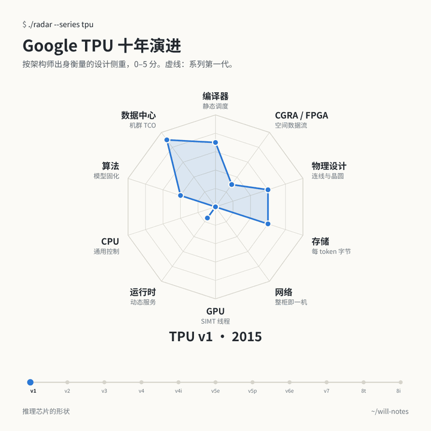
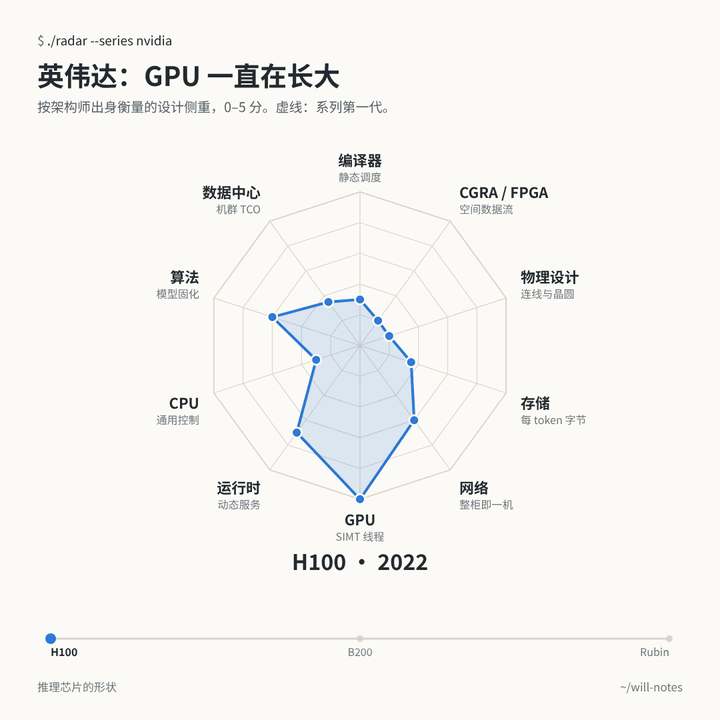



<link rel="stylesheet" href="/assets/chip-radar/radar.css">

魔镜魔镜告诉我，谁是世界上最好的推理芯片？

魔镜没有回答。它只是把每颗芯片照了一遍：照出 TPU 背后那群从不把调度交还给硬件的编译器工程师，照出 Groq 把仲裁器全部拿掉的执念，照出 Cerebras 干脆把整片晶圆做成一颗芯片的胆量，也照出英伟达这几年一边守住 CUDA、一边把网络、存储和推理服务一样样收进来的耐心。

这面镜子就是下面这张雷达图：2015 到 2026 年的 40 颗推理芯片，加上 5 套「GPU + 另一种加速器」的异构系统，每颗按 10 个设计维度打 0–5 分，依据全部是公开论文、Hot Chips 报告和厂商文档。先玩，长文在后面。

**怎么看。** 每个维度对应一种工程师出身和它带来的直觉，比如「编译器 · 静态调度」。分数衡量的是这种直觉在多大程度上决定了芯片的关键设计。**面积大不代表芯片好**，十项全满分的芯片，大概是开会开出来的。悬停或点击任何一个点，能看到分数、置信度和一句话理由。「系列演进」可以播放一条产品线的变化，「异构系统」可以拆开看 GPU 加专用芯片的组合，「数据表」里是全部数字。

<nav class="toc" markdown="1">
**目录**

1. [芯片长什么样，取决于谁设计的](#idea)
2. [十个维度，以及它们为什么这样排](#axes)
3. [Google TPU：从 v2 起，编译器就再没放手](#tpu)
4. [英伟达：多面手一直在长大](#gpus)
5. [挑战者们，和背后的人](#challengers)
6. [云厂商自研：从电费账单出发](#hyperscalers)
7. [异构系统：一种形状不够用了](#hetero)
8. [云、边缘、PC：同样的坐标，不同的重心](#deploy)
9. [八个流派，各自怕什么](#families)
10. [对编译器和运行时意味着什么](#software)
11. [方法与局限](#method)
12. [参考来源](#sources)
</nav>

## 1. 芯片长什么样，取决于谁设计的 {#idea}

前阵子 NeuralTalk 有篇[文章](https://mp.weixin.qq.com/s/TFExyhdJsxa7inerxCe8IQ)讲了一个很朴素的观察：看一颗 AI 芯片，往往能猜出团队是什么出身。做 GPU 出身的，会做线程和大寄存器堆。做编译器出身的，会把硬件仲裁拿掉，让编译器看清每一个周期。做后端物理设计的，盯着连线下手。做数据中心的，从电费开始算。

这个视角好用，因为它解释的是芯片**为什么**不一样。规格表告诉你算力和带宽，但不会告诉你设计者认为最难的是哪个问题。所以这次做了两件事：一是按十种出身给每颗芯片打分（原文九种，我加了 CGRA / FPGA 空间数据流，这一派明显自成体系）；二是去查每颗芯片到底是谁做的。查下来发现，出身真的能解释很多事：

- **Groq** 的创始人 Jonathan Ross，当年以 20% 项目的形式开启了 Google TPU，Groq 成立时带走了 [TPU 最早 10 人里的 8 位](https://www.electronicdesign.com/technologies/embedded-revolution/article/21805495/groq-secretive-startup-rooted-in-google-hires-top-xilinx-executive)。Ross 说 TPU 的起点[其实是一个 FPGA 加速项目](https://moderncto.io/302-jonathan-ross-ceo-founder-at-groq/)；而 Groq [先写了半年编译器，才开始设计芯片](https://www.electronicdesign.com/technologies/embedded-revolution/article/21161146/electronic-design-ai-chip-startup-led-by-exgoogle-engineer-raises-300-million)。
- **Cerebras** 的五位创始人都来自高密度微服务器公司 [SeaMicro](https://research.contrary.com/report/cerebras)。晶圆级芯片是系统工程师的答案：网络难做，那就干脆不要网络。
- **SambaNova** 出自斯坦福的 [Kunle Olukotun](https://profiles.stanford.edu/kunle-olukotun)（Niagara 多核、Plasticine CGRA）和 Chris Ré，CEO 是前 Sun/Oracle SPARC 负责人。它的芯片就是一颗 CGRA。
- **AWS Trainium** 来自 [Annapurna Labs](https://www.aboutamazon.com/news/aws/take-a-look-inside-the-lab-where-aws-makes-custom-chips)，一家以色列网络芯片公司，先做的是 Nitro 卸载卡，后来才做 AI 芯片。首席架构师的说法是：先把整个系统设计好，再倒推芯片。
- **华为**的达芬奇架构，据 [36 氪的长文](https://eu.36kr.com/en/p/3934504849325442)，当年内部有过一场争论：一派想做得像英伟达，廖恒提出了 3D Cube，最后胜出，编译器被视为整个项目的「圣杯」。

在雷达图里点任何一颗芯片，卡片上的「设计团队」一行会告诉你它出自谁手。

## 2. 十个维度，以及它们为什么这样排 {#axes}

每个维度 0 到 5 分，问的都是同一个问题：**这种出身的思路，在多大程度上决定了芯片的关键设计？** 锚点是固定的，保证每个维度上的「3 分」是同一个意思。

| 维度 · 直觉 | 0 分 | 5 分 |
|---|---|---|
| **编译器 · 静态调度** | 依赖全靠硬件动态发现 | 完全由编译器编排：没有互锁，编译器知道每个周期 |
| **CGRA / FPGA · 空间数据流** | 时分复用的核 | 芯片本身是空间阵列，整张图铺在空间上 |
| **物理设计 · 连线与晶圆** | 常规大 die，没有物理层面的押注 | 物理实现本身就是架构（晶圆级、冗余内建） |
| **存储 · 每 token 字节** | 存储按惯例配 | 围绕每 token 搬多少字节来设计（全 SRAM、存内计算） |
| **网络 · 整柜即一机** | 单卡思维 | 整个 pod 才是一台机器 |
| **GPU · SIMT 线程** | 没有 SIMT，不能通用编程 | 完整 SIMT、warp，CUDA 级可编程性 |
| **运行时 · 动态服务** | 一切由 host 驱动 | 按服务系统来设计（KV 分页、请求调度、prefill/decode） |
| **CPU · 通用控制** | 没有控制核、没有 cache | 一颗 CPU 挂了个矩阵单元 |
| **算法 · 模型固化** | 通用数据通路 | 模型本身做进了硅片 |
| **数据中心 · 机群 TCO** | 峰值算力优先 | 从所有者自己的机群经济账倒推出来 |

**为什么这样排。** 雷达图里，谁和谁挨着，会直接影响你看到什么形状。可视化研究（[Ankerst 等，1998](https://bib.dbvis.de/uploadedFiles/180.pdf)；[Miller 等，2019](https://arxiv.org/abs/1908.00576)）的建议是把相关的维度放在一起，读者主要靠「尖角朝哪个方向」来给形状分组。所以我们用 40 颗芯片的分数算了维度之间的相关性，把所有 181,440 种环形排列都试了一遍。最后的顺序让关系最强的维度挨着：存储与物理设计（r = 0.76）、物理设计与 CGRA、CGRA 与编译器、编译器与数据中心，以及 CPU、GPU、运行时这一簇。最对立的放在对面：GPU 正对着编译器（r = −0.74）。结果读起来像一张地图：右半边是静态、空间、物理的一侧，左下是灵活、动态的一侧。GPU 的尖角朝下，TPU 和模型固化芯片朝上。

## 3. Google TPU：从 v2 起，编译器就再没放手 {#tpu}

TPU 是我们能找到的最好的自然实验：同一家公司，同一套软件栈，十年十一颗芯片。在雷达图里打开「系列演进 → TPU」，或者直接看这张动图：

**v1 是协处理器，还不算编译器机器。** 2015 年的 TPU 插在 PCIe 上，host 给它发[十几条 CISC 指令](https://sites.coecis.cornell.edu/isca50retrospective/files/2023/06/Jouppi_2017_In_Datacenter.pdf)，数据没到位时，矩阵单元由硬件停下来等。它最强的维度不是编译器（3.5 分），而是成本：目标写得很直白，要把推理的 [TCO 降低 10 倍](https://pages.cs.wisc.edu/~markhill/restricted/isca17_tpu_slides.pdf)（数据中心 4.5 分）。

**从 v2 开始，编译器接管了芯片。** TPU v2 换成宽 VLIW 指令包和软件管理的存储，全部由 XLA 编译器来排，此后每一代编译器都是 4.5 分。没给满分，只是因为 HBM 搬运是异步的，软件要靠同步标志位等待。Google 自己那篇[《三代 TPU 的十条经验》](https://conferences.computer.org/iscapub/pdfs/ISCA2021-4ghucdBnCWYB7ES2Pe4YdT/333300a001/333300a001.pdf)里也说，对 VLIW 加速器来说，编译器兼容比二进制兼容更重要。

**网络从无到有，一路长成整个 pod。** v1 网络 0 分。v2 有了 torus，3 分。v4 加上光路交换，5 分。此后的旗舰款一直是 5 分，一直到 Ironwood 的 9,216 芯片 pod。

**不太被注意的第二条线：成本。** TPU v4i、v5e、v6e 是 TCO 优先的设计：风冷、pod 更小、HBM 更少。数据中心 4.5 到 5 分，网络只有 1 到 3 分。

**2026 年，分岔摆上了台面。** 第八代是两颗芯片，[Google 的技术详解](https://cloud.google.com/blog/products/compute/tpu-8t-and-tpu-8i-technical-deep-dive)写得很清楚。TPU 8t 专做训练。TPU 8i 是第一颗延迟优先的推理 TPU：片上 SRAM 翻了三倍（384 MB），把 KV cache 尽量留在芯片上；新增集合通信加速引擎，专门加速 decode 时的归约与同步；网络换成直径更小的 Boardfly。它的存储（4 分）和运行时（3.5 分）是所有 TPU 里最高的。另据报道，8t 和 8i 的设计合作方分别是[博通和联发科](https://nand-research.com/google-cloud-8th-generation-tpu-family-splits-training-and-inference/)。

## 4. 英伟达：多面手一直在长大 {#gpus}

GPU 的形状和 TPU、Groq 正好相反：GPU 4.5 到 5 分，编译器 1.5 到 2 分，CGRA 接近 0。硬件靠线程和占用率隐藏延迟，编译器就不用知道每个周期。这正是 GPU 什么都能跑的原因。

| | 运行时 | 网络 | 存储 | 数据中心 |
|---|---|---|---|---|
| H100（2022） | 3.5 | 3 | 1.75 | 1.75 |
| B200（2024） | 3.5 | 4 | 2.25 | 3.25 |
| Rubin（2026） | 4.5 | 4.5 | 3.25 | 4 |

[Rubin](https://developer.nvidia.com/blog/inside-the-nvidia-rubin-platform-six-new-chips-one-ai-supercomputer/) 已经不太像一颗芯片，更像一个机柜级的推理服务平台：六颗协同设计的芯片、HBM4、分层的 KV cache 存储、Dynamo 推理服务软件。它的 GPU 分反而略降（5 到 4.5），因为 Blackwell 和 Rubin 把矩阵计算挪进了异步的 tile 引擎，多少游离在经典 SIMT 模型之外。多面手正在一个维度一个维度地把其他流派吃进来。

AMD 走的是同一条路，起点不同：MI300X 主打 chiplet 和每美元的显存容量（物理设计 3.75 分），[MI455X/Helios](https://www.storagereview.com/news/amd-mi455x-and-helios-432gb-hbm4-72-gpu-racks-and-a-real-answer-to-vera-rubin) 加上了单卡最大的 HBM 和以太网 scale-up。华为昇腾的形状是被供应限制塑造出来的：910C 数据中心只有 1 分，网络却有 4.75 分，单颗芯片弱一些，就用超大规模的光互联超节点来补；[昇腾 950](https://www.huawei.com/en/news/2025/9/hc-xu-keynote-speech) 又加了 SIMT 编程路径，并且把 prefill 和 decode 拆成了不同型号。

## 5. 挑战者们，和背后的人 {#challengers}

创业公司的形状最极端，因为每家都把注押在一个想法上，而这个想法往往就是创始人的老本行。

**Groq：编译器派。** 编译器 5 分，存储 5 分，CPU 0 分。[ISCA 2022 论文](https://groq.com/wp-content/uploads/2024/02/GroqISCAPaper2022_ASoftwareDefinedTensorStreamingMultiprocessorForLargeScaleMachineLearning.pdf)描述的芯片没有 cache、没有仲裁器、没有互锁，连芯片之间的链路都在静态调度里。权重放在 SRAM，分散在很多颗芯片上。代价体现在运行时（0.75 分）：硬件不做任何动态的事，所有动态的事都归 host 管。一个从编译器起家的团队，做出了一颗编译器能完全看透的芯片。2025 年 12 月，英伟达授权了这套架构，并招走了 Groq 的核心团队。[Groq 3 LP30](https://developer.nvidia.com/blog/inside-nvidia-groq-3-lpx-the-low-latency-inference-accelerator-for-the-nvidia-vera-rubin-platform) 形状没变，变的是它的角色（见[第 7 节](#hetero)）。

**Cerebras：系统派。** 物理设计 5 分，存储 5 分。整个模型放在一整片富含 SRAM 的晶圆上，网络问题自然就没了，所以 WSE-2 网络只有 2.25 分。[SDK 文档](https://sdk.cerebras.ai/computing-with-cerebras)显示，每个核的硬件在数据到达时自动启动任务，编译器负责布局和路由，但不排周期（编译器 3.25 分）。到了 WSE-3 和[机柜级系统](https://www.servethehome.com/cerebras-talks-going-rack-scale-with-their-wses-at-hot-chips-2026/)，晶圆越来越多地被当成 decode 引擎，和别家的 prefill 搭配使用。

**SambaNova：CGRA 派。** CGRA 5 分。[SN40L 论文](https://arxiv.org/abs/2405.07518)把整段计算图铺在可重构数据流阵列上，背后是三级存储（SRAM、HBM、DDR），论文给出的核心结果是：同时服务大量模型时，机器规模最多可缩小 19 倍。这是 Plasticine 那条研究线的商业化。[SN50](https://sambanova.ai/blog/introducing-the-sn50-rdu-purpose-built-for-agentic-inference) 保留了这个形状，主打 decode。

**Tenstorrent：CPU 派。** 数据中心芯片里 CPU 分最高（3.5 分）：750 多个小 RISC-V 核驱动计算单元，另有 16 个能跑 Linux 的核，每颗芯片都带以太网。创始人 Ljubisa Bajic 是 [ATI/AMD/英伟达出身的架构师](https://www.anandtech.com/show/16709)，CPU 老将 Jim Keller 后来出任 CEO。加速器被做成了一台众核计算机。

**Taalas：同一个创始人，相反的押注。** 离开 Tenstorrent 后，Bajic 联合创办了 Taalas。它的 [HC1](https://www.cnx-software.com/2026/02/22/taalas-hc1-hardwired-llama-3-1-8b-ai-accelerator-delivers-up-to-17000-tokens-s/) 在制造时就把一个模型的权重定死了：全文唯一的算法 5 分，网络只有 0.5 分。AMD 在 2026 年 8 月[宣布收购 Taalas](https://ir.amd.com/news-events/press-releases/detail/1296)，尚待审批，说这项技术是对 Instinct GPU 的补充。

**Etched 和 d-Matrix。** Etched Sohu 只跑 transformer（算法 4.5 分），CEO 是 ML 编译器出身（OctoML、Xnor.ai），这颗芯片是全文公开技术细节最少的一颗，形状的置信度偏低。d-Matrix 在 SRAM 里做计算（存储 5 分），两位创始人来自 [Inphi 的数据中心互联业务](https://engineering.purdue.edu/Engr/AboutUs/News/Events/tech-summit/2025/sudeep-bhoja)：一群搬数据的专家，做了一颗尽量不搬数据的芯片。

## 6. 云厂商自研：从电费账单出发 {#hyperscalers}

Meta、AWS、微软自己有负载，自己付电费。它们最高的维度都是数据中心：Maia 200 和 MTIA 2i 都是 5 分，Trainium3 是 4.5 分。

- **AWS Inferentia2 和 Trainium3** 像是 TPU 的表亲：编译器 4 分，多个独立引擎由编译器同步，存储由软件管理，扩展靠交换式的 UltraServer。做过 Nitro 网络卸载卡的团队，做加速器也是系统先行。
- **微软 Maia 200** 出自 [Azure 硬件系统与基础设施部门](https://runasradio.com/Shows/Show/940)，芯片、系统和数据中心在一个团队里。那篇[架构详解](https://techcommunity.microsoft.com/blog/azureinfrastructureblog/deep-dive-into-the-maia-200-architecture/4489312)读起来像一个 TCO 模型，顺带附了一颗芯片：软件管理的 SRAM、FP4、片上集成以太网 scale-up。
- **Meta MTIA** 的 CPU 分出乎意料地高（3 分）：带 RISC-V 控制核和 cache，因为它最早是给推荐排序做的。2025 年 Meta [收购了 Rivos](https://www.hpcwire.com/?p=184116)，这家 RISC-V 公司此前就参与了 MTIA 的设计。MTIA 300/400 转向 chiplet、HBM 和 72 芯片机柜，其中 400 还在实验室测试。

## 7. 异构系统：一种形状不够用了 {#hetero}

2026 年最大的变化不是某种新的芯片形状，而是在一个请求里同时用两种形状。打开雷达图的「异构系统」：实心的是各个组件，虚线是部署后的整个系统。

| 系统 | 组件一 | 组件二 | 怎么分工 |
|---|---|---|---|
| 英伟达 Vera Rubin NVL72 + Groq 3 LPX | Rubin GPU | Groq 3 LPU | GPU 管 prefill、attention 和 KV cache；LPU 跑 decode 的 FFN/MoE 层，每个 token 交接一次 |
| AWS Trainium + Cerebras CS-3 | Trainium | Cerebras 晶圆 | Trainium 做 prefill，晶圆做 decode，KV cache 走 EFA |
| SambaNova SN50 + GPU | B200 级 GPU | SN50 | GPU 只做 prefill，数据流芯片做 decode |
| d-Matrix Corsair + GPU（经 Gimlet） | GPU | Corsair 卡 | 调度器通过以太网，把受内存限制的部分派给存内计算卡 |
| Cerebras + AMD Instinct（计划中） | Instinct GPU | Cerebras 晶圆 | 晶圆 decode，旁边是 HBM 充足的 GPU；已宣布，未出货 |

分数里有三点很明显：

- **合起来的形状很大，这正是目的。** Vera Rubin 加 LPX 在运行时、网络、存储上同时拿到 5 分。HBM 存 KV cache，SRAM 流式供给权重，没有任何一颗单芯片能两头兼顾。
- **编译器分降下来了。** 系统的编译器分（3.25）落在 LPU 的 5 分和 GPU 的 2 分之间，一半静态调度，一半动态调度，两者的边界得有人管。
- **运行时成了最难的维度。** 已出货或已宣布的系统，运行时都在 4 分以上（计划中的 AMD 组合是 3.5 分，只因为服务软件还没公开）。难点已经不在任何一颗芯片内部，而在于决定哪个阶段、哪一层、哪个 token 去哪里，并且足够快地把 KV cache 或激活值搬过去。英伟达的 [LPX](https://developer.nvidia.com/blog/inside-nvidia-groq-3-lpx-the-low-latency-inference-accelerator-for-the-nvidia-vera-rubin-platform) 是在每个 token 内部拆开 attention 和 FFN；[Cerebras](https://www.cerebras.ai/blog/disaggregated-inference) 是拆开 prefill 和 decode。这是同一个思路的两个层级。

这也改变了怎么看那些挑战者。一颗单独看太窄的芯片，比如全 SRAM 的 decode 芯片、或者不要网络的晶圆，一旦有 GPU 帮它兜住所有它不擅长的事，就变得非常有用。AMD 收购 Taalas 给出的理由，「补充 GPU」，也是同一个逻辑。

## 8. 云、边缘、PC：同样的坐标，不同的重心 {#deploy}

雷达图的「云与端」把各场景的形状取了平均。

| 场景 | 芯片数 | 最高 | 最低 |
|---|---|---|---|
| 云端，推理优先 | 14 | 存储 3.9、数据中心 3.9、编译器 3.8 | GPU 0.8、CPU 0.9 |
| 云端，训练加推理 | 20 | 网络 3.7、数据中心 3.4、编译器 3.3 | CGRA 1.9 |
| 边缘、PC、手机 | 6 | 数据中心 4.2、编译器 3.7 | 网络 0、GPU 0.8 |

端侧没有机群，这里的「数据中心」指每 token 的能耗和成本。三点观察：

- **除了能训练的云端芯片，GPU 维度几乎是空的。** 只做推理的芯片平均不到 1 分。如果只为推理设计，SIMT 的通用性是第一个被舍弃的。
- **存储把云端推理芯片区分开了：** 平均 3.9 分，训练芯片 2.7，端侧 2.1。在数据中心，decode 卡在每 token 搬多少字节上。
- **到了端侧，网络消失了，编译器还在。** 笔记本和手机上的 NPU 也带着各自的出身：AMD XDNA 2 就是[赛灵思 AI Engine](https://www.amd.com/en/technologies/xdna.html)，一颗来自 FPGA 世界的 CGRA（4.5 分）；英特尔 NPU 来自 [Movidius](https://www.anandtech.com/show/18878)；高通 Hexagon 是 VLIW DSP 一路长大的（CPU 3.5 分）；苹果的神经网络引擎是封闭的，只能通过 Core ML 用。端侧厂商披露得最少，这些形状的置信度也最低。

## 9. 八个流派，各自怕什么 {#families}

雷达图的「全部芯片」把所有形状分成八个流派。每个形状都可以当成设计者对「最难的是什么」的回答。

1. **编译器优先、从机群出发**（TPU、Inferentia/Trainium、Maia）。**怕账单。** 编译器 4.3，数据中心 4.3。
2. **确定性、全 SRAM**（Groq）。**怕不可预测。** 编译器 5，存储 5，CPU 0。
3. **空间数据流与晶圆级**（Cerebras、SambaNova）。**怕数据出芯片。** CGRA 4.6，存储 4.7，物理设计 4.0。
4. **模型固化**（Taalas、Etched）。**怕为通用性买单。** 算法 4.8。
5. **存储优先**（d-Matrix）。**怕内存墙。** 存储 5。
6. **偏 CPU 的众核**（Tenstorrent、MTIA）。**怕没预料到的负载。** CPU 3.2。
7. **通用 GPU**（英伟达、AMD、华为）。**怕失去开发者。** GPU 4.0，网络 4.0，运行时 3.4。
8. **端侧 NPU。** **怕电池。** 网络 0，能耗 4.2。

这些「怕」没有哪个是错的。它们是对「什么会稀缺」的不同回答：算力、带宽、功耗、开发者的时间，还是灵活性。异构系统之所以出现，是因为老实的答案是「都稀缺，只是在同一个请求的不同阶段」。

## 10. 对编译器和运行时意味着什么 {#software}

对做软件栈（编译器、vLLM、SGLang）的人来说，有三个结论。

**「编译器」在不同形状上是不同的活。** 在 Groq 这样的芯片上，编译器就是调度器，精确到周期，跨芯片。在 TPU 或 Trainium 上，它要显式管理存储和同步。在 GPU 上，它主要负责生成好的 kernel，调度交给硬件。在 CGRA 上，它要做布局和布线。一套编译器架构要同时服务这四种，前提是它清楚自己在做的是哪一种活。

**运行时是涨得最快的维度。** 它在一代代 GPU 上涨，在 TPU 8i 上涨，在每一套异构系统上都高。推理服务引擎过去是硬件之上的一层，现在正在变成硬件设计的一部分：KV cache 分层、prefill 和 decode 的放置、不同芯片之间按 token 交接。vLLM 和 SGLang 已经把 prefill-decode 解耦当成一等功能了，下一步是一个能理解不同芯片类型的调度器，而不只是不同节点。

**静态和动态的边界，现在是一个系统设计问题。** 当一颗确定性芯片和一颗动态芯片共同处理一个 token 时，总得有人在精确到周期的调度和 batch 大小、到达时间都在变的世界之间做翻译。这一层既不完全属于编译器，也不完全属于运行时。它大概是眼下推理硬件里最有意思的软件问题。

## 11. 方法与局限 {#method}

**方法。** 资料只用公开来源：论文（ISCA、HPCA、arXiv）、Hot Chips 报告、厂商架构文档和靠谱的技术媒体。用同一套评分标准做了两轮独立打分：一轮按芯片逐颗打，一轮按维度打（同一维度先把所有芯片排一遍）。每个分数都附一句理由、一个出处和一个置信度（论文或规格为高，厂商说法或二手分析为中，推断为低）。最终分数取两轮平均，置信度取较低者。两轮结果很接近：450 个分数里有 317 个完全一样，没有任何一个相差超过 1 分。之后又做了第二轮研究，用一手资料替换掉较弱的来源，并根据一手证据改了 16 个分数，比如 TPU v1 的编译器分从 4.5 降到 3.5，Cerebras 的编译器和 GPU 分也按上文的理由做了调整。

**局限。**
- **这些是判断，不是测量。** 评分标准保证了一致性，理由让每个分数可以核对，但换一个团队来打，很多格子会差半分。悬停任何一个点，可以看到理由。
- **两轮打分是相关的。** 各自独立打，但用的是同一批研究笔记，这在一定程度上解释了为什么结果这么接近。
- **公开信息不均匀。** 端侧 NPU、Etched、d-Matrix Raptor、Google Tensor G5 披露很少，标为低置信度。2026 年刚发布的芯片根据发布材料打分，而发布材料通常偏重优点。
- **分数衡量的是设计侧重，不是好坏或速度。** 低分不是批评：Groq 的 CPU 0 分是有意为之，Taalas 的网络 0.5 分也是。
- **异构系统的分数描述部署后的系统，** 按哪个组件承担主要工作来加权，这是方法里最不标准的部分。
- **设计团队的出身是简化的说法。** 大团队里什么背景都有，这里写的是公开资料里提到的创始人或主导团队。
- **状态截至 2026 年 11 月。** AMD 收购 Taalas 已宣布、待审批；英伟达和 Groq 之间是技术授权加人员招聘，GroqCloud 仍在用 Groq 自己的芯片；MTIA 400 还在实验室测试。

所有分数、理由和出处都在「数据表」和[数据文件](/assets/chip-radar/data.js)里，欢迎指正。

## 12. 参考来源 {#sources}

完整来源列表见[英文版](/2026/11/inference-chip-shapes/#sources)，每个分数对应的来源都在数据文件里。主要来源：

- [NeuralTalk：从架构师的出身看芯片设计](https://mp.weixin.qq.com/s/TFExyhdJsxa7inerxCe8IQ)
- [Jouppi 等，TPU v1（ISCA 2017）](https://sites.coecis.cornell.edu/isca50retrospective/files/2023/06/Jouppi_2017_In_Datacenter.pdf)；[三代 TPU 的十条经验（ISCA 2021）](https://conferences.computer.org/iscapub/pdfs/ISCA2021-4ghucdBnCWYB7ES2Pe4YdT/333300a001/333300a001.pdf)
- [TPU 8t / 8i 技术详解（Google Cloud）](https://cloud.google.com/blog/products/compute/tpu-8t-and-tpu-8i-technical-deep-dive)
- [Groq ISCA 2022 论文](https://groq.com/wp-content/uploads/2024/02/GroqISCAPaper2022_ASoftwareDefinedTensorStreamingMultiprocessorForLargeScaleMachineLearning.pdf)；[NVIDIA Groq 3 LPX 详解](https://developer.nvidia.com/blog/inside-nvidia-groq-3-lpx-the-low-latency-inference-accelerator-for-the-nvidia-vera-rubin-platform)；[NVIDIA Rubin 平台详解](https://developer.nvidia.com/blog/inside-the-nvidia-rubin-platform-six-new-chips-one-ai-supercomputer/)
- [Cerebras SDK 文档](https://sdk.cerebras.ai/computing-with-cerebras)；[SambaNova SN40L 论文](https://arxiv.org/abs/2405.07518)
- [AMD 收购 Taalas](https://ir.amd.com/news-events/press-releases/detail/1296)；[Taalas HC1（CNX Software）](https://www.cnx-software.com/2026/02/22/taalas-hc1-hardwired-llama-3-1-8b-ai-accelerator-delivers-up-to-17000-tokens-s/)
- [达芬奇架构，Hot Chips 31（华为）](https://www.old.hotchips.org/hc31/HC31_1.11_Huawei.Davinci.HengLiao_v4.0.pdf)；[华为全联接大会 2025 主题演讲](https://www.huawei.com/en/news/2025/9/hc-xu-keynote-speech)；[华为 AI 芯片之路（36 氪）](https://eu.36kr.com/en/p/3934504849325442)
- [Maia 200 架构详解（微软）](https://techcommunity.microsoft.com/blog/azureinfrastructureblog/deep-dive-into-the-maia-200-architecture/4489312)；[MTIA（ISCA 2025）](https://aisystemcodesign.github.io/papers/MTIA-ISCA25.pdf)
- 团队出身：[Groq 与 TPU 团队（Electronic Design）](https://www.electronicdesign.com/technologies/embedded-revolution/article/21805495/groq-secretive-startup-rooted-in-google-hires-top-xilinx-executive)；[Cerebras 创始人（Contrary Research）](https://research.contrary.com/report/cerebras)；[SambaNova 创始人](https://www.design-reuse.com/news/news43740.html)；[Annapurna Labs（亚马逊）](https://www.aboutamazon.com/news/aws/take-a-look-inside-the-lab-where-aws-makes-custom-chips)
- 可视化：[Ankerst 等，1998](https://bib.dbvis.de/uploadedFiles/180.pdf)；[Miller 等，2019](https://arxiv.org/abs/1908.00576)
