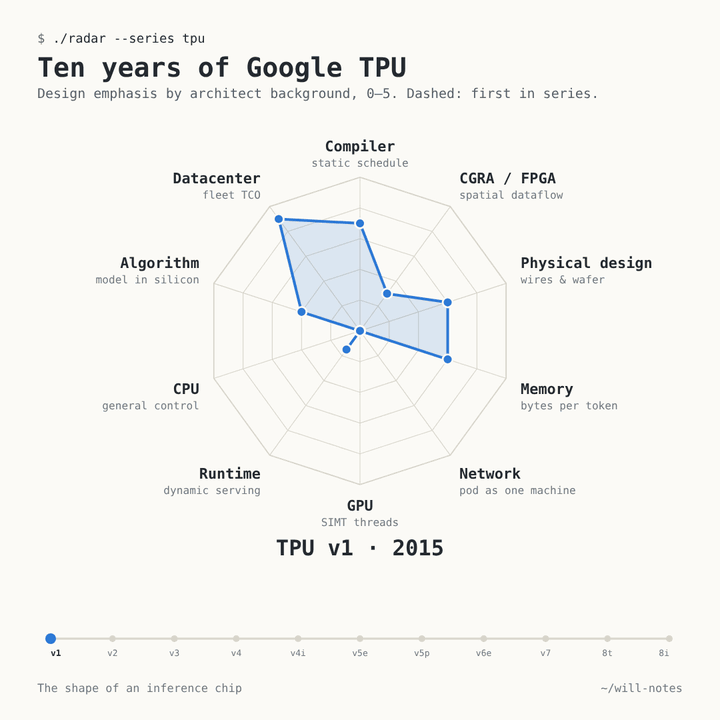
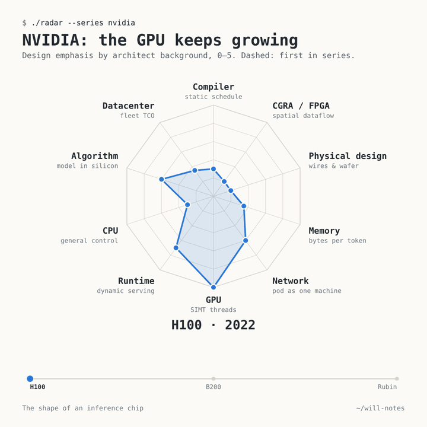



<link rel="stylesheet" href="/assets/chip-radar/radar.css">

Ed Sheeran's biggest hit is "Shape of You". This post is about the shape of AI chips.

Every inference chip is a bet placed by people with a particular background, and the bet leaves a shape. Below are 40 chips from 2015 to 2026, plus five systems that pair a GPU with a different accelerator, each scored 0–5 on ten design axes from public papers, Hot Chips talks and vendor documentation. Start by playing with it; the long read follows.

**How to read it.** Each axis names an engineering background and the instinct it brings, for example *Compiler · static schedule*. The score says how strongly that instinct shaped the chip's defining decisions. **A bigger shape is not a better chip**; a chip with 5 on every axis would be a committee design. Hover or tap any point for the score, the confidence and the one-line reason. *Series* animates a product line, *Heterogeneous* opens up the GPU-plus-accelerator systems, and *Table* lists every number.

<nav class="toc" markdown="1">
**Contents**

1. [A chip is shaped by who designed it](#idea)
2. [The ten axes, and why they sit where they sit](#axes)
3. [Google TPU: the compiler takes over at v2 and never leaves](#tpu)
4. [NVIDIA: the generalist keeps growing](#gpus)
5. [The challengers, and who built them](#challengers)
6. [Hyperscalers' own chips: designed from the bill](#hyperscalers)
7. [Heterogeneous systems: when one shape is not enough](#hetero)
8. [Cloud, edge and PC: same axes, different priorities](#deploy)
9. [Eight families, and what each one fears](#families)
10. [What this means for compilers and runtimes](#software)
11. [Method and caveats](#method)
12. [Sources](#sources)
</nav>

## 1. A chip is shaped by who designed it {#idea}

A recent [NeuralTalk article](https://mp.weixin.qq.com/s/TFExyhdJsxa7inerxCe8IQ) made a simple observation: you can often tell an AI chip team's background from the chip. GPU people build threads and big register files. Compiler people remove hardware arbitration so the compiler can see every cycle. Physical-design people attack the wires. Datacenter people start from the electricity bill.

This lens explains *why* chips differ, not only *how*. A spec sheet gives TFLOPS and bandwidth; it does not say which problem the designers thought was the hard one. So this study does two things. It scores each chip on ten backgrounds (the article's nine, plus CGRA / FPGA spatial dataflow, which is clearly its own school). And it traces who actually built each chip, because the lineages turn out to explain a lot:

- **Groq** was founded by Jonathan Ross, who started Google's TPU as a 20% project, with [8 of the first 10 TPU engineers](https://www.electronicdesign.com/technologies/embedded-revolution/article/21805495/groq-secretive-startup-rooted-in-google-hires-top-xilinx-executive). Ross has said that TPU work [began as FPGA acceleration](https://moderncto.io/302-jonathan-ross-ceo-founder-at-groq/), and Groq [built its compiler for six months before designing the silicon](https://www.electronicdesign.com/technologies/embedded-revolution/article/21161146/electronic-design-ai-chip-startup-led-by-exgoogle-engineer-raises-300-million).
- **Cerebras** was founded by the five people behind [SeaMicro](https://research.contrary.com/report/cerebras), a dense-microserver company. Their wafer-scale chip is a system builder's answer: avoid the network by not having one.
- **SambaNova** comes from Stanford's [Kunle Olukotun](https://profiles.stanford.edu/kunle-olukotun) (the Niagara multicore and the Plasticine CGRA) and Chris Ré, with a former Sun/Oracle SPARC chief as CEO. Its chip is a CGRA.
- **AWS's Trainium** comes from [Annapurna Labs](https://www.aboutamazon.com/news/aws/take-a-look-inside-the-lab-where-aws-makes-custom-chips), an Israeli networking-chip startup that built the Nitro offload card before any AI chip. Its chief architect describes designing the full system first and working backwards.
- **Huawei's** Da Vinci core won an [internal debate](https://eu.36kr.com/en/p/3934504849325442) against a design meant to look like NVIDIA's; Liao Heng's 3D cube won, and the compiler was called the project's holy grail.

Pick any chip in the radar: the *Built by* line under its card tells you where the team came from.

## 2. The ten axes, and why they sit where they sit {#axes}

Each axis runs 0–5. The question is always the same: *how strongly does this background shape the chip's defining design decisions?* The anchors are fixed, so a 3 means the same thing on every axis.

| Axis · instinct | 0 means | 5 means |
|---|---|---|
| **Compiler · static schedule** | hardware discovers all dependencies | fully compiler-orchestrated: no interlocks, the compiler knows every cycle |
| **CGRA / FPGA · spatial dataflow** | time-multiplexed cores | the chip is a spatial fabric; whole graphs mapped in space |
| **Physical design · wires & wafer** | conventional big die, no physical bet | the physical implementation *is* the architecture (wafer scale, built-in redundancy) |
| **Memory · bytes per token** | memory follows convention | built around bytes per token (all-SRAM, in-memory compute) |
| **Network · pod as one machine** | single-device thinking | the machine is the pod |
| **GPU · SIMT threads** | no SIMT, not generally programmable | full SIMT, CUDA-class programmability |
| **Runtime · dynamic serving** | the host drives everything | designed as a serving machine (KV paging, request scheduling, prefill/decode) |
| **CPU · general control** | no control cores, no caches | a CPU with a matrix unit attached |
| **Algorithm · model in silicon** | generic datapath | the model itself is in silicon |
| **Datacenter · fleet TCO** | peak FLOPS first | designed from the owner's fleet economics outward |

**Why this order.** In a radar chart, neighbours shape what you see. The visualization literature ([Ankerst et al. 1998](https://bib.dbvis.de/uploadedFiles/180.pdf); [Miller et al. 2019](https://arxiv.org/abs/1908.00576)) suggests placing related dimensions next to each other. Readers mostly group star shapes by the direction their spikes point. So we measured how the axes correlate across all 40 chips and tested every possible circular order (181,440 of them). The chosen order keeps the strongest pairs side by side: Memory–Physical (r = 0.76), Physical–CGRA, CGRA–Compiler, Compiler–Datacenter, and the CPU/GPU/Runtime cluster. It puts the strongest opposites across from each other: GPU sits directly opposite Compiler (r = −0.74). The result reads like a map. The right half is the static, spatial, physical side. The lower left is the flexible, dynamic side. GPUs point down; TPUs and model-in-silicon chips point up.

## 3. Google TPU: the compiler takes over at v2 and never leaves {#tpu}

The TPU line is the closest thing we have to a natural experiment: one company, one software stack, eleven chips over ten years. Open *Series → TPU* in the radar, or watch:

**v1 was a coprocessor, not yet a compiler machine.** The 2015 TPU sat on PCIe, and the host sent it [about a dozen CISC instructions](https://sites.coecis.cornell.edu/isca50retrospective/files/2023/06/Jouppi_2017_In_Datacenter.pdf); the matrix unit stalled in hardware when its data was not ready. Its strongest axis was not the compiler (3.5) but cost: the stated goal was cutting the [TCO of inference by 10x](https://pages.cs.wisc.edu/~markhill/restricted/isca17_tpu_slides.pdf) (Datacenter 4.5).

**From v2 on, the compiler owns the chip.** TPU v2 moved to wide VLIW bundles and software-managed memory scheduled by the XLA compiler, and every TPU since scores 4.5 on Compiler. It stops short of 5 only because HBM transfers run asynchronously and software waits on sync flags. Google's own ["Ten Lessons"](https://conferences.computer.org/iscapub/pdfs/ISCA2021-4ghucdBnCWYB7ES2Pe4YdT/333300a001/333300a001.pdf) paper says compiler compatibility matters more than binary compatibility for VLIW accelerators.

**The network grows from nothing to the pod.** v1: Network 0. v2: a torus, 3. v4: optical circuit switching, 5. Every flagship since stays at 5, through Ironwood's 9,216-chip pods.

**A quiet second branch: cost.** TPU v4i, v5e and v6e are TCO-first designs: air-cooled, smaller pods, less HBM. They score 4.5–5 on Datacenter and only 1–3 on Network.

**2026: the split is official.** The eighth generation is two chips, [described in Google's deep dive](https://cloud.google.com/blog/products/compute/tpu-8t-and-tpu-8i-technical-deep-dive). TPU 8t is a training machine. TPU 8i is the first latency-first inference TPU: three times the on-chip SRAM (384 MB) to keep KV cache on silicon, a Collectives Acceleration Engine for decode reductions, and a lower-diameter "Boardfly" network. Its Memory (4) and Runtime (3.5) are the highest of any TPU. Reports name [Broadcom and MediaTek](https://nand-research.com/google-cloud-8th-generation-tpu-family-splits-training-and-inference/) as design partners for 8t and 8i respectively.

## 4. NVIDIA: the generalist keeps growing {#gpus}

The GPU shape is the mirror image of the TPU and Groq shapes: GPU 4.5–5, Compiler 1.5–2, CGRA near zero. The hardware hides latency with threads and occupancy, so the compiler does not have to know every cycle. That is why the GPU runs everything.

| | Runtime | Network | Memory | Datacenter |
|---|---|---|---|---|
| H100 (2022) | 3.5 | 3 | 1.75 | 1.75 |
| B200 (2024) | 3.5 | 4 | 2.25 | 3.25 |
| Rubin (2026) | 4.5 | 4.5 | 3.25 | 4 |

[Rubin](https://developer.nvidia.com/blog/inside-the-nvidia-rubin-platform-six-new-chips-one-ai-supercomputer/) is less a chip than a rack-scale serving platform: six co-designed chips, HBM4, tiered KV-cache storage and the Dynamo serving software. Its GPU score dips slightly (5 to 4.5) because Blackwell and Rubin move matrix work into asynchronous tile engines that sit partly outside the classic SIMT model. The generalist absorbs the other schools one axis at a time.

AMD follows the same path from a different start: MI300X led with chiplets and memory capacity per dollar (Physical 3.75), and [MI455X/Helios](https://www.storagereview.com/news/amd-mi455x-and-helios-432gb-hbm4-72-gpu-racks-and-a-real-answer-to-vera-rubin) adds the most HBM per GPU and Ethernet scale-up. Huawei's Ascend is shaped by supply constraints: the 910C scores 1 on Datacenter but 4.75 on Network, compensating for weaker chips with very large optical supernodes, and the [Ascend 950](https://www.huawei.com/en/news/2025/9/hc-xu-keynote-speech) adds a SIMT path and separate prefill and decode variants.

## 5. The challengers, and who built them {#challengers}

The startups have the most extreme shapes, because each one bet on a single idea, usually the founders' own specialty.

**Groq: the compiler people.** Compiler 5, Memory 5, CPU 0. The [ISCA 2022 paper](https://groq.com/wp-content/uploads/2024/02/GroqISCAPaper2022_ASoftwareDefinedTensorStreamingMultiprocessorForLargeScaleMachineLearning.pdf) describes a chip with no caches, no arbiters and no interlocks; even chip-to-chip links are in the static schedule. Weights live in SRAM spread across many chips. The cost shows on Runtime (0.75): nothing dynamic happens in hardware, so the host handles all of it. A team that started from the compiler built a chip the compiler can fully see. In December 2025 NVIDIA licensed the architecture and hired Groq's leaders. The [Groq 3 LP30](https://developer.nvidia.com/blog/inside-nvidia-groq-3-lpx-the-low-latency-inference-accelerator-for-the-nvidia-vera-rubin-platform) keeps the shape, but its job changes ([section 7](#hetero)).

**Cerebras: the system builders.** Physical 5, Memory 5. Keep the whole model on one SRAM-rich wafer and the network problem goes away, so WSE-2 scores only 2.25 on Network. The [SDK documentation](https://sdk.cerebras.ai/computing-with-cerebras) shows each core's hardware starting a task when its data arrives, so the compiler fixes placement and routes rather than cycles (Compiler 3.25). With WSE-3 and [rack-scale systems](https://www.servethehome.com/cerebras-talks-going-rack-scale-with-their-wses-at-hot-chips-2026/), the wafer increasingly serves as a decode engine next to someone else's prefill.

**SambaNova: the CGRA people.** CGRA 5. The [SN40L paper](https://arxiv.org/abs/2405.07518) maps whole graph regions onto a reconfigurable dataflow fabric backed by three memory tiers (SRAM, HBM, DDR) and frames its result as up to 19× smaller machine footprint for many-model serving. This is the Plasticine research line, commercialized. The [SN50](https://sambanova.ai/blog/introducing-the-sn50-rdu-purpose-built-for-agentic-inference) keeps the shape and targets decode.

**Tenstorrent: the CPU people.** The highest CPU score among datacenter chips (3.5): over 750 small RISC-V cores driving the compute tiles, 16 Linux-capable cores, Ethernet everywhere. Founder Ljubisa Bajic was an [ATI/AMD/NVIDIA architect](https://www.anandtech.com/show/16709), and CPU designer Jim Keller became CEO. The accelerator is a many-core computer.

**Taalas: the same founder, the opposite bet.** After Tenstorrent, Bajic co-founded Taalas, whose [HC1](https://www.cnx-software.com/2026/02/22/taalas-hc1-hardwired-llama-3-1-8b-ai-accelerator-delivers-up-to-17000-tokens-s/) fixes one model's weights at manufacture: the only Algorithm 5 in the study, with Network 0.5. AMD [agreed to acquire Taalas](https://ir.amd.com/news-events/press-releases/detail/1296) in August 2026, pending approvals, and described the technology as a complement to its Instinct GPUs.

**Etched and d-Matrix.** Etched's Sohu runs only transformers (Algorithm 4.5). Its CEO came from ML compilers (OctoML, Xnor.ai), and the chip has the thinnest public technical disclosure of any here, so its shape is low confidence. d-Matrix computes inside SRAM (Memory 5). Its founders came from [Inphi's datacenter interconnect business](https://engineering.purdue.edu/Engr/AboutUs/News/Events/tech-summit/2025/sudeep-bhoja), so a team of data-movement specialists built a chip around not moving data.

## 6. Hyperscalers' own chips: designed from the bill {#hyperscalers}

Meta, AWS and Microsoft own the workloads and pay the power bill. Their highest axis is Datacenter: Maia 200 and MTIA 2i score 5, Trainium3 4.5.

- **AWS Inferentia2 and Trainium3** look like the TPU's cousin: Compiler 4, separate engines synchronized by the compiler, software-managed memory, switched UltraServers. The team that built Nitro, a networking-and-offload card, builds accelerators system-first.
- **Microsoft Maia 200** comes out of [Azure Hardware Systems and Infrastructure](https://runasradio.com/Shows/Show/940), which owns silicon, systems and datacenter together. Its [architecture deep dive](https://techcommunity.microsoft.com/blog/azureinfrastructureblog/deep-dive-into-the-maia-200-architecture/4489312) reads like a TCO model with a chip attached: software-managed SRAM, FP4 and on-die Ethernet scale-up.
- **Meta MTIA** has a surprisingly high CPU score (3): RISC-V control cores and caches, because its first job was recommendation ranking. Meta [bought Rivos](https://www.hpcwire.com/?p=184116), the RISC-V startup that had helped design MTIA, in 2025. The MTIA 300/400 roadmap moves to chiplets, HBM and 72-chip racks; the 400 is still in lab testing.

## 7. Heterogeneous systems: when one shape is not enough {#hetero}

The biggest change in 2026 is not a new chip shape but systems that combine two shapes in one request. Open the *Heterogeneous* tab: filled shapes are the components, the dashed outline is the system as deployed.

| System | Component A | Component B | How the work splits |
|---|---|---|---|
| NVIDIA Vera Rubin NVL72 + Groq 3 LPX | Rubin GPUs | Groq 3 LPUs | GPUs: prefill, attention, KV cache. LPUs: decode FFN/MoE layers, handed off every token |
| AWS Trainium + Cerebras CS-3 | Trainium | Cerebras wafer | prefill on Trainium, decode on the wafer, KV cache moved over EFA |
| SambaNova SN50 + GPU | B200-class GPUs | SN50 | GPUs prefill only; the dataflow chip decodes |
| d-Matrix Corsair + GPU (Gimlet) | GPUs | Corsair cards | a scheduler sends memory-bound parts to the in-SRAM-compute cards over Ethernet |
| Cerebras + AMD Instinct (planned) | Instinct GPUs | Cerebras wafer | wafer decode beside HBM-rich GPUs; announced, not shipping |

Three things stand out:

- **The combined shape is large, and that is the point.** Vera Rubin plus LPX scores 5 on Runtime, Network and Memory at once. HBM holds the KV cache, and SRAM streams the weights. No single chip here does both.
- **The compiler score drops.** The system scores 3.25 on Compiler, between the LPU's 5 and the GPU's 2, because half of it is scheduled statically and half dynamically. Someone has to manage the boundary.
- **Runtime becomes the hardest axis.** Every shipping or announced system scores 4 or higher; the planned AMD pairing is 3.5 only because its serving software is not public yet. The hard part is no longer inside either chip. It is deciding which phase, layer or token goes where, and moving KV cache or activations fast enough. NVIDIA's [LPX design](https://developer.nvidia.com/blog/inside-nvidia-groq-3-lpx-the-low-latency-inference-accelerator-for-the-nvidia-vera-rubin-platform) splits attention from FFN within each token. [Cerebras](https://www.cerebras.ai/blog/disaggregated-inference) splits prefill from decode. These are two levels of the same idea.

This changes how to read the challengers. A chip that looks too narrow alone, such as an all-SRAM decoder or a wafer with no network, becomes very useful once a GPU handles everything it is bad at. AMD's stated reason for buying Taalas, complementing its GPUs, follows the same logic.

## 8. Cloud, edge and PC: same axes, different priorities {#deploy}

The *Cloud vs edge* tab averages the shapes by deployment.

| Scenario | Chips | Highest | Lowest |
|---|---|---|---|
| Cloud, inference-first | 14 | Memory 3.9, Datacenter 3.9, Compiler 3.8 | GPU 0.8, CPU 0.9 |
| Cloud, training + inference | 20 | Network 3.7, Datacenter 3.4, Compiler 3.3 | CGRA 1.9 |
| Edge, PC and phone | 6 | Datacenter 4.2, Compiler 3.7 | Network 0, GPU 0.8 |

On the edge, "Datacenter" is read as energy and cost per token, since there is no fleet. Three observations:

- **Outside training-capable cloud chips, the GPU axis is almost empty.** Inference-first chips average under 1. If you design only for inference, SIMT generality is the first thing to go.
- **Memory separates cloud inference chips:** 3.9 on average, against 2.7 for training-capable chips and 2.1 for edge. In the datacenter, decode is bound by bytes per token.
- **On the edge, the network disappears and the compiler stays.** Each laptop and phone NPU also carries its lineage. AMD's XDNA 2 is the [Xilinx AI Engine](https://www.amd.com/en/technologies/xdna.html), an FPGA-world CGRA (4.5). Intel's NPU comes from [Movidius](https://www.anandtech.com/show/18878). Qualcomm's Hexagon is a VLIW DSP grown up (CPU 3.5). Apple's Neural Engine is closed and reachable only through Core ML. Edge vendors disclose the least, so these shapes carry the lowest confidence.

## 9. Eight families, and what each one fears {#families}

The *All chips* tab groups every shape into eight families. Read each shape as the designers' answer to the question "what is the hard part?"

1. **Compiler-first, designed from the fleet** (TPU, Inferentia/Trainium, Maia). *Fear: the bill.* Compiler 4.3, Datacenter 4.3.
2. **Deterministic, all-SRAM** (Groq). *Fear: unpredictability.* Compiler 5, Memory 5, CPU 0.
3. **Spatial dataflow and wafer scale** (Cerebras, SambaNova). *Fear: data leaving the chip.* CGRA 4.6, Memory 4.7, Physical 4.0.
4. **Model in silicon** (Taalas, Etched). *Fear: paying for generality.* Algorithm 4.8.
5. **Memory-first** (d-Matrix). *Fear: the memory wall.* Memory 5.
6. **CPU-flavoured many-core** (Tenstorrent, MTIA). *Fear: the workload you did not plan for.* CPU 3.2.
7. **Generalist GPUs** (NVIDIA, AMD, Huawei). *Fear: losing the developer.* GPU 4.0, Network 4.0, Runtime 3.4.
8. **On-device NPUs.** *Fear: the battery.* Network 0, energy 4.2.

None of these fears is wrong. They are different answers to the question of what will be scarce: compute, bandwidth, power, developer time or flexibility. Heterogeneous systems exist because the honest answer is "all of them, in different phases of the same request".

## 10. What this means for compilers and runtimes {#software}

For people working on the software stack (compilers, vLLM, SGLang), three conclusions follow.

**"The compiler" is a different job on each shape.** On a Groq-style chip, the compiler is the scheduler, down to the cycle and across chips. On a TPU or Trainium, it manages memory and synchronization explicitly. On a GPU, it mostly generates good kernels and leaves scheduling to hardware. On a CGRA, it places and routes. One compiler architecture can serve all four only if it is clear about which job it is doing.

**The runtime is rising fastest.** It climbs across GPU generations, on TPU 8i, and on every heterogeneous system. The serving engine used to sit above the hardware. It is becoming part of the hardware design: KV-cache tiering, prefill and decode placement, and per-token handoff between chip types. vLLM and SGLang already treat prefill-decode disaggregation as a first-class feature. The next step is a scheduler that understands different chip types, not just different nodes.

**The static-dynamic boundary is now a system-design problem.** When a deterministic chip and a dynamic chip share a token, something must translate between a cycle-exact schedule and a world of variable batch sizes and arrival times. That layer belongs neither cleanly to the compiler nor to the runtime. It may be the most interesting software problem in inference hardware right now.

## 11. Method and caveats {#method}

**Method.** All research used public sources only: papers (ISCA, HPCA, arXiv), Hot Chips talks, vendor architecture documents and reputable technical press. Two independent scoring passes used the same rubric: one went chip by chip, the other axis by axis, ranking all chips on one axis before moving on. Every score has a one-line reason, a source and a confidence level (high for a paper or spec, medium for vendor claims or secondary analysis, low for inference). The final score is the mean of the two passes, with the lower of the two confidences. The passes agreed closely: 317 of 450 scores were identical, and none differed by more than one point. A second research round then replaced weak sources with primary ones and changed 16 scores where the primary evidence disagreed. TPU v1's Compiler score fell from 4.5 to 3.5, for example, and Cerebras's Compiler and GPU scores moved for the reasons given above.

**Caveats.**
- **These are judgements, not measurements.** The rubric makes them consistent and the reasons make them checkable, but another team would land half a point away on many cells. Hover any point to see why.
- **The two scoring passes are correlated.** They worked independently but from the same research notes, which partly explains the agreement.
- **Public information is uneven.** Edge NPUs, Etched, d-Matrix Raptor and Google's Tensor G5 rest on thin disclosure and are marked low confidence. Announced 2026 parts are scored from launch material, which favours strengths.
- **Scores measure design emphasis, not quality or speed.** A low score is not a criticism: Groq's CPU 0 is deliberate, and so is Taalas's Network 0.5.
- **Heterogeneous scores describe the deployed system,** weighted by which component does most of the work. This is the least standard part of the method.
- **Designer lineages are simplifications.** Large teams have many backgrounds; the lines name the founders or leading organizations that public sources credit.
- **Status as of November 2026.** AMD's Taalas deal is announced and pending approvals. NVIDIA's arrangement with Groq is a license plus hiring, and GroqCloud continues on Groq's own chips. MTIA 400 is in lab testing.

Every score, reason and source is in the *Table* tab and the [data file](/assets/chip-radar/data.js). Corrections are welcome.

## 12. Sources {#sources}

The lens and the method:
- [NeuralTalk on WeChat: reading chip design through the architect's background](https://mp.weixin.qq.com/s/TFExyhdJsxa7inerxCe8IQ)
- [Ankerst et al., similarity clustering of dimensions (1998)](https://bib.dbvis.de/uploadedFiles/180.pdf); [Miller et al., axis order in star glyphs (2019)](https://arxiv.org/abs/1908.00576)

Google TPU:
- [Jouppi et al., TPU v1 (ISCA 2017), ISCA@50 retrospective copy](https://sites.coecis.cornell.edu/isca50retrospective/files/2023/06/Jouppi_2017_In_Datacenter.pdf) and [ISCA 2017 slides](https://pages.cs.wisc.edu/~markhill/restricted/isca17_tpu_slides.pdf)
- [Ten Lessons From Three Generations Shaped Google's TPUv4i (ISCA 2021)](https://conferences.computer.org/iscapub/pdfs/ISCA2021-4ghucdBnCWYB7ES2Pe4YdT/333300a001/333300a001.pdf)
- [TPU v4 (ISCA 2023)](https://arxiv.org/abs/2304.01433); [TPU v2/v3 at Hot Chips 2020](https://www.hc32.hotchips.org/assets/program/conference/day2/HotChips2020_ML_Training_Google_Norrie_Patil.v01.pdf); [Ironwood at Hot Chips 2025](https://hc2025.hotchips.org/assets/program/conference/day2/61_Google_Ironwood-Final.pdf)
- [TPU 8t and 8i technical deep dive (Google Cloud)](https://cloud.google.com/blog/products/compute/tpu-8t-and-tpu-8i-technical-deep-dive)

Groq and NVIDIA:
- [Groq ISCA 2022 paper](https://groq.com/wp-content/uploads/2024/02/GroqISCAPaper2022_ASoftwareDefinedTensorStreamingMultiprocessorForLargeScaleMachineLearning.pdf); [Groq at Hot Chips 34](https://hc34.hotchips.org/assets/program/conference/day2/Machine%20Learning/HotChips34%20-%20Groq%20-%20Abts%20-%20final.pdf)
- [Inside NVIDIA Groq 3 LPX](https://developer.nvidia.com/blog/inside-nvidia-groq-3-lpx-the-low-latency-inference-accelerator-for-the-nvidia-vera-rubin-platform); [Inside the NVIDIA Rubin platform](https://developer.nvidia.com/blog/inside-the-nvidia-rubin-platform-six-new-chips-one-ai-supercomputer/)

Spatial and specialized:
- [Cerebras SDK: computing with Cerebras](https://sdk.cerebras.ai/computing-with-cerebras); [Cerebras at Hot Chips 2024](https://www.hc2024.hotchips.org/assets/program/conference/day2/72_HC2024.Cerebras.Sean.v03.final.pdf); [Cerebras on disaggregated inference](https://www.cerebras.ai/blog/disaggregated-inference)
- [SambaNova SN40L (arXiv)](https://arxiv.org/abs/2405.07518); [SN50 announcement](https://sambanova.ai/blog/introducing-the-sn50-rdu-purpose-built-for-agentic-inference)
- [Tenstorrent interview, AnandTech](https://www.anandtech.com/show/16709); [Blackhole, The Register](https://www.theregister.com/2024/08/27/tenstorrent_ai_blackhole/)
- [AMD to acquire Taalas](https://ir.amd.com/news-events/press-releases/detail/1296); [Taalas HC1, CNX Software](https://www.cnx-software.com/2026/02/22/taalas-hc1-hardwired-llama-3-1-8b-ai-accelerator-delivers-up-to-17000-tokens-s/)
- [d-Matrix Corsair at Hot Chips 2025](https://www.servethehome.com/d-matrix-presents-corsair-an-in-memory-computing-architecture-for-inference-at-hot-chips-2025/); [d-Matrix and Gimlet](https://www.datacenterknowledge.com/infrastructure/d-matrix-gimlet-labs-partner-to-boost-agentic-ai-inference-performance)

Hyperscalers:
- [MTIA (ISCA 2025)](https://aisystemcodesign.github.io/papers/MTIA-ISCA25.pdf); [Meta acquires Rivos (HPCwire)](https://www.hpcwire.com/?p=184116)
- [Trainium/Inferentia2 architecture (AWS Neuron docs)](https://awsdocs-neuron.readthedocs-hosted.com/en/v2.32.0/_sources/nki/guides/architecture/trainium_inferentia2_arch.rst); [Inside Annapurna Labs (Amazon)](https://www.aboutamazon.com/news/aws/take-a-look-inside-the-lab-where-aws-makes-custom-chips)
- [Maia 200 architecture deep dive (Microsoft)](https://techcommunity.microsoft.com/blog/azureinfrastructureblog/deep-dive-into-the-maia-200-architecture/4489312)

GPUs and Ascend:
- [AMD MI300 architecture (ROCm docs)](https://rocm.docs.amd.com/en/latest/reference/gpu-arch/mi300.html); [MI455X and Helios (StorageReview)](https://www.storagereview.com/news/amd-mi455x-and-helios-432gb-hbm4-72-gpu-racks-and-a-real-answer-to-vera-rubin)
- [Da Vinci at Hot Chips 31 (Huawei)](https://www.old.hotchips.org/hc31/HC31_1.11_Huawei.Davinci.HengLiao_v4.0.pdf); [Huawei Connect 2025 keynote](https://www.huawei.com/en/news/2025/9/hc-xu-keynote-speech); [The road of Huawei's AI chips (36Kr)](https://eu.36kr.com/en/p/3934504849325442)

Edge and PC:
- [Apple M5 (Apple Newsroom)](https://www.apple.com/newsroom/2025/10/apple-unleashes-m5-the-next-big-leap-in-ai-performance-for-apple-silicon/); [Transformers on the Neural Engine (Apple ML Research)](https://machinelearning.apple.com/research/neural-engine-transformers)
- [Qualcomm Hexagon (Chips and Cheese)](https://chipsandcheese.com/p/qualcomms-hexagon-dsp-and-now-npu); [AMD XDNA](https://www.amd.com/en/technologies/xdna.html); [Intel NPU Acceleration Library](https://pypi.org/project/intel-npu-acceleration-library/1.1.0)
- [Hailo-10H product brief](https://hailo.ai/files/hailo-10h-product-brief-en); [Tensor G5 (Google)](https://blog.google/products/pixel/tensor-G5-pixel-10)

Team origins:
- [Groq and the TPU team (Electronic Design)](https://www.electronicdesign.com/technologies/embedded-revolution/article/21805495/groq-secretive-startup-rooted-in-google-hires-top-xilinx-executive); [Jonathan Ross on the Modern CTO podcast](https://moderncto.io/302-jonathan-ross-ceo-founder-at-groq/)
- [Cerebras founders (Contrary Research)](https://research.contrary.com/report/cerebras); [SambaNova founders (Design & Reuse)](https://www.design-reuse.com/news/news43740.html); [Sudeep Bhoja, d-Matrix (Purdue)](https://engineering.purdue.edu/Engr/AboutUs/News/Events/tech-summit/2025/sudeep-bhoja)
- [Hailo founders (Globes)](https://en.globes.co.il/en/article-hailo-raises-100m-becomes-israels-latest-unicorn-1001375594); [Rani Borkar and Azure hardware](https://runasradio.com/Shows/Show/940)

The full per-score source list is in the data file.
