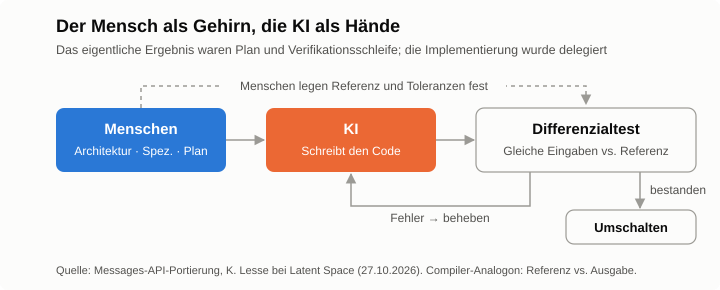
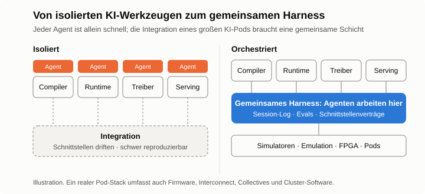



*Teil 2 von 3. [Teil 1](/de/2026/11/you-cant-avoid-the-hard-part/) erzählte zwei Geschichten über die Entscheidung für den schweren statt den sicheren Weg. Dieser Beitrag betrachtet einen dritten, jüngeren großen Wurf und fragt, was er für die Entwicklung von Compilern, Runtimes und der Infrastruktur um sie herum bedeutet.*

Anfang dieses Jahres kam das Plattform-Team von Anthropic zu dem Schluss, dass CPU-Kapazität zum Engpass für die Claude Messages API werden würde. Der Dienst war ein Python-Monolith. Die technische Antwort lag auf der Hand: eine Neuentwicklung in einer Systemsprache wie Rust. Die organisatorische Antwort nicht, denn im Team schrieb niemand Rust.

Das Team tat es trotzdem, Claude schrieb den Großteil des Codes, und im Oktober ging der Rust-Dienst vollständig in Betrieb. Dieser Beitrag untersucht, wie die Arbeit zwischen Menschen und KI aufgeteilt war, warum diese Aufteilung wichtiger ist als die berichteten Einsparungen, und was sie für ein KI-Chip-Unternehmen nahelegt, dessen Compiler und Runtime voller Aufgaben mit genau dieser Struktur sind.

## Auf einen Blick

**Wenn KI den Großteil des Codes schreibt, ändern sich zwei Dinge.** Der Engpass verschiebt sich vom Schreiben des Codes zum Nachweis seiner Korrektheit. Und die Infrastruktur, in der Menschen und Agenten arbeiten, wird so wichtig wie das Produkt selbst.

- **Die Portierung:** Menschen verantworteten Architektur, Migrationsplan und Verifikation, die KI die Implementierung. Berichtete Ergebnisse: rund 40–50 % weniger CPU-Verbrauch, rund 10–20 % kürzere Time to First Token.
- **Für Compiler und Tooling:** zuerst das Differenzialtest-Framework bauen, früher unerreichbare Neuentwicklungen neu bewerten, das Nachziehen von Upstream automatisieren, deterministische Hardware als sauberes Signal für Agenten nutzen und hostseitige CPU in die Kosten pro Aufgabe einrechnen.
- **Für das Unternehmen:** Eine gemeinsame, orchestrierte Agenten-Infrastruktur ist so wichtig wie Chip und Compiler. Wer KI-Werkzeuge isoliert nutzt, ist allein schnell und wird bei der Integration langsam, besonders bei einem großen KI-Pod.

## Die Portierung

Katelyn Lesse, Leiterin des Platform Engineering bei Anthropic, beschrieb das Projekt am 27. Oktober im [Latent-Space-Podcast](https://latent.space/p/how_anthropic_ships_the_1_llm_in_the_world_safely_separating_the_brain_from_the_hands/), einen Tag nachdem sie einen längeren [Essay auf X](https://x.com/katelyn_lesse/status/2114542280535318557) über die neuen technischen Probleme durch Agenten veröffentlicht hatte.

Der Ansatz hatte drei Teile. Erstens behandelte das Team das Vorhaben als *Portierung*, nicht als Neuentwicklung: keine neuen Funktionen, bis sich der Rust-Dienst genauso verhielt wie der Python-Dienst. Andere Teams lieferten während der Migration weiter Funktionen in Python aus, daher markierte das Portierungsteam per statischer Analyse jede Änderung, die ein Gegenstück in Rust brauchte. Zweitens entwarfen Menschen das System und planten die Migration, Claude übernahm den Großteil der Implementierung. Drittens wurde der Rust-Dienst mit *Shadow Traffic* verifiziert: Er erhielt dieselben Anfragen wie der Python-Dienst, beide Ausgaben wurden verglichen, und echter Verkehr wanderte erst über, als das Vertrauen wuchs.

Berichtet wurden 40–50 % weniger CPU-Verbrauch und eine um 10–20 % kürzere Time to First Token, bei längeren Workloads mit größeren Gewinnen. Lesse sagte außerdem, sie hätte eine solche Migration früher nie genehmigt. Eine Neuentwicklung dieser Größe wäre in Stücke zerlegt und über mehrere Jahre migriert worden. Es ist der Test aus Teil 1, erneut angewandt: Angenommen, der riskante Schritt gelingt, trägt dann der Rest des Plans? Neu ist, dass KI den riskanten Schritt bezahlbar gemacht hat.

## Der Mensch als Gehirn, die KI als Hände

Die Einsparungen selbst überraschen nicht. Ein CPU-gebundener Dienst verbraucht nach dem Wechsel von Python zu Rust weniger CPU, mit oder ohne KI. Bemerkenswert ist, dass ein Team ohne Rust-Erfahrung die gesamte Neuentwicklung in etwa einem Jahr abschloss. Das gelang, weil das Team genau wusste, was weiterhin in menschlicher Verantwortung bleiben musste.

Menschen verantworteten die *Architektur*, denn der Dienst ist nach wie vor ein verteiltes System, und jemand muss seine Form festlegen. Sie verantworteten die *Definition von „fertig“*: „verhält sich exakt wie das alte System“ musste so konkret werden, dass es testbar war. Sie verantworteten den *Äquivalenznachweis*, also das Shadow-Traffic-Setup, das Alt und Neu auf realen Eingaben verglich. Und sie verantworteten den *Umfang*, indem sie neue Funktionen bis zum Abschluss der Portierung ablehnten. Der Rest, das große Volumen an Implementierung, wurde delegiert.

Eine treffende Beschreibung dieser Aufteilung ist die, die Anthropic für die eigenen Agenten verwendet: Die Menschen waren das Gehirn, die KI waren die Hände. **Code wurde billig, der Nachweis nicht.** Das wichtigste Ergebnis des Teams war nicht der Rust-Code, sondern der Plan und das Verifikationssystem, die diesen Code vertrauenswürdig machten.

## Was das für Compiler und Tooling von KI-Chips bedeutet

Der Software-Stack eines KI-Chips ist voller Arbeit mit derselben Struktur: große Codemengen, die neu geschrieben, auf ein neues Ziel portiert oder mit etwas konsistent gehalten werden müssen, das sich darunter ständig verändert. Daraus folgen sechs Konsequenzen.

**Differenzialtests sind der Shadow Traffic des Compilers.** Für einen Compiler wird aus dem Vergleich von Python- und Rust-Dienst der Vergleich einer Referenz (PyTorch eager oder eine GPU) mit der kompilierten Ausgabe auf identischen Eingaben. Zufällig erzeugte Graphen und Shapes erweitern die Abdeckung, und numerische Toleranzen pro Operator werden vereinbart, bevor überhaupt verglichen wird. Dieses Framework sollte existieren, bevor KI das Backend verändern darf. Ohne es ist KI-geschriebener Compiler-Code eine Belastung, mit ihm ist derselbe Code ein Hebel.

**Früher unerreichbare Neuentwicklungen verdienen einen zweiten Blick.** Jedes Chip-Software-Team hat eine Liste von Projekten, die sich nie ganz gelohnt haben: das Backend auf MLIR umstellen, statt eine alternde IR zu erweitern; hostseitige Runtime und Serving-Glue in Python durch Rust oder C++ ersetzen; eine komplette Kernel-Bibliothek für eine neue Chipgeneration auf einmal portieren; ein Performance-Modell oder einen Simulator in einer schnelleren Sprache neu schreiben. Die Disziplin ist jedes Mal dieselbe: Funktionen einfrieren, Alt und Neu parallel betreiben, vergleichen, umschalten.

**Das Nachziehen von Upstream lässt sich automatisieren.** vLLM und SGLang ändern sich wöchentlich. Der Ansatz mit statischer Analyse, der Python und Rust synchron hielt, lässt sich direkt übertragen: Bei jedem Rebase vergleicht die CI neue Operatoren, Modellarchitekturen und Scheduler-Funktionen mit der Abdeckung des Backends, markiert die Lücken, und Agenten entwerfen die fehlenden Teile zur Prüfung.

**Deterministische Hardware liefert Agenten ein sauberes Signal.** Agenten werden besser, indem sie Änderungen vorschlagen und messen. Auf einem deterministischen, vom Compiler geplanten Chip liefert ein zyklengenauer Simulator für jeden Versuch eine exakte Zykluszahl. Ein Agent, der Tilings, Schedules oder Speicherlayouts sucht, erhält so eine rauschfreie Bewertung. Auf dynamisch geplanter Hardware erfordert dieselbe Messung wiederholte Läufe und Statistik.

**Evals sollten zahlreich sein und einfach beginnen.** Lesses Rat lautet, dass die meisten Teams mehr Evals brauchen als erwartet, und dass das häufigste Versagen darin besteht, über Frameworks zu diskutieren und keine einzige zu bauen. Für einen Compiler ist eine feste Suite pro Workload ein vernünftiger Anfang, die Korrektheit, Performance und Kompilierzeit abdeckt und bei jeder von Agenten erzeugten Änderung läuft.

**Hostseitige CPU gehört in die Kosten pro Aufgabe.** Die Portierung war durch CPU-Kosten motiviert, und Inference Serving steht auf dem Host unter demselben Druck. In einem [früheren Beitrag zu Anthropics S-1](/2026/10/anthropic-s1-inference-chips/) habe ich argumentiert, dass Wert inzwischen pro Aufgabe statt pro Token gemessen wird: Die Kosten pro erfolgreicher Aufgabe entsprechen den Tokens pro Aufgabe mal den Kosten pro Token, geteilt durch die Erfolgsquote. Eine Agenten-Aufgabe besteht aus Dutzenden bis Hunderten aufeinanderfolgender Schritte, und jeder Schritt zahlt einen hostseitigen Zoll: Scheduling, die Tokenisierung eines wachsenden Kontexts, Prefix-Matching und Python-Buchhaltung. Ein Tokens-pro-Sekunde-Benchmark auf einem einzelnen langen Decode sieht diesen Zoll nie. Über Hunderte Schritte zeigt er sich in der Aufgabenlatenz und in der Zahl der CPU-Kerne, die neben jedem Beschleuniger stehen müssen. Je schneller der Beschleuniger, desto größer der Anteil des Hosts. Gemessen werden sollte pro Schritt und pro Aufgabe, nicht nur pro Token.

## Die Infrastruktur ist Teil des Produkts

„Gehirn und Hände“ ist nicht nur eine Metapher. So beschreibt Anthropic die Architektur von [Claude Managed Agents](https://www.anthropic.com/research/managed-agents), jenem System, dessen erste Ein-Container-Version Teil 1 beschrieben hat. Nach dem Umbau laufen Harness und Session-Log (das Gehirn) auf vertrauenswürdiger Infrastruktur, während generierter Code in wegwerfbaren Sandboxes (den Händen) ausgeführt wird. Zugangsdaten liegen in einem Vault und werden erst von einem Proxy eingesetzt, wenn eine Anfrage die Sandbox verlässt. Das Design begann als Lösung für Latenz und Zuverlässigkeit; heute hält Lesse Sicherheit für seine wichtigste Eigenschaft.

Für ein KI-Chip-Unternehmen betrifft die weitergehende Lehre die Frage, wer diese Art von Infrastruktur baut und wann. **Die Infrastruktur, in der Ingenieure und Agenten arbeiten, verdient dieselbe Priorität wie Chip und Compiler.**

Man betrachte die Alternative. Jeder Ingenieur führt KI-Werkzeuge für sich ein. Der Agent des Compiler-Ingenieurs wird sehr gut im Compiler; die Ingenieure für Runtime, Treiber, Collective Communication und Serving haben jeweils ihren eigenen. Alle sind schneller als zuvor, aber jeder für sich. Jeder Agent sieht nur sein eigenes Repository, seine eigenen Tests und seine eigenen Annahmen über die Schnittstellen ringsum.

Das hält bis zur Integration. Ein KI-Pod ist ein großes System: Chips, Boards, Interconnect, Firmware, Treiber, Runtime, Compiler, Collectives, der Serving-Stack und die Cluster-Software darüber. Die meisten schwierigen Fehler sitzen an den Grenzen zwischen diesen Schichten. Isoliert arbeitende Agenten optimieren lokal, während die Schnittstellen auseinanderdriften, und kein einzelner Agent kann einen Fehler reproduzieren, der erst mit drei Komponenten auftritt. Die in jedem Silo gewonnene Zeit wird bei der Integration wieder ausgegeben, oft mehr als das.

Ein gemeinsames, orchestriertes Harness macht diese Grenzen sichtbar. Ein *gemeinsames Session-Log* hält die Arbeit aller Agenten an einem Ort fest, sodass sich ein Fehler auf Pod-Ebene über Komponenten hinweg verfolgen und zwischen Agenten und Menschen übergeben lässt. *Gemeinsame Umgebungen* stellen Simulatoren, Emulation, FPGA-Prototypen, Referenz-GPUs und später echte Pods allen Agenten über eine Schnittstelle bereit und planen die knappen Ressourcen. *Gemeinsame Evals und Schnittstellenverträge* machen Regressionen auf Pod-Ebene und maschinell prüfbare Schnittstellenspezifikationen zu schnellem Feedback: Ein Agent, der die Runtime ändert, erfährt sofort, welche Compiler-Annahme er verletzt hat. Um all das liegen die Schutzmechanismen von Gehirn und Händen: Sandboxes für generierten Code, Zugangsdaten und vertrauliches IP hinter einem Proxy, Tracing und ein Not-Aus für lang laufende Jobs, und CPU-Kapazität, die geplant wird wie jede andere Rechenleistung.

Das ist kein Nebenprojekt, das ein Plattform-Team später übernehmen kann. Es bestimmt, wie schnell das gesamte Produkt zusammenfindet, und es ist weit günstiger, es vor Beginn der Integration aufzubauen als währenddessen. [Teil 3](/de/2026/11/agent-infra-chip-startup/) zeigt anhand zweier aktueller öffentlicher Designs, wie ein kleines Chip-Startup es aufbauen kann und was es kostet.

## Einschränkungen

Die Zahlen sind Selbstauskünfte ohne veröffentlichte Methodik oder Baseline, und dass Rust Python beim CPU-Verbrauch schlägt, ist unabhängig davon zu erwarten, wer den Code geschrieben hat. Wenn KI sowohl den Code als auch seine Tests schreibt, können beide dasselbe Missverständnis teilen; die Referenz sollte daher unabhängig bleiben: von Menschen geschrieben, aus der Spezifikation abgeleitet oder einer separaten Implementierung entnommen. Mit wachsender Code-Produktion durch Agenten wird das menschliche Review zur neuen Warteschlange, was Teams zu mehr automatisierter Prüfung drängt. Und die hier beschriebene Erfahrung ist die eines Unternehmens, erzählt von der Person, die die betreffende Plattform leitet.

## Schlussgedanke

Compiler für KI-Chips wurden immer an zwei Dingen gemessen: korrekt laufen und schnell laufen. Je mehr des Schreibens die KI übernimmt, desto mehr zahlt sich die Infrastruktur aus, die beides nachweist, und das gemeinsame Harness, mit dem viele Agenten und Ingenieure wie ein Team arbeiten. Teams, die das zuerst aufbauen, können KI auf die großen Neuentwicklungen und auf die Integration ansetzen, während andere noch an den Schnittstellen debuggen.
