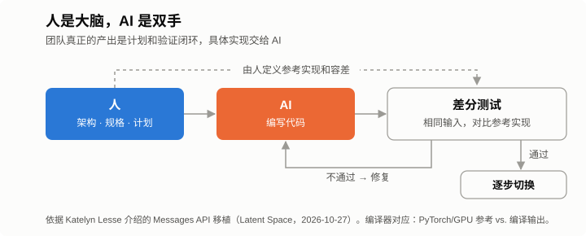
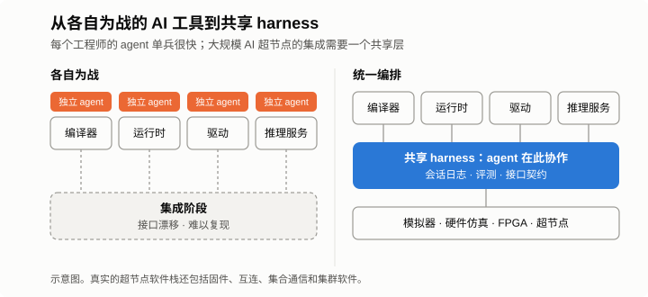



*系列第二篇，共三篇。[第一篇](/zh/2026/11/you-cant-avoid-the-hard-part/)讨论了什么时候「大动作」胜过稳妥路线；这一篇看一个成功的大动作，以及它对芯片软件研发意味着什么。*

Anthropic 最近把 Claude Messages API 从 Python 单体服务整体重写成了 Rust。项目启动时团队里没有一位 Rust 工程师，大部分代码由 Claude 完成。公开的收益很可观，但更有价值的在别处：人不再写代码之后在做什么，以及这种工作方式需要什么样的基础设施。这两点都可以直接对应到 AI 芯片公司如何构建编译器、运行时和推理服务栈。

## 要点速览

**当 AI 承担大部分编码，有两件事会变：瓶颈从「写代码」转移到「证明代码是对的」；agent 赖以工作的基础设施成为产品的一部分。**

- **发生了什么：** 一个生产级 API 从 Python 整体移植到 Rust，实现主要由 AI 完成；人负责架构、迁移计划和验证。公开的结果：CPU 消耗下降约 40%–50%，首 token 延迟改善约 10%–20%。
- **分工：** 人是大脑（规格、架构、等价性证明），AI 是双手（具体实现）。
- **对编译器和工具链：** 先建差分测试框架；重新考虑过去回避的重写；自动跟进上游；把确定性硬件当作给 agent 的干净信号；把 host 端 CPU 算进每任务成本。
- **对公司：** 一套共享、统一编排的 agent 基础设施，和芯片本身、编译器本身同样重要。每个工程师各自用 AI 工具、各自为战，单兵很快，到集成阶段就会变慢，大规模 AI 超节点（pod）产品尤其如此。

## 一、发生了什么

Anthropic 平台工程负责人 Katelyn Lesse 10 月 27 日在 [Latent Space 播客](https://latent.space/p/how_anthropic_ships_the_1_llm_in_the_world_safely_separating_the_brain_from_the_hands/)里介绍了这个项目；前一天她在 X 上发了一篇[长文](https://x.com/katelyn_lesse/status/2114542280535318557)，讨论 agent 带来的新工程问题。

- **为什么：** CPU 容量成了约束，而 Python 单体服务很耗 CPU。技术上 Rust 是显而易见的选择，但团队里没人会 Rust。
- **怎么做：** 人负责系统设计和迁移计划，具体实现主要交给 Claude。项目被严格限定为一次*移植*，不加新功能。其他团队仍在给 Python 版本加功能，于是用静态分析标出每一个需要在 Rust 版本中同步实现的改动。
- **怎么验证：** 影子流量。Rust 服务接收和 Python 服务相同的请求，对比输出，再逐步把真实流量切过去。
- **结果（据其介绍）：** CPU 消耗下降约 40%–50%，首 token 延迟改善约 10%–20%，运行时间更长的负载改善更大。

Lesse 说，放在过去她绝不会批准这样的迁移：这种规模的重写通常要拆开、花好几年慢慢迁。这正是第一篇所说的那种「大动作」，而 AI 让它变得负担得起。

## 二、人是大脑，AI 是双手

性能提升本身并不意外：从 Python 换到 Rust，有没有 AI 都能省下大量 CPU。新的地方在于，一个没有 Rust 经验的团队用大约一年完成了整体重写，因为他们清楚哪些事仍然必须由人负责：

- **架构。** 这本质上还是一个分布式系统，形态要由人来定。
- **「完成」的定义。** 「和旧系统行为完全一致」必须被精确化。
- **等价性证明。** 要有一套机制，在真实输入上证明新系统和旧系统一致。
- **范围纪律。** 移植完成之前，不加新功能。

其余都交给「双手」。**代码变便宜了，证明没有。** 这个团队真正的产出，是计划和验证体系。

## 三、对 AI 芯片编译器和工具链意味着什么

芯片软件栈里，类似这次移植的工作随处可见：大量代码需要重写、换目标平台，或者和别的东西保持同步。

**1. 差分测试就是你的影子流量。** 对编译器来说，「对比 Python 和 Rust 的输出」对应的是：用参考实现（PyTorch eager 或 GPU）和自己编译的结果跑同样的输入。再加上随机计算图和形状的 fuzzing，并事先约定每个算子的数值容差。在让 AI 动后端之前，先把这套框架搭起来。没有它，AI 写的编译器代码是负债；有了它，才是杠杆。

**2. 过去回避的重写，可以重新考虑。** 把后端迁到 MLIR，而不是继续修补旧 IR；把 host 端运行时或推理服务的胶水代码从 Python 换成 Rust 或 C++；为新一代芯片一次性移植整个 kernel 库；用更快的语言重写性能模型或模拟器。每次都用同样的纪律：冻结功能，新旧并行运行，对比，切换。

**3. 自动跟进上游。** vLLM 和 SGLang 每周都在变。让 Python 和 Rust 保持同步的静态分析思路在这里同样适用：每次 rebase，由 CI 对比新增的算子、模型结构和调度功能与后端已覆盖的部分，标出缺口，再由 agent 起草缺失的实现供人审阅。

**4. 确定性硬件给 agent 一个干净的信号。** Agent 靠反复尝试和测量来改进。在确定性、编译器静态调度的芯片上，模拟器能给出精确的周期数，agent 搜索 tiling、调度和内存布局时，每次尝试都能得到没有噪声的评分。而在动态调度的硬件上，每次测量都需要多次运行再做统计。

**5. 评测比你想的要多，而且从简单开始。** Lesse 的建议是，多数团队需要的评测比预期多；常见的错误是一直在比较评测框架，结果一个评测也没建起来。编译器的第一版可以是一套按负载固定的测试集，覆盖正确性、性能和编译时间，在 agent 的每次改动上运行。

**6. 把 host 端 CPU 算进每任务成本。** Anthropic 这次移植的起因就是 CPU 成本，推理服务在 host 端也有同样的问题。我在[上一篇读 Anthropic S-1 的文章](/zh/2026/10/anthropic-s1-inference-chips/)里提到，价值现在按任务衡量，而不是按 token：每个成功任务的成本 =（每任务 token 数 × 每 token 成本）÷ 任务成功率。一个 agent 任务是几十到几百个串行步骤，每一步都要付一笔 host 端的「过路费」：调度、对不断变长的上下文做分词、前缀匹配、Python 层的簿记。单条长序列 decode 的 tokens/s 测试看不到这笔费用；乘上几百步，它会体现在任务延迟上，也体现在每颗加速器旁边要配多少 CPU。芯片越快，这部分占比越大。要按每步、每任务去测，而不只是按每 token。

## 四、基础设施本身就是产品的一部分

「大脑与双手」也是 Anthropic 对其 agent 架构的描述。在 [Claude Managed Agents](https://www.anthropic.com/research/managed-agents) 中，harness 和会话日志（大脑）运行在可信的服务器上，生成的代码在可随时销毁的沙箱（双手）里执行。凭据保存在 Vault 中，只在请求离开沙箱时由代理注入。这个设计最初是为了解决延迟和可靠性问题，Lesse 现在认为安全性才是它最重要的好处。

对 AI 芯片公司来说，更大的启示在于：这类基础设施由谁来建、什么时候建。**为工程师和 agent 搭建工作所需的基础设施，和设计芯片、开发编译器同样重要。**

它要防止的是这样一种失败模式：每个工程师各自引入 AI 工具。编译器工程师有一个很懂编译器的 agent；运行时、驱动、集合通信、推理服务的工程师各有各的。每个人都比以前快，但都在各自的「筒仓」里。每个 agent 只看得到自己的仓库、自己的测试，以及自己对周边接口的理解。

这在集成之前都没问题。一个 AI 超节点是一个庞大的系统：芯片、板卡、互连、固件、驱动、运行时、编译器、集合通信、推理服务栈，以及上层的集群软件。最难的 bug 大多出在这些部分的边界上。各自为战的 agent 只做局部优化，接口在不知不觉中漂移；一个需要三个组件同时在场才能复现的问题，谁的 agent 都复现不了。各个筒仓里省下的时间，在集成阶段会被加倍花掉。

统一编排的 harness 让这些边界变得可见：

- **共享的会话日志。** 所有 agent 的工作记录在同一处，超节点级的故障可以跨组件追踪，并在 agent 和人之间交接。
- **共享的环境，作为工具接入。** 模拟器、硬件仿真、FPGA 原型、参考 GPU，以及之后真实的超节点，通过同一个接口提供给所有 agent，并作为稀缺资源统一调度。
- **共享的评测和接口契约。** 超节点级的回归测试，以及可以被机器检查的接口规格。一个 agent 改了运行时，马上就能知道它破坏了编译器的哪些假设。
- **安全内建。** 生成的代码在沙箱里运行；凭据、工具许可证和保密 IP 留在沙箱外，通过代理使用。
- **对运行数小时的 agent 任务做链路追踪，保留紧急停止开关；** 并且像规划其他算力一样**规划 CPU 容量**，因为编译和仿真的负载会随 agent 数量增长。

这不是一个留给平台团队以后再做的边角项目。它决定了整个产品能多快集成起来，而在集成开始之前建好，远比集成过程中再补便宜。[第三篇](/zh/2026/11/agent-infra-chip-startup/)会讨论一家小型芯片初创公司如何在实践中把它建起来。

## 五、几点保留

- **数字是自述的**，没有公开测量方法和基线。Rust 在 CPU 上胜过 Python，本来就在预期之内。
- **相关性错误。** 如果代码和测试都由 AI 写，二者可能共享同一个误解。参考实现要保持独立：由人编写、来自规格，或来自另一套实现。
- **审阅会成为新的队列。** 当 agent 产出的代码多出十倍，人工审阅就是瓶颈，这会推动团队采用更多自动化检查。
- **背景。** 讲述者负责的正是她所介绍的平台。架构是公开的，也被广泛讨论，但经验来自一家公司。

## 结语

AI 芯片的编译器一直靠两件事来评判：跑得对，跑得快。随着 AI 承担越来越多的编写工作，真正会积累的，是证明这两点的基础设施，以及让许多 agent 和工程师像一个团队一样协作的共享 harness。先建好这些的公司，才能把 AI 用在大规模重写和系统集成上，而别人还在边界上调 bug。
