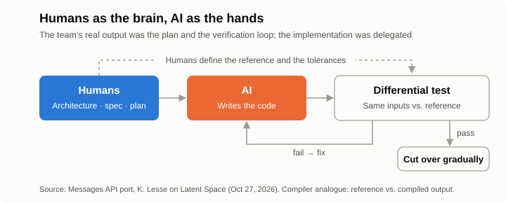
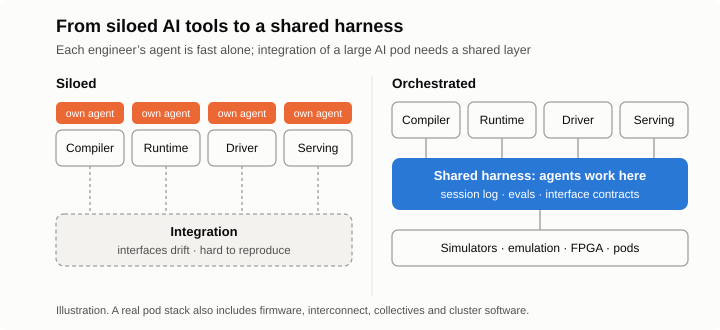



*Part 2 of 3. [Part 1](/2026/11/you-cant-avoid-the-hard-part/) told two stories about choosing the hard path over the safe one. This post looks at a third, more recent big swing, and at what it implies for building compilers, runtimes and the infrastructure around them.*

Earlier this year, Anthropic's platform team concluded that CPU capacity would become a bottleneck for the Claude Messages API. The service was a Python monolith. The technical answer was obvious: rewrite it in a systems language such as Rust. The organizational answer was not, because nobody on the team wrote Rust.

They did it anyway, with Claude writing most of the code, and shipped the Rust service in full in October. This post looks at how the work was divided between people and AI, why that division matters more than the reported savings, and what it suggests for an AI chip company, whose compiler and runtime are full of work that looks just like this port.

## At a glance

**When AI writes most of the code, two things change.** The bottleneck moves from writing code to proving it correct. And the infrastructure that people and agents work in becomes as important as the product itself.

- **The port:** humans owned the architecture, the migration plan and verification; AI owned the implementation. Reported results: CPU use down about 40–50%, time to first token down about 10–20%.
- **For compilers and tooling:** build the differential-testing harness first, revisit rewrites that used to be out of reach, automate keeping up with upstream, use deterministic hardware as a clean signal for agents, and count host-side CPU in cost per task.
- **For the company:** a shared, orchestrated agent infrastructure matters as much as the chip and the compiler. Engineers using AI tools in isolation move fast alone and slow down at integration, especially on a large AI pod.

## The port

Katelyn Lesse, who leads platform engineering at Anthropic, walked through the project on the [Latent Space podcast](https://latent.space/p/how_anthropic_ships_the_1_llm_in_the_world_safely_separating_the_brain_from_the_hands/) on October 27, a day after publishing a longer [essay on X](https://x.com/katelyn_lesse/status/2114542280535318557) about the engineering problems agents create.

The approach had three parts. First, the team treated it as a *port*, not a rewrite: no new features until the Rust service matched the Python one. Other teams kept shipping features in Python during the migration, so the port team used static analysis to flag every change that needed a Rust counterpart. Second, people designed the system and planned the migration, and Claude did most of the implementation. Third, the Rust service was verified with *shadow traffic*: it received the same requests as the Python service, the two outputs were compared, and real traffic moved over only as confidence grew.

The reported results were a 40–50% reduction in CPU use and a 10–20% improvement in time to first token, with larger gains on longer workloads. Lesse also said that in the past she would never have approved a migration like this. A rewrite of this size would have been cut into pieces and moved over several years. It is the test from Part 1 applied again: assume the risky move works, and check whether the rest of the plan holds. What changed is that AI made the risky move affordable.

## Humans as the brain, AI as the hands

The savings themselves are not surprising. Moving a CPU-bound service from Python to Rust would reduce CPU use with or without AI. The interesting result is that a team without Rust expertise completed the whole rewrite in about a year. That worked because the team was precise about what people still had to own.

People owned the *architecture*, because the service is still a distributed system and someone has to decide its shape. They owned the *definition of done*: "behaves exactly like the old system" had to be made concrete enough to test. They owned the *proof of equivalence*, the shadow-traffic setup that compared old and new on real inputs. And they owned *scope*, saying no to new features until the port was finished. The rest, the large volume of implementation, was delegated.

A useful way to describe this split is the one Anthropic uses for its own agents: the people were the brain, and AI was the hands. **Code became cheap; proof did not.** The team's most important output was not the Rust code but the plan and the verification system that made the Rust code trustworthy.

## What this means for AI chip compilers and tooling

An AI chip software stack is full of work with the same shape: large bodies of code that need to be rewritten, retargeted, or kept consistent with something that changes underneath them. Six implications follow.

**Differential testing is the compiler's shadow traffic.** For a compiler, comparing the Python and Rust services becomes comparing a reference (PyTorch eager, or a GPU) with the compiled output on identical inputs. Random graph and shape generation widens coverage, and numeric tolerances per operator are agreed before any comparison is run. This harness should exist before AI is allowed to change the backend. Without it, AI-written compiler code is a liability; with it, the same code is leverage.

**Rewrites that were out of reach are worth revisiting.** Every chip software team has a list of projects that were never quite worth it: moving the backend onto MLIR instead of extending an aging IR, replacing Python host-side runtime and serving glue with Rust or C++, porting an entire kernel library at once for a new chip generation, rewriting a performance model or simulator in a faster language. The discipline is the same each time: freeze features, run old and new side by side, compare, and cut over.

**Keeping up with upstream can be automated.** vLLM and SGLang change weekly. The static-analysis approach that kept Python and Rust in step applies directly: on each rebase, CI compares new operators, model architectures and scheduler features with the backend's coverage, flags the gaps, and agents draft the missing pieces for review.

**Deterministic hardware gives agents a clean signal.** Agents improve by proposing changes and measuring them. On a deterministic, compiler-scheduled chip, a cycle-accurate simulator returns an exact cycle count for every attempt, so an agent searching tilings, schedules or memory layouts gets a noise-free score. On dynamically scheduled hardware, the same measurement needs repeated runs and statistics.

**Evals should be plentiful and start simple.** Lesse's advice is that most teams need more evals than they expect, and that the common failure is debating frameworks while building none. For a compiler, a reasonable first version is a fixed suite per workload covering correctness, performance and compile time, run on every agent-generated change.

**Host-side CPU belongs in cost per task.** The port was motivated by CPU cost, and inference serving has the same pressure on the host. In an [earlier post on Anthropic's S-1](/2026/10/anthropic-s1-inference-chips/), I argued that value is now measured per task rather than per token: cost per successful task equals tokens per task times cost per token, divided by the success rate. An agent task consists of tens to hundreds of sequential steps, and each step pays a host-side toll: scheduling, tokenizing a growing context, prefix matching and Python bookkeeping. A tokens-per-second benchmark on a single long decode never sees that toll. Across hundreds of steps it shows up in task latency, and in the number of CPU cores that must sit next to every accelerator. The faster the accelerator, the larger the host's share. It should be measured per step and per task, not only per token.

## The infrastructure is part of the product

"Brain and hands" is not only a metaphor. It is how Anthropic describes the architecture of [Claude Managed Agents](https://www.anthropic.com/research/managed-agents), the system whose single-container first version Part 1 described. After the rebuild, the harness and the session log (the brain) run on trusted infrastructure, while generated code runs in disposable sandboxes (the hands). Credentials sit in a vault and are injected by a proxy only as a request leaves the sandbox. The design started as a fix for latency and reliability; Lesse now considers security its most important property.

For an AI chip company, the broader lesson concerns who builds this kind of infrastructure, and when. **The infrastructure that engineers and agents work in deserves the same priority as the chip and the compiler.**

Consider the alternative. Each engineer adopts AI tools independently. The compiler engineer's agent becomes very good at the compiler; the runtime, driver, collective-communication and serving engineers each have their own. Everyone moves faster than before, but in isolation. Each agent sees only its own repository, its own tests and its own assumptions about the interfaces around it.

That arrangement holds until integration. An AI pod is a large system: chips, boards, interconnect, firmware, driver, runtime, compiler, collectives, the serving stack and the cluster software above it. Most of the difficult defects live at the boundaries between those layers. Agents working in isolation optimize locally while the interfaces drift, and no single agent can reproduce a failure that needs three components to appear. The time saved inside each silo is spent, and often exceeded, during integration.

A shared, orchestrated harness makes those boundaries visible. A *shared session log* records every agent's work in one place, so a pod-level failure can be traced across components and handed between agents and people. *Shared environments* expose simulators, emulation, FPGA prototypes, reference GPUs and, later, real pods to every agent through one interface, and schedule the scarce ones. *Shared evals and interface contracts* turn pod-level regressions and machine-checked interface specifications into fast feedback, so an agent that changes the runtime learns immediately which compiler assumption it broke. Around all of this sit the brain-and-hands safeguards: sandboxes for generated code, credentials and confidential IP behind a proxy, tracing and a kill switch for long-running jobs, and CPU capacity planned like any other compute.

This is not a side project for a platform team to take on later. It determines how quickly the whole product comes together, and it is far cheaper to build before integration starts than during it. [Part 3](/2026/11/agent-infra-chip-startup/) looks at how a small chip startup can build it, using two recent public designs as reference points, and what it costs.

## Caveats

The numbers are self-reported, without a published method or baseline, and Rust outperforming Python on CPU is expected regardless of how the code was written. When AI writes both the code and its tests, the two can share the same misunderstanding, so the reference should stay independent: written by people, derived from the specification, or taken from a separate implementation. Human review becomes the new queue as agents produce more code, which pushes teams toward more automated checking. And the experience described here is one company's, told by the person who leads the platform in question.

## Closing thought

AI chip compilers have always been judged on two things: running correctly and running fast. As AI takes on more of the writing, what compounds is the infrastructure that proves both, and the shared harness that lets many agents and engineers work as one team. Teams that build these first can point AI at the big rewrites, and at integration, while others are still debugging the boundaries.
