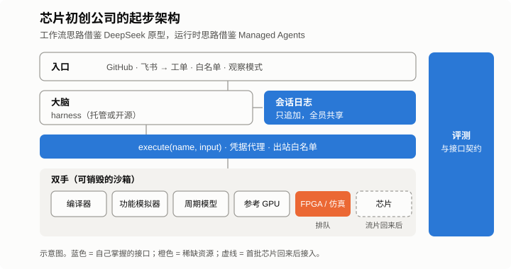



*系列第三篇，共三篇。[第一篇](/zh/2026/11/you-cant-avoid-the-hard-part/)讲的是选择正面硬啃。[第二篇](/zh/2026/10/humans-brain-ai-hands/)提出，人和 agent 赖以工作的基础设施，应该和芯片、编译器享有同样的优先级。这一篇讨论：一家小型推理芯片初创公司，没有历史、没有遗留系统、第一次流片回来之前也没有芯片，该如何建设这套基础设施，又要花多少钱。*

最近有两个公开的设计正好可以放在一起看。DeepSeek 发布了 [dsh-superagent](https://github.com/deepseek-ai/dsh-superagent-prototype)，一个面向团队代码仓库的主动式编程 agent，构建在其开源 agent 运行时 DeepSeek Harness 之上。Anthropic 介绍了 [Claude Managed Agents](https://www.anthropic.com/research/managed-agents) 的架构，这是它用来运行长时间 agent 的托管服务。两者很容易被看作竞品，但更准确的理解是同一个技术栈里的两层。

## 要点速览

**DeepSeek 的原型解决的是：agent 该接什么活、为谁做、什么时候该让人介入。Managed Agents 解决的是：这些工作如何可靠、安全地运行。初创公司两层都需要。**

- **向 DeepSeek 借鉴：** 带明确授权的工单、先观察再行动的模式、对人的注意力严格设限。
- **向 Anthropic 借鉴：** 只追加的会话日志、所有工具和环境共用一个接口、可随时销毁的沙箱、让生成的代码碰不到凭据。
- **对还没有芯片的初创公司：** 现在就把模拟器、FPGA 原型和参考 GPU 接到这个接口后面，并把这套基础设施作为一级预算科目。对一个 30 人的软件团队，合理的估算是每年 100 万到 200 万美元，不含硬件仿真和许可证。

## 两个设计，两个层次

DeepSeek 的 dsh-superagent 是 DeepSeek Harness 的一个插件包，监听一个 GitHub 仓库，以及可选的飞书群聊。README 对它的定位很坦率：这是研究原型而不是官方产品，来自团队的日常开发，其中大量工程由编程 agent 完成。它的组织原则是*占用尽可能少的人类注意力，提供尽可能多的价值*，整个领域模型都围绕这条原则展开。

一条消息只有在评估步骤依据带版本的 *policy* 接受之后，才会成为*工单*。Policy 规定谁可以提需求、通过哪个渠道，以及哪些成文规则允许 agent 主动做事。接受的结果记录为 *mandate*，写明工作范围以及为什么允许做。主动工作先在*观察*模式下运行，只记录 agent 本来会做什么；团队审阅这些记录后，再切换到自动模式。每个工单在自己的会话和工作目录里运行，通常是一个 git worktree，并在提出需求的那个对话里回复。并发由 worker 槽位限制，始终保留一个槽位，保证人的消息不会排在新任务后面。对外的动作先存储再执行，重启后可以干净地恢复，所有状态保存在一个 SQLite 文件里。

文档对隔离性同样坦率：worker 以运维者的操作系统用户身份、完全权限运行，账户包装只是默认设置，不是安全边界。文档建议使用专用的系统账户。

Claude Managed Agents 围绕三个可以各自失败、各自替换的组件构建。*会话*是记录所有事件的只追加日志；*harness* 是调用模型并分发工具调用的循环；*沙箱*是代码执行的地方。Harness 通过统一接口 `execute(name, input) → string` 访问任何环境，崩溃后可以通过 `wake(sessionId)` 从日志重启。容器被当作「牲畜」而不是「宠物」。Git token 在沙箱创建时接好，其他凭据保存在代理后面的 Vault 中，harness 和生成的代码都不会持有它们。Anthropic 称解耦之后，首 token 延迟中位数下降约 60%，p95 下降超过 90%。它还观察到，harness 里内置的假设会随着模型进步而过时，所以它固定的是接口，而不是某一个具体的 harness。这正是第一篇里那个第一版跑在单个容器里、后来被重建的系统。

| | dsh-superagent（DeepSeek） | Claude Managed Agents（Anthropic） |
|---|---|---|
| 层次 | 团队工作流：入口、授权、人的注意力 | 运行时：持久会话、执行、隔离 |
| 工作单元 | 在带版本 policy 下、附带 mandate 的工单 | 带只追加事件日志的会话 |
| 触发方式 | GitHub 和飞书事件；明确请求和成文规则 | 开发者应用发起的 API 调用 |
| 执行 | 单机上每个工单一个会话和目录 | 无状态 harness；沙箱按需创建 |
| 隔离 | 运维者系统用户、完全权限；建议专用账户 | 沙箱；凭据在代理后的 Vault 中 |
| 恢复 | 已存储的待办动作，重启后附恢复说明 | 新 harness 从会话日志续跑 |
| 状态 | MIT 许可的研究原型 | 商业托管服务 |

## 芯片初创公司可以从两者借鉴什么

初创公司在这里有一个结构性优势：没有东西需要迁移。等每个团队都习惯了各自的工具和做法，也就是第二篇提醒过的「各自为战」状态，下面这些选择会难做得多。

**采用接口，而不是某个产品。** 第一天就定义好自己的会话日志、`execute`、`provision` 和 `wake`，哪怕暂时由托管的 harness 来实现。Anthropic 的经验是：harness 会过时，接口会留下来。以后公司换模型、换 harness、换供应商，工具、评测和日志都能延续下来。

**把入口做明确。** DeepSeek 的入口纪律可以直接借用：工作从团队已经在用的渠道（比如 GitHub 加飞书或 Slack）里、由白名单上的人发起，并成为一个记录了范围的工单。主动工作，比如修掉 kernel 库每晚的所有回归，先在观察模式下运行。再给 agent 设一个注意力预算：确认一次，工作时保持安静，然后给出结果，或者提一个具体的问题。

**在芯片回来之前，先把「双手」备齐。** 流片之前，芯片初创公司已经有很多可以让 agent 动手的环境：编译器本身、功能模拟器、周期精确模型、参考 GPU 机器、FPGA 原型，以及共享的硬件仿真时间。每一个都应该接在同一个 `execute` 接口后面，稀缺资源（尤其是硬件仿真）需要排队机制。确定性、编译器静态调度的设计还有一个额外好处：正如第二篇所说，周期精确模型能给 agent 一个精确的优化目标。

**为芯片回来的那一天做设计。** Bring-up 是时间最宝贵的阶段。如果 agent、评测和日志已经通过统一接口在模拟器上运行，一块 bring-up 板卡就只是多了一只「手」。同一套回归测试第一天就能跑，模型的预测和芯片的实际表现之间的差距变成一份 diff，而不是一场调查。

**从第一天就隔离，而不是等第一次出事。** 原型的完全权限模式对研究工具来说合理，放在 RTL、保密协议下的代工厂数据、工具许可证或客户模型旁边就不合理。基本配置是：每个工单一个可销毁的沙箱或虚拟机，一个负责注入凭据的代理，一个出站白名单，再加一条明确规则，规定哪些数据 agent 永远不能看到。选择托管方案之前，先确认公司可以使用哪些模型和哪些部署区域；Anthropic 表示，Managed Agents 也可以使用部署在客户自己基础设施上的沙箱。

**把会话日志当作集成的记忆。** 对超节点级的产品来说，最有价值的记录是一个故障如何穿过组件边界。编译器、运行时、驱动、推理服务的 agent 共用一份日志，人或另一个 agent 就能接着上一个停下的地方继续，集成缺陷也会变成附带证据的工单。

**明确负责人。** 从一开始就由一两位工程师把这套基础设施当作产品来运营，地位与编译器、运行时的负责人相当。

## 要花多少钱

这些都不是免费的，而且这些成本和传统芯片预算里的任何一项都长得不一样。为了具体一些，设想一个处于流片前阶段的 30 人软件团队，日常使用交互式编程 agent，并运行一支规模不大的后台 agent 队伍。下表使用 2026 年 10 月的公开标价，目的是给出量级，而不是报价。

| 项目 | 假设 | 每月 |
|---|---|---|
| 交互式编程 agent | 30 名工程师，每人 250–1,000 美元 | 7.5k–30k 美元 |
| 后台 agent | 20 个 agent，每月 22 个工作日，每个 agent 每天 30–100 美元 | 13k–44k 美元 |
| 沙箱、构建和仿真用的 CPU | 40 个 32 vCPU 沙箱持续运行，约 92 万 vCPU 小时，每 vCPU 小时 0.02–0.045 美元 | 18k–41k 美元 |
| 参考 GPU | 两台 8 卡 H100 服务器，约 1.15 万 GPU 小时，每 GPU 小时 3–4 美元 | 35k–46k 美元 |
| 存储、日志和网络 | 约为以上合计的 10% | 7k–16k 美元 |
| **合计** | | **约 8 万–18 万美元** |

折合每年约 100 万–200 万美元，即每名工程师每月 2,700–5,900 美元。输入数据都来自公开资料。Anthropic 公布的 Claude Code 指引显示，企业部署的平均成本约为[每名开发者每月 150–250 美元](https://www.morphllm.com/claude-code-api-cost)；大公司里重度使用 API 的工程师，有报道称每月 [500–2,000 美元](https://www.cloudzero.com/blog/codex-vs-claude-code/)。10 月初，按需租用一张 H100 的[中位价格约为每 GPU 小时 4.20 美元](https://uvik.net/blog/gpu-price-index/)，专业 GPU 云更便宜，而且租赁价格在 2026 年一路上涨。计算优化型云 CPU 的按需标价约为每 vCPU 小时 0.045 美元，签多年承诺大约能降到一半。

有三项不在表里。FPGA 原型和硬件仿真系统按报价销售、没有公开标价，而且往往是单笔最大的一项。EDA 许可证有自己的合同。负责这个平台的一两位工程师属于人力成本，不在云账单里。

重点不在于总数精确到多少，而在于支出的形态。传统芯片公司的预算围绕人头、EDA 许可证、IP、掩膜和实验室来做，算力被当作 IT 开销。这个模型的前提是：工程产出随工程师人数增长。有了 agent 之后，产出越来越多地随算力和 token 增长，账单随实际完成的工作量增长，而不是随团队规模增长。它是可变的，在集成和 bring-up 阶段会冲高，一个失控的任务一夜之间就可能烧掉几千美元。

**因此，AI 基础设施必须成为 AI 芯片公司计划里的一级预算科目，与 EDA 许可证和流片享有同样的地位。** 落到实处，就是要有明确的负责人，预算与芯片里程碑而不是人头挂钩，并用单位指标把支出和结果联系起来：每个合入改动的成本、每修复一个回归的成本、每仿真小时的成本。还要把护栏内建在 harness 里：按 agent、按工单设预算，借鉴 DeepSeek 设计的并发槽位，不急的工作用批处理价格，保持高的 prompt 缓存命中率，回归测试使用可抢占的廉价资源。沿用旧预算方式的公司，要么给基础设施投入不足，拿不到它本该带来的生产力，要么事后才发现账单。

## 自建还是采用

不要自己写 agent 循环，它会是最先过时的部分。在公司政策允许的范围内，使用托管或开源的 harness。自己要建的，是专属于公司、并且比任何 harness 都长寿的东西：模拟器、FPGA、硬件仿真以及之后芯片的工具适配层；评测集和参考模型；组件之间的接口契约；以及规定谁可以让 agent 做什么的策略。

## 与芯片进度挂钩的计划

RTL 冻结之前，优先级是统一的仓库规范和 CI、会话日志和 `execute` 接口、带观察模式的入口、编译器和模拟器作为第一批「双手」，以及第一批评测集。第一次流片回来之前，优先级是超节点级的系统模型、接入排队机制的 FPGA 和硬件仿真、跨组件工单和接口契约，以及沙箱和凭据代理。首批芯片回来之后，bring-up 板卡成为「双手」，同一套回归测试在真实硬件上运行，实验室的访问控制收紧，所有接触硬件的操作都配备紧急停止开关。

## 几点保留

以上解读基于公开的文档和代码。DeepSeek 说明其原型与内部版本不同；Anthropic 的文章描述的是一项服务，而不是一份配方。托管服务用控制权换速度；稳定的接口可以降低锁定，但不能消除。成本模型只是示意，价格每个月都在变。这些都不能替代工程判断：哪些东西永远不该让 agent 碰。

## 结语

第一篇以一个问题收尾：能绕开最难的部分，仍然成功吗？对芯片初创公司来说，agent 基础设施就是这样一块硬骨头。人们很容易想把它推到流片之后，等有了芯片、也许也有了更多钱再说。但正是这套基础设施决定了集成和 bring-up 能有多快，而到那时再从容地建，已经来不及了。把两个设计放在一起看，就能看清该建什么：一个决定哪些工作值得占用人的注意力，另一个确保没人盯着的时候工作也能安全地完成。预算一节则说明了为此要付出多少。
