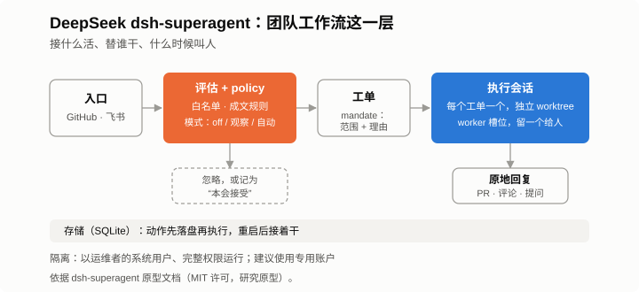
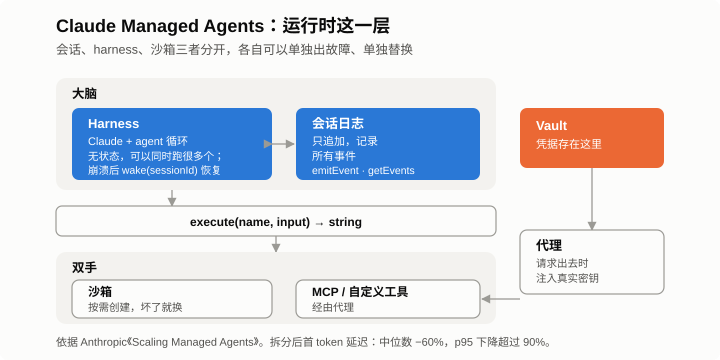
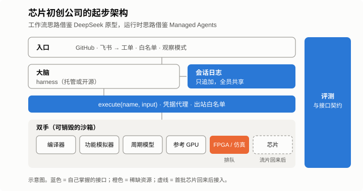



*系列第三篇，共三篇。[第一篇](/zh/2026/11/you-cant-avoid-the-hard-part/)讲的是该硬啃时就硬啃。[第二篇](/zh/2026/10/humans-brain-ai-hands/)说，人和 agent 干活用的基础设施，应该和芯片、编译器排在同一个优先级。这一篇是一次设想和讨论：一家小型推理芯片初创公司，没有遗留系统，第一次流片回来之前手里也没有芯片，如果要搭这套基础设施，可以怎么搭，大概要花多少钱。它不是现状汇报。这是我们想做、但还有很长路要走的事，先讨论清楚是第一步。*

最近有两个公开的设计，放在一起看很有意思。

一个是 DeepSeek 发布的 [dsh-superagent](https://github.com/deepseek-ai/dsh-superagent-prototype)，一个盯着团队代码仓库、会主动接活的编程 agent，跑在 DeepSeek 开源的 agent 运行时 DeepSeek Harness 上。另一个是 Anthropic 介绍的 [Claude Managed Agents](https://www.anthropic.com/research/managed-agents) 架构，这是 Anthropic 用来跑长时间 agent 任务的托管服务。

乍一看是竞品。细看下来，它们更像同一套技术栈里的上下两层。

## 要点速览

**DeepSeek 的原型管的是 agent 该接什么活、替谁干、什么时候该叫人；Managed Agents 管的是这些活怎么稳定、安全地跑完。初创公司两层都要。**

- **跟 DeepSeek 学：** 每项工作都要有明确授权；先观察，再动手；严格控制打扰人的次数。
- **跟 Anthropic 学：** 只追加的会话日志；所有环境走同一个接口；沙箱用完即弃；生成的代码碰不到凭据。
- **还没有芯片的初创公司：** 现在就把模拟器、FPGA 原型和参考 GPU 接到这个接口后面，并把基础设施单列为一级预算。30 人的软件团队，一年大约 100 万到 200 万美元。

## 两个设计，两层问题

**先看 dsh-superagent。** 它监听一个 GitHub 仓库，也可以接飞书群聊。README 写得很直白：这是研究原型，不是正式产品。它的设计原则是尽量少占用人的注意力，尽量多给出价值。

一条消息要先过一道评估，符合一份带版本号的 policy 之后，才会变成工单。Policy 写明谁能提需求、从哪个渠道提，以及哪些成文规则允许 agent 主动做事。主动做的事，一开始只在“观察”模式下跑，agent 只记录自己本来会做什么，并不真动手。

每个工单有自己的会话和 git worktree。并发数受 worker 槽位限制，其中一个槽位永远留给人。待执行的动作先落盘再执行，重启之后能接着干。

文档对隔离问题也不回避：worker 以运维者的系统用户身份、带完整权限运行，文档建议另开一个专用账户。

**再看 Claude Managed Agents。** 它把三个部分拆开，每个部分都可以单独出故障、单独替换：会话，一份只追加、记录所有事件的日志；harness，负责调用模型、分发工具调用的那个循环；沙箱，代码真正运行的地方。

Harness 访问任何环境都走同一个接口，`execute(name, input) → string`。harness 崩了，用 `wake(sessionId)` 从日志里恢复。凭据放在代理后面的 Vault 里，harness 和生成的代码都拿不到。

据 Anthropic 介绍，拆开之后首 token 延迟的中位数下降了约 60%，p95 下降了 90% 以上。这就是第一篇里那个第一版塞在单个容器里、后来推倒重来的系统。

| | dsh-superagent（DeepSeek） | Claude Managed Agents（Anthropic） |
|---|---|---|
| 管哪一层 | 团队工作流：接活、授权、打扰人的次数 | 运行时：会话、执行、隔离 |
| 工作单元 | 按带版本 policy 批准、附有 mandate 的工单 | 带只追加事件日志的会话 |
| 怎么执行 | 单机上，每个工单一个会话和 worktree | harness 无状态；沙箱按需创建 |
| 怎么隔离 | 运维者系统用户，完整权限 | 沙箱；凭据放在代理后面 |
| 现状 | MIT 许可的研究原型 | 商业托管服务 |

## 芯片初创公司能借鉴什么

初创公司有个先天优势：没有旧东西要迁移。等到各个团队都习惯了各用各的工具，也就是第二篇说的“各自为战”，下面这些事就难办多了。

**学接口，不必照搬产品。** 第一天就把自己的会话日志、`execute`、`provision` 和 `wake` 定下来，哪怕眼下先用托管的 harness 来实现。Harness 会过时，接口不会，建在接口上的工具、评测和日志也都能留下来。

**入口要明确。** 工作从团队平时用的渠道里发起，只有白名单上的人能提，每个需求都变成一个写清范围的工单。主动做的事先在观察模式下跑。Agent 确认一次就安静干活，最后交结果，或者只问一个具体的问题。

**芯片回来之前，先把“双手”备齐。** 流片之前，初创公司手里其实已经有不少东西：编译器、功能模拟器、周期精确模型、参考 GPU、FPGA 原型，还有和别人共享的硬件仿真时间。把它们都接到同一个接口后面，稀缺的资源排队用。等芯片回来，bring-up 板卡只是多了一只“手”。同一套回归测试第一天就能跑起来，模型预测和芯片实测之间的差异，直接看 diff 就行，不用再从头排查。

**第一天就做隔离。** 完整权限放在研究工具里可以接受，放在 RTL、签了保密协议的代工厂数据或者客户模型旁边就不行了。最基本的配置是：每个工单一个用完即弃的沙箱，一个负责注入凭据的代理，一份出站白名单，再加一条规定 agent 能看哪些数据的明确规则。另外要先确认公司能用哪些模型、能部署在哪些区域。Anthropic 表示，Managed Agents 也支持使用部署在客户自己基础设施上的沙箱。

**会话日志就是集成阶段的记忆，要有专人负责。** 编译器、运行时、驱动、推理服务的 agent 共用一份日志，超节点层面的故障就会变成附带证据的工单。从一开始就安排一两位工程师，把这个平台当产品来运营。

## 要花多少钱

这些都要花钱，而且花法和传统芯片预算里的哪一项都不一样。

举个例子：一个流片前的 30 人软件团队，日常用交互式编程 agent，另外养一支不大的后台 agent 队伍。按 2026 年 10 月美国市场的公开标价算（模型用 Claude，GPU 和 CPU 用美国云厂商价格），大致如下。数字只代表量级，不是报价。

| 项目 | 假设 | 每月 |
|---|---|---|
| 交互式编程 agent | 30 名工程师，每人 250–1,000 美元 | 7.5k–30k 美元 |
| 后台 agent | 20 个 agent，22 个工作日，每个每天 30–100 美元 | 13k–44k 美元 |
| 沙箱、构建和仿真用的 CPU | 40 个 32 vCPU 沙箱全天运行，每 vCPU 小时 0.02–0.045 美元 | 18k–41k 美元 |
| 参考 GPU | 两台 8 卡 H100 服务器，每 GPU 小时 3–4 美元 | 35k–46k 美元 |
| 存储、日志和网络 | 约为以上合计的 10% | 7k–16k 美元 |
| **合计** | | **约 8 万–18 万美元** |

折算下来，一年 100 万到 200 万美元，相当于每名工程师每月 2,700 到 5,900 美元。

这几个数字的来源：按 Anthropic 的指引，企业里 Claude Code 的平均使用成本约为[每人每月 150–250 美元](https://www.morphllm.com/claude-code-api-cost)，重度使用 API 的用户则有报道称每月 [500–2,000 美元](https://www.cloudzero.com/blog/codex-vs-claude-code/)。10 月初，按需租一张 H100 的[中位价约为每小时 4.20 美元](https://uvik.net/blog/gpu-price-index/)，而且 2026 年租价一直在涨。

表里没算的有三项：FPGA 和硬件仿真系统，按报价卖，往往是最大的一笔；EDA 许可证；还有运营这个平台的工程师。

<em>以上是“美国口径”。如果全部放在国内：模型换成 DeepSeek V4 Pro（每百万 token 输入 3 元、输出 6 元，缓存命中更便宜），token 费用大约只有 Claude 的十分之一；国内 H100 级算力的租价约为每卡每小时 10–15 元；云 CPU 也便宜一些。粗略估算，每月 20 万–40 万元，一年 250 万–500 万元，大约是美国口径的三分之一。高端 GPU 的可获得性和模型选择，会让实际数字有不小的出入。</em>

比总数更值得注意的，是钱怎么花出去。

传统芯片公司做预算，围绕的是人头、EDA 许可证、IP、掩膜和实验室，算力只算 IT 开销。背后的假设是，产出跟着人数涨。有了 agent，产出越来越多地跟着算力和 token 涨。账单跟着工作量走，不跟着团队规模走；集成和 bring-up 阶段会突然冲高；一个跑飞的任务，一晚上就能烧掉几千美元。

所以，**AI 基础设施要在 AI 芯片公司的计划里单列为一级预算，和 EDA 许可证、流片放在同一层。**

具体来说：要有明确的负责人；预算跟芯片里程碑挂钩，不跟人头挂钩；要有能把花销和结果对上的单位指标，比如每合入一个改动花多少钱、每修一个回归花多少钱。护栏也要做进 harness 里：按工单设预算上限、限制并发槽位、不急的任务走批处理价格、回归测试用可抢占的便宜资源。还按老办法做预算的公司，要么投得不够，要么等账单来了才发现超支。

## 自建还是采用，什么时候做

Agent 循环别自己写，它是最先过时的部分。

要自己建的，是比任何 harness 都活得久的东西：对接模拟器、FPGA、硬件仿真和芯片的工具适配层；评测集和参考模型；组件之间的接口契约；以及规定谁能让 agent 干什么的策略。

节奏上，RTL 冻结之前，先把日志、接口、入口和第一批评测搭好。流片回来之前，补上超节点级的系统模型、排队使用的 FPGA 和硬件仿真、沙箱和凭据代理。到了 bring-up，板卡作为“双手”接进来，所有碰硬件的操作都配上紧急停止开关。

## 几点保留

以上内容基于公开的文档和代码。DeepSeek 说明了原型和内部版本不一样，Anthropic 介绍的是一项服务，不是一份配方。接口稳定能降低对供应商的依赖，但不能完全消除。成本模型只是示意，价格每个月都在变。

## 写在最后

第一篇最后留了一个问题：最难的那部分绕开了，事情还能成吗？

对芯片初创公司来说，agent 基础设施就是这样一块硬骨头。大家很容易想等芯片回来、手头宽裕一点再说。可集成和 bring-up 能有多快，恰恰取决于这套基础设施，到那时候再慢慢建，已经来不及了。

两个设计放在一起，答案就比较清楚了：一个决定哪些事值得占用人的注意力，一个保证没人盯着的时候，事情也能安全地做完。预算则决定这两样能不能真正落地。
