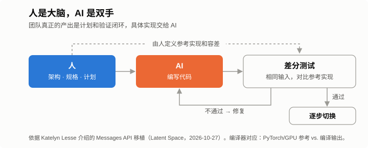
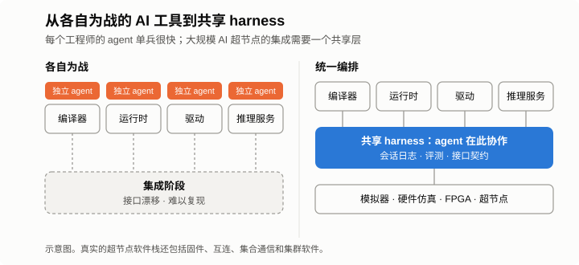



*系列第二篇，共三篇。[第一篇](/zh/2026/11/you-cant-avoid-the-hard-part/)讲了两次放弃稳妥路线、正面硬啃的经历。这一篇讲第三次，也是最近的一次，再看看它对编译器、运行时和周边基础设施有什么启发。*

今年早些时候，Anthropic 平台团队判断，Claude Messages API 很快会卡在 CPU 上。这个服务是一个 Python 单体。

技术上该怎么办很清楚：换成 Rust 这类系统语言重写。难的是人，团队里没有一个人写过 Rust。

他们还是动手了。大部分代码由 Claude 来写，10 月，Rust 版本全面上线。

这篇想聊三件事：这次重写里人和 AI 是怎么分工的；为什么分工方式比省下多少 CPU 更值得看；以及这对 AI 芯片公司意味着什么。芯片公司的编译器和运行时里，类似的活儿一抓一大把。

## 要点速览

**AI 写了大部分代码之后，有两件事变了。** 一是瓶颈从写代码挪到了证明代码正确；二是人和 agent 干活用的基础设施，变得和产品本身一样重要。

- **这次重写：** 人管架构、迁移计划和验证，AI 管实现。公开的数据是 CPU 消耗降了 40%–50%，首 token 延迟缩短 10%–20%。
- **编译器和工具链：** 先把差分测试搭起来；以前不敢碰的重写可以重新考虑；跟进上游可以自动化；确定性硬件能给 agent 一个干净的反馈；host 端 CPU 要算进每任务成本。
- **公司层面：** 共享的、统一编排的 agent 基础设施，和芯片、编译器一样重要。每个人各用各的 AI 工具，单兵很快，一到集成就慢下来，大规模 AI 超节点（pod）尤其明显。

## 这次重写是怎么做的

Anthropic 平台工程负责人 Katelyn Lesse 10 月 27 日上了 [Latent Space 播客](https://latent.space/p/how_anthropic_ships_the_1_llm_in_the_world_safely_separating_the_brain_from_the_hands/)，详细讲了这个项目。前一天，她还在 X 上发了一篇[长文](https://x.com/katelyn_lesse/status/2114542280535318557)，谈 agent 给工程师带来的新问题。

做法可以分三步看。

第一，定性为“移植”，不是重写。Rust 版本和 Python 版本行为一致之前，不加任何新功能。迁移期间别的团队还在往 Python 版本里加功能，移植团队就用静态分析把这些改动一个个标出来，提醒在 Rust 里也要补上。

第二，人做系统设计和迁移计划，具体实现大部分交给 Claude。

第三，用影子流量验证。Rust 服务接收和 Python 服务一样的请求，两边输出逐一比对，确认没问题了，再一点点把真实流量切过去。

结果是 CPU 消耗降了 40%–50%，首 token 延迟缩短 10%–20%，跑得越久的任务改善越明显。

Lesse 说，放在以前，她绝不会批准这样的迁移。这么大的重写，正常做法是拆成很多块，花好几年慢慢迁。

第一篇里那个问题在这里又用上了：假设风险最大的那一步做成了，计划的其他部分站得住吗？区别在于，有了 AI，这一步的成本降到了可以接受的程度。

## 人是大脑，AI 是双手

省下 CPU 本身不奇怪。一个吃 CPU 的服务从 Python 换成 Rust，有没有 AI 都会省。少见的是，一个没有 Rust 经验的团队，大约一年就完成了整体重写。

能做到，是因为团队很清楚哪些事必须自己来：

架构要人来定。这说到底还是一个分布式系统。

“做完”的标准要人来定。“和旧系统行为完全一致”这句话，要具体到能写成测试。

等价性要人来证明。影子流量那一整套比对机制，就是证据。

范围要人来守。移植没做完，新功能一概不加。

剩下的大量实现工作，交给 AI。

Anthropic 描述自家 agent 时用过一个说法：大脑和双手。放在这里也合适，人是大脑，AI 是双手。代码变便宜了，证明代码正确的成本并没有降。这个团队最有价值的产出，是那份计划和那套让 Rust 代码可信的验证体系，Rust 代码反倒是其次。

## 对 AI 芯片的编译器和工具链意味着什么

AI 芯片的软件栈里，到处是类似的活儿：一大坨代码要重写、要换目标平台，或者要跟着底下不停变化的东西保持一致。我觉得有六点可以借鉴。

**1. 差分测试就是编译器的影子流量。** 对编译器来说，“比对 Python 和 Rust 的输出”就变成了：同样的输入，分别跑参考实现（PyTorch eager 或 GPU）和自家编译器的输出，再做比对。随机生成计算图和 shape 可以扩大覆盖面，每个算子的数值容差要事先定好。这套框架要在 AI 动后端之前就搭好。没有它，AI 写的编译器代码是隐患；有了它，才谈得上提效。

**2. 以前不敢碰的重写，可以重新排进计划。** 每个芯片软件团队都有一张“一直想做、一直没做”的清单：后端迁到 MLIR，不再修补老 IR；host 端运行时和推理服务里的 Python 胶水代码换成 Rust 或 C++；新一代芯片出来，整个 kernel 库一次性移植；性能模型或模拟器用更快的语言重写。套路都一样：冻结功能，新旧并行，比对，切换。

**3. 跟进上游可以自动化。** vLLM 和 SGLang 每周都在变。Anthropic 用静态分析让 Python 和 Rust 保持同步，这个思路可以直接搬过来：每次 rebase，让 CI 把上游新增的算子、模型结构和调度功能跟后端已经支持的部分对一遍，列出缺口，再让 agent 起草实现，人来审。

**4. 确定性硬件能给 agent 一个干净的反馈。** Agent 靠不断尝试、测量来改进。在确定性、由编译器静态调度的芯片上，周期精确模拟器每次都能给出准确的周期数。Agent 搜索 tiling、调度策略或内存布局时，拿到的分数没有噪声。换成动态调度的硬件，同样的测量得跑很多遍，再做统计。

**5. 评测要多，先从简单的做起。** Lesse 的建议是，大多数团队需要的评测比自己以为的多，最常见的问题是一直在讨论用什么框架，结果一个评测都没建起来。编译器的第一版评测，可以就是一套按负载固定下来的测试集，覆盖正确性、性能和编译时间，agent 每提交一次改动就跑一遍。

**6. host 端 CPU 要算进每任务成本。** 这次重写本身就是被 CPU 成本逼出来的，推理服务的 host 端也有同样的压力。我在[上一篇读 Anthropic S-1 的文章](/zh/2026/10/anthropic-s1-inference-chips/)里提过，现在衡量价值要看每个任务，不能只看每个 token：每个成功任务的成本，等于每任务的 token 数乘以每 token 成本，再除以任务成功率。

一个 agent 任务往往要串行跑几十到几百步，每一步在 host 端都有一笔开销：调度、给越来越长的上下文做分词、前缀匹配、Python 层的各种簿记。只测单条长序列 decode 的 tokens/s，这笔开销根本看不到。几百步累积下来，它会拉长任务延迟，也决定了每颗加速器旁边要配多少 CPU 核。加速器越快，host 这部分的占比越大。所以要按每一步、每个任务去测，不能只盯着每个 token。

## 基础设施本身就是产品的一部分

“大脑和双手”不只是个比喻。Anthropic 就是这样描述 [Claude Managed Agents](https://www.anthropic.com/research/managed-agents) 架构的，也就是第一篇里那个第一版跑在单个容器里的系统。

重做之后，harness 和会话日志（大脑）跑在可信的基础设施上，AI 生成的代码放进随时可以销毁的沙箱（双手）里执行。凭据存在 Vault 里，只有请求离开沙箱的那一刻，才由代理注入。这个设计最早是为了解决延迟和稳定性问题，现在 Lesse 认为，它最重要的价值是安全。

放到 AI 芯片公司，我想强调的是另一点：这类基础设施由谁来建，什么时候建。我的看法是，人和 agent 干活用的基础设施，应该和芯片、编译器排在同一个优先级。

不这样做，会发生什么？

每个工程师各自用上 AI 工具。编译器工程师的 agent 越来越懂编译器，做运行时、驱动、集合通信、推理服务的同事也各有各的 agent。每个人都比以前快，但都是各干各的。每个 agent 只看得到自己的仓库、自己的测试，对周边接口的理解也全凭自己的假设。

集成之前，一切都好。

可一个 AI 超节点是个庞大的系统：芯片、板卡、互连、固件、驱动、运行时、编译器、集合通信、推理服务，再加上上层的集群软件。最难缠的缺陷，大多出在这些层的交界处。各干各的 agent 只做局部优化，接口在不知不觉中越走越偏；有的故障要三个组件同时在场才会出现，哪个 agent 都复现不了。前面在各自小圈子里省下的时间，到了集成阶段会花回去，还常常花得更多。

一套共享的、统一编排的 harness，能把这些交界处摊开来看：

- **共享的会话日志：** 所有 agent 的工作都记在一个地方，超节点层面的故障可以跨组件追查，也能在 agent 和人之间交接。
- **共享的环境：** 模拟器、硬件仿真、FPGA 原型、参考 GPU，以及后面的真实超节点，通过同一个接口提供给所有 agent，稀缺资源统一排队。
- **共享的评测和接口契约：** 超节点级的回归测试，加上可以机器检查的接口规格。某个 agent 改了运行时，立刻就知道它打破了编译器的哪条假设。
- **大脑和双手那一套安全措施：** 生成的代码在沙箱里跑，凭据和保密 IP 放在代理后面，长时间任务要有链路追踪和紧急停止开关，CPU 容量也要像其他算力一样提前规划。

这件事不能等平台团队有空了再做。它决定了整个产品多快能拼起来，而且在集成开始之前建好，比集成过程中再补要便宜得多。[第三篇](/zh/2026/11/agent-infra-chip-startup/)会参照两个最新的公开设计，聊聊一家小型芯片初创公司怎么把它建起来，要花多少钱。

## 几点保留

这些数字是 Anthropic 自己说的，没有公开测量方法和基线。而且 Rust 比 Python 省 CPU，不管代码是谁写的都在意料之中。

如果代码和测试都由 AI 来写，两者可能犯同一个错误。参考实现最好保持独立：由人来写，从规格推出来，或者干脆用另一套实现。

Agent 写的代码越多，人工审阅就越容易排成长队，团队会被推着去做更多自动化检查。

最后，这是一家公司的经验，讲述者本人就是这个平台的负责人。

## 写在最后

AI 芯片的编译器，评判标准一直是两条：跑得对，跑得快。AI 写的代码越多，越值钱的是证明这两条的基础设施，以及让一群 agent 和一群工程师像一个团队那样协作的共享 harness。先把这些建起来的团队，可以放心让 AI 去做大规模重写和系统集成；没建的团队，大概还在接口的交界处一个个查 bug。
