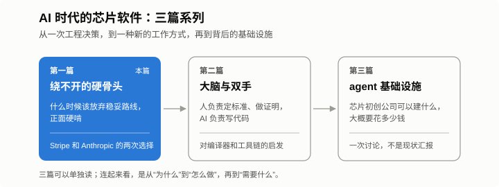



*“AI 时代的芯片软件”系列第一篇，共三篇。*

AI 开始替工程师写大部分代码之后，一家 AI 芯片公司的研发方式会怎么变？这个系列想用三篇文章把这个问题想一想。

第一篇讲一个老问题：项目里最难的那部分绕不开时，要不要正面硬啃。第二篇看 Anthropic 最近一次靠 AI 完成的整体重写，聊人和 AI 怎么分工，以及对编译器和工具链的启发。第三篇是一次讨论：一家芯片初创公司如果想让 agent 真正参与研发，需要搭什么样的基础设施，大概要花多少钱。

先说一个场景。

几位工程师在开 offsite，桌上的项目之前已经有团队做过，卡住了。

公司是 Stripe，一家美国在线支付公司，很多网站和平台背后的收款、付款和结算都是它在做。Stripe 想让一个用户在所有产品里只有一个账户：同一家企业，可能既在付订阅费，又在收客户的刷卡款，还在接收转账，最好用一份余额统一结算。

现有的数据模型做不到。客户、商户、收款方是三种不同的对象，公司里几乎所有支付和计费 API 都是照着这些对象写的。

Katelyn Lesse 当时在 Stripe Connect 团队，现在是 Anthropic 的平台工程负责人。她今年 7 月写了一篇 [《You can't avoid the hard part》](https://www.katelynlesse.com/blog/you-cant-avoid-the-hard-part)，讲的就是这件事。

## 看起来最稳的方案

既定方案很稳妥：旧模型不动，在旁边新建一套统一账户模型，新旧之间双向同步。这样现有代码一行都不用改。

放在 PPT 上，这个方案挑不出毛病。可真做下去，一家既当商户又当客户的企业，会在系统里同时存在三条记录：旧的商户账户、旧的客户对象，再加上新的统一账户。三条记录各存一份同样的名称和邮箱，而且必须永远保持一致。

改一次邮箱，三个地方都要同步；哪一处同步失败，数据就对不上。这样的同步很脆弱，业务一多也撑不住。

## 被否掉过一次的想法

讨论来讨论去，大家总绕回一个之前被否掉的想法，姑且叫它“封装”：在代码库里每一处读写前面加一层统一接口，让所有代码只跟新模型打交道。

它被否掉的理由很简单，工作量要按“工程年”来算。

这次他们换了个问法：假设最难的这一块真能做成，计划的其他部分站得住吗？答案是站得住。

于是事情就定了。几位对这个问题有兴趣的工程师接手，工作集中推进，主要靠 codemod 批量改代码。Lesse 也心里有数，这块很可能会成为整个项目里最慢的那条线。

最后花了好几个工程年，中间挫折不少。她的判断是，不走这一步，新账户体系根本上不了线。

## 第二次，在 Anthropic

很多年后，类似的选择又摆到她面前。

她的团队做 Claude Managed Agents 的第一版时，用的是最省事的办法：每个会话起一个容器，里面跑 Claude Code，所有东西都放在这个容器里。

早期客户用下来，问题一个接一个：启动慢；容器一挂，会话就没了；AI 生成的代码和各种凭据跑在同一个环境里。

团队先是哪里坏修哪里，花了大量时间排查卡死的会话，经常说不清问题出在 harness、事件流还是容器上。后来他们才看明白，这些毛病是同一个原因造成的：单容器这个设计本身。

要根治，就得把系统拆开，重做成真正的分布式系统。可公开测试版已经近在眼前。

他们又问了那个问题：用旧设计上线，能成吗？答案是不能。于是推迟发布，推倒重来。

## 华山只有一条路

Lesse 的结论很直接：如果最难的部分绕不开，"the safe path is just delaying failure"。稳妥路线只是把失败往后推。

华山自古一条路，想看日出，就得摸黑往上爬，凌晨赶到山顶。在山脚转来转去，找不到一条更好走的路。

她在文章结尾还提到一点，这也是这个系列的起点：AI 正在改变哪些事算“难”。过去要花几个工程年的 codemod，或者用一门团队没人会的语言整体重写，现在可能够得着了。

[第二篇](/zh/2026/10/humans-brain-ai-hands/)讲的就是这样一次革新：工程开发方式的改变，以及它对 AI 芯片公司的编译器和工具链意味着什么。[第三篇](/zh/2026/11/agent-infra-chip-startup/)是一次设想和讨论：一家小型芯片初创公司如果也想这样干活，可能需要建什么、要花多少钱。这还不是现实，是我们想做、但还有很长的路要走的事。先把它想清楚、讨论清楚，是第一步。
