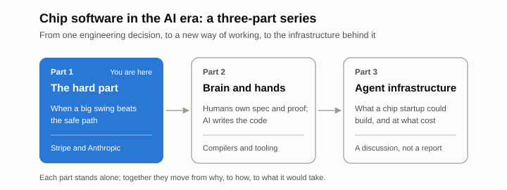



*Part 1 of 3 in a short series on how AI is changing the way chip software gets built.*

Once AI writes most of an engineer's code, how should an AI chip company change the way it does R&D? This series thinks it through in three parts: whether to take on the hardest part directly, what one AI-driven rewrite at Anthropic teaches, and what agent infrastructure a chip startup would need and what it might cost.

Picture a small group of engineers at an offsite. The project in front of them has stalled before. Stripe, the online payments company behind the checkout of countless websites and platforms, wants one user to be one account across all of its products: the same business might pay a subscription, accept card payments and receive payouts, with one balance covering all of it. The existing data model can't express that. Customers, merchants and recipients live in separate objects, and almost every payments and billing API in the company is written against those objects.

Katelyn Lesse, who now leads platform engineering at Anthropic, was working on Stripe Connect at the time. She tells the story in her July post, ["You can't avoid the hard part"](https://www.katelynlesse.com/blog/you-cant-avoid-the-hard-part).

The plan of record was the responsible one: build the new account model alongside the old ones and keep them in sync in both directions, so existing code wouldn't have to change. On a slide, it looked safe. In practice, a business acting as both merchant and customer would end up with three records of itself: its old merchant account, its old customer object, and the new unified account. All three would hold copies of the same name and email, and all three would have to stay consistent forever. The sync would be brittle, and it wouldn't scale.

The group kept coming back to an idea that had already been rejected once. Call it encapsulation: put a single interface in front of every read and write in the codebase, so all code talks to the new model only. It had been dismissed because the estimate was measured in engineering years. So they tried a different test. Assume the impossible part works. Does the rest of the plan hold? It did. The decision followed: a few engineers who were energized by the problem took ownership, the work stayed centralized and was driven by codemods, and Lesse accepted that it might become the longest pole in the whole program. The work ran to multiple engineering years, with plenty of setbacks. She believes the new accounts would never have shipped without it.

The second moment came years later, at Anthropic. Her team had built the first version of Claude Managed Agents the simple way: each session started a container with Claude Code inside, and everything lived in that container. Early customers saw slow starts, sessions that died with their container, and generated code running right next to credentials. The team patched each symptom separately and spent long stretches debugging sessions stuck somewhere between the harness, the event stream and the container. Eventually they saw one root cause: the single-container design itself. The fix was a real distributed system. Public beta was close. They asked the same question, could they launch on the old design and still succeed, answered no, and delayed the launch to rebuild.

Lesse's summary is blunt: when the hard part is unavoidable, "the safe path is just delaying failure."

Her closing point is where this series starts. AI is changing which problems count as hard. A multi-year codemod or a full rewrite in an unfamiliar language may now be within reach. [Part 2](/2026/10/humans-brain-ai-hands/) looks at one such shift in how engineering gets done, and what it means for compilers and tooling at an AI chip company. [Part 3](/2026/11/agent-infra-chip-startup/) is a thought exercise: what a small chip startup might need to build, and pay for, to work this way. It is not a description of something already running. It is something we want to do, with a long road ahead, and discussing it openly is the first step.
