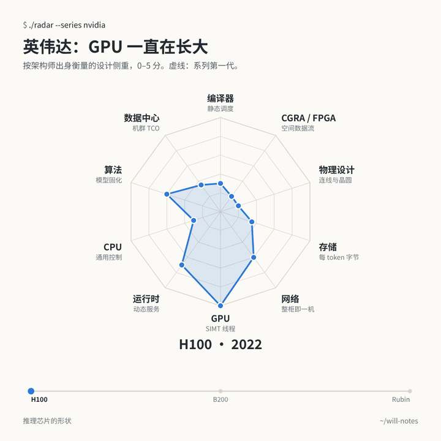
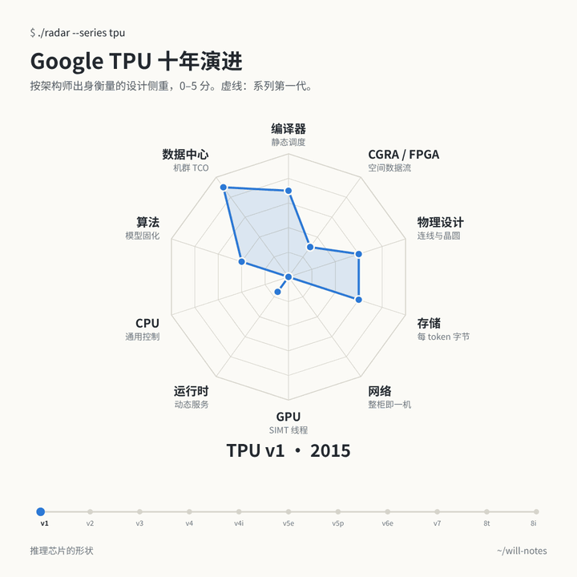



<link rel="stylesheet" href="/assets/chip-radar/radar.css">

前阵子读到 NeuralTalk 的一篇文章，讲「从芯片能看出设计团队出身」。周一到周五，我们做的是正向设计：从模型出发，协同设计芯片和软件栈。这个周末我反过来照了一回魔镜：拿已经出货的芯片，推敲它们的设计者当初想了什么。

魔镜魔镜告诉我，谁是世界上最好的推理芯片？

魔镜没有回答。它只是把每颗芯片照了一遍：照出 TPU 背后那群从不把调度交还给硬件的编译器工程师，照出 Groq 把仲裁器全部拿掉的执念，照出 Cerebras 干脆把整片晶圆做成一颗芯片的胆量，也照出英伟达这几年一边守住 CUDA、一边把网络、存储和推理服务一样样收进来的耐心。

这面镜子就是下面这张雷达图：2015 到 2026 年的 43 颗推理芯片，每颗按 10 个设计维度打 0–5 分，另外还拆开了 5 套「GPU + X」的异构系统，依据全部是公开论文、Hot Chips 报告和厂商文档。先玩，长文在后面。

**怎么看。** 每个维度对应一种工程师出身和它带来的直觉，比如「编译器 · 静态调度」。分数衡量的是这种直觉在多大程度上决定了芯片的关键设计。**面积大不代表芯片好**，十项全满分的芯片，大概是开会开出来的。悬停或点击任何一个点，能看到分数、置信度和一句话理由。「系列演进」可以播放一条产品线的变化，「异构系统」可以拆开看 GPU 加专用芯片的组合，「数据表」里是全部数字。

<nav class="toc" markdown="1">
**目录**

1. [芯片的形状，取决于设计者认为什么最稀缺](#idea)
2. [十个维度，以及它们为什么这样排](#axes)
3. [英伟达：多面手一直在长大](#nvidia)
4. [Google TPU：从 v2 起，编译器就再没放手](#tpu)
5. [其他 GPU：AMD 与华为昇腾](#othergpus)
6. [挑战者们，和背后的人](#challengers)
7. [云厂商自研：从电费账单出发](#hyperscalers)
8. [异构系统：切在哪里，比用哪两颗芯片更重要](#hetero)
9. [云、边缘、PC：一条站得住的差异](#deploy)
10. [八个流派，各自怕什么](#families)
11. [对编译器和运行时意味着什么](#software)
12. [方法、独立审计与局限](#method)
13. [参考来源](#sources)
</nav>

## 1. 芯片的形状，取决于设计者认为什么最稀缺 {#idea}

NeuralTalk 那篇[文章](https://mp.weixin.qq.com/s/TFExyhdJsxa7inerxCe8IQ)讲了一个很朴素的观察：看一颗 AI 芯片，往往能猜出团队是什么出身。做 GPU 出身的，会做线程和大寄存器堆。做编译器出身的，会把硬件仲裁拿掉，让编译器看清每一个周期。做后端物理设计的，盯着连线下手。做数据中心的，从电费开始算。

把这个观察变成问题，就能拿去问任何一颗芯片：**设计者认为什么资源最稀缺？为此选了哪种机制？代价交给了谁：硬件、编译器，还是服务系统？** 规格表告诉你算力和带宽，但不会告诉你设计者认为最难的是哪个问题。

这也能解释今年计算机历史博物馆一场[对谈](https://computerhistory.org/blog/the-silicon-gold-rush-how-ai-is-driving-development-of-new-chips/)里的分歧。David Patterson 认为 AI 加速器在「趋同演化」：大矩阵单元、高内存带宽、快速互联。英伟达的 Bill Dally 不同意它们都一样，他举的是数值格式、稀疏和网络。Google 的 Norm Jouppi 则说，TPU 从一开始就是按超级计算机来设计的。两边都对，雷达图正好把这一点画出来：大家的原料差不多，形状不同在于各自把注押在哪里。

团队经历确实会留下痕迹。不过比履历更有说服力的，是当事人亲口讲的一次选择：

- **当事人讲的一次选择。** Jonathan Ross 当年以 20% 项目的形式开启了 Google TPU，后来带着 [TPU 最早 10 人里的 8 位](https://www.electronicdesign.com/technologies/embedded-revolution/article/21805495/groq-secretive-startup-rooted-in-google-hires-top-xilinx-executive)创办 Groq。他说，即使自己参与设计了 TPU，[给它移植软件还是很难](https://moderncto.io/302-jonathan-ross-ceo-founder-at-groq/)，所以 Groq 先写编译器，再按编译器的需要设计硬件。这个先后顺序，在芯片上看得出来。
- **一个反例。** TPU v4 的光路交换后来对大模型训练很有帮助，但 [TPU v4 论文](https://arxiv.org/abs/2304.01433)写明，最初引入它是为了扩展规模和可靠性。拿今天跑得好的负载倒推当初的动机，故事就讲错了。
- **谱系是线索，不是证明。** Cerebras 的创始人来自高密度微服务器公司 [SeaMicro](https://research.contrary.com/report/cerebras)；SambaNova 出自 [Kunle Olukotun](https://profiles.stanford.edu/kunle-olukotun) 的 Niagara 和 Plasticine；AWS Trainium 来自先做 Nitro 卸载系统的 [Annapurna Labs](https://www.aboutamazon.com/news/aws/take-a-look-inside-the-lab-where-aws-makes-custom-chips)，首席架构师说他们先把整个系统设计好，再倒推芯片；华为达芬奇架构在内部[一场争论](https://eu.36kr.com/en/p/3934504849325442)里胜过了「做得像英伟达」的方案。这些都可以拿去问设计者，但不能证明是出身导致了某个选择。

在雷达图里点任何一颗芯片，卡片上的「设计团队」一行会告诉你它出自谁手。

## 2. 十个维度，以及它们为什么这样排 {#axes}

每个维度 0 到 5 分，问的都是同一个问题：**这种出身的思路，在多大程度上决定了芯片的关键设计？** 锚点是固定的，保证每个维度上的「3 分」是同一个意思。分数是作者对**设计侧重**的编码，不是性能、带宽或每 token 搬运字节的实测。

| 维度 · 直觉 | 0 分 | 5 分 |
|---|---|---|
| **编译器 · 静态调度** | 依赖全靠硬件动态发现 | 完全由编译器编排：没有互锁，编译器知道每个周期 |
| **CGRA / FPGA · 空间数据流** | 时分复用的核 | 芯片本身是空间阵列，整张图铺在空间上 |
| **物理设计 · 连线与晶圆** | 常规大 die，没有物理层面的押注 | 物理实现本身就是架构（晶圆级、冗余内建） |
| **存储 · 每 token 字节** | 存储按惯例配 | 围绕每 token 搬多少字节来设计（全 SRAM、存内计算） |
| **网络 · 整柜即一机** | 单卡思维 | 整个 pod 才是一台机器 |
| **GPU · SIMT 线程** | 没有 SIMT，不能通用编程 | 完整 SIMT、warp，CUDA 级可编程性 |
| **运行时 · 动态服务** | 一切由 host 驱动 | 按服务系统来设计（KV 分页、请求调度、prefill/decode） |
| **CPU · 通用控制** | 没有控制核、没有 cache | 一颗 CPU 挂了个矩阵单元 |
| **算法 · 模型固化** | 通用数据通路 | 模型本身做进了硅片 |
| **数据中心 · 机群 TCO** | 峰值算力优先 | 从所有者自己的机群经济账倒推出来（端侧芯片指每 token 能耗，是另一种量） |

**为什么这样排。** 雷达图里谁和谁挨着，会直接影响你看到的形状。可视化研究（[Ankerst 等，1998](https://bib.dbvis.de/uploadedFiles/180.pdf)；[Miller 等，2019](https://arxiv.org/abs/1908.00576)）建议把相关的维度放在一起，因为读者主要靠「尖角朝哪个方向」给形状分组。我们用自己的打分把全部 181,440 种环形排列都试了一遍。最后的顺序让关系强的维度挨着：存储与物理设计、物理设计与 CGRA、CGRA 与编译器、编译器与数据中心，以及 CPU、GPU、运行时这一簇；GPU 正对着编译器。读起来像一张地图：右半边是静态、空间、物理的一侧，左下是灵活、动态的一侧。GPU 的尖角朝下，TPU 和模型固化芯片朝上。

这只是一种排版选择，算不上发现。每颗芯片各算一次时，GPU 与编译器的相关系数是 −0.79；每个厂商各算一次，就只有 −0.54，因为样本里有 11 颗 TPU、6 颗英伟达 GPU。而且维度是我们自己定义的，相关性有一部分来自提问的方式。

## 3. 英伟达：多面手一直在长大 {#nvidia}

英伟达仍然是参照系，所以放在最前面。GPU 的形状和 TPU、Groq 正好相反：GPU 4.5 到 5 分，编译器 1.5 到 2 分，CGRA 接近 0。硬件靠线程和占用率隐藏延迟，编译器就不用知道每个周期。这正是 GPU 什么都能跑的原因。

| | 年份 | 变了什么 | 运行时 | 网络 | 存储 | 算法 | 数据中心 |
|---|---|---|---|---|---|---|---|
| [V100](https://images.nvidia.com/content/volta-architecture/pdf/volta-architecture-whitepaper.pdf) | 2017 | 第一代 Tensor Core；NVLink 2 | 2 | 2 | 1 | 1.5 | 1 |
| [A100](https://www.nvidia.com/content/dam/en-zz/Solutions/Data-Center/nvidia-ampere-architecture-whitepaper.pdf) | 2020 | TF32、2:4 稀疏；MIG 一卡切七 | 3 | 2.5 | 1.5 | 2 | 1.5 |
| H100 | 2022 | FP8 Transformer Engine | 3.5 | 3 | 1.75 | 3 | 1.75 |
| B200 | 2024 | 双 die；NVL72 机柜 | 3.5 | 4 | 2.25 | 3.25 | 3.25 |
| [B300](https://developer.nvidia.com/blog/inside-nvidia-blackwell-ultra-the-chip-powering-the-ai-factory-era/) | 2025 | 288 GB HBM3e；attention softmax 加速 2 倍 | 3.5 | 4 | 2.75 | 3.75 | 3.5 |
| [Rubin](https://developer.nvidia.com/blog/inside-the-nvidia-rubin-platform-six-new-chips-one-ai-supercomputer/) | 2026 | 六颗协同设计的芯片；KV cache 分层；Dynamo | 4.5 | 4.5 | 3.25 | 3.5 | 4 |

每一列往下看，都在稳定地累积：A100 的 MIG 是第一个真正的推理服务特性；NVLink 从 8 卡网格长到 72 卡机柜；单卡存储从 16 GB 涨到 288 GB，机柜层面还多了 KV cache 存储；数值格式和 attention 硬件一路向 transformer 靠拢。与此同时 GPU 分本身略降（5 到 4.5），因为 Blackwell 把矩阵计算挪进了异步 tile 引擎，多少游离在经典 SIMT 模型之外。多面手正把其他流派一个维度一个维度地吃进来。Dally 说「产品是整个系统」，画成图就是这样。

## 4. Google TPU：从 v2 起，编译器就再没放手 {#tpu}

TPU 是我们能找到的最好的自然实验：同一家公司，同一套软件栈，十年十一颗芯片。Google 2026 年在 IEEE Micro 上发表的[五代回顾](https://arxiv.org/abs/2606.15870)可以作为内部视角的印证：从 v2 到 Ironwood，双核微架构、脉动矩阵单元和编译器控制的存储一直没变，系统规模却扩大了 36 倍。

| 代 | 年份 | 定位 | 计算与控制 | 存储 | 扩展 |
|---|---|---|---|---|---|
| [v1](https://sites.coecis.cornell.edu/isca50retrospective/files/2023/06/Jouppi_2017_In_Datacenter.pdf) | 2015 | 推理 | 256×256 int8 脉动阵列；host 发 CISC 指令 | 8 GiB DDR3，片上 28 MiB | PCIe 卡 |
| [v2](https://www.hc32.hotchips.org/assets/program/conference/day2/HotChips2020_ML_Training_Google_Norrie_Patil.v01.pdf) | 2017 | 训练 | bf16 MXU；VLIW 由 XLA 调度；早期 SparseCore | 16 GiB HBM | 2D torus，256 芯片 |
| v3 | 2018 | 训练 | 每核 MXU 翻倍；液冷 | 32 GiB HBM | 1,024 芯片 |
| [v4](https://arxiv.org/abs/2304.01433) | 2020 | 训练 | SparseCore 处理 embedding | 32 GiB HBM | 3D torus，4,096 芯片，光路交换 |
| [v4i](https://conferences.computer.org/iscapub/pdfs/ISCA2021-4ghucdBnCWYB7ES2Pe4YdT/333300a001/333300a001.pdf) | 2020 | 推理 | 单核，风冷 | 8 GiB HBM + 128 MiB 片上 CMEM | 小规模 |
| [v5e](https://docs.cloud.google.com/tpu/docs/v5e) | 2023 | 性价比 | 按每美元定价 | 16 GB HBM | 256 芯片 |
| [v5p](https://docs.cloud.google.com/tpu/docs/v5p) | 2023 | 训练 | 旗舰 | 95 GB HBM | 8,960 芯片 |
| [v6e](https://docs.cloud.google.com/tpu/docs/v6e) | 2024 | 性价比 | 更大的 MXU | 32 GB HBM | 256 芯片 |
| [v7 Ironwood](https://docs.cloud.google.com/tpu/docs/tpu7x) | 2025（2026 年 3 月 GA） | 推理为主，也能训练 | FP8 | 192 GiB HBM | 9,216 芯片 |
| [8t](https://cloud.google.com/blog/products/compute/tpu-8t-and-tpu-8i-technical-deep-dive) | 2026 | 训练 | SparseCore + LLM decoder engine | 216 GB HBM，128 MB SRAM | 3D torus |
| [8i](https://cloud.google.com/blog/products/compute/tpu-8t-and-tpu-8i-technical-deep-dive) | 2026 | 推理服务、后训练 | 集合通信加速引擎（CAE） | 288 GB HBM，384 MB SRAM | Boardfly，最多 1,152 芯片 |

**v1 是协处理器，还不算编译器机器。** host 通过 PCIe 给它发十几条 CISC 指令，数据没到位时矩阵单元由硬件停下来等（编译器 3.5 分）。目标写得很直白：把推理的 [TCO 降低 10 倍](https://pages.cs.wisc.edu/~markhill/restricted/isca17_tpu_slides.pdf)，同时满足 7 ms 的 p99 延迟限制。从第一代 TPU 起，延迟就很重要。

**从 v2 开始，编译器接管了芯片。** VLIW 指令包和软件管理的存储，全部由 XLA 来排，此后每一代编译器都是 4.5 分。Google 自己那篇[《三代 TPU 的十条经验》](https://conferences.computer.org/iscapub/pdfs/ISCA2021-4ghucdBnCWYB7ES2Pe4YdT/333300a001/333300a001.pdf)也说，对 VLIW 加速器来说，编译器兼容比二进制兼容更重要。

**网络从无到有，一路长成整个 pod。** 网络分 0 → 3 → v4 的 5 分，一直保持到 Ironwood 的 9,216 芯片 pod。Jouppi 说的「从一开始就是超级计算机」在图上看得见，但要记住上面那个限定：光路交换最初是为了规模和可靠性。

**不太被注意的第二条线：成本。** v4i、v5e、v6e 是 TCO 优先的设计：风冷、pod 更小、HBM 更少。数据中心 4.5 到 5 分，网络只有 1 到 3 分。

**2026 年：推理有了自己的分支。** TPU 8i 片上 SRAM 翻了三倍，新增集合通信加速引擎专门加速 decode 时的归约，网络直径更小。它的存储（4 分）和运行时（3.5 分）是所有 TPU 里最高的。新意不在于 Google 开始重视延迟（v1 就重视），而在于为生成式推理和后训练单独做了一颗芯片。关于供货：博通在 [9 月的业绩会](https://www.nasdaq.com/articles/broadcom-q3-earnings-call-highlights)上说已开始量产出货 8i，并把 8t 称作联发科的版本。供货方不一定是架构决策者，TPU 是 Google 设计的。

## 5. 其他 GPU：AMD 与华为昇腾 {#othergpus}

**AMD** 走的是英伟达那条路，起点不同。MI300X 主打 chiplet、3D 堆叠和每美元的显存容量（物理设计 3.75 分，GPU 里最高）。[MI455X 和 Helios 机柜](https://www.storagereview.com/news/amd-mi455x-and-helios-432gb-hbm4-72-gpu-racks-and-a-real-answer-to-vera-rubin)加上了单卡最大的 HBM 和基于以太网的 scale-up。AMD 在推理上的其他押注方向一致：宣布收购 Taalas（见[第 6 节](#challengers)），并把 Instinct GPU 与 Cerebras 晶圆搭配（见[第 8 节](#hetero)）。

**华为昇腾**的形状是被供应限制塑造出来的。910C 数据中心只有 1 分，网络却有 4.75 分：单颗芯片弱一些，就用超大规模的光互联超节点来补。[昇腾 950](https://www.huawei.com/en/news/2025/9/hc-xu-keynote-speech) 保留了这个网络，在达芬奇 Cube 旁边加了 SIMT 编程路径（GPU 3 分），并把 prefill 和 decode 拆成了不同型号。架构的来历也合主题：3D Cube [在内部争论中胜过](https://eu.36kr.com/en/p/3934504849325442)了更像英伟达的方案，编译器被视为整个项目的「圣杯」。

## 6. 挑战者们，和背后的人 {#challengers}

创业公司的形状最极端，因为每家都把注押在一个想法上，而这个想法往往就是创始人的老本行。

**Groq：编译器派。** 编译器 5 分，存储 5 分，CPU 0 分。[ISCA 2022 论文](https://groq.com/wp-content/uploads/2024/02/GroqISCAPaper2022_ASoftwareDefinedTensorStreamingMultiprocessorForLargeScaleMachineLearning.pdf)描述的芯片在正常执行路径上没有 cache、没有仲裁器、没有互锁，连芯片之间的链路都在静态调度里。代价体现在运行时（0.75 分）：硬件里几乎不做动态的事，由 host 来承担。2025 年 12 月，英伟达拿到了 [Groq 技术的非独家授权，并招走了核心团队](https://www.sec.gov/Archives/edgar/data/1045810/000104581026000021/nvda-20260125.htm)；Groq 作为英伟达云合作伙伴继续运营推理云。[Groq 3 LP30](https://www.nvidia.com/en-us/data-center/lpx/) 保留了 SRAM 优先的芯片（每颗 500 MB），而 LPX 机柜另加了 12 TB DDR5 容量层。芯片工作存储、机柜容量层、服务调度是三层不同的东西，雷达图打的是芯片。

**Cerebras：系统派。** 物理设计 5 分，存储 5 分。一整片富含 SRAM 的晶圆，减少了必须跨网络传输的数据，但网络并没有消失：16 位的 70B 模型[至少要 4 台 CS-3](https://www.cerebras.ai/blog/introducing-cerebras-inference-ai-at-instant-speed)，2026 年的 CS-4 机柜里有三片晶圆。[SDK 文档](https://sdk.cerebras.ai/computing-with-cerebras)显示，每个核的硬件在数据到达时自动启动任务，编译器负责布局和路由，但不排周期（编译器 3.25 分）。

**SambaNova：CGRA 派。** CGRA 5 分。[SN40L 论文](https://arxiv.org/abs/2405.07518)把整段计算图铺在可重构数据流阵列上，配三级存储（SRAM、HBM、DDR），并把第三级存储和「让很多模型同时常驻」联系起来：同时服务大量模型时，机器规模最多可缩小 19 倍。谱系是真的（Plasticine 先商业化成了 SN10），但这是改造而不是照搬：原本全静态的互联变成了分组交换。

**Tenstorrent：CPU 派。** 数据中心芯片里 CPU 分最高（3.5 分）：750 多个小 RISC-V 核驱动计算单元，处处是以太网。创始人 Ljubisa Bajic 是 [ATI/AMD/英伟达出身的架构师](https://www.anandtech.com/show/16709)，CPU 老将 Jim Keller 后来出任 CEO。

**Taalas：同一个创始人，相反的押注。** 离开 Tenstorrent 后，Bajic 联合创办了 Taalas。它的 [HC1](https://taalas.com/the-path-to-ubiquitous-ai/) 把一个模型硬连线进芯片（Llama 3.1 8B，用 3/6 位量化，有一定质量损失）：全文唯一的算法 5 分，网络只有 0.5 分。AMD 在 2026 年 8 月[宣布收购 Taalas](https://ir.amd.com/news-events/press-releases/detail/1296)，到 AMD 11 月的财报文件里仍待交割。

**Etched 和 d-Matrix。** Etched Sohu 只跑 transformer（算法 4.5 分）。Etched 发过[一手的机制说明](https://www.etched.com/progress/frontier-inference-clusters)（低电压计算块、可拆分阵列、HBM/SRAM 混合），并在 2026 年 8 月[交付了首个机柜](https://www.etched.com/progress/from-zero-to-one)，但没有公开完整的微架构和编程模型，所以形状的置信度仍偏低。d-Matrix 在 SRAM 里做计算（存储 5 分），创始人来自 [Inphi 的数据中心互联业务](https://engineering.purdue.edu/Engr/AboutUs/News/Events/tech-summit/2025/sudeep-bhoja)。

## 7. 云厂商自研：从电费账单出发 {#hyperscalers}

Meta、AWS、微软自己有负载，自己付电费。它们最高的维度都是数据中心：Maia 200 和 MTIA 2i 都是 5 分，Trainium3 是 4.5 分。

- **AWS Inferentia2 和 Trainium3** 像是 TPU 的表亲：编译器 4 分，多个独立引擎由编译器同步，存储由软件管理。两者的扩展方式不同：[Inf2](https://aws.amazon.com/ec2/instance-types/inf2/) 用 NeuronLink 最多连 12 颗，[Trn3 UltraServer](https://aws.amazon.com/ec2/instance-types/trn3/) 通过 NeuronSwitch 最多连 144 颗。
- **微软 Maia 200** 出自 [Azure 硬件系统与基础设施部门](https://runasradio.com/Shows/Show/940)，芯片、系统和数据中心在一个团队里。那篇[架构详解](https://techcommunity.microsoft.com/blog/azureinfrastructureblog/deep-dive-into-the-maia-200-architecture/4489312)读起来像一个 TCO 模型，顺带附了一颗芯片。
- **Meta MTIA** 的 CPU 分出乎意料地高（3 分）：带 RISC-V 控制核和 cache，因为它最早是给推荐排序做的。2025 年 Meta [收购了 Rivos](https://www.hpcwire.com/?p=184116)，这家 RISC-V 公司此前就参与了 MTIA 的设计。据 [Meta](https://ai.meta.com/blog/meta-mtia-scale-ai-chips-for-billions/)，MTIA 400 已结束实验室测试，正在走向部署。

## 8. 异构系统：切在哪里，比用哪两颗芯片更重要 {#hetero}

2026 年最大的变化，是在一个请求里同时用两种形状的芯片。最直观的画法是给整个系统画一个合成形状。我们在早一版里这么做过，后来删掉了：审计发现，50 个系统分数里有 9 个落在两个组件的分数区间之外，任何加权都得不出来。系统整合也许会产生新能力，那就该把这个能力写出来，取平均说明不了它。打开「异构系统」：雷达图只画两个组件，表格写清谁来算、传什么、多久一次、证据有多硬。

最清楚的例子来自英伟达自己。对 Vera Rubin + Groq 3 LPX，英伟达描述了同样两类机柜上的[三种分工方式](https://developer.nvidia.com/blog/how-nvidia-groq-3-lpx-unlocks-ultrafast-interactivity-at-long-context-on-nvidia-vera-rubin/)：

| 切在哪里 | 谁来算 | 传什么、多久一次 | 该查的代价 |
|---|---|---|---|
| Prefill / decode | GPU 做 prefill，LPX 做 decode | KV cache，每轮对话一次 | 长提示词的 KV 传输会不会吃掉收益？ |
| Attention / FFN | GPU 留 KV 并算 attention，LPX 算 FFN/MoE | 中间激活，每个全注意力层一次 | 传输小但频繁，落在逐 token 关键路径上 |
| 草稿 / 验证 | LPX 用小模型出草稿，GPU 验证 | 草稿 token 与验证结果；两端各留自己的 KV | 接受率和验证批次 |

三种切法有三种不同的瓶颈，所以一个分数描述不了「这个系统」。证据也不一样：LPX 单独的速度是实测（Gemma 4 31B、100K 上下文，输出中位数 3,431 tokens/s），而联合 2T 模型的结果是投影。

另外四套组合都切在 prefill/decode 或草稿/验证，状态各不相同：AWS Trainium + Cerebras 已宣布，Bedrock 服务预计 2027 年一季度；SambaNova 7 月的演示用 [4 张 H200 做 prefill、16 颗 SN50 做 decode](https://sambanova.ai/blog/sn50-runs-fastest-minimax-speeds-in-the-world)；d-Matrix + GPU 经 Gimlet 做[投机解码](https://gimletlabs.ai/blog/low-latency-spec-decode-corsair)，1.6B 草稿模型跑在 Corsair 上，120B 目标模型跑在 GPU 上；Cerebras + AMD Instinct 预计 2026 年四季度量产。

还有两个对照必须放进来。拆分阶段不一定要两种芯片：[DistServe](https://www.usenix.org/conference/osdi24/presentation/zhong-yinmin) 就是把 prefill 和 decode 分到同一种 GPU 的不同池子里。OpenAI 与博通合作的 [Jalapeño](https://openai.com/index/jalapeno-first-results/) 走了相反的路：一种加速器兼顾两个阶段，尽量让 KV 留在本地（首批结果是厂商自测）。任何异构系统公平的比较对象，是同样质量、延迟和功耗下的同构分池，并且要把传输和排队开销算进去。

## 9. 云、边缘、PC：一条站得住的差异 {#deploy}

雷达图的「云与端」把各场景的形状取了平均。0–5 是序数分，取平均容易误导，所以站得住的结论用计数来讲：

| 分组 | 芯片数 | 存储 ≥ 3 | 存储 ≥ 4 |
|---|---|---|---|
| 云端，推理优先 | 14 | 12 / 14 | 8 / 14 |
| 云端，其余 | 23 | 7 / 23 | 3 / 23 |
| 边缘、PC、手机 | 6 | 0 / 6 | 0 / 6 |

在数据里出现的每一个分数门槛上，推理优先组的达标比例都不低于另外两组，所以这个差异不依赖于把 0–5 各档当成等距。它说明的是：**在这份样本和这套编码里，云端推理芯片在存储上的设计侧重最强。** 它不说明的是：这些芯片每 token 实际搬运更多字节，或者每位评分者都会得出同样结果。只看第一轮打分，就有一个门槛会反过来。

另外两点观察，把握要松一些：

- **只做推理的芯片大多舍弃了 SIMT。** 无论云端还是端侧，GPU 维度平均都不到 1 分。
- **到了端侧，网络消失了，编译器还在**（编译器平均 3.7 分）。端侧的「数据中心」分指每 token 能耗，和机群 TCO 不是同一个量，不要拿它的高低和云端芯片比。笔记本和手机上的 NPU 也带着各自的出身：AMD XDNA 2 就是[赛灵思 AI Engine](https://www.amd.com/en/technologies/xdna.html)（CGRA 4.5 分）；英特尔 NPU 来自 [Movidius](https://www.anandtech.com/show/18878)；高通 Hexagon 是 VLIW DSP 一路长大的（CPU 3.5 分）；苹果神经网络引擎只能通过 Core ML 用。端侧厂商披露得最少，这些形状的置信度也最低。

## 10. 八个流派，各自怕什么 {#families}

雷达图的「全部芯片」把所有形状分成八个流派。每个流派都只是关于「设计者认为什么最稀缺」的假设，动机并没有被证明：

1. **编译器优先、从机群出发**（TPU、Inferentia/Trainium、Maia）。**稀缺的是钱和电。** 编译器和数据中心都高。
2. **确定性、全 SRAM**（Groq）。**稀缺的是可预测性。** 编译器 5，存储 5，CPU 0。
3. **空间数据流与晶圆级**（Cerebras、SambaNova）。**稀缺的是片外带宽。** CGRA、存储、物理设计都高。
4. **模型固化**（Taalas、Etched）。**稀缺的是通用性吃掉的效率。** 算法高。
5. **存储优先**（d-Matrix）。**稀缺的是内存带宽。** 存储 5。
6. **偏 CPU 的众核**（Tenstorrent、MTIA）。**稀缺的是对明天负载的把握。** CPU 高。
7. **通用 GPU**（英伟达、AMD、华为）。**稀缺的是开发者。** GPU、网络、运行时都高。
8. **端侧 NPU。** **稀缺的是电池。** 网络 0。

这些判断没有对错之分，只是对「什么会稀缺」给了不同的答案：算力、带宽、功耗、开发者的时间，还是灵活性。异构系统之所以出现，部分是因为老实的答案是「在同一个请求的不同阶段，稀缺的东西不一样」。即便如此，第 8 节也说明了，同构分池是一个必须认真对待的替代方案。

## 11. 对编译器和运行时意味着什么 {#software}

对做软件栈（编译器、vLLM、SGLang）的人来说，有三个结论。

**「编译器」在不同形状上是不同的活。** 在 Groq 这样的芯片上，编译器就是调度器，精确到周期，跨芯片。在 TPU 或 Trainium 上，它要显式管理存储和同步。在 GPU 上，它主要负责生成好的 kernel，调度交给硬件。在 CGRA 上，它要做布局和布线。一套编译器架构要同时服务这四种，前提是它清楚自己在做的是哪一种活。

**服务层正在进入硬件设计。** 英伟达六代芯片的运行时分一路上涨，TPU 8i 也一样。KV cache 分层、prefill 与 decode 的放置、不同芯片之间的交接，现在都是设计的输入，不再是事后补丁。vLLM 和 SGLang 已经把 prefill-decode 解耦当成一等功能了，下一步是一个既理解不同芯片类型、也理解不同切法（按阶段、按层、按草稿）的调度器，而不只是理解不同节点。

**静态和动态的边界，现在是一个系统设计问题。** 当一颗确定性芯片和一颗动态芯片共同处理一个 token 时，总得有人在精确到周期的调度和 batch 大小、到达时间都在变的世界之间做翻译。这一层既不完全属于编译器，也不完全属于运行时。我觉得这是眼下推理硬件里最有意思的软件问题。

## 12. 方法、独立审计与局限 {#method}

**关于刻度。** 分数是 0–5，半分一档；两轮平均会产生 0.25 的步长，表里照实显示。我们考虑过改成 0–10，最后没有改。更细的刻度不会带来更多信息：锚点（0、1、3、5）是公开资料能定义清楚的仅有几个点，两位独立评分者在 450 格里已有 130 格相差半分。0–10 会让数字看起来比证据更精确，评分者之间的一致性大概率还会下降。那些 0.25 是平均的产物，不是测量结果。

**方法。** 资料只用公开来源：论文（ISCA、HPCA、OSDI、arXiv）、Hot Chips 报告、厂商架构文档、业绩会和财报文件，以及靠谱的技术媒体。用同一套评分标准做了两轮独立打分，一轮按芯片，一轮按维度。每个分数都附一句理由、一个出处和一个置信度；最终分数取两轮平均，置信度取较低者。最初 450 个分数里有 317 个完全一样，没有任何一个相差超过 1 分。两轮用的是同一批研究笔记，所以这说明的是一致性，不是彼此独立地得到了真相。

**两轮纠错。** 第二轮研究用一手资料替换了较弱的来源，改了 16 个分数。之后一位同事做了独立审计：从原始文件重算了全部数字，并对关键断言查了一手资料。审计找到了几处真实的错误，这一版都已改正。

审计还证明了合成的异构系统分数不可能是组件的加权，所以第 8 节改成了描述机制。它最有价值的建议，也是本文采纳的，是第 1 节的问法：什么最稀缺，选了哪种机制，代价交给了谁。

**局限。**
- **这些是判断，不是测量。** 评分标准保证了一致性，理由让每个分数可以核对，但换一个团队来打，很多格子会差半分。
- **轴序和八个流派是排版选择**，用我们自己的编码检验过，不是关于芯片的发现。
- **公开信息不均匀。** 端侧 NPU、Etched、d-Matrix Raptor、Google Tensor G5 披露较少，标为低置信度。资料缺失只表示置信度低，不表示「设计者没做这件事」。
- **分数衡量的是设计侧重，不是好坏或速度。** Groq 的 CPU 0 分和 Taalas 的网络 0.5 分都是有意的选择，不是缺陷。
- **谱系是线索，不是原因。** 大团队里什么背景都有，供货方也不等于架构师。
- **状态截至 2026 年 11 月 7 日。** AMD 收购 Taalas 待交割；英伟达和 Groq 之间是授权加人员招聘；LPX 机柜已量产；MTIA 400 正走向部署。

所有分数、理由和出处都在「数据表」和[数据文件](/assets/chip-radar/data.js)里，欢迎指正。

周末结束了，该切回正向设计。反向走过一遍，正向的那些问题现在有了更好的名字。

## 13. 参考来源 {#sources}

完整来源列表见[英文版](/2026/11/inference-chip-shapes/#sources)，每个分数对应的来源都在数据文件里。主要来源：

- [NeuralTalk：从架构师的出身看芯片设计](https://mp.weixin.qq.com/s/TFExyhdJsxa7inerxCe8IQ)；[硅谷淘金热：Patterson、Dally、Jouppi 在计算机历史博物馆的对谈](https://computerhistory.org/blog/the-silicon-gold-rush-how-ai-is-driving-development-of-new-chips/)
- 英伟达：[V100 白皮书](https://images.nvidia.com/content/volta-architecture/pdf/volta-architecture-whitepaper.pdf)；[A100 白皮书](https://www.nvidia.com/content/dam/en-zz/Solutions/Data-Center/nvidia-ampere-architecture-whitepaper.pdf)；[Blackwell Ultra 详解](https://developer.nvidia.com/blog/inside-nvidia-blackwell-ultra-the-chip-powering-the-ai-factory-era/)；[Rubin 平台详解](https://developer.nvidia.com/blog/inside-the-nvidia-rubin-platform-six-new-chips-one-ai-supercomputer/)
- TPU：[从 TPU v2 到 Ironwood 的五代回顾（IEEE Micro 2026）](https://arxiv.org/abs/2606.15870)；[v1（ISCA 2017）](https://sites.coecis.cornell.edu/isca50retrospective/files/2023/06/Jouppi_2017_In_Datacenter.pdf)；[三代 TPU 的十条经验（ISCA 2021）](https://conferences.computer.org/iscapub/pdfs/ISCA2021-4ghucdBnCWYB7ES2Pe4YdT/333300a001/333300a001.pdf)；[TPU v4（ISCA 2023）](https://arxiv.org/abs/2304.01433)；[TPU 8t / 8i 技术详解](https://cloud.google.com/blog/products/compute/tpu-8t-and-tpu-8i-technical-deep-dive)；[博通 2026 财年三季度业绩会要点](https://www.nasdaq.com/articles/broadcom-q3-earnings-call-highlights)
- Groq 与英伟达：[Groq ISCA 2022 论文](https://groq.com/wp-content/uploads/2024/02/GroqISCAPaper2022_ASoftwareDefinedTensorStreamingMultiprocessorForLargeScaleMachineLearning.pdf)；[英伟达 2026 财年 10-K（Groq 授权）](https://www.sec.gov/Archives/edgar/data/1045810/000104581026000021/nvda-20260125.htm)；[LPX 规格](https://www.nvidia.com/en-us/data-center/lpx/)；[LPX 与 Vera Rubin 的三种协作模式](https://developer.nvidia.com/blog/how-nvidia-groq-3-lpx-unlocks-ultrafast-interactivity-at-long-context-on-nvidia-vera-rubin/)
- [Cerebras SDK 文档](https://sdk.cerebras.ai/computing-with-cerebras)；[Cerebras 推理与内存墙](https://www.cerebras.ai/blog/introducing-cerebras-inference-ai-at-instant-speed)；[SambaNova SN40L 论文](https://arxiv.org/abs/2405.07518)；[Taalas HC1](https://taalas.com/the-path-to-ubiquitous-ai/)；[AMD 收购 Taalas](https://ir.amd.com/news-events/press-releases/detail/1296)；[Etched 技术说明](https://www.etched.com/progress/frontier-inference-clusters)
- 异构与同构：[AWS 与 Cerebras](https://press.aboutamazon.com/aws/2026/3/aws-and-cerebras-collaboration-aims-to-set-a-new-standard-for-ai-inference-speed-and-performance-in-the-cloud)；[SambaNova SN50 + H200 演示](https://sambanova.ai/blog/sn50-runs-fastest-minimax-speeds-in-the-world)；[Gimlet 在 Corsair 上做投机解码](https://gimletlabs.ai/blog/low-latency-spec-decode-corsair)；[DistServe（OSDI 2024）](https://www.usenix.org/conference/osdi24/presentation/zhong-yinmin)；[OpenAI Jalapeño 首批结果](https://openai.com/index/jalapeno-first-results/)
- [达芬奇架构，Hot Chips 31](https://www.old.hotchips.org/hc31/HC31_1.11_Huawei.Davinci.HengLiao_v4.0.pdf)；[华为全联接大会 2025 主题演讲](https://www.huawei.com/en/news/2025/9/hc-xu-keynote-speech)；[华为 AI 芯片之路（36 氪）](https://eu.36kr.com/en/p/3934504849325442)
- [Maia 200 架构详解](https://techcommunity.microsoft.com/blog/azureinfrastructureblog/deep-dive-into-the-maia-200-architecture/4489312)；[Meta MTIA](https://ai.meta.com/blog/meta-mtia-scale-ai-chips-for-billions/)；[Annapurna Labs（亚马逊）](https://www.aboutamazon.com/news/aws/take-a-look-inside-the-lab-where-aws-makes-custom-chips)
- 可视化：[Ankerst 等，1998](https://bib.dbvis.de/uploadedFiles/180.pdf)；[Miller 等，2019](https://arxiv.org/abs/1908.00576)

*感谢一位同事的独立审计，指出了早一版中的若干错误。*
