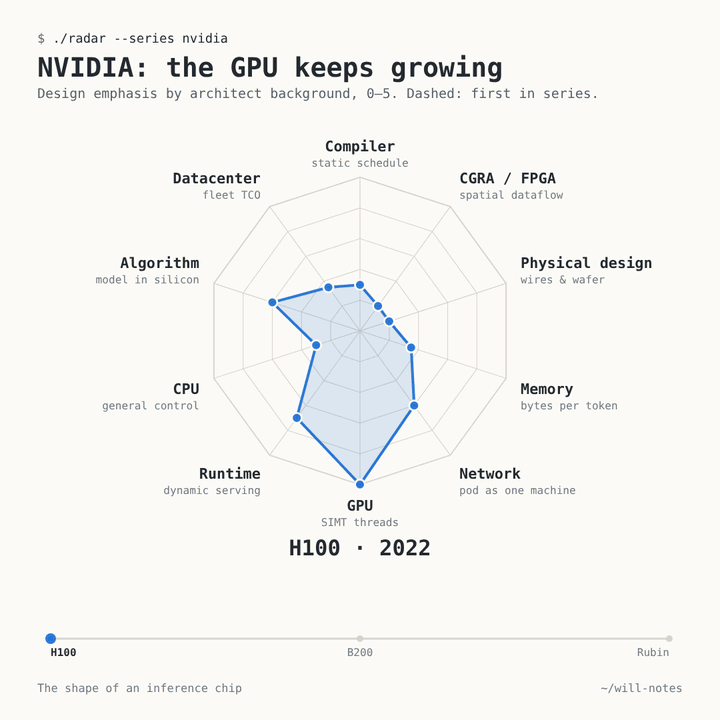
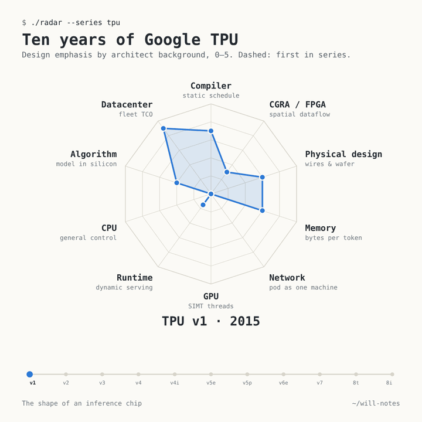



<link rel="stylesheet" href="/assets/chip-radar/radar.css">

Friday night, Spotify playing Ed Sheeran's biggest hit, and I was reading a post about how an AI chip betrays the background of the people who designed it. "Shape of You" became "the shape of chips", and the weekend study was on.

It is a different kind of work from my weekdays. Monday to Friday we design forward: start from the model and the serving goals, and co-design the chip and the software stack together. This study runs the other way. It takes the chips that shipped and asks what their designers were thinking during their own forward process: what they thought was scarce, and which mechanism they chose because of it. An empirical study, then, in the plain sense: take what is there and reason about the rationale behind it.

Every inference chip is a bet placed by people with a particular background, and the bet leaves a shape. Below are 43 chips from 2015 to 2026, each scored 0–5 on ten design axes from public papers, Hot Chips talks and vendor documentation, plus five systems that pair a GPU with a different accelerator. Start by playing with it; the long read follows.

**How to read it.** Each axis names an engineering background and the instinct it brings, for example *Compiler · static schedule*. The score says how strongly that instinct shaped the chip's defining decisions. **A bigger shape is not a better chip**; a chip with 5 on every axis would be a committee design. Hover or tap any point for the score, the confidence and the one-line reason. *Series* animates a product line, *Heterogeneous* opens up the GPU-plus-accelerator systems, and *Table* lists every number.

<nav class="toc" markdown="1">
**Contents**

1. [A chip is shaped by what its designers thought was scarce](#idea)
2. [The ten axes, and why they sit where they sit](#axes)
3. [NVIDIA: the generalist keeps growing](#nvidia)
4. [Google TPU: the compiler takes over at v2 and never leaves](#tpu)
5. [The other GPUs: AMD and Huawei Ascend](#othergpus)
6. [The challengers, and who built them](#challengers)
7. [Hyperscalers' own chips: designed from the bill](#hyperscalers)
8. [Heterogeneous systems: where you cut matters more than the chips](#hetero)
9. [Cloud, edge and PC: one robust difference](#deploy)
10. [Eight families, and what each one fears](#families)
11. [What this means for compilers and runtimes](#software)
12. [Method, an independent audit, and caveats](#method)
13. [Sources](#sources)
</nav>

## 1. A chip is shaped by what its designers thought was scarce {#idea}

A recent [NeuralTalk article](https://mp.weixin.qq.com/s/TFExyhdJsxa7inerxCe8IQ) made a simple observation: you can often tell an AI chip team's background from the chip. GPU people build threads and big register files. Compiler people remove hardware arbitration so the compiler can see every cycle. Physical-design people attack the wires. Datacenter people start from the electricity bill.

The more useful version of that idea is a question you can ask of any chip: **what did the designers think would be scarce, which mechanism did they pick because of it, and who pays the cost: the hardware, the compiler, or the serving system?** A spec sheet gives you TFLOPS and bandwidth. It does not tell you which problem the designers thought was the hard one.

This also explains a debate at a [Computer History Museum panel](https://computerhistory.org/blog/the-silicon-gold-rush-how-ai-is-driving-development-of-new-chips/) earlier this year. David Patterson suggested AI accelerators show "convergent evolution": big matrix units, high memory bandwidth, fast interconnect. Bill Dally of NVIDIA disagreed that they are all alike, pointing to number formats, sparsity and networking. Norm Jouppi of Google added that the TPU was designed as a supercomputer from the start. Both are right, and the radar shows how: every chip has the same broad ingredients, but the shapes differ in where each team put its bet.

Team history can leave a trace, but the best evidence is a decision someone described, not a résumé:

- **A decision, in the designer's own words.** Jonathan Ross started Google's TPU as a 20% project and left with [8 of its first 10 engineers](https://www.electronicdesign.com/technologies/embedded-revolution/article/21805495/groq-secretive-startup-rooted-in-google-hires-top-xilinx-executive) to found Groq. He has said that even having designed the TPU, he found [porting software to it hard](https://moderncto.io/302-jonathan-ross-ceo-founder-at-groq/), so Groq wrote the compiler first and designed hardware around it. That ordering shows up in the chip.
- **A counterexample.** TPU v4's optical circuit switches later turned out to help large-model training. But the [TPU v4 paper](https://arxiv.org/abs/2304.01433) says they were first introduced for scale and reliability. Reading today's winning workload back into the original motive would get the story wrong.
- **Lineages as leads, not proof.** Cerebras was founded by the [SeaMicro](https://research.contrary.com/report/cerebras) microserver team. SambaNova comes from [Kunle Olukotun's](https://profiles.stanford.edu/kunle-olukotun) Niagara and Plasticine work. AWS's Trainium comes from [Annapurna Labs](https://www.aboutamazon.com/news/aws/take-a-look-inside-the-lab-where-aws-makes-custom-chips), which built the Nitro offload system first; its chief architect describes designing the full system first and working backwards. Huawei's Da Vinci core won an [internal debate](https://eu.36kr.com/en/p/3934504849325442) against a design meant to look like NVIDIA's. These are good questions to ask the designers. They do not prove that a background caused a choice.

Pick any chip in the radar: the *Built by* line on its card says where the team came from.

## 2. The ten axes, and why they sit where they sit {#axes}

Each axis runs 0–5. The question is always the same: *how strongly does this background's instinct shape the chip's defining design decisions?* The anchors are fixed, so a 3 means the same thing on every axis. A score is the author's coding of **design emphasis**, not a measurement of performance, bandwidth or bytes moved.

| Axis · instinct | 0 means | 5 means |
|---|---|---|
| **Compiler · static schedule** | hardware discovers all dependencies | fully compiler-orchestrated: no interlocks, the compiler knows every cycle |
| **CGRA / FPGA · spatial dataflow** | time-multiplexed cores | the chip is a spatial fabric; whole graphs mapped in space |
| **Physical design · wires & wafer** | conventional big die, no physical bet | the physical implementation *is* the architecture (wafer scale, built-in redundancy) |
| **Memory · bytes per token** | memory follows convention | built around bytes per token (all-SRAM, in-memory compute) |
| **Network · pod as one machine** | single-device thinking | the machine is the pod |
| **GPU · SIMT threads** | no SIMT, not generally programmable | full SIMT, CUDA-class programmability |
| **Runtime · dynamic serving** | the host drives everything | designed as a serving machine (KV paging, request scheduling, prefill/decode) |
| **CPU · general control** | no control cores, no caches | a CPU with a matrix unit attached |
| **Algorithm · model in silicon** | generic datapath | the model itself is in silicon |
| **Datacenter · fleet TCO** | peak FLOPS first | designed from the owner's fleet economics outward (for edge chips: energy per token, which is a different quantity) |

**Why this order.** In a radar chart, which axes sit next to each other changes the shapes you see. The visualization literature ([Ankerst et al. 1998](https://bib.dbvis.de/uploadedFiles/180.pdf); [Miller et al. 2019](https://arxiv.org/abs/1908.00576)) suggests placing related dimensions next to each other, because readers group star shapes mostly by where their spikes point. We tested every circular order (181,440 of them) against our own scores. The chosen order keeps strongly related axes together: Memory–Physical, Physical–CGRA, CGRA–Compiler, Compiler–Datacenter, and the CPU/GPU/Runtime cluster. GPU sits opposite Compiler. The result reads like a map: the right half is the static, spatial, physical side, and the lower left is the flexible, dynamic side. GPUs point down; TPUs and model-in-silicon chips point up.

Treat this as a layout choice, not a discovery. The GPU–Compiler correlation is −0.79 when every chip counts once, but only −0.54 when each vendor counts once, because the sample has eleven TPUs and six NVIDIA GPUs. And the axes were defined by us, so part of any correlation comes from how the questions were asked.

## 3. NVIDIA: the generalist keeps growing {#nvidia}

NVIDIA is still the reference point, so it comes first. The GPU shape is the mirror image of the TPU and Groq shapes: GPU 4.5–5, Compiler 1.5–2, CGRA near zero. The hardware hides latency with threads and occupancy, so the compiler does not have to know every cycle. That is why a GPU runs everything.

| | Year | What changed | Runtime | Network | Memory | Algorithm | Datacenter |
|---|---|---|---|---|---|---|---|
| [V100](https://images.nvidia.com/content/volta-architecture/pdf/volta-architecture-whitepaper.pdf) | 2017 | first Tensor Cores; NVLink 2 | 2 | 2 | 1 | 1.5 | 1 |
| [A100](https://www.nvidia.com/content/dam/en-zz/Solutions/Data-Center/nvidia-ampere-architecture-whitepaper.pdf) | 2020 | TF32, 2:4 sparsity; MIG splits one GPU into 7 | 3 | 2.5 | 1.5 | 2 | 1.5 |
| H100 | 2022 | FP8 Transformer Engine | 3.5 | 3 | 1.75 | 3 | 1.75 |
| B200 | 2024 | two dies; NVL72 racks | 3.5 | 4 | 2.25 | 3.25 | 3.25 |
| [B300](https://developer.nvidia.com/blog/inside-nvidia-blackwell-ultra-the-chip-powering-the-ai-factory-era/) | 2025 | 288 GB HBM3e; 2x attention softmax | 3.5 | 4 | 2.75 | 3.75 | 3.5 |
| [Rubin](https://developer.nvidia.com/blog/inside-the-nvidia-rubin-platform-six-new-chips-one-ai-supercomputer/) | 2026 | six co-designed chips; KV-cache tiers; Dynamo | 4.5 | 4.5 | 3.25 | 3.5 | 4 |

Read down the columns and the story is steady accretion. A100's MIG was the first real serving feature. NVLink grew from an 8-GPU mesh to a 72-GPU rack. Memory grew from 16 GB to 288 GB per GPU, plus rack-level KV-cache storage. The number formats and the attention hardware moved towards the transformer. Meanwhile the GPU score itself dips slightly, from 5 to 4.5, because Blackwell moves matrix work into asynchronous tile engines that sit partly outside the classic SIMT model. The generalist absorbs the other schools one axis at a time, which is Dally's "the product is the whole system" in chart form.

## 4. Google TPU: the compiler takes over at v2 and never leaves {#tpu}

The TPU line is the closest thing we have to a natural experiment: one company, one software stack, eleven chips over ten years. Google's own [five-generation retrospective](https://arxiv.org/abs/2606.15870) (IEEE Micro, 2026) makes the same point from the inside: the two-core microarchitecture with systolic matrix units and compiler-controlled memory stayed stable from v2 to Ironwood while the system scaled 36× in node count.

| Gen | Year | Role | Compute and control | Memory | Scale-out |
|---|---|---|---|---|---|
| [v1](https://sites.coecis.cornell.edu/isca50retrospective/files/2023/06/Jouppi_2017_In_Datacenter.pdf) | 2015 | inference | 256×256 int8 systolic array; CISC instructions sent by the host | 8 GiB DDR3, 28 MiB on chip | PCIe card |
| [v2](https://www.hc32.hotchips.org/assets/program/conference/day2/HotChips2020_ML_Training_Google_Norrie_Patil.v01.pdf) | 2017 | training | bf16 MXUs; VLIW scheduled by XLA; early SparseCore | 16 GiB HBM | 2D torus, 256 chips |
| v3 | 2018 | training | twice the MXUs per core; liquid cooled | 32 GiB HBM | 1,024 chips |
| [v4](https://arxiv.org/abs/2304.01433) | 2020 | training | SparseCore for embeddings | 32 GiB HBM | 3D torus, 4,096 chips, optical circuit switches |
| [v4i](https://conferences.computer.org/iscapub/pdfs/ISCA2021-4ghucdBnCWYB7ES2Pe4YdT/333300a001/333300a001.pdf) | 2020 | inference | one core, air cooled | 8 GiB HBM + 128 MiB on-chip CMEM | small |
| [v5e](https://docs.cloud.google.com/tpu/docs/v5e) | 2023 | cost-efficient | priced per dollar | 16 GB HBM | 256 chips |
| [v5p](https://docs.cloud.google.com/tpu/docs/v5p) | 2023 | training | flagship | 95 GB HBM | 8,960 chips |
| [v6e](https://docs.cloud.google.com/tpu/docs/v6e) | 2024 | cost-efficient | larger MXUs | 32 GB HBM | 256 chips |
| [v7 Ironwood](https://docs.cloud.google.com/tpu/docs/tpu7x) | 2025 (GA Mar 2026) | inference-led, also training | FP8 | 192 GiB HBM | 9,216 chips |
| [8t](https://cloud.google.com/blog/products/compute/tpu-8t-and-tpu-8i-technical-deep-dive) | 2026 | training | SparseCore + LLM decoder engine | 216 GB HBM, 128 MB SRAM | 3D torus |
| [8i](https://cloud.google.com/blog/products/compute/tpu-8t-and-tpu-8i-technical-deep-dive) | 2026 | serving, post-training | Collectives Acceleration Engine | 288 GB HBM, 384 MB SRAM | Boardfly, up to 1,152 chips |

**v1 was a coprocessor, not yet a compiler machine.** The host sent it about a dozen CISC instructions over PCIe, and the matrix unit stalled in hardware when its data was not ready (Compiler 3.5). Its goal was explicit: cut the [TCO of inference by 10x](https://pages.cs.wisc.edu/~markhill/restricted/isca17_tpu_slides.pdf) while meeting a 7 ms p99 latency limit. Latency mattered from the very first TPU.

**From v2 on, the compiler owns the chip.** VLIW bundles and software-managed memory, scheduled by XLA: every TPU since scores 4.5 on Compiler. Google's own ["Ten Lessons"](https://conferences.computer.org/iscapub/pdfs/ISCA2021-4ghucdBnCWYB7ES2Pe4YdT/333300a001/333300a001.pdf) paper says compiler compatibility matters more than binary compatibility for VLIW accelerators.

**The network grows from nothing to the pod.** Network goes 0 → 3 → 5 at v4, and stays at 5 through Ironwood's 9,216-chip pods. Jouppi's "a supercomputer from the start" is visible in the chart, with the caveat above: the optical switches came in for scale and reliability first.

**A quiet second branch: cost.** v4i, v5e and v6e are TCO-first designs: air cooling, smaller pods, less HBM. They score 4.5–5 on Datacenter and only 1–3 on Network.

**2026: an inference branch of its own.** TPU 8i adds three times the on-chip SRAM, a Collectives Acceleration Engine for decode reductions and a lower-diameter network. Its Memory (4) and Runtime (3.5) are the highest of any TPU. What is new is not that Google cares about latency, which v1 already did, but a separate chip built for generative serving and post-training. On suppliers: Broadcom said on its [September earnings call](https://www.nasdaq.com/articles/broadcom-q3-earnings-call-highlights) that it began production shipments of 8i, and described 8t as the MediaTek version. A supplier is not necessarily the architecture owner; Google designs the TPU.

## 5. The other GPUs: AMD and Huawei Ascend {#othergpus}

**AMD** follows NVIDIA's path from a different starting point. MI300X led with chiplets and 3D stacking, and memory capacity per dollar (Physical 3.75, the highest among GPUs). [MI455X and the Helios rack](https://www.storagereview.com/news/amd-mi455x-and-helios-432gb-hbm4-72-gpu-racks-and-a-real-answer-to-vera-rubin) add the most HBM per GPU and Ethernet-based scale-up. AMD's other inference bets point the same way: it agreed to acquire Taalas ([section 6](#challengers)) and has paired Instinct GPUs with Cerebras wafers ([section 8](#hetero)).

**Huawei's Ascend** is shaped by supply constraints. The 910C scores 1 on Datacenter but 4.75 on Network: when individual chips are weaker, Huawei compensates with very large optical supernodes. The [Ascend 950](https://www.huawei.com/en/news/2025/9/hc-xu-keynote-speech) keeps that network, adds a SIMT path next to the Da Vinci cube (GPU 3), and splits prefill and decode into separate variants. The architecture's origin story fits the theme: the 3D cube [won an internal argument](https://eu.36kr.com/en/p/3934504849325442) against a more NVIDIA-like design, and the compiler was treated as the project's holy grail.

## 6. The challengers, and who built them {#challengers}

The startups have the most extreme shapes, because each bet on a single idea, usually the founders' own specialty.

**Groq: the compiler people.** Compiler 5, Memory 5, CPU 0. The [ISCA 2022 paper](https://groq.com/wp-content/uploads/2024/02/GroqISCAPaper2022_ASoftwareDefinedTensorStreamingMultiprocessorForLargeScaleMachineLearning.pdf) describes no caches, no arbiters and no interlocks on the normal execution path; even chip-to-chip links are part of the static schedule. The cost shows on Runtime (0.75): little dynamic work happens in hardware, so the host takes it on. In December 2025 NVIDIA took a [non-exclusive license and hired Groq's leaders](https://www.sec.gov/Archives/edgar/data/1045810/000104581026000021/nvda-20260125.htm); Groq continues to run its inference cloud as an NVIDIA Cloud Partner. The [Groq 3 LP30](https://www.nvidia.com/en-us/data-center/lpx/) keeps the SRAM-first chip (500 MB per chip), while the LPX rack adds a 12 TB DDR5 capacity tier. Chip working memory, rack capacity and serving schedule are three different layers, and the radar scores the chip.

**Cerebras: the system builders.** Physical 5, Memory 5. A whole wafer, rich in SRAM, reduces how much has to cross a network. It does not remove the network: a 70B model at 16 bits [needs at least four CS-3 systems](https://www.cerebras.ai/blog/introducing-cerebras-inference-ai-at-instant-speed), and the 2026 CS-4 rack holds three wafers. The [SDK](https://sdk.cerebras.ai/computing-with-cerebras) shows each core's hardware starting a task when its data arrives, so the compiler fixes placement and routes rather than cycles (Compiler 3.25).

**SambaNova: the CGRA people.** CGRA 5. The [SN40L paper](https://arxiv.org/abs/2405.07518) maps whole graph regions onto a reconfigurable dataflow fabric with three memory tiers (SRAM, HBM, DDR), and ties that third tier to keeping many models resident: up to 19× smaller machine footprint for many-model serving. The lineage is real (Plasticine was commercialized, first as SN10), but it was adapted, not transplanted: the original fully static interconnect became packet-switched.

**Tenstorrent: the CPU people.** The highest CPU score among datacenter chips (3.5): over 750 small RISC-V cores driving the compute tiles, Ethernet everywhere. Founder Ljubisa Bajic was an [ATI/AMD/NVIDIA architect](https://www.anandtech.com/show/16709), and CPU designer Jim Keller became CEO.

**Taalas: the same founder, the opposite bet.** After Tenstorrent, Bajic co-founded Taalas. Its [HC1](https://taalas.com/the-path-to-ubiquitous-ai/) hardwires one model (Llama 3.1 8B, with 3- and 6-bit quantization that costs some quality): the only Algorithm 5 in the study, with Network 0.5. AMD [agreed to acquire Taalas](https://ir.amd.com/news-events/press-releases/detail/1296) in August 2026; the deal was still pending at AMD's November filing.

**Etched and d-Matrix.** Etched's Sohu runs only transformers (Algorithm 4.5). Etched has published a [first-party note on its mechanisms](https://www.etched.com/progress/frontier-inference-clusters) (low-voltage compute blocks, splittable arrays, mixed HBM/SRAM) and [delivered its first rack](https://www.etched.com/progress/from-zero-to-one) in August 2026, but not a full microarchitecture or programming model, so its shape stays lower confidence. d-Matrix computes inside SRAM (Memory 5); its founders came from [Inphi's datacenter interconnect business](https://engineering.purdue.edu/Engr/AboutUs/News/Events/tech-summit/2025/sudeep-bhoja).

## 7. Hyperscalers' own chips: designed from the bill {#hyperscalers}

Meta, AWS and Microsoft own the workloads and pay the power bill. Their highest axis is Datacenter: Maia 200 and MTIA 2i score 5, Trainium3 4.5.

- **AWS Inferentia2 and Trainium3** look like cousins of the TPU: Compiler 4, separate engines synchronized by the compiler, software-managed memory. Scale-out differs by chip. [Inf2](https://aws.amazon.com/ec2/instance-types/inf2/) links up to 12 chips with NeuronLink, while [Trn3 UltraServers](https://aws.amazon.com/ec2/instance-types/trn3/) connect up to 144 chips through NeuronSwitch.
- **Microsoft Maia 200** comes out of [Azure Hardware Systems and Infrastructure](https://runasradio.com/Shows/Show/940), which owns silicon, systems and datacenter together. Its [architecture deep dive](https://techcommunity.microsoft.com/blog/azureinfrastructureblog/deep-dive-into-the-maia-200-architecture/4489312) reads like a TCO model with a chip attached.
- **Meta MTIA** has a surprisingly high CPU score (3): RISC-V control cores and caches, because its first job was recommendation ranking. Meta [bought Rivos](https://www.hpcwire.com/?p=184116), the RISC-V startup that had helped design MTIA, in 2025. Per [Meta](https://ai.meta.com/blog/meta-mtia-scale-ai-chips-for-billions/), MTIA 400 has finished lab testing and is heading to deployment.

## 8. Heterogeneous systems: where you cut matters more than the chips {#hetero}

The biggest change in 2026 is systems that combine two chip shapes in one request. The obvious way to chart them would be a combined system shape. We did that in an earlier draft and removed it. An audit found that on 9 of 50 cells, the system score fell outside the range of its two components, so no weighting of the components could produce it. Integration may create new capability, but then the capability should be written down rather than averaged. Open the *Heterogeneous* tab: the radar shows the two components, and the table says who computes, what moves, how often, and how solid the evidence is.

The clearest case is NVIDIA's own. For Vera Rubin plus Groq 3 LPX, NVIDIA describes [three different ways to split the work](https://developer.nvidia.com/blog/how-nvidia-groq-3-lpx-unlocks-ultrafast-interactivity-at-long-context-on-nvidia-vera-rubin/) on the same two rack types:

| Where you cut | Who computes | What moves, how often | What to check |
|---|---|---|---|
| Prefill / decode | GPU prefill, LPX decode | KV cache, once per turn | does moving a long prompt's KV eat the gain? |
| Attention / FFN | GPU keeps KV and runs attention; LPX runs FFN/MoE | activations, at every full-attention layer | small, frequent transfers on the per-token critical path |
| Draft / verify | LPX drafts with a small model, GPU verifies | draft tokens and verdicts; each side keeps its own KV | acceptance rate and verify batching |

The three cuts have three different bottlenecks, so one score cannot describe "the system". Evidence also differs: LPX-alone speed (3,431 output tokens/s median on Gemma 4 31B at 100K context) is measured, while the joint 2T-model result is a projection.

The other four pairings all cut at prefill/decode or draft/verify, and their status varies. AWS Trainium + Cerebras is announced, with Bedrock service expected in Q1 2027. SambaNova's July demo paired [4 H200s for prefill with 16 SN50s for decode](https://sambanova.ai/blog/sn50-runs-fastest-minimax-speeds-in-the-world). d-Matrix + GPU via Gimlet runs [speculative decoding](https://gimletlabs.ai/blog/low-latency-spec-decode-corsair) with a 1.6B draft model on Corsair and a 120B target on GPUs. Cerebras + AMD Instinct is expected in production in Q4 2026.

Two contrasts keep this honest. Splitting phases does not require two kinds of chips: [DistServe](https://www.usenix.org/conference/osdi24/presentation/zhong-yinmin) splits prefill and decode across pools of identical GPUs. And OpenAI's [Jalapeño](https://openai.com/index/jalapeno-first-results/), built with Broadcom, takes the opposite route: one accelerator handles both phases and keeps the KV cache local (its first results are vendor-reported). The fair comparison for any heterogeneous system is a homogeneous split at the same quality, latency and power, with transfer and queueing costs counted.

## 9. Cloud, edge and PC: one robust difference {#deploy}

The *Cloud vs edge* tab averages the shapes by deployment. Averages of ordinal scores can mislead, so the result worth keeping is stated as counts:

| Group | Chips | Memory ≥ 3 | Memory ≥ 4 |
|---|---|---|---|
| Cloud, inference-first | 14 | 12 / 14 | 8 / 14 |
| Cloud, everything else | 23 | 7 / 23 | 3 / 23 |
| Edge, PC and phone | 6 | 0 / 6 | 0 / 6 |

At every score threshold that occurs in the data, the inference-first group has the higher or an equal share. So the difference does not depend on treating the 0–5 steps as evenly spaced. What it says: **in this sample and this coding, cloud inference chips put the most design emphasis on memory.** What it does not say: that they move more bytes per token, or that every scorer would agree. Taking only the first scoring pass, one threshold reverses.

Two more observations, held more loosely:

- **Inference-first chips mostly drop SIMT.** They average under 1 on the GPU axis, in cloud and on the edge alike.
- **On the edge, the network disappears and the compiler stays** (Compiler 3.7 on average). The edge chips' "Datacenter" score means energy per token, which is not the same quantity as fleet TCO, so do not compare its height with the cloud chips. Each laptop and phone NPU also carries its lineage: AMD's XDNA 2 is the [Xilinx AI Engine](https://www.amd.com/en/technologies/xdna.html) (CGRA 4.5), Intel's NPU comes from [Movidius](https://www.anandtech.com/show/18878), Qualcomm's Hexagon grew out of a VLIW DSP (CPU 3.5), and Apple's Neural Engine is reachable only through Core ML. Edge vendors disclose the least, so these shapes carry the lowest confidence.

## 10. Eight families, and what each one fears {#families}

The *All chips* tab groups every shape into eight families. Read each one as a hypothesis about what its designers thought was scarce, not as a proven motive:

1. **Compiler-first, designed from the fleet** (TPU, Inferentia/Trainium, Maia). *Scarce: money and power.* Compiler and Datacenter both high.
2. **Deterministic, all-SRAM** (Groq). *Scarce: predictability.* Compiler 5, Memory 5, CPU 0.
3. **Spatial dataflow and wafer scale** (Cerebras, SambaNova). *Scarce: off-chip bandwidth.* CGRA, Memory and Physical high.
4. **Model in silicon** (Taalas, Etched). *Scarce: the efficiency that generality costs.* Algorithm high.
5. **Memory-first** (d-Matrix). *Scarce: memory bandwidth.* Memory 5.
6. **CPU-flavoured many-core** (Tenstorrent, MTIA). *Scarce: knowing tomorrow's workload.* CPU high.
7. **Generalist GPUs** (NVIDIA, AMD, Huawei). *Scarce: developers.* GPU, Network and Runtime high.
8. **On-device NPUs.** *Scarce: battery.* Network 0.

None of these is wrong. They are different answers to what will be scarce: compute, bandwidth, power, developer time or flexibility. Heterogeneous systems exist partly because the honest answer is "different things, in different phases of the same request". Even then, as section 8 shows, a homogeneous split is a serious alternative.

## 11. What this means for compilers and runtimes {#software}

For people working on the software stack (compilers, vLLM, SGLang), three conclusions follow.

**"The compiler" is a different job on each shape.** On a Groq-style chip, the compiler is the scheduler, down to the cycle and across chips. On a TPU or Trainium, it manages memory and synchronization explicitly. On a GPU, it mostly generates good kernels and leaves scheduling to hardware. On a CGRA, it places and routes. One compiler architecture can serve all four only if it is clear about which job it is doing.

**The serving layer is moving into the hardware design.** Runtime scores rise across NVIDIA's six generations and on TPU 8i. KV-cache tiering, prefill and decode placement, and handoffs between chip types are now design inputs, not afterthoughts. vLLM and SGLang already treat prefill-decode disaggregation as a first-class feature. The next step is a scheduler that understands different chip types and different cuts (phase, layer or draft), not just different nodes.

**The static-dynamic boundary is now a system-design problem.** When a deterministic chip and a dynamic chip share a token, something must translate between a cycle-exact schedule and a world of variable batch sizes and arrival times. That layer belongs neither cleanly to the compiler nor to the runtime. It may be the most interesting software problem in inference hardware right now.

## 12. Method, an independent audit, and caveats {#method}

**On the scale.** Scores are 0–5 in half-point steps, and averaging two passes produces quarter points, which the table shows as they are. We considered moving to 0–10 and decided against it. A finer scale would not add information: the anchors (0, 1, 3, 5) are the only points we can define from public evidence, and two independent scorers already disagree by half a point on 130 of 450 cells. A 0–10 scale would make the numbers look more precise than the evidence allows, and would likely lower agreement between scorers. The quarter points are averaging artefacts, not measurements.

**Method.** All research used public sources: papers (ISCA, HPCA, OSDI, arXiv), Hot Chips talks, vendor architecture documents, earnings calls and filings, and reputable technical press. Two independent scoring passes used the same rubric, one chip by chip and one axis by axis. Every score carries a one-line reason, a source and a confidence level. The final score is the mean of the two passes, with the lower confidence. Of 450 original scores, 317 matched exactly and none differed by more than one point. Both passes worked from the same research notes, so this measures consistency, not independent truth.

**Two rounds of correction.** A second research round replaced weak sources with primary ones and changed 16 scores. Then a colleague ran an independent audit. It recomputed every number from the raw files and checked key claims against primary sources. It found several real errors, all fixed in this version.

It also showed that the combined heterogeneous-system scores could not be component weightings, which is why section 8 now describes mechanisms instead. Its strongest suggestion, which we adopt, is the framing in section 1: ask what was scarce, which mechanism was chosen, and who pays.

**Caveats.**
- **These are judgements, not measurements.** The rubric makes them consistent and the reasons make them checkable, but another team would land half a point away on many cells.
- **The axis order and the eight families are layout choices,** checked against our own coding, not discoveries about the chips.
- **Public information is uneven.** Edge NPUs, Etched, d-Matrix Raptor and Google's Tensor G5 rest on thinner disclosure and are marked low confidence. Missing information is shown as low confidence, not as "the designers didn't do this".
- **Scores measure design emphasis, not quality or speed.** Groq's CPU 0 and Taalas's Network 0.5 are deliberate choices, not failings.
- **Lineage is a lead, not a cause.** Large teams have many backgrounds, and a supplier is not the architect.
- **Status as of 7 November 2026.** AMD's Taalas deal is pending. NVIDIA's arrangement with Groq is a license plus hiring. LPX racks are in production; MTIA 400 is heading to deployment.

Every score, reason and source is in the *Table* tab and the [data file](/assets/chip-radar/data.js). Corrections are welcome.

The weekend is over, and I am switching back to forward design. The nice thing about having done the reverse study is that the forward questions now have better names.

## 13. Sources {#sources}

The lens and the method:
- [The Silicon Gold Rush: Patterson, Dally and Jouppi at the Computer History Museum](https://computerhistory.org/blog/the-silicon-gold-rush-how-ai-is-driving-development-of-new-chips/)
- [NeuralTalk on WeChat: reading chip design through the architect's background](https://mp.weixin.qq.com/s/TFExyhdJsxa7inerxCe8IQ)
- [Ankerst et al., similarity clustering of dimensions (1998)](https://bib.dbvis.de/uploadedFiles/180.pdf); [Miller et al., axis order in star glyphs (2019)](https://arxiv.org/abs/1908.00576)

Google TPU:
- [Jouppi et al., TPU v1 (ISCA 2017), ISCA@50 retrospective copy](https://sites.coecis.cornell.edu/isca50retrospective/files/2023/06/Jouppi_2017_In_Datacenter.pdf) and [ISCA 2017 slides](https://pages.cs.wisc.edu/~markhill/restricted/isca17_tpu_slides.pdf)
- [Ten Lessons From Three Generations Shaped Google's TPUv4i (ISCA 2021)](https://conferences.computer.org/iscapub/pdfs/ISCA2021-4ghucdBnCWYB7ES2Pe4YdT/333300a001/333300a001.pdf)
- [TPU v4 (ISCA 2023)](https://arxiv.org/abs/2304.01433); [Google's training supercomputers from TPU v2 to Ironwood (IEEE Micro 2026)](https://arxiv.org/abs/2606.15870); [TPU v2/v3 at Hot Chips 2020](https://www.hc32.hotchips.org/assets/program/conference/day2/HotChips2020_ML_Training_Google_Norrie_Patil.v01.pdf); [Ironwood at Hot Chips 2025](https://hc2025.hotchips.org/assets/program/conference/day2/61_Google_Ironwood-Final.pdf)
- [TPU 8t and 8i technical deep dive (Google Cloud)](https://cloud.google.com/blog/products/compute/tpu-8t-and-tpu-8i-technical-deep-dive); [Broadcom Q3 FY2026 call highlights (8i shipments)](https://www.nasdaq.com/articles/broadcom-q3-earnings-call-highlights)
- Google Cloud docs: [v5e](https://docs.cloud.google.com/tpu/docs/v5e), [v5p](https://docs.cloud.google.com/tpu/docs/v5p), [v6e](https://docs.cloud.google.com/tpu/docs/v6e), [TPU7x](https://docs.cloud.google.com/tpu/docs/tpu7x)

NVIDIA GPUs:
- [Volta V100 whitepaper](https://images.nvidia.com/content/volta-architecture/pdf/volta-architecture-whitepaper.pdf); [Ampere A100 whitepaper](https://www.nvidia.com/content/dam/en-zz/Solutions/Data-Center/nvidia-ampere-architecture-whitepaper.pdf); [Inside Blackwell Ultra](https://developer.nvidia.com/blog/inside-nvidia-blackwell-ultra-the-chip-powering-the-ai-factory-era/)

Groq and NVIDIA:
- [NVIDIA FY2026 10-K, Note 2 (Groq license)](https://www.sec.gov/Archives/edgar/data/1045810/000104581026000021/nvda-20260125.htm); [NVIDIA LPX specifications](https://www.nvidia.com/en-us/data-center/lpx/); [How Groq 3 LPX works alongside Vera Rubin: three collaboration modes](https://developer.nvidia.com/blog/how-nvidia-groq-3-lpx-unlocks-ultrafast-interactivity-at-long-context-on-nvidia-vera-rubin/)
- [Groq ISCA 2022 paper](https://groq.com/wp-content/uploads/2024/02/GroqISCAPaper2022_ASoftwareDefinedTensorStreamingMultiprocessorForLargeScaleMachineLearning.pdf); [Groq at Hot Chips 34](https://hc34.hotchips.org/assets/program/conference/day2/Machine%20Learning/HotChips34%20-%20Groq%20-%20Abts%20-%20final.pdf)
- [Inside NVIDIA Groq 3 LPX](https://developer.nvidia.com/blog/inside-nvidia-groq-3-lpx-the-low-latency-inference-accelerator-for-the-nvidia-vera-rubin-platform); [Inside the NVIDIA Rubin platform](https://developer.nvidia.com/blog/inside-the-nvidia-rubin-platform-six-new-chips-one-ai-supercomputer/)

Spatial and specialized:
- [Cerebras SDK: computing with Cerebras](https://sdk.cerebras.ai/computing-with-cerebras); [Cerebras inference and the memory barrier](https://www.cerebras.ai/blog/introducing-cerebras-inference-ai-at-instant-speed); [Cerebras at Hot Chips 2024](https://www.hc2024.hotchips.org/assets/program/conference/day2/72_HC2024.Cerebras.Sean.v03.final.pdf); [Cerebras on disaggregated inference](https://www.cerebras.ai/blog/disaggregated-inference)
- [SambaNova SN40L (arXiv)](https://arxiv.org/abs/2405.07518); [SN50 announcement](https://sambanova.ai/blog/introducing-the-sn50-rdu-purpose-built-for-agentic-inference)
- [Tenstorrent interview, AnandTech](https://www.anandtech.com/show/16709); [Blackhole, The Register](https://www.theregister.com/2024/08/27/tenstorrent_ai_blackhole/)
- [Taalas: the path to ubiquitous AI](https://taalas.com/the-path-to-ubiquitous-ai/); [AMD to acquire Taalas](https://ir.amd.com/news-events/press-releases/detail/1296); [Taalas HC1, CNX Software](https://www.cnx-software.com/2026/02/22/taalas-hc1-hardwired-llama-3-1-8b-ai-accelerator-delivers-up-to-17000-tokens-s/)
- [Etched: frontier inference clusters](https://www.etched.com/progress/frontier-inference-clusters); [Etched: first rack](https://www.etched.com/progress/from-zero-to-one)
- [d-Matrix Corsair at Hot Chips 2025](https://www.servethehome.com/d-matrix-presents-corsair-an-in-memory-computing-architecture-for-inference-at-hot-chips-2025/); [d-Matrix and Gimlet](https://www.datacenterknowledge.com/infrastructure/d-matrix-gimlet-labs-partner-to-boost-agentic-ai-inference-performance)

Hyperscalers:
- [MTIA (ISCA 2025)](https://aisystemcodesign.github.io/papers/MTIA-ISCA25.pdf); [Meta MTIA at scale (Meta)](https://ai.meta.com/blog/meta-mtia-scale-ai-chips-for-billions/); [Meta acquires Rivos (HPCwire)](https://www.hpcwire.com/?p=184116)
- [Trainium/Inferentia2 architecture (AWS Neuron docs)](https://awsdocs-neuron.readthedocs-hosted.com/en/v2.32.0/_sources/nki/guides/architecture/trainium_inferentia2_arch.rst); [Inside Annapurna Labs (Amazon)](https://www.aboutamazon.com/news/aws/take-a-look-inside-the-lab-where-aws-makes-custom-chips); [Inf2](https://aws.amazon.com/ec2/instance-types/inf2/) and [Trn3](https://aws.amazon.com/ec2/instance-types/trn3/) instance pages
- [Maia 200 architecture deep dive (Microsoft)](https://techcommunity.microsoft.com/blog/azureinfrastructureblog/deep-dive-into-the-maia-200-architecture/4489312)

GPUs and Ascend:
- [AMD MI300 architecture (ROCm docs)](https://rocm.docs.amd.com/en/latest/reference/gpu-arch/mi300.html); [MI455X and Helios (StorageReview)](https://www.storagereview.com/news/amd-mi455x-and-helios-432gb-hbm4-72-gpu-racks-and-a-real-answer-to-vera-rubin)
- [Da Vinci at Hot Chips 31 (Huawei)](https://www.old.hotchips.org/hc31/HC31_1.11_Huawei.Davinci.HengLiao_v4.0.pdf); [Huawei Connect 2025 keynote](https://www.huawei.com/en/news/2025/9/hc-xu-keynote-speech); [The road of Huawei's AI chips (36Kr)](https://eu.36kr.com/en/p/3934504849325442)

Heterogeneous and homogeneous serving:
- [AWS and Cerebras collaboration](https://press.aboutamazon.com/aws/2026/3/aws-and-cerebras-collaboration-aims-to-set-a-new-standard-for-ai-inference-speed-and-performance-in-the-cloud); [SambaNova SN50 + H200 demo](https://sambanova.ai/blog/sn50-runs-fastest-minimax-speeds-in-the-world); [Gimlet: speculative decoding on Corsair](https://gimletlabs.ai/blog/low-latency-spec-decode-corsair); [AMD and Cerebras](https://ir.amd.com/news-events/press-releases/detail/1293/amd-and-cerebras-announce-industry-leading-ultra-low-latency-and-high-throughput-ai-inference-solution)
- [DistServe (OSDI 2024)](https://www.usenix.org/conference/osdi24/presentation/zhong-yinmin); [OpenAI Jalapeño first results](https://openai.com/index/jalapeno-first-results/)

Edge and PC:
- [Apple M5 (Apple Newsroom)](https://www.apple.com/newsroom/2025/10/apple-unleashes-m5-the-next-big-leap-in-ai-performance-for-apple-silicon/); [Transformers on the Neural Engine (Apple ML Research)](https://machinelearning.apple.com/research/neural-engine-transformers)
- [Qualcomm Hexagon (Chips and Cheese)](https://chipsandcheese.com/p/qualcomms-hexagon-dsp-and-now-npu); [AMD XDNA](https://www.amd.com/en/technologies/xdna.html); [Intel NPU Acceleration Library](https://pypi.org/project/intel-npu-acceleration-library/1.1.0)
- [Hailo-10H product brief](https://hailo.ai/files/hailo-10h-product-brief-en); [Tensor G5 (Google)](https://blog.google/products/pixel/tensor-G5-pixel-10)

Team origins:
- [Groq and the TPU team (Electronic Design)](https://www.electronicdesign.com/technologies/embedded-revolution/article/21805495/groq-secretive-startup-rooted-in-google-hires-top-xilinx-executive); [Jonathan Ross on the Modern CTO podcast](https://moderncto.io/302-jonathan-ross-ceo-founder-at-groq/)
- [Cerebras founders (Contrary Research)](https://research.contrary.com/report/cerebras); [SambaNova founders (Design & Reuse)](https://www.design-reuse.com/news/news43740.html); [Sudeep Bhoja, d-Matrix (Purdue)](https://engineering.purdue.edu/Engr/AboutUs/News/Events/tech-summit/2025/sudeep-bhoja)
- [Hailo founders (Globes)](https://en.globes.co.il/en/article-hailo-raises-100m-becomes-israels-latest-unicorn-1001375594); [Rani Borkar and Azure hardware](https://runasradio.com/Shows/Show/940)

The full per-score source list is in the data file.

*Thanks to a colleague for an independent audit that caught several errors in an earlier draft.*
