

*法医威尔系列第二篇。[第一篇](/zh/2026/11/inference-chip-shapes/)拿 43 颗推理芯片做了同样的事：从已经出货的东西倒推，设计者当初认为什么最稀缺。这一篇把镜子转向芯片上面那一层软件。*

<b>关于系列名</b>（题外话）：小时候我妈妈一直希望我当医生。我没听，后来当了工程师。「法医威尔」算是迟到的交代，虽然她不看 GitHub。好玩讲真，我最后也算是个 Doctor：计算机工程博士。只不过我的病人是芯片和软件框架，而且送来的时候都已经出货了。

<link rel="stylesheet" href="/assets/chip-radar/radar.css">
<link rel="stylesheet" href="/assets/fw-forensics/fw.css">

做推理芯片和 AI 软件栈这几年，我越来越觉得 AI 把每个人的履历都清零了一次。如果把 2023 到 2024 年当成 AI 进入普通人生活的起点，那么不管之前干了多少年、在哪个垂直领域攒了多少经验，从那时起大家都成了同一年入学的学生。

推理框架也一样。vLLM、SGLang、llama.cpp、Ollama 全都生在 2023 年前后，今天的主流框架只有三岁上下。在位者的根基这么浅，「新芯片要不要自己写一套框架，干翻龙位」才是个真问题。不过时钟清零，经验并没有清零：PagedAttention 是把操作系统的分页搬到了 KV cache 上，continuous batching 来自 2022 年的一篇服务系统论文。老系统的经验在新领域里照样管用。说实话，今天的推理框架更像过去那些老派的大规模分布式系统：调度、缓存、路由、分层存储、故障处理，一样不少。也许有一天它会长成别的东西，但眼下，我们还可以依靠互联网和大数据这几十年给软件工程攒下的那套扎实底子。

这一篇照第一篇的路子来：给 22 个推理框架在 10 个设计维度上打 0–5 分，两轮独立打分再对账，依据全是公开论文、设计文档、发布说明和代码仓库。先玩，长文在后面。

**怎么看。** 每个维度对应一种「出身带来的直觉」，比如「内存管理 · KV 当虚拟内存」。分数衡量的是这种直觉在多大程度上决定了框架的关键设计，**不是性能，也不是好坏**。面积大不代表框架好。悬停或点击任何一个点，能看到分数、置信度和一句话理由；「按出身」把 22 个框架按血统排开；「按层」把数据中心引擎、集群层、端侧和芯片厂商栈各取平均；「数据表」里是全部数字。

<nav class="toc" markdown="1">
**目录**

1. [推理元年：今天的主流框架大多生在 2023 年前后](#year0)
2. [两条血统，拿走四分之三的注意力](#lineages)
3. [十个维度，以及它们为什么这样排](#axes)
4. [数据中心引擎：批处理槽位、KV 显存、重复计算](#dc)
5. [集群层：把整个集群当一台机器](#fleet)
6. [本地与端侧：上手门槛，还是每个后端的工程师时间](#edge)
7. [芯片厂商的栈：静态形状要交的税](#chips)
8. [新芯片：自建框架，还是接进去？](#newchip)
9. [异构与分离式服务：统一的是控制平面，不是引擎](#hetero)
10. [从 token 推理系统到任务推理系统](#task)
11. [结语：五个要点](#close)

附录 A：[方法与局限](#method) · 附录 B：[参考来源](#sources)
</nav>

## 1. 推理元年：今天的主流框架大多生在 2023 年前后 {#year0}

[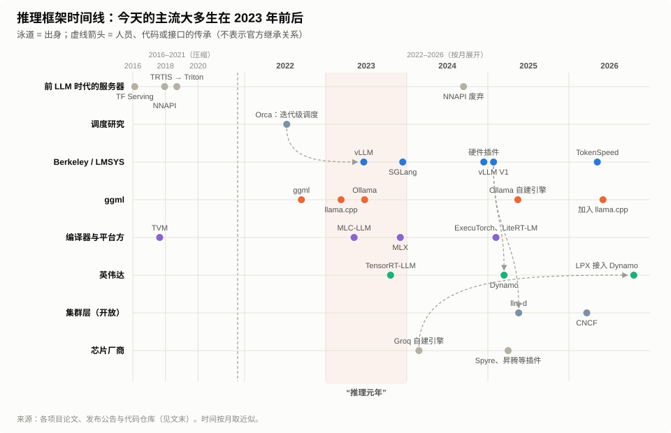](/assets/fw-forensics/lineage-zh.svg)
*点图可看大图。*

把这些框架按出身排成泳道，最显眼的是那一列浅色：2023 年。在它之前，推理服务是个安静的角落。[TensorFlow Serving](https://opensource.googleblog.com/2016/02/running-your-models-in-production-with.html) 在 2016 年开源，做的是模型版本管理和带超时的请求级批处理，[设计论文](https://arxiv.org/abs/1712.06139)里一个 batch 在一次前向里是固定的。英伟达的 TensorRT Inference Server 在 [2018 年 9 月](https://www.edge-ai-vision.com/?p=4341)发布，要解决的问题是「一个模型用不满一张 GPU」，答案是多框架、并发执行和动态批处理，2020 年[改名 Triton](https://docs.nvidia.com/deeplearning/triton-inference-server/release-notes/rel_20-03.html)。手机这边，Android 8.1 引入了 NNAPI，一个系统 API 下面挂各家芯片的 delegate，全是静态图。

然后在 2022 到 2023 年之间，今天最常被提到的那几个名字同时冒了出来：Orca（2022 年 7 月）、llama.cpp（2023 年 3 月）、vLLM（6 月）、Ollama（6 月）、TensorRT-LLM（9 月）、SGLang（12 月论文，2024 年 1 月开源）、MLX（12 月）。22 个框架里并不都生在这一年，但现在的主流几乎都是。之后几年的变化，大多是在这些起点上长出来的：vLLM 的硬件插件、Dynamo 和 llm-d 这样的集群层、2026 年的 TokenSpeed。

GitHub star 的曲线把这个断层画得更直白：

2019 到 2022 年，这 23 个和推理相关的仓库（比打分的 22 个框架多了 KServe、TorchServe、OpenVINO、ONNX Runtime、Modular 和 Ray 等，见附录 A）每半年加起来只有两千到五千个新 star，其中一半左右还来自通用计算框架 Ray。2023 年上半年一下子跳到六万，之后一直在六万到十万之间。所以我把 2023 年叫作「推理元年」。「元年」原本指一个新年号的第一年，旧朝的东西并没有作废，只是纪年从这里重新算起：2023 年以前的经验仍然有用，但这组仓库受到的关注一下子换了量级，今天的主流框架也都从这一年算起。人员和生产部署是不是也同样换了一批，star 说明不了。

## 2. 两条血统，拿走四分之三的注意力 {#lineages}

切到「新增 star 占比」看，在我选的这 23 个仓库里，从 2024 年起，两条血统每半年都拿走 74% 到 80% 的新 star（每个半年有 5 到 7 个空格，有的是仓库还没建、有的是数据缺口，都按 0 计，见附录 A）：

- **Berkeley / LMSYS 一脉**（vLLM、SGLang）：占比从 2023 年下半年的 11% 一路涨到 2025 年下半年的 36%。
- **ggml 一脉**（llama.cpp、Ollama）。伯克利人人都知道，ggml 知道的人就少多了，这里多说两句。ggml 不是一个机构，而是一个开源的 C 语言张量库，作者是保加利亚的独立开发者 Georgi Gerganov。它没有任何第三方依赖，一台 MacBook 就能跑起量化后的大模型。Gerganov 先写了 ggml 和一个 GPT-2 的实现，接着用同一套代码移植了语音识别模型 Whisper（whisper.cpp），2023 年 3 月又写了 llama.cpp，据报道[起初只是一个晚上的业余项目](https://simonwillison.net/2026/Feb/20/ggmlai-joins-hugging-face/)。2023 年 8 月它又定义了 GGUF 模型文件格式，在本地跑的模型里很常见；Ollama、LM Studio 这些桌面工具，底下多半都是它。他后来成立的公司叫 ggml.ai，2026 年整个团队加入了 Hugging Face。这一脉的占比：2023 到 2024 年本地运行热潮里一直过半；2026 年上半年 llama.cpp 新增 2.6 万 star，自 2023 年以来第一次又超过了 Ollama。

读这张图要先记住四个前提：

1. **star 衡量的是开发者注意力，不是生产份额。** 本地工具天然被高估。
2. **层与层会重叠。** Ollama 跑在 llama.cpp 上，Dynamo 和 llm-d 跑在 vLLM 上，份额不能跨层相加。
3. **没有任何调查给出过生产环境的引擎份额。** 能找到的最接近的数字，是一份[自托管者调查](https://datatalks.club/surveys/2025-2026/ai-engineering)里 18% 用 vLLM，样本口径还不清楚。
4. **GitHub 看不到最大的那批私有系统。** 谷歌 2026 年 5 月自报其各产品每月处理超过 3.2 千万亿个 token，跑在自研栈上。这个数没有可比的分母，但足以说明开源仓库只是图景的一部分。

血统不只是 star 的分组。把背后的人、实验室和公司画出来，就是一张真正的族谱。图里有四个家族，从上到下是四代；实线表示「创建或创立」，虚线表示人员流动、fork、被嵌入、被托管、授权或收购这类间接关系，线上的小标签写明是哪一种。连线只说明来历，不代表今天的所有权或项目治理：

[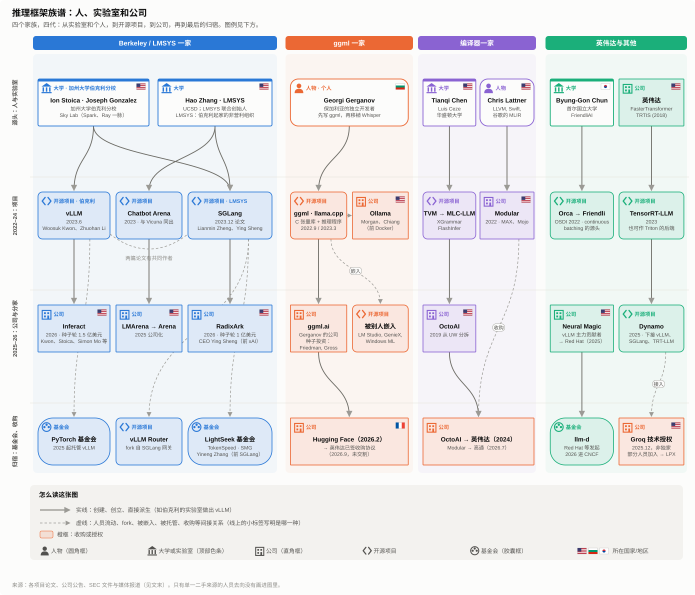](/assets/fw-forensics/tree-zh.svg)
*点图可看大图。*

几条值得讲的线：

- **一篇伯克利论文，两家公司。** 2023 年 vLLM 论文的九位作者里，就有后来 SGLang 的两位带头人 Lianmin Zheng 和 Ying Sheng（[vLLM 论文](https://arxiv.org/abs/2309.06180)、[SGLang 论文](https://arxiv.org/abs/2312.07104)）。两个项目都出自 Ion Stoica 在伯克利的实验室圈子，也就是做出 Spark 和 Ray 的那条线。2026 年两个引擎背后各自有了一家公司（公司不等于项目治理，vLLM 仍由 PyTorch 基金会托管）：vLLM 一侧是 [Inferact](https://siliconangle.com/2026/01/22/inferact-launches-150m-funding-commercialize-vllm/)，Stoica 和 vLLM 第一作者 Woosuk Kwon 都在创始团队里，种子轮 1.5 亿美元；SGLang 一侧是 [RadixArk](https://pulse2.com/radixark-launches-with-100-million-in-seed-funding-to-democratize-frontier-ai-infrastructure/)，CEO 是 Ying Sheng（此前在 xAI），种子轮 1 亿美元。
- **LMSYS 是个孵化器。** [LMSYS](https://lmsys.org/about/) 是伯克利起家的学生与教授组织，2024 年起成为非营利机构，联合创始人之一是现在 UCSD 的 Hao Zhang。它先后做了 Vicuna、Chatbot Arena 和 SGLang。Chatbot Arena 2025 年[独立成公司](https://en.wikipedia.org/wiki/LMArena)，2026 年改名 Arena。
- **人在流动，代码也在流动。** 蚂蚁集团[统计](https://developer.ant-ling.com/en/blogs/llm-landscape-vllm-sgl/)有 194 位开发者同时给 vLLM 和 SGLang 提交过代码。vLLM 的路由器[fork 自 SGLang 的网关](https://vllm.ai/blog/2025-12-13-vllm-router-release)。前 SGLang 核心维护者 Yineng Zhang 后来据[其个人资料](https://latent.space/wiki/yineng-zhang/)到了 Together AI，又在非营利的 [LightSeek 基金会](https://lightseek.org/blog/lightseek-tokenspeed.html)下参与创建了 TokenSpeed。两个引擎共用的 attention 内核库 [FlashInfer](https://arxiv.org/abs/2501.01005) 出自华盛顿大学的 Zihao Ye，作者里也有陈天奇和 Yineng Zhang。
- **ggml 一家从一个人开始。** ggml 是保加利亚开发者 Georgi Gerganov 写的一个 C 语言张量库，可以理解为一个极简的「PyTorch 底层」；llama.cpp 是建在它上面的推理程序。他先写了 ggml 和一个 GPT-2 的实现，再用这套代码移植了 Whisper，然后是 llama.cpp，2023 年成立 ggml.ai，种子钱来自 Nat Friedman 和 Daniel Gross（[量子位](https://www.qbitai.com/2023/06/63720.html)）。Ollama 的两位创始人 Jeffrey Morgan 和 Michael Chiang 此前做过 Kitematic，后来进了 Docker（[TechCrunch](https://techcrunch.com/2026/07/09/popular-open-source-ai-developer-tool-ollama-raises-65m-grows-to-nearly-9m-users/)）。Ollama 拉模型、跑模型的命令行用起来很像 Docker，我猜这不是巧合。
- **编译器一家，最后都被芯片公司买走了。** 陈天奇和 Luis Ceze 在华盛顿大学做了 TVM，2019 年分拆出 OctoML（后来叫 OctoAI），[2024 年被英伟达收购](https://www.geekwire.com/2024/chip-giant-nvidia-acquires-octoai-a-seattle-startup-that-helps-companies-run-ai-models/)。Chris Lattner 从 LLVM、Swift 一路做到谷歌的 MLIR，2022 年创立 Modular，[2026 年 7 月被高通收购](https://www.nasdaq.com/press-release/qualcomm-completes-acquisition-modular-2026-07-29)。
- **归宿：基金会和大买家。** vLLM 2025 年进了 [PyTorch 基金会](https://pytorch.org/blog/pytorch-foundation-welcomes-vllm/)，SGLang 加入的是 PyTorch 生态（不是托管项目）。vLLM 的主力贡献者 Neural Magic 被 [Red Hat 收购](https://redhat.com/en/about/press-releases/red-hat-completes-acquisition-neural-magic-fuel-optimized-generative-ai-innovation-across-hybrid-cloud)，Red Hat 随后发起了 llm-d。llama.cpp 团队 2026 年 2 月[加入 Hugging Face](https://simonwillison.net/2026/Feb/20/ggmlai-joins-hugging-face/)，9 月英伟达与 Hugging Face [签了收购协议](https://www.sec.gov/Archives/edgar/data/0001045810/000104581026000078/nvda-20260902.htm)（约 119 亿美元，预计 2027 年上半年交割）。再加上 OctoAI、Groq 的技术授权和团队，英伟达和这张族谱里的好几家都连上了线。

本地那边，Ollama、[LM Studio](https://lmstudio.ai/blog/0.4.0)、高通 [GenieX](https://geniex.aihub.qualcomm.com/llms-full.txt) 都把 llama.cpp 嵌在里面。

部署层也指向同一个结论。AWS SageMaker 的[大模型推理容器](https://aws.amazon.com/blogs/machine-learning/supercharge-your-llm-performance-with-amazon-sagemaker-large-model-inference-container-v15/)跑在 vLLM 上，llm-d 直接建在 vLLM 上，Dynamo 的后端是 vLLM、SGLang 和 TensorRT-LLM。PyPI 最近 30 天的下载量里，vLLM、SGLang、llama-cpp-python 三者大约是 62%、24%、14%（[pypistats](https://pypistats.org/packages/vllm)；SGLang 这一项按 pypistats 的数，它在别的数据源里被机器流量放大过，只能粗看）。

数据和方法见[附录 A](#method)。我没找到任何已发表的推理引擎份额随时间变化的图，所以这张图是原创的，输入数据随文公开。

## 3. 十个维度，以及它们为什么这样排 {#axes}

每个维度 0 到 5 分，问的都是：**这种出身的直觉，在多大程度上决定了框架的关键设计？** 锚点固定，保证每个维度上的「3 分」是同一个意思。

| 维度 · 直觉 | 0 分 | 5 分 |
|---|---|---|
| **内存管理 · KV 当虚拟内存** | 每个请求一块连续缓冲区 | 分页、写时复制、多级卸载是立身之本 |
| **程序运行时 · 跨调用复用** | 只有无状态的单次请求 | 多次调用、控制流、会话是一等公民 |
| **调度器 · 迭代级批处理** | 静态 batch | 调度器本身就是核心发明 |
| **编译器 · 提前编译出引擎** | eager 执行，运行时挑内核 | 一切提前编译：静态内存规划，按形状出二进制 |
| **可移植性 · 多后端** | 只支持一家的硬件 | 可移植是创立目标：CPU、多家 GPU、NPU、浏览器 |
| **集群 · 整个集群当一台机器** | 单进程单设备 | KV 感知路由、规划器、KV 传输、故障处理 |
| **垂直整合 · 厂商掌握整套栈** | 基金会式中立治理 | 一家厂商从芯片管到服务 |
| **广度 · 模型与硬件覆盖** | 一个模型家族 | 生态默认选项，新模型首日支持 |
| **主机路径 · CPU 退出 token 循环** | 每步一个 Python 控制循环 | 原生主机循环是创立目标 |
| **端侧 · 体积与能耗** | 只在数据中心，依赖很重 | 为设备而设计：KB 级运行时、NPU、每 token 能耗 |

**为什么这样排。** 和第一篇一样，用打分本身把所有环形排列都试了一遍，让相关性强的维度挨在一起。结果读起来像一张地图：上方和右上是内存、程序、广度，这是 vLLM 和 SGLang 的一侧；右下是主机路径和可移植性，正下方是端侧，这是 llama.cpp 和端侧运行时的一侧；左下是编译器和垂直整合，这是芯片厂商的一侧；左上是调度器和集群。

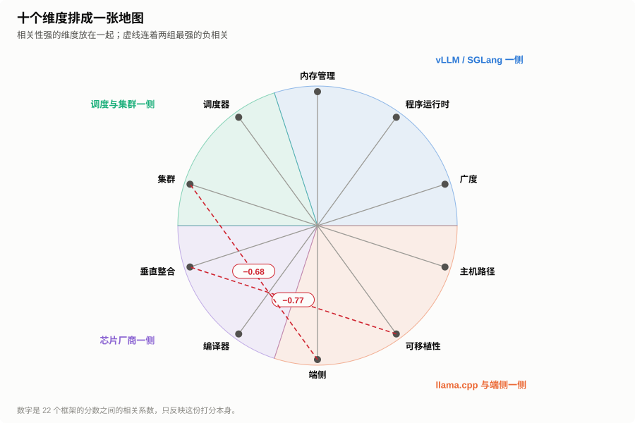

两组负相关最有意思。**可移植性和垂直整合是 −0.77**：芯片厂商的栈几乎都是编译器和垂直整合 4 分以上、可移植性 0 分，vLLM 正好反过来。**端侧和集群是 −0.68**：没有一个框架同时在乎一台手机和一万张卡。这只是我们自己的打分里的相关，维度是自己定义的，相关性有一部分来自提问的方式。

## 4. 数据中心引擎：批处理槽位、KV 显存、重复计算 {#dc}

数据中心引擎这一组，平均最高的是调度器（3.7）、主机路径（3.2）和内存（3.1），编译器只有 1.4。每个引擎最尖的那个角，往往对应它早期明确要解决的瓶颈。

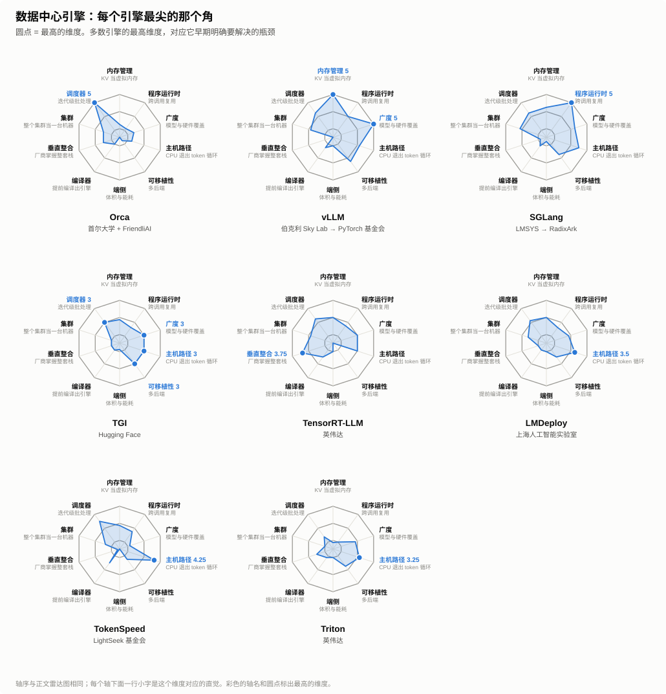

**Orca（首尔大学 Byung-Gon Chun 团队与 FriendliAI）：稀缺的是批处理槽位。** 2022 年 OSDI 的 [Orca](https://www.usenix.org/conference/osdi22/presentation/yu) 观察到，请求级批处理会让已经结束的请求干等，新请求也进不来。它的答案是每个迭代重新组一次 batch，在 GPT-3 175B 上报告了 36.9 倍吞吐。这里打分的是论文里的系统：调度器 5 分，其他维度证据都薄；商用的 Friendli 引擎闭源，不计入。vLLM 论文把 Orca 列为[参考文献并当作基线重新实现](https://arxiv.org/pdf/2309.06180)；TGI 叫它 continuous batching，TensorRT-LLM 叫它 [in-flight batching](https://developer.nvidia.com/blog/nvidia-tensorrt-llm-supercharges-large-language-model-inference-on-nvidia-h100-gpus/)，指的都是同一件事。

**vLLM（伯克利 Sky Computing Lab，今属 PyTorch 基金会）：稀缺的是 KV 显存，后来是广度。** 2023 年 6 月伯克利的 [vLLM](https://vllm.ai/blog/2023-06-20-vllm) 把问题定在显存：KV cache 又大又不定长，管不好就限制了 batch 大小。PagedAttention 借用了操作系统的虚拟内存：固定大小的块、块表、写时复制，浪费只发生在最后一个块，不到 4%（[论文](https://arxiv.org/abs/2309.06180)）。它最早服务的负载是 Chatbot Arena。第二个直觉是广度：[V1](https://vllm.ai/blog/2025-01-27-v1-alpha-release) 把引擎循环隔离出来，硬件插件 RFC 让 vLLM 成了昇腾、Spyre、Neuron、TPU 和 AMD ATOM 的默认接入点。内存和广度都是 5 分，垂直整合 0 分。

广度的账由两拨人付。芯片厂商付的是插件滞后：AMD ATOM 只在 vLLM 0.17.x 上测过，AFD 插件钉在 0.19.1。用户付的是一点峰值速度：[Baseten 的书](https://www.baseten.co/inference-engineering/book/04-software/4.3-inference-engines.md)里说 vLLM 到不了更窄的引擎那样的顶级性能。

**SGLang（LMSYS，伯克利一脉，今有 RadixArk）：稀缺的是跨调用的重复计算，后来是 CPU。** [SGLang](https://arxiv.org/abs/2312.07104) 从「LLM 程序」出发：一段程序里有多次生成调用、控制流和结构化输出。RadixAttention 在调用之间复用 KV，压缩状态机加速结构化输出，程序运行时 5 分。第二个直觉出现在 [v0.4](https://lmsys.org/blog/2024-12-04-sglang-v0-4)：团队说没优化过的引擎可能有一半时间花在 CPU 开销上，于是做了重叠调度器，在 GPU 算当前 batch 时准备下一个，把 CPU 调度开销藏起来；另外还有一个用 Rust 写的缓存感知路由，那是请求入口，和逐 token 的调度器是两个组件。主机路径 4 分，仅次于 TokenSpeed。

**TGI、TensorRT-LLM 和 LMDeploy：中间地带。** Hugging Face 的 [TGI](https://huggingface.co/docs/text-generation-inference/index) 押的是从 Hub 一键部署，continuous batching 和分页注意力都是从别处采用的，现在已进入维护模式，文档把用户指向 vLLM、SGLang、llama.cpp 和 MLX。英伟达的 [TensorRT-LLM](https://nvidia.github.io/TensorRT-LLM/latest/legacy/tensorrt-backend-removal.html) 继承了 FasterTransformer 的内核，押的是自家硬件上的峰值速度。后来它删掉了 TensorRT 后端，只剩 PyTorch 执行。两位评分者在编译器这一格差一分：一位看最初的引擎构建，一位看今天的代码；审校后统一按今天的版本打，编译器 2 分。垂直整合 3.75，可移植性 0。上海人工智能实验室（OpenMMLab）的 LMDeploy，核心 TurboMind 是 C++/CUDA 引擎，主机路径 3.5。

**TokenSpeed（非营利的 LightSeek 基金会，前 SGLang 维护者参与创建）：2026 年唯一的新面孔。** [TokenSpeed](https://docs.nvidia.com/dynamo/digest/tokenspeed-day-0) 3 月中开始开发，5 月 6 日发布性能预览。调度器是原生 C++，运行时和集成层仍是 Python；首发即支持 Dynamo。发布测试用的是 B200 上的 Kimi K2.5、没有做 PD 分离：batch 为 1 时比 TensorRT-LLM 快约 9%，每用户约 100 tok/s 处吞吐高约 11%。主机路径 4.25，是全表最高。它也说明了今天的新引擎是怎么做出来的：复用现成的 Rust 网关（SMG）、厂商的内核团队和 Dynamo。5 月时模型覆盖和 PD 分离还列在待办里；10 月 [Dynamo 1.6.0](https://docs.nvidia.com/dynamo/reference/releases/v1-6-0) 已经为它加上了基于 Mooncake 的 PD 分离和 KV 事件。

**一个跨时代的观察：主机开销又被重视起来了。** 前 LLM 时代的三个基线在别的维度都很低，主机路径却有 3 到 3.25 分：TF Serving 和 Triton 本来就是 C++ 服务器，NNAPI 是 Android 上的原生 C API（它不是服务器，也没有逐 token 的循环）。2023 年的 vLLM 和 SGLang 为了迭代速度，用 Python 写调度循环（TGI 的路由器一开始就是 Rust；TensorRT-LLM 旧后端的批管理是 C++，今天的 PyTorch 后端则由 Python 驱动每一步、调用 C++ 的调度和 KV 绑定）。2024 到 2026 年，这两家用了好几种办法来降低和隐藏主机开销：SGLang 的重叠调度、vLLM V1 把引擎核心拆进单独的进程、Rust 写的路由和 vLLM 的 [Rust 前端 RFC](https://github.com/vllm-project/vllm/issues/40846)（预处理密集的负载上，一个 Rust 进程 837 req/s，对比 32 个 Python API 进程 786 req/s）。要分清楚的是：路由和前端管的是请求入口，逐 token 的调度器在两家都还是 Python。[vLLM 0.6 的博客](https://vllm.ai/blog/2024-09-05-perf-update)给过一组数：Llama 3 8B 在一张 H100 上，HTTP 服务占 33% 时间，调度和输入准备占 29%，GPU 执行只占 38%。

## 5. 集群层：把整个集群当一台机器 {#fleet}

集群层的形状最简单：集群 4.9 分，编译器和端侧都是 0。

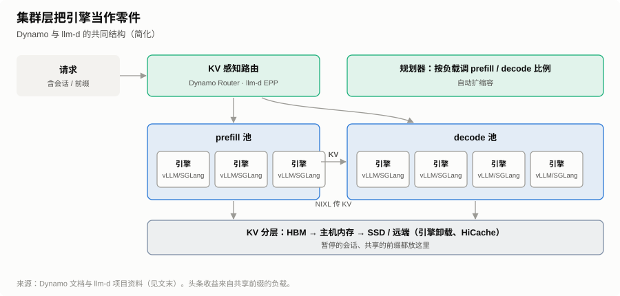

英伟达的 [Dynamo](https://docs.nvidia.com/dynamo/knowledge-base/overview) 2025 年 3 月发布，它点名的问题是 prefill 和 decode 不平衡、路由不看缓存重叠导致 KV 重算、显存外的容量压力。机制是 KV 感知路由、规划器和 NIXL 传输库，热路径用 Rust，后端是 vLLM、SGLang、TensorRT-LLM 和 TokenSpeed。它原先自带的 KV 块管理器 KVBM 已在 1.5.0 [弃用](https://docs.nvidia.com/dynamo/reference/releases/deprecations)（计划 1.7.0 移除），主机和磁盘分层改用各引擎自己的卸载。[llm-d](https://www.cncf.io/blog/2026/03/24/welcome-llm-d-to-the-cncf-evolving-kubernetes-into-sota-ai-infrastructure/) 是 Kubernetes 那边的回答：Red Hat、谷歌、IBM、CoreWeave 和英伟达在 2025 年 5 月发起，2026 年 3 月进入 CNCF 沙箱，10 月发布 [1.0](https://llm-d.ai/blog/llm-d-v1.0-state-of-the-art-inference-ready-for-day-2)。它最初以 vLLM 为核心，1.0 已同时支持 vLLM 和 SGLang。

两者的头条收益都来自共享前缀。Dynamo 报告 TTFT 快 3 倍，llm-d 报告从 35 秒降到 120 毫秒，都是共享前缀的负载，换成各不相同的提示词就不成立（[Red Hat](https://developers.redhat.com/articles/2026/06/11/intelligent-inference-scheduling-llm-d-red-hat-ai)）。它们的调度器分数反而不高（1.75），因为路由是按请求做的，迭代级的批处理仍然在下面的引擎里。

Triton 走到今天也成了这一层的前门：产品页现在叫它 [Dynamo-Triton](https://developer.nvidia.com/dynamo-triton)，LLM 的批处理交给 TensorRT-LLM 或 vLLM 后端去做。

## 6. 本地与端侧：上手门槛，还是每个后端的工程师时间 {#edge}

端侧这一组的形状和集群层正好相反：端侧 3.9、可移植性 3.4，集群只有 0.5。组内却有两种针锋相对的直觉。

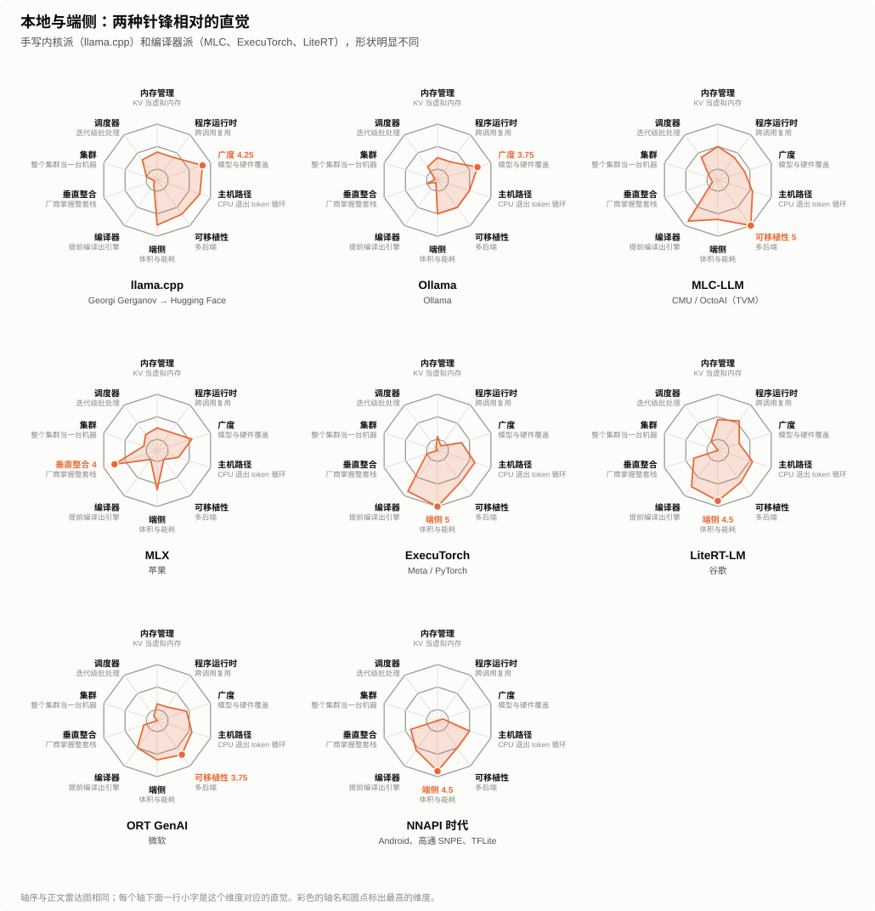

**llama.cpp（Georgi Gerganov 个人项目，后来的 ggml.ai）：稀缺的是上手门槛。** ggml 是 2022 年下半年写成的 C 张量库，最早跑的是 GPT-2，随后被用来移植 Whisper。Georgi Gerganov 在一期[播客](https://changelog.com/podcast/532)里说，动机是零依赖、零配置，外加一个粗算：4 bit 的 65B 模型能塞进一台 MacBook。代价是每个后端都要手写内核。广度 4.25、主机路径 4、端侧 4，是全表唯一三个维度都在 4 分以上的框架。2026 年 2 月团队加入 Hugging Face，9 月英伟达宣布收购 Hugging Face（尚未交割），llama.cpp 最终归谁还没有定。

**MLC-LLM（陈天奇与 TVM 社区）和 ExecuTorch（Meta / PyTorch）：稀缺的是每个后端的工程师时间。** 陈天奇曾经花半年给一个模型手写 CUDA 内核，所以他要用 TVM 编译来代替「每个平台一个团队」（[Latent Space](https://www.latent.space/p/llms-everywhere)）。MLC 的可移植性是全表唯一的 5 分，从 CUDA 一直编到浏览器里的 WebGPU。[ExecuTorch](https://arxiv.org/abs/2605.08195) 的作者批评的也是手写路线：每个后端都要把模型重新实现一遍。它把 `torch.export` 降到不到 300 个核心算子，导出时规划好内存，端侧 5 分、编译器 4.5 分。

**Ollama（Ollama 公司，创始人来自 Docker）：外壳的选择也有代价。** [Ollama](https://ollama.com/blog/multimodal-models) 2025 年 5 月为多模态自建了 Go 引擎，2026 年 3 月在苹果芯片上加了 MLX，又在 0.30 版[加入了 llama.cpp](https://registry.ollama.ai/blog/improved-performance-and-model-support-with-gguf)，用来扩大 GGUF 模型的覆盖。官方的说法是补充，没说放弃自建引擎；但它说明模型覆盖是一笔持续的成本，自建引擎也得找人分担。

**平台方：静态图上加一层有状态的 LLM 层。** 谷歌的 [LiteRT-LM](https://developers.googleblog.com/on-device-genai-in-chrome-chromebook-plus-and-pixel-watch-with-litert-lm/) 在 LiteRT 之上加了引擎和会话对象，但在 NPU 上要[每颗 SoC 一个模型文件、上下文固定](https://developers.google.com/edge/litert/next/litert_lm_npu)，比如 Gemma3-1B 在高通、联发科和 Tensor G5 上是 1,280 个 token。微软的 Phi Silica 把提示词切成 64 token 的块。苹果机器学习研究团队（Awni Hannun 等）的 MLX 押的是统一内存，垂直整合 4 分。它们的祖先、谷歌 Android 的 NNAPI 在 Android 15 被[废弃](https://developer.android.com/ndk/guides/neuralnetworks/migration-guide)，理由是模型变化太快，操作系统 API 跟不上。

## 7. 芯片厂商的栈：静态形状要交的税 {#chips}

芯片厂商栈的平均形状是 vLLM 的镜像：编译器 4.6、垂直整合 4.6、可移植性 0。Groq、AWS 的 Neuron（来自 Annapurna Labs）、韩国 FuriosaAI 的 furiosa-llm，三家都是先有编译器，再在上面搭服务。Groq 2026 年在 MLSys 发表的 [SHIP 论文](https://proceedings.mlsys.org/paper_files/paper/2026/file/9c20f16b05f5e5e70fa07e2a4364b80e-Paper-Conference.pdf)第一次比较完整地讲了它第一代 LPU 的服务栈：编译器静态调度所有指令，运行时按请求分配 KV 页、用 BlockTrie 做前缀缓存，调度器默认 decode 优先、prefill 动态分块，主机只负责发起流水线和收结果。vLLM 和 SGLang 在论文里只作为 GPU 基线出现。

编译型后端接入动态服务时，往往要额外承担分桶、补齐和功能适配的成本，这里叫它「静态形状的税」。IBM 研究院的 Spyre 记录最详细：它的插件只为[一个固定的 chunk 大小](https://docs.vllm.ai/projects/spyre/en/latest/user_guide/configuration.html)编译 prefill 程序，直接[替换了 vLLM 的 V1 调度器](https://docs.vllm.ai/projects/spyre/en/latest/contributing/scheduler.html)，decode batch 要补齐成矩形，前缀缓存只在整块命中时才算数。2024 年的 [RFC](https://github.com/vllm-project/vllm/issues/9652) 里 continuous batching 是关掉的，首次支持一年后，到 2025 年三季度它还在路线图的 P0 上。AWS Neuron [按桶编译静态程序](https://awsdocs-neuron.readthedocs-hosted.com/en/latest/_sources/vllm-neuron/docs/guides/features-guide.md)，每个桶都占显存和启动时间，prefill 和 decode 永远不在一个 batch 里。一份昇腾的实地[研究](https://arxiv.org/pdf/2607.08215)在 16 颗 910 上跑两个大负载，打了 12 个源码补丁，作者说主要成本是工程投入，不是硬件。

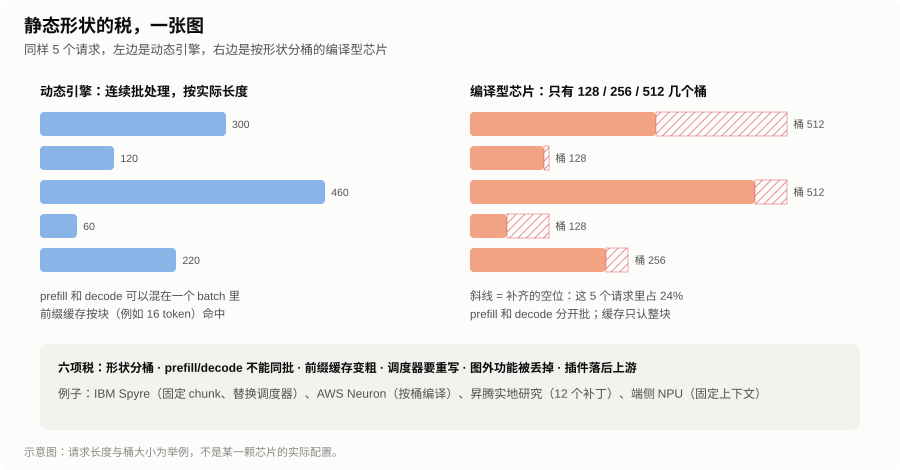

端侧 NPU 从 2017 年起就在交同一份税：KV 大小在编译时固定，上下文满了要么报错、要么滑窗、要么下载更大的包。在骁龙手机上，一篇论文测到 NPU decode 只有 23.0 tok/s，反而输给 CPU 上的 llama.cpp（55.7 tok/s），尽管 NPU 的 prefill 快得多。

归纳下来，静态形状的税有六项。Spyre 和 Neuron 各自至少交了三项；例子来自接进 vLLM 的芯片，不完全是雷达图里打分的那三家：

| 税项 | 表现 | 例子 |
|---|---|---|
| 形状分桶 | 补齐浪费算力和显存 | Neuron 的桶、Spyre 的固定 chunk |
| prefill 与 decode 不能同批 | 调度只能二选一 | Neuron、Spyre |
| 前缀缓存粒度变粗 | 只有整块命中才算 | Spyre |
| 调度器要重写 | 上游的改进接不上 | Spyre 替换 V1 调度器 |
| 图外功能要绕路 | logprobs、结构化输出、投机解码、LoRA 要回退到另一条执行路径，或在某些集成里直接拒绝 | Neuron 默认回退到旧版 model runner，Dynamo sidecar 直接拒绝 |
| 插件落后上游 | 每次升级都要重新验证 | ATOM 停在 0.17.x，昇腾研究里的 12 个补丁 |

## 8. 新芯片：自建框架，还是接进去？ {#newchip}

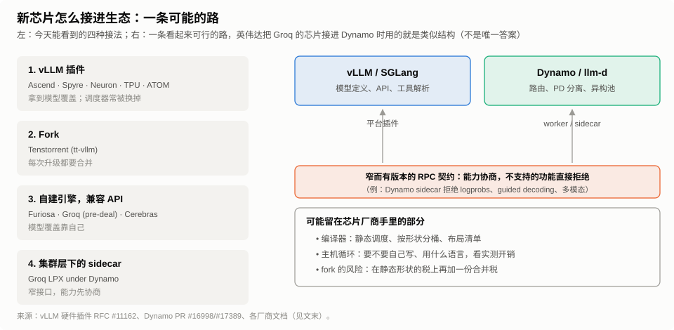

这个问题没有标准答案。这里的「新芯片」可以是编译型芯片，可以是别的架构，也可以是几种芯片拼起来的系统，各家的约束也不一样。下面能做的，是把两边的证据摆出来，再说说哪条路**看起来**更可能走通。要先说明：下面的证据多来自静态编译、追求低延迟 decode 的芯片，别的部署形态未必适用。

**自建的理由是真的。** 编译型芯片往往先有编译器、再有芯片（Groq 就是这样），所有数据流都静态调度。动态引擎的调度器用不上这一点，只能整个换掉，Spyre 就是这样做的。在 GPU 上，[TileRT](https://newsletter.semianalysis.com/p/ultra-high-interactivity-on-nvidia) 把整个 decode 图编进一个常驻内核，8 卡 B200 上单用户 340 tok/s，对比常规最好成绩 181.4 tok/s（batch size 为 1，总吞吐会低一些）。自己掌握循环，还可以明确不做芯片不擅长的功能。

**反对的理由也很重。** 模型覆盖是一笔持续的成本：Ollama 自建了 Go 引擎，后来仍加入 llama.cpp 来扩大 GGUF 覆盖。SemiAnalysis 报告说多数实验室不想在生产里跑 AMD 的 ATOM，建议 AMD 回到 vLLM 上游。AWS 从 Trainium 总结的[经验](https://hosted-files.sched.co/pytorchconferenceeu2026/40/Pluggable%20PyTorch%20LLM%20-%20pytorch%2026.pdf)是：分桶该放进调度器，厂商应该扩展 vLLM，而不是 fork。集群层现在默认下面就是 vLLM 或 SGLang。

**一个已经走过这条路的例子。** 英伟达拿到 Groq 的技术授权之后，要把一颗编译型芯片接进自己的 Dynamo。它在 [PR #16998](https://github.com/ai-dynamo/dynamo/pull/16998) 里写的是一个 `dynamo-sidecar`：把 Dynamo worker 接到芯片自己的引擎上，走 OpenEngine gRPC；logprobs、guided decoding 和多模态请求直接拒绝；可以作为 vLLM prefill worker 后面的 decode worker，KV 通过 NIXL 拉过来。另外两个 PR（[#17389](https://github.com/ai-dynamo/dynamo/pull/17389)，草稿；[#18362](https://github.com/ai-dynamo/dynamo/pull/18362)）让 Dynamo 的 operator 直接读编译器输出的部署清单，而不是自己推导布局。英伟达保留了芯片自己的引擎，没有把它移植进 vLLM，也没有 fork vLLM，只是放在一个窄接口后面。这只是一家的选择，但它是目前公开得最细的一例。

把这些放在一起，一条**可能**走得通的路大致是这样（不是唯一的路）：

1. **芯片特有的编译和执行能力留在厂商手里。** 静态调度、按形状分桶、布局清单都离不开芯片本身的知识。主机循环要不要自己写、用什么语言，取决于实测的主机开销：token 步长到了亚毫秒级，主机一侧有可能先成为上限，但这要量出来，不必预设「第一天就用 C++/Rust」。
2. **放在一个窄而有版本的接口后面。** 能力先协商，不支持的功能在门口拒绝，比做一半更容易维护。接口放在进程内还是走 RPC，也按实测的关键路径来定。
3. **按需要选接入点。** 可以作为 vLLM/SGLang 的逐步插件（沿用上游的调度器和模型定义，也继承它的控制路径），可以作为整个运行时的适配器（保留自己的循环，能借用的上游部分更少），也可以作为集群层下的 worker，用于异构部署。三者给的东西不一样，不必都做，也不会自动打包成一套；小团队接一个、配上现成的编译器，可能就够了。fork 看起来最省事，但从 Tenstorrent 和各家插件的经历看，它很可能把静态形状的税变成长期的合并税。

也有走另一条路的理由：如果一家公司只服务自己的少数几个模型，或者芯片和通用引擎的执行模型差得太远，自建一整套也说得通。

还有一个没答案的问题：我没找到任何在亚毫秒 token 步长上测量主机开销的公开数据。[一篇 Georgia Tech 的论文](https://arxiv.org/abs/2603.22774)测到 vLLM V1 每步 CPU 侧时间在 2–16 毫秒，有负载干扰时到 46–73 毫秒。这些数包含进程间排队等待，是那篇论文的硬件和负载下的结果，不只是 Python 计算本身，也不是下限。但如果一颗芯片的目标是每 token 几毫秒，这个数量级值得先量一量。

## 9. 异构与分离式服务：统一的是控制平面，不是引擎 {#hetero}

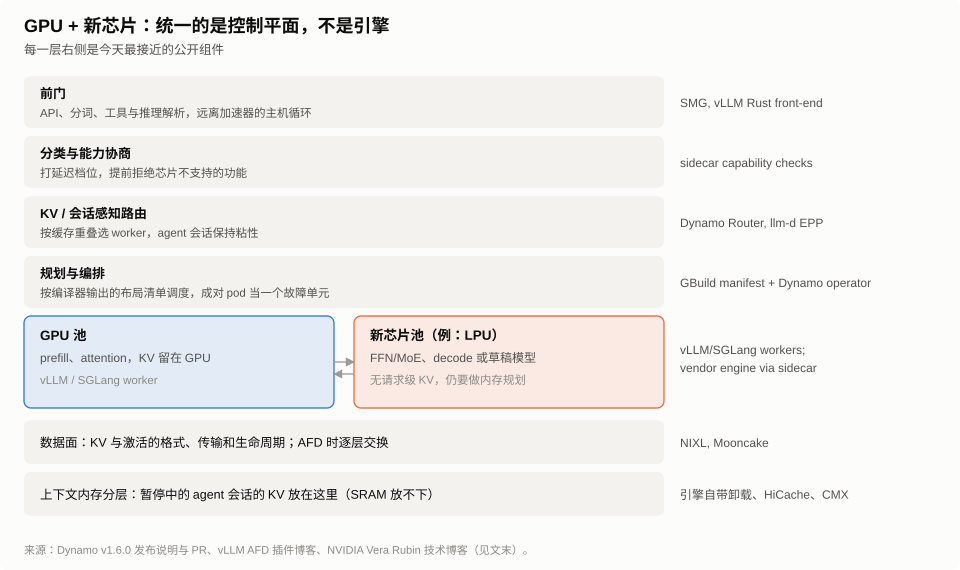

上一节问的是「一颗芯片怎么接进去」，这一节问的是另一件事：几种芯片怎么分担同一个请求。新芯片多半不会单独上场，而是和 GPU 搭档；即使全是 GPU，prefill 和 decode 分池（PD 分离）也已经是主流做法。

第一篇讲过公开资料里最完整的一个例子：英伟达 Vera Rubin + Groq 3 LPX 的三种分工。从软件看，三种切法对框架的要求差别很大：

- **按阶段拆**（一种芯片 prefill，另一种 decode，传 KV）在控制上主要靠集群层，但两边的 KV 格式、量化、位置编码、传输和生命周期必须对齐，这是一份数据面的约定，不只是路由策略。AWS Trainium + Cerebras、AMD + Cerebras、SambaNova 都描述了这种切法，但没有一家说明调度器和 KV 传输机制，性能数字也都是投影。
- **草稿与验证**需要一个调草稿长度和接受率的闭环。
- **按层拆（AFD，attention 和 FFN 分离）**耦合最紧。字节的 [MegaScale-Infer](https://arxiv.org/abs/2504.02263v4) 2025 年提出了这种做法；vLLM 的 [AFD 插件](https://vllm.ai/blog/2026-07-23-vllm-afd-plugin)把调度、KV 和采样留在 attention 一侧，FFN 一侧不保存请求级的 KV，异构加速器混搭还在「未来工作」里。也有反证：一项 128 张 B200 的模拟发现 AFD 只在最严格的交互延迟目标下占优，[百度](https://arxiv.org/abs/2602.09721)报告了标准集群上的 AFD「死区」。它更像低延迟档的产品，不是默认方案。

把这些公开设计拼起来，一个 GPU + 新芯片的系统大致需要上图这七层，而每一层今天都已经有一个最接近的开源组件。所以要统一的，看起来是控制平面（路由、规划、能力协商、故障语义），而不是把所有芯片塞进同一个引擎；KV 和激活的格式、传输和生命周期，还需要一份单独的数据面约定。

一个细节很关键：**在英伟达的按层拆设计里，KV cache 留在 GPU 上。** 这时新芯片一侧不需要请求级的 KV 管理器，但权重、激活和工作区仍要做内存规划，可以是一份静态分区计划，加一个确定性的 RPC。如果新芯片单独跑整条 decode，情况就不同了，Groq 的 SHIP 论文描述的就是芯片自己管理分页 KV。相关 PR 也写着部分路径还没在硬件上跑过，这是早期代码。

每个 token 在两种芯片之间传什么、多大、多快，目前没有公开。[NVIDIA 的博客](https://developer.nvidia.com/blog/how-the-nvidia-vera-rubin-platform-is-solving-agentic-ais-scale-up-problem/)只说激活每个 token 交换一次；[Hot Chips 的报道](https://tomshardware.com/tech-industry/semiconductors/nvidia-presents-groq-3-lpx-architecture-and-unveils-its-first-third-party-inference-benchmark)补充说中间有一块 FPGA 把同步域和 GPU 接起来。在这些数字公开之前，按层拆的软件设计只能做到一半。

## 10. 从 token 推理系统到任务推理系统 {#task}

**B2A 经济。** a16z 11 月的一篇文章把正在发生的事叫做 [B2A 经济](https://www.a16z.news/p/welcome-to-the-b2a-economy)（business-to-agent）：agent 正在从回答问题走向完成任务，替用户挑产品、开数据库、做部署。文中引用的数字很直白：9 月 GitHub 上超过 40% 的 PR 起于 agent 写的草稿，半年前是 17%；Supabase 超过 60% 的新数据库由 AI 工具创建；Vercel 上由 agent 触发的部署一年涨了 28 倍。

**S-1 的口径。** 同一时间，Anthropic 10 月 26 日提交的 [S-1](https://www.sec.gov/Archives/edgar/data/2130357/000162828026067168/anthropicpbc-sx1.htm) 用每任务成本衡量客户价值。按公司自己的说法，Opus 5.5 让客户的每任务成本比 Opus 5 降了大约 40%，这里面混着定价、模型效率和质量，不是推理引擎的指标。但计费仍然按 token，消费型收入占 2026 年上半年收入的 80%。价值口径变了，定价口径还没变。

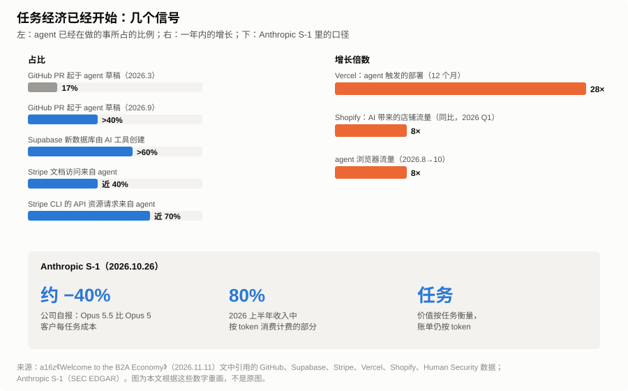
*图按 a16z 文中引用的数字重画；a16z 自己做的原图更好看，值得去[原文](https://www.a16z.news/p/welcome-to-the-b2a-economy)看一眼。*

买单的人买的是完成的任务，推理系统也就要从「token 推理系统」走向「任务推理系统」。上面所有框架优化的都是 token：每秒多少 token、每 token 多少钱，它们都在 harness（agent 的外壳）下面。下面看这个转变走到了哪一步：引擎这边，目前走到了「会话」。

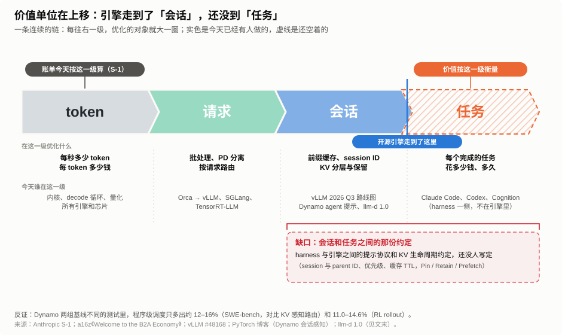

**一个 agent 任务的钱花在哪。** SemiAnalysis 的 [AgentX](https://newsletter.semianalysis.com/p/agentx-inferencexv3-does-cuda-moat) 公开基准是 393 个经过筛选和重建的 Claude Code 会话，来自一个约 8,300 个会话的采集库。在这个处理后的子集里，单次请求输入中位数 142K token，输出只有 444，轮次之间的间隔中位数 3.84 秒（含工具和人的等待）。一篇斯坦福的[论文](https://arxiv.org/pdf/2608.25399)用 Kimi K3 按标价算了五个选定的 SWE-bench Verified 任务：每次运行的中位成本 0.11 到 1.16 美元；缓存命中率 96.3%；输出只占 2.7% 的 token，却占 51% 的钱。作者也提醒，这些比例依赖当时的价格和缓存条件，不能直接搬到别的栈。缓存一旦被挤掉，账就变了：一项高并发 agent 批推理的研究里，工具调用暂停期间被淘汰的前缀要重算，占到端到端延迟的 [49.1%](https://arxiv.org/pdf/2601.22705)。按缓存读 5%、写 125–200% 输入价粗算，一个前缀断掉一次、要按缓存写重新计费的话，大约等于二十到四十次缓存读的钱；引擎内部的 KV 淘汰也不一定变成客户账单上的未命中。目前能找到的按结果定价的例子，都在结果容易验证的场景，比如 [Intercom Fin](https://www.intercom.com/learning-center/ai-customer-service-agent-pricing-comparison) 每解决一个工单 0.99 美元。

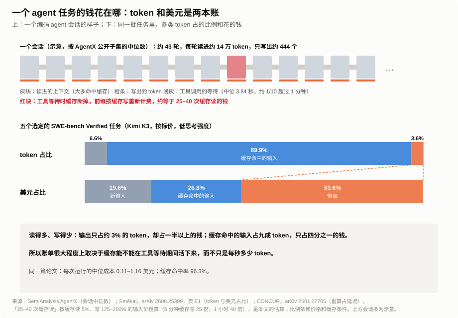

**两边已经在靠近，交汇点是会话。** Claude Code 团队说他们[整个 harness 都围绕前缀缓存设计](https://claude.com/blog/lessons-from-building-claude-code-prompt-caching-is-everything)，命中率掉了就按事故处理；[Codex](https://openai.com/index/unrolling-the-codex-agent-loop) 也写了同样的前缀纪律。引擎这边，vLLM 2026 年三季度的路线图交付了 session ID 和多级 KV 卸载，Dynamo 映射了 Claude Code、Codex、OpenCode 的会话头并移植了程序级调度器，llm-d 1.0 加了会话感知路由。按各自写明的设计原则，这些都只是**可选提示**，请求格式不变。

**反证限制了整合能走多远。** 实验室论文报告程序级调度有 4–15 倍收益，但比较对象是没有会话感知的引擎。在 KV 感知路由和卸载已经到位的前提下，Dynamo 的测试里程序感知只多出 11–16%，低并发时没有收益。一项研究里，agent 感知的淘汰策略比朴素 LRU 还差 7–23%。我没找到直接优化「每个完成的任务花多少钱」的论文。

**AI 写代码能不能让重写变便宜？** 有现成「裁判」的重写确实便宜了：据 Bun 作者自报，[Bun](https://bun.com/blog/bun-in-rust) 把 53.5 万行 Zig 移植成 Rust，11 天后合入主分支，合入前的 API 标价约 16.5 万美元，靠的是每个平台大约 6 万个测试（合入后还有安全审查、fuzzing 和回归修复）；Anthropic 的研究型 C 编译器两周、不到 2 万美元，用 GCC 当裁判。这些都不是完整的工程成本。推理引擎的正确性和性能都可以测，也已经有 [FlashInfer-Bench](https://arxiv.org/abs/2601.00227) 这样的评测，难的是跨硬件的代表性、可比性和覆盖面，昇腾那份研究里的成本恰恰就在这里。在我检索的范围内，没找到主要由 agent 写成的生产推理引擎。维护者说的瓶颈是代码审查：vLLM [禁止纯 agent 提交的 PR](https://docs.vllm.ai/en/stable/contributing/)，vllm-ascend 积压了约 3,200 个 PR。

**合理的「整合层」可能长什么样。** 一个可能的切法是按访问模式：需要逐 token 访问的（语法掩码、KV 驻留、采样）留在引擎；I/O 型的（工具、历史、解析、MCP 编排）放到旁边的网关，像 SMG 那样。两边之间是一份提示协议和 KV 生命周期接口：session 和 parent ID、优先级、预计输出长度、缓存 TTL，以及 Pin、Retain、Prefetch 这样的动词（SGLang #27574、vLLM #51428 都有提案）。这不一定需要重写引擎。多租户的引擎也不能盲信 harness 的提示，所以有提案加了信用机制。

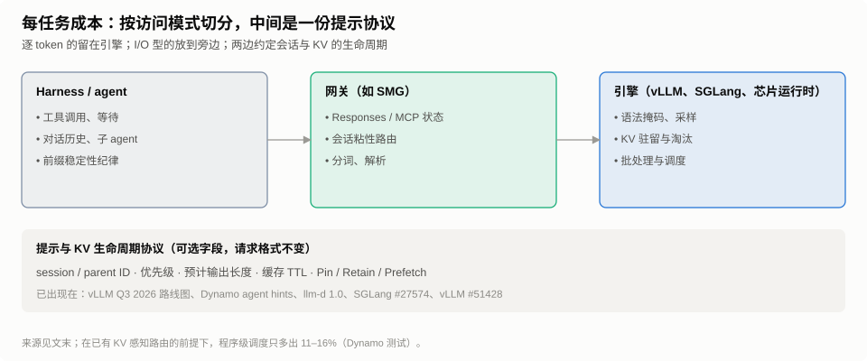

**谁会来做。** 垂直整合的 harness 方已经在自己的栈里动服务层了：OpenAI 在目标速度到 1,000 tok/s 之后，发现 API 开销占了 agent 延迟的一大块，于是做了[按连接的 WebSocket 缓存](https://openai.com/index/speeding-up-agentic-workflows-with-websockets)；Cognition 把模型、harness 和 Cerebras 推理[一起设计](https://cognition.com/blog/swe-1-5)，还重写了 lint 和命令执行，每步省下最多 2 秒。网关和集群这一层在往上长：LightSeek 同时做 SMG 和 TokenSpeed，英伟达给 Dynamo 加了 agent 提示。两家引擎创业公司 Inferact（vLLM）和 RadixArk（SGLang）都还没公开 harness 方面的路线。

对做快速 decode 芯片的人，有一点要注意：如果 harness、工具和 API 的延迟不跟着降，decode 再快，单个任务的收益也很快到顶；暂停会话的 KV 也得放在片上内存以外的地方。按每任务成本讲一颗 decode 芯片，可能要讲的是 KV 分层和工具等待，而不只是每秒多少 token。

## 11. 结语：五个要点 {#close}

1. **今天的主流框架很年轻，而且来自两个家族。** vLLM、SGLang、llama.cpp、Ollama 都生在 2023 年前后；在我选的 23 个仓库里，从 2024 年起，Berkeley/LMSYS 和 ggml 两条血统每半年拿走 74–80% 的新 star。这是开发者注意力，不是生产份额。
2. **每个框架最尖的角，往往对应它早期明确要解决的瓶颈。** Orca 的调度器、vLLM 的内存、SGLang 的程序运行时、MLC 的可移植性、ExecuTorch 的端侧，都是 5 分。
3. **护城河从机制变成了接口。** PagedAttention 人人都抄了，留下来的是 vLLM 的插件接口和 API 兼容层；英伟达接 Groq 的芯片，靠的也是一个 sidecar 接口，而不是一个新框架。
4. **新芯片可能更该争取的是接口，而不是框架。** 静态形状的税（Spyre、Neuron、昇腾）和插件滞后都说明，接口写得早、写得窄、有版本，往往比另起炉灶划算。对多数新芯片团队，先复用成熟生态，再按实测的瓶颈决定自建多少，通常更稳妥。
5. **下一个战场是任务，不是 token。** a16z 的 B2A 数据和 Anthropic S-1 的口径都指向按任务算账；引擎目前走到了「会话」，harness 到引擎之间那份提示和 KV 生命周期的约定，还没人写定。

推理元年过去快三年了。反着走完这一遍，留下的还是第一篇那张清单：当初什么最稀缺，用什么机制应对，代价由谁来付。

---

*以下两个附录给想核对的人看，可以跳过。*

## 附录 A：方法与局限 {#method}

**打分。** 同一份评分标准，两轮独立打分：评分者 A 按框架打，评分者 B 按维度打，彼此看不到对方的结果，只用公开资料，每格附理由、来源和置信度。220 格里 129 格完全相同，73 格差半分，15 格差一分，3 格相差超过一分；这 3 格按一手资料裁定（Groq 的内存与调度器按 SHIP 论文，Orca 的主机路径取低置信度）。其余取两轮平均。

**star 与族谱。** star 数据来自公开的、每天提交 star 数的 git 仓库（[EvanLi/Github-Ranking](https://github.com/EvanLi/Github-Ranking)、[yuxiaopeng/Github-Ranking-AI](https://github.com/yuxiaopeng/Github-Ranking-AI) 等），缺失值按 0 计；SGLang 2026 年的 PyPI 月度数据被机器流量放大，没有用于时间序列。族谱图里每条边都有公开来源，只有单一二手来源的人员去向没有画进图里。

**审校后的修正。** 一位同事做了独立审校，逐格复算了合并和统计，抽查了 30 格和全部分歧格。根据审校，我按 2026 年 11 月的当前版本更正了一批理由，并改了 10 格分数（TensorRT-LLM 的程序、集群、编译器，Dynamo 的内存，TokenSpeed 的程序，Neuron 的程序和主机路径，ONNX Runtime GenAI 的可移植性，llm-d 的程序和广度），数据文件里每格都写着新的理由和来源。上面的分歧统计按两轮原始打分计算，不受这些修正影响。

**范围。** 22 个框架不是全量普查：我选的是 2016 年以来有代表性的服务引擎、集群层、端侧运行时和三家芯片厂商的栈。每个框架按 2026 年 11 月的当前版本打分，Orca 按论文里的系统打分。几个维度有重叠：主机路径同时涉及语言、计算重叠和路由；内存和程序运行时、可移植性和垂直整合都相关；不同层的框架在有些维度上本来就不适用，0 分有时是「不适用」。

**局限。** 分数是判断，不是测量；Orca 的商用引擎、Groq 的服务栈、TokenSpeed 的细节偏少，标为低置信度；框架在变，分数截至 2026 年 11 月 15 日；轴序和出身分组是排版选择；异构和每任务成本两节里的很多机制来自厂商博客和 PR 里的早期代码。

全部分数、理由和来源在「数据表」和[数据文件](/assets/fw-forensics/fw-data.js)里，star 数据在[这里](/assets/fw-forensics/attention-data.js)，欢迎指正。

## 附录 B：参考来源 {#sources}

完整来源列表见[英文版](/2026/11/inference-framework-forensics/#sources)，每个分数对应的来源都在数据文件里。主要来源：

- 族谱与人物：[LMSYS](https://lmsys.org/about/)；[Inferact 融资](https://siliconangle.com/2026/01/22/inferact-launches-150m-funding-commercialize-vllm/)；[a16z 投资 Inferact](https://a16z.com/announcement/investing-in-inferact/)；[RadixArk 融资](https://pulse2.com/radixark-launches-with-100-million-in-seed-funding-to-democratize-frontier-ai-infrastructure/)；[LMArena](https://en.wikipedia.org/wiki/LMArena)；[vLLM Router](https://vllm.ai/blog/2025-12-13-vllm-router-release)；[LightSeek 与 TokenSpeed](https://lightseek.org/blog/lightseek-tokenspeed.html)；[FlashInfer](https://arxiv.org/abs/2501.01005)；[ggml.ai（量子位）](https://www.qbitai.com/2023/06/63720.html)；[ggml.ai 加入 Hugging Face](https://simonwillison.net/2026/Feb/20/ggmlai-joins-hugging-face/)；[英伟达收购 Hugging Face 的 8-K](https://www.sec.gov/Archives/edgar/data/0001045810/000104581026000078/nvda-20260902.htm)；[英伟达收购 OctoAI](https://www.geekwire.com/2024/chip-giant-nvidia-acquires-octoai-a-seattle-startup-that-helps-companies-run-ai-models/)；[高通完成收购 Modular](https://www.nasdaq.com/press-release/qualcomm-completes-acquisition-modular-2026-07-29)；[Red Hat 收购 Neural Magic](https://redhat.com/en/about/press-releases/red-hat-completes-acquisition-neural-magic-fuel-optimized-generative-ai-innovation-across-hybrid-cloud)；[PyTorch 基金会接纳 vLLM](https://pytorch.org/blog/pytorch-foundation-welcomes-vllm/)
- 前 LLM 时代：[TensorFlow Serving 开源](https://opensource.googleblog.com/2016/02/running-your-models-in-production-with.html)；[TF Serving 设计论文](https://arxiv.org/abs/1712.06139)；[TensorRT Inference Server 发布](https://www.edge-ai-vision.com/?p=4341)；[Triton 改名](https://docs.nvidia.com/deeplearning/triton-inference-server/release-notes/rel_20-03.html)；[Dynamo-Triton](https://developer.nvidia.com/dynamo-triton)；[NNAPI 迁移指南](https://developer.android.com/ndk/guides/neuralnetworks/migration-guide)
- 数据中心引擎：[Orca（OSDI 2022）](https://www.usenix.org/conference/osdi22/presentation/yu)；[vLLM 博客](https://vllm.ai/blog/2023-06-20-vllm)与[论文](https://arxiv.org/abs/2309.06180)；[vLLM V1](https://vllm.ai/blog/2025-01-27-v1-alpha-release)；[vLLM 0.6 性能更新](https://vllm.ai/blog/2024-09-05-perf-update)；[vLLM Rust 前端 RFC](https://github.com/vllm-project/vllm/issues/40846)；[SGLang 论文](https://arxiv.org/abs/2312.07104)；[SGLang v0.4](https://lmsys.org/blog/2024-12-04-sglang-v0-4)；[TGI 文档](https://huggingface.co/docs/text-generation-inference/index)；[TensorRT-LLM 移除 TensorRT 后端](https://nvidia.github.io/TensorRT-LLM/latest/legacy/tensorrt-backend-removal.html)；[TensorRT-LLM 发布](https://developer.nvidia.com/blog/nvidia-tensorrt-llm-supercharges-large-language-model-inference-on-nvidia-h100-gpus/)；[TokenSpeed 与 Dynamo](https://docs.nvidia.com/dynamo/digest/tokenspeed-day-0)；[SMG](https://pytorch.org/blog/lightseek-smg/)
- 集群层：[Dynamo 概览](https://docs.nvidia.com/dynamo/knowledge-base/overview)；[Dynamo 弃用说明](https://docs.nvidia.com/dynamo/reference/releases/deprecations)；[Dynamo 1.6.0](https://docs.nvidia.com/dynamo/reference/releases/v1-6-0)；[llm-d 1.0](https://llm-d.ai/blog/llm-d-v1.0-state-of-the-art-inference-ready-for-day-2)；[llm-d 加入 CNCF](https://www.cncf.io/blog/2026/03/24/welcome-llm-d-to-the-cncf-evolving-kubernetes-into-sota-ai-infrastructure/)；[llm-d 智能调度（Red Hat）](https://developers.redhat.com/articles/2026/06/11/intelligent-inference-scheduling-llm-d-red-hat-ai)
- 端侧：[Gerganov 访谈（Changelog #532）](https://changelog.com/podcast/532)；[陈天奇访谈（Latent Space）](https://www.latent.space/p/llms-everywhere)；[ExecuTorch 论文](https://arxiv.org/abs/2605.08195)；[LiteRT-LM](https://developers.googleblog.com/on-device-genai-in-chrome-chromebook-plus-and-pixel-watch-with-litert-lm/)；[LiteRT-LM NPU](https://developers.google.com/edge/litert/next/litert_lm_npu)；[Ollama 多模态引擎](https://ollama.com/blog/multimodal-models)；[Ollama 0.30](https://registry.ollama.ai/blog/improved-performance-and-model-support-with-gguf)
- 芯片厂商：[Groq SHIP 论文（MLSys 2026）](https://proceedings.mlsys.org/paper_files/paper/2026/file/9c20f16b05f5e5e70fa07e2a4364b80e-Paper-Conference.pdf)；[Spyre 配置](https://docs.vllm.ai/projects/spyre/en/latest/user_guide/configuration.html)与[调度器](https://docs.vllm.ai/projects/spyre/en/latest/contributing/scheduler.html)；[Spyre RFC #9652](https://github.com/vllm-project/vllm/issues/9652)；[Neuron vLLM 特性指南](https://awsdocs-neuron.readthedocs-hosted.com/en/latest/_sources/vllm-neuron/docs/guides/features-guide.md)；[昇腾实地研究](https://arxiv.org/pdf/2607.08215)；[AWS 可插拔 PyTorch LLM 报告](https://hosted-files.sched.co/pytorchconferenceeu2026/40/Pluggable%20PyTorch%20LLM%20-%20pytorch%2026.pdf)；[Dynamo PR #16998](https://github.com/ai-dynamo/dynamo/pull/16998)；[TileRT（SemiAnalysis）](https://newsletter.semianalysis.com/p/ultra-high-interactivity-on-nvidia)；[vLLM V1 的 CPU 开销（Georgia Tech）](https://arxiv.org/abs/2603.22774)；[Baseten 谈推理引擎](https://www.baseten.co/inference-engineering/book/04-software/4.3-inference-engines.md)
- 异构：[MegaScale-Infer](https://arxiv.org/abs/2504.02263v4)；[vLLM AFD 插件](https://vllm.ai/blog/2026-07-23-vllm-afd-plugin)；[百度 AFD 研究](https://arxiv.org/abs/2602.09721)；[Vera Rubin 与 LPX](https://developer.nvidia.com/blog/how-the-nvidia-vera-rubin-platform-is-solving-agentic-ais-scale-up-problem/)；[LPX Hot Chips 报道](https://tomshardware.com/tech-industry/semiconductors/nvidia-presents-groq-3-lpx-architecture-and-unveils-its-first-third-party-inference-benchmark)
- 每任务成本：[a16z：B2A 经济](https://www.a16z.news/p/welcome-to-the-b2a-economy)；[Anthropic S-1](https://www.sec.gov/Archives/edgar/data/2130357/000162828026067168/anthropicpbc-sx1.htm)；[SWE-bench 任务成本研究](https://arxiv.org/pdf/2608.25399)；[CONCUR](https://arxiv.org/pdf/2601.22705)；[Claude Code 与前缀缓存](https://claude.com/blog/lessons-from-building-claude-code-prompt-caching-is-everything)；[Codex agent 循环](https://openai.com/index/unrolling-the-codex-agent-loop)；[OpenAI WebSocket](https://openai.com/index/speeding-up-agentic-workflows-with-websockets)；[Cognition SWE-1.5](https://cognition.com/blog/swe-1-5)；[AgentX（SemiAnalysis）](https://newsletter.semianalysis.com/p/agentx-inferencexv3-does-cuda-moat)；[FlashInfer-Bench](https://arxiv.org/abs/2601.00227)；[Bun 移植到 Rust](https://bun.com/blog/bun-in-rust)；[vLLM 贡献指南](https://docs.vllm.ai/en/stable/contributing/)
- star 与下载：[EvanLi/Github-Ranking](https://github.com/EvanLi/Github-Ranking)；[yuxiaopeng/Github-Ranking-AI](https://github.com/yuxiaopeng/Github-Ranking-AI)；[pypistats](https://pypistats.org/packages/vllm)；[蚂蚁开源社区：vLLM 与 SGLang](https://developer.ant-ling.com/en/blogs/llm-landscape-vllm-sgl/)
