

*Forensic Will, part 2. [Part 1](/2026/11/inference-chip-shapes/) did this for 43 inference chips: start from what shipped and work back to what its designers thought was scarce. This part turns the same lens on the software layer above the chip.*

<b>About the series name</b> (an aside): as a kid, my mom wanted me to become a doctor. I didn't listen and became an engineer. "Forensic Will" is my late attempt at a compromise, though she doesn't read GitHub. Funnily enough, I did end up a Doctor: a PhD in computer engineering. My patients are chips and software frameworks, and they arrive after they have already shipped.

<link rel="stylesheet" href="/assets/chip-radar/radar.css">
<link rel="stylesheet" href="/assets/fw-forensics/fw.css">

A few years into building inference chips and the software around them, AI feels to me like a reset on everyone's career. Take 2023–24 as the point where AI entered ordinary people's lives. From then on, however long your career and however deep your experience in one field, you enrolled in the same first-year class as everyone else.

Inference frameworks are in the same position. vLLM, SGLang, llama.cpp and Ollama were all born around 2023, so the frameworks that dominate today are about three years old. That shallow incumbency is why "should a new chip write its own framework and topple the incumbents?" is a real question. The clock was reset, though, not the experience. PagedAttention is operating-system paging applied to the KV cache, and continuous batching comes from a 2022 serving-systems paper. Old systems craft still works in the new field. To be honest, today's inference frameworks look a lot like the good old large-scale distributed systems: scheduling, caching, routing, tiered storage, failure handling. One day they may grow into something else, but for now we can still count on the solid base that software engineering built over the last decades of the Internet and big data.

This post follows part 1. It scores 22 inference frameworks from 0 to 5 on ten design axes, in two independent passes that were then reconciled, using only public papers, design documents, release notes and repositories. Play first; the long read follows.

**How to read it.** Each axis stands for an instinct that comes with a background, such as "Memory: KV as virtual memory". A score measures how strongly that instinct shaped the framework's defining design decisions. **It is not performance and not quality**; a bigger shape is not a better framework. Hover or tap any point for the score, the confidence and a one-line reason. "By origin" lays the 22 frameworks out by lineage, "By layer" averages datacenter engines, cluster layers, local and edge runtimes and chip-vendor stacks, and "Data table" has every number.

<nav class="toc" markdown="1">
**Contents**

1. [Inference Year One: most of today's mainstream was born around 2023](#year0)
2. [Two lineages hold three-quarters of the attention](#lineages)
3. [Ten axes, and why they sit where they do](#axes)
4. [Datacenter engines: batch slots, KV memory, repeated work](#dc)
5. [Cluster layers: the fleet as one machine](#fleet)
6. [Local and edge: developer friction, or engineer time per backend](#edge)
7. [Chip-vendor stacks: the static-shape tax](#chips)
8. [A new chip: build its own framework, or plug in?](#newchip)
9. [Heterogeneous and disaggregated serving](#hetero)
10. [From token inference systems to task inference systems](#task)
11. [Closing: five takeaways](#close)

Appendix A: [method and limits](#method) · Appendix B: [sources](#sources)
</nav>

## 1. Inference Year One: most of today's mainstream was born around 2023 {#year0}

[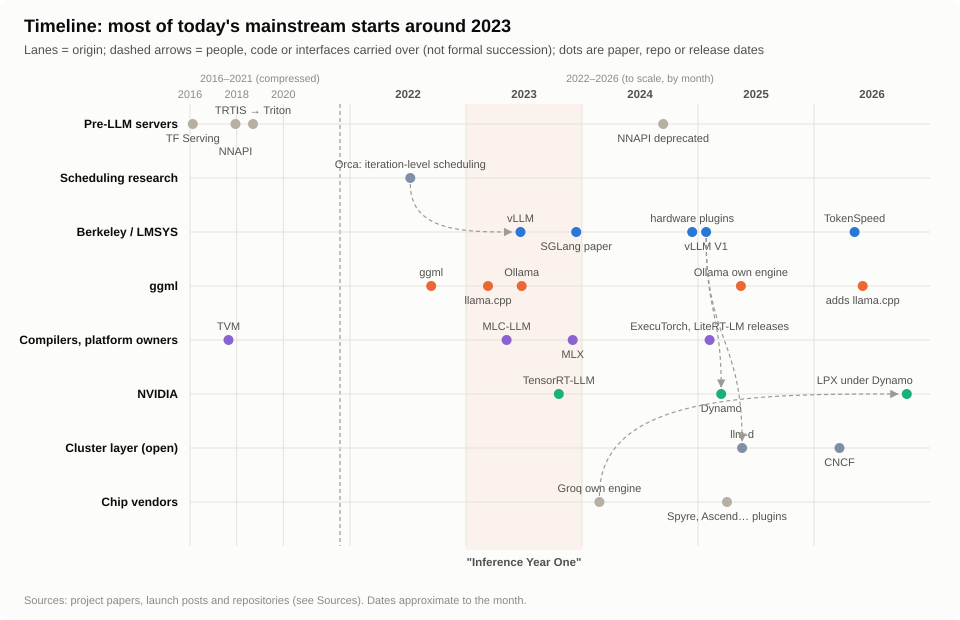](/assets/fw-forensics/lineage-en.svg)
*Click the figure to open it full size.*

Lay the frameworks out in lanes by origin and one column stands out: 2023. Before it, inference serving was a quiet corner. [TensorFlow Serving](https://opensource.googleblog.com/2016/02/running-your-models-in-production-with.html) was open-sourced in 2016 for versioned models and request-level batching with a timeout; in its [design paper](https://arxiv.org/abs/1712.06139) a batch is fixed for one forward pass. NVIDIA announced the TensorRT Inference Server in [September 2018](https://www.edge-ai-vision.com/?p=4341) because a single model left a GPU under-used; the answer was many frameworks, concurrent execution and dynamic batching, and it was [renamed Triton](https://docs.nvidia.com/deeplearning/triton-inference-server/release-notes/rel_20-03.html) in 2020. On phones, Android 8.1 introduced NNAPI: one OS API over each vendor's delegates, all static graphs.

Then, between 2022 and 2023, the names mentioned most today appeared at once: Orca (July 2022), llama.cpp (March 2023), vLLM (June), Ollama (June), TensorRT-LLM (September), SGLang (paper in December, open-sourced January 2024) and MLX (December). Not all 22 frameworks were born that year, but nearly all of today's mainstream was. Most of what followed grew from those starting points: vLLM's hardware plugins, cluster layers such as Dynamo and llm-d, and TokenSpeed in 2026.

The GitHub star curve shows the break even more plainly:

From 2019 to 2022 these 23 inference-related repositories (more than the 22 scored frameworks; they add KServe, TorchServe, OpenVINO, ONNX Runtime, Modular and Ray, see Appendix A) gained only 2,000 to 5,000 new stars per half-year between them, and about half of that came from Ray, a general compute framework. In the first half of 2023 the figure jumped to about 61,000 and has stayed between 60,000 and 100,000 since. So I call 2023 "Inference Year One", after the Chinese 元年: the first year of a new era name. What came before does not become worthless; the count simply restarts there. The experience from before 2023 still helps, but the attention these repositories get changed scale almost overnight, and today's mainstream frameworks all date from that year. Whether the people and the production deployments changed as fast, stars cannot say.

## 2. Two lineages hold three-quarters of the attention {#lineages}

Switch the chart to "Share of new stars". Within the 23 repositories I picked, from 2024 on, two lineages take 74% to 80% of new stars in every half-year (each half-year has 5 to 7 empty cells, some because a repository did not exist yet and some because of gaps in the data; all count as zero, see Appendix A):

- **The Berkeley / LMSYS line** (vLLM, SGLang) grew from 11% in the second half of 2023 to 36% in the second half of 2025.
- **The ggml line** (llama.cpp, Ollama). Everyone knows Berkeley; far fewer people know ggml, so a little background. ggml is not an organization: it is an open-source C tensor library written by Georgi Gerganov, an independent developer in Bulgaria. It has no third-party dependencies, and it runs quantized large models on a MacBook. Gerganov first wrote ggml and a GPT-2 implementation, then reused that code to port the speech-recognition model Whisper (whisper.cpp), and wrote llama.cpp in March 2023, reportedly [as an evening hack](https://simonwillison.net/2026/Feb/20/ggmlai-joins-hugging-face/). In August 2023 it introduced the GGUF model file format, which is now common for models run locally, and desktop tools such as Ollama and LM Studio mostly run on it underneath. He later founded a company, ggml.ai, whose whole team joined Hugging Face in 2026. This line held more than half through the local-runner boom of 2023–24. In the first half of 2026 llama.cpp gained 26,000 stars and passed Ollama for the first time since 2023.

Read the chart with four caveats in mind:

1. **Stars measure developer attention, not production share.** Local tools are over-represented.
2. **Layers overlap.** Ollama runs on llama.cpp, Dynamo and llm-d run on vLLM, so shares do not add across layers.
3. **I found no comparable measure of production share.** Public practitioner surveys ask different questions of different samples, so they do not add up to a production split.
4. **GitHub cannot see the largest private systems.** Google reported in May 2026 that its products process over 3.2 quadrillion tokens a month, on its own stack. That figure has no comparable denominator, but it is enough to show that open repositories are only part of the picture.

The lineages are more than a way of grouping stars. Draw the people, labs and companies behind them and you get a real family tree. It has four families and four generations from top to bottom; solid lines mean "created or founded", dashed lines mean indirect links such as people moving, forks, embedding, hosting, licensing or acquisition, and a small tag on each dashed line says which. A line shows where something came from, not who owns or governs it today:

[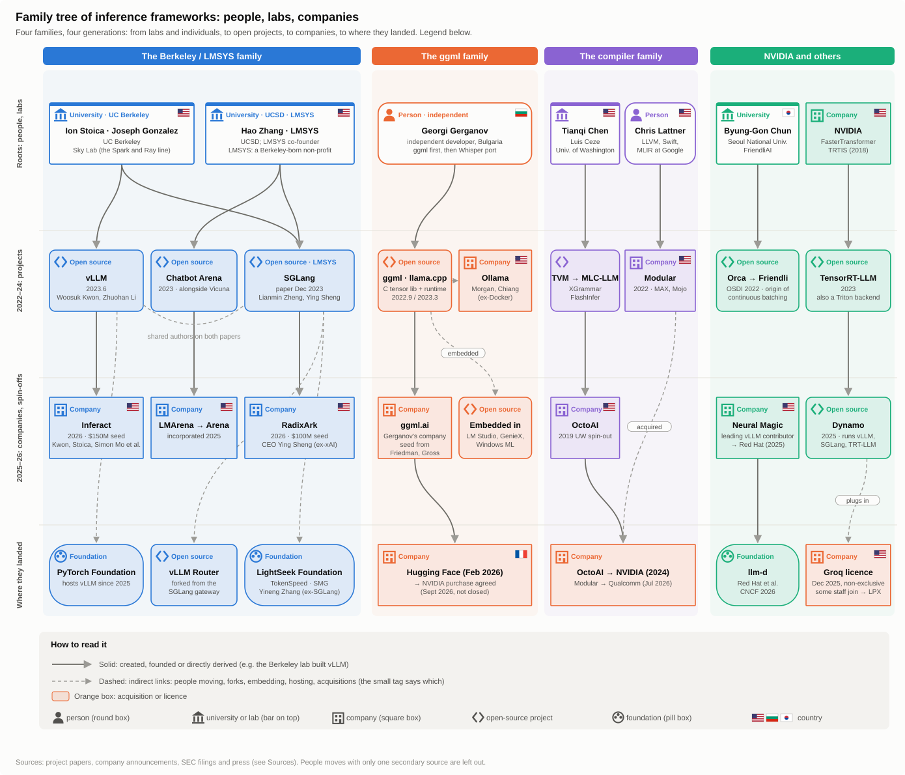](/assets/fw-forensics/tree-en.svg)
*Click the figure to open it full size.*

A few lines worth following:

- **One Berkeley paper, two companies.** The nine authors of the 2023 vLLM paper include both of SGLang's later leads, Lianmin Zheng and Ying Sheng ([vLLM paper](https://arxiv.org/abs/2309.06180), [SGLang paper](https://arxiv.org/abs/2312.07104)). Both projects came out of Ion Stoica's Berkeley lab circle, the line that produced Spark and Ray. In 2026 each engine gained a company behind it (a company is not project governance: vLLM is still hosted by the PyTorch Foundation). On the vLLM side, [Inferact](https://siliconangle.com/2026/01/22/inferact-launches-150m-funding-commercialize-vllm/) counts Stoica and vLLM's first author Woosuk Kwon among its founders and raised a $150M seed. On the SGLang side, [RadixArk](https://pulse2.com/radixark-launches-with-100-million-in-seed-funding-to-democratize-frontier-ai-infrastructure/) is led by CEO Ying Sheng (previously at xAI) and raised a $100M seed.
- **LMSYS was an incubator.** [LMSYS](https://lmsys.org/about/) is a student and faculty organization born at Berkeley and a non-profit since 2024; one co-founder, Hao Zhang, is now at UCSD. It produced Vicuna, Chatbot Arena and SGLang. Chatbot Arena [became a company](https://en.wikipedia.org/wiki/LMArena) in 2025 and was renamed Arena in 2026.
- **People move, and so does code.** An [Ant Group count](https://developer.ant-ling.com/en/blogs/llm-landscape-vllm-sgl/) finds 194 developers who contributed to both vLLM and SGLang (see the original for its time window and de-duplication). vLLM's router is [a fork of the SGLang gateway](https://vllm.ai/blog/2025-12-13-vllm-router-release). Former SGLang core maintainer Yineng Zhang (later at Together AI, per [Latent Space's profile page](https://latent.space/wiki/yineng-zhang/)) co-created TokenSpeed under the non-profit [LightSeek Foundation](https://lightseek.org/blog/lightseek-tokenspeed.html). [FlashInfer](https://arxiv.org/abs/2501.01005), the attention-kernel library both engines use, comes from Zihao Ye at the University of Washington, with Tianqi Chen and Yineng Zhang among its authors.
- **The ggml family started with one person.** ggml is a C tensor library written by Bulgarian developer Georgi Gerganov, think of it as a minimal "bottom half of PyTorch"; llama.cpp is the inference program built on it. He wrote ggml and a GPT-2 implementation first, reused that code to port Whisper, then wrote llama.cpp, and founded ggml.ai in 2023 with seed money from Nat Friedman and Daniel Gross ([QbitAI](https://www.qbitai.com/2023/06/63720.html)). Ollama's founders, Jeffrey Morgan and Michael Chiang, previously built Kitematic and then worked at Docker ([TechCrunch](https://techcrunch.com/2026/07/09/popular-open-source-ai-developer-tool-ollama-raises-65m-grows-to-nearly-9m-users/)). Ollama's pull-and-run command line feels a lot like Docker's, which I suspect is no accident.
- **The compiler family ended up with chip companies.** Tianqi Chen and Luis Ceze built TVM at the University of Washington and spun out OctoML (later OctoAI) in 2019, which [NVIDIA bought in 2024](https://www.geekwire.com/2024/chip-giant-nvidia-acquires-octoai-a-seattle-startup-that-helps-companies-run-ai-models/). Chris Lattner went from LLVM and Swift to MLIR at Google, founded Modular in 2022, and [Qualcomm bought it in July 2026](https://www.nasdaq.com/press-release/qualcomm-completes-acquisition-modular-2026-07-29).
- **Where they landed: foundations and big buyers.** vLLM joined the [PyTorch Foundation](https://pytorch.org/blog/pytorch-foundation-welcomes-vllm/) in 2025; SGLang joined the PyTorch ecosystem, not as a hosted project. Neural Magic, a leading vLLM contributor, was [bought by Red Hat](https://redhat.com/en/about/press-releases/red-hat-completes-acquisition-neural-magic-fuel-optimized-generative-ai-innovation-across-hybrid-cloud), which then started llm-d. The llama.cpp team [joined Hugging Face](https://simonwillison.net/2026/Feb/20/ggmlai-joins-hugging-face/) in February 2026, and on 2 September NVIDIA [signed an agreement](https://www.sec.gov/Archives/edgar/data/0001045810/000104581026000078/nvda-20260902.htm) to buy Hugging Face (about $11.9B, expected to close in the first half of 2027, subject to conditions; it says nothing about the future governance of open projects such as ggml). Add OctoAI and the non-exclusive Groq technology licence (with some staff joining NVIDIA), and NVIDIA is now connected to several branches of this tree.

On the local side, Ollama, [LM Studio](https://lmstudio.ai/blog/0.4.0) and Qualcomm's [GenieX](https://geniex.aihub.qualcomm.com/llms-full.txt) all embed llama.cpp.

The deployment layer gives similar signals. AWS SageMaker's [large-model inference container](https://aws.amazon.com/blogs/machine-learning/supercharge-your-llm-performance-with-amazon-sagemaker-large-model-inference-container-v15/) v15 defaults to vLLM (one product's choice), llm-d is built on vLLM, and Dynamo's backends are vLLM, SGLang and TensorRT-LLM. In the 30 days of PyPI downloads before 15 November, normalized across just these three packages, vLLM, SGLang and llama-cpp-python split roughly 62%, 24% and 14% ([pypistats](https://pypistats.org/packages/vllm)). Downloads include CI and mirrors, so they are not installs, and SGLang's count varies a lot between sources; treat it as rough.

Data and method are in [Appendix A](#method). I found no published chart of inference-engine share over time, so this one is original work and its inputs are published with it.

## 3. Ten axes, and why they sit where they do {#axes}

Each axis runs from 0 to 5 and asks the same question: **how strongly did this instinct shape the framework's defining design decisions?** Each axis has written anchors at 0, 1, 3 and 5.

| Axis · instinct | 0 | 5 |
|---|---|---|
| **Memory · KV as virtual memory** | one contiguous buffer per request | paging, copy-on-write and multi-tier offload are the founding idea |
| **Program · reuse across calls** | stateless single requests | multi-call programs, control flow and sessions are first-class |
| **Scheduler · iteration-level batching** | static batches | the scheduler is the core invention |
| **Compiler · ahead-of-time engine** | eager execution, kernels picked at run time | everything compiled ahead: static memory plan, a binary per shape |
| **Portability · many backends** | one vendor's hardware | portability is the founding goal: CPU, several GPUs, NPU, browser |
| **Fleet · cluster as one machine** | one process, one device | KV-aware routing, planner, KV transfer, failure handling |
| **Vertical · vendor owns the stack** | neutral foundation governance | one vendor from chip to service |
| **Breadth · models and tasks** | one model family | the ecosystem default, day-0 support for new models |
| **Host path · CPU off the token loop** | a Python control loop every step | a native host loop is a founding goal |
| **Device · footprint and energy** | datacenter only, heavy dependencies | built for devices: KB-scale runtime, NPU, energy per token |

**Why this order.** As in part 1, every ring order was tried against the scores themselves, placing correlated axes next to each other. The result reads like a map. At the top and upper right sit memory, program and breadth, the vLLM and SGLang side. Host path and portability sit at the lower right with device at the bottom, the llama.cpp and edge-runtime side. At the lower left are compiler and vertical, the chip-vendor side. Scheduler and fleet sit at the upper left.

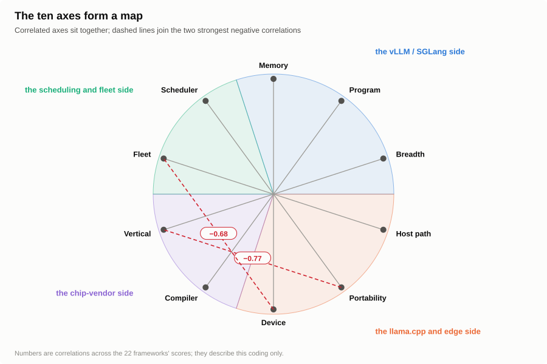

Two negative correlations are the most telling. **Portability and vertical: −0.77.** Chip-vendor stacks score ≥4 on compiler and vertical and 0 on portability; vLLM sits at portability 3.5, compiler 1.5, vertical 0. **Device and fleet: −0.68.** No framework cares about one phone and ten thousand GPUs at once. These are correlations in our own coding; we defined the axes, so part of the correlation comes from how the questions were asked. It also depends on the sample: without the three chip-vendor stacks, the first correlation falls to about −0.60.

## 4. Datacenter engines: batch slots, KV memory, repeated work {#dc}

Averaged over the datacenter engines, the highest axes are scheduler (3.7), memory (3.1) and host path (3.0); compiler is only 1.4. Each engine's sharpest point tends to match the bottleneck it set out to solve early on.

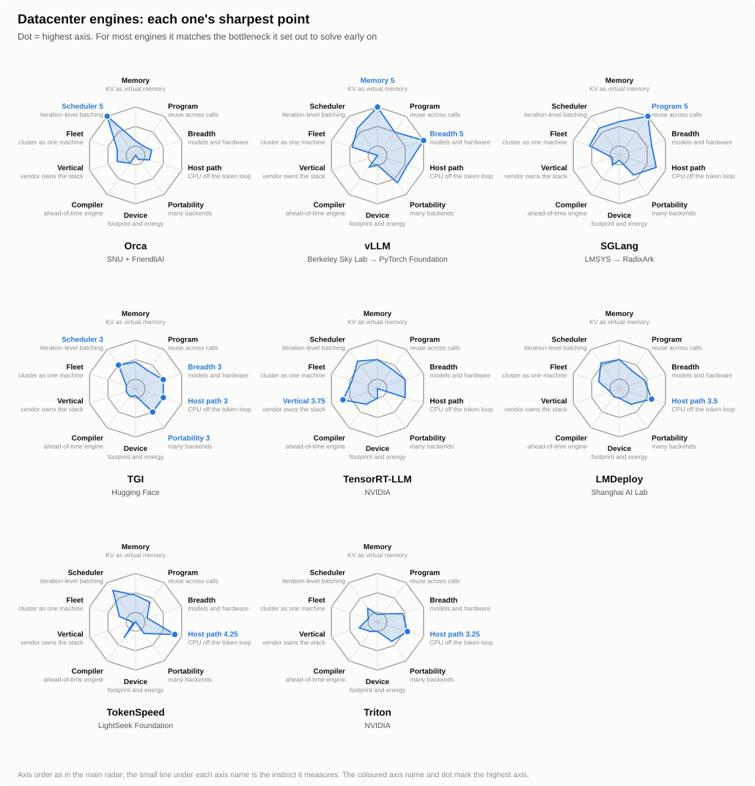

**Orca (Byung-Gon Chun's team at Seoul National University, with FriendliAI): scarce batch slots.** [Orca](https://www.usenix.org/conference/osdi22/presentation/yu) (OSDI 2022) observed that request-level batching makes finished requests wait and keeps new ones out. Its answer was to re-form the batch every iteration (together with selective batching), and it reported 36.9x the throughput of NVIDIA's FasterTransformer at the same latency on GPT-3 175B. The score covers the paper's system: 5 on scheduler, thin evidence on the other axes; the commercial Friendli engine is closed and not scored. The vLLM paper [cites Orca and reimplements it as a baseline](https://arxiv.org/pdf/2309.06180); TGI calls the idea continuous batching and TensorRT-LLM calls it [in-flight batching](https://developer.nvidia.com/blog/nvidia-tensorrt-llm-supercharges-large-language-model-inference-on-nvidia-h100-gpus/). Different names, same idea.

**vLLM (Berkeley's Sky Computing Lab, now under the PyTorch Foundation): scarce KV memory, then breadth.** [vLLM](https://vllm.ai/blog/2023-06-20-vllm) (Berkeley, June 2023) named memory as the bottleneck: the KV cache is large and variable, and poor management caps batch size. PagedAttention borrowed OS virtual memory: fixed blocks, a block table and copy-on-write, so unused KV slots occur only in the last block, under 4% in the paper's evaluation ([paper](https://arxiv.org/abs/2309.06180); that is internal fragmentation, not total memory overhead). At launch it served Vicuna and Chatbot Arena. The second instinct was breadth: [V1](https://vllm.ai/blog/2025-01-27-v1-alpha-release) isolated the engine loop, and after the hardware-plugin RFC, Ascend, Spyre, Neuron, TPU and AMD's ATOM all chose to plug into vLLM, each plugin maintained by a different team. Memory and breadth both score 5; vertical scores 0.

Two groups pay for that breadth. Chip vendors pay in plugin lag: ATOM was tested only on vLLM 0.17.x, and the AFD plugin is pinned to 0.19.1. Users pay a little peak speed; [Baseten's book](https://www.baseten.co/inference-engineering/book/04-software/4.3-inference-engines.md) says vLLM falls short of the top-end performance of narrower engines.

**SGLang (LMSYS, from the Berkeley line, now with RadixArk): scarce repeated work across calls, then the CPU.** [SGLang](https://arxiv.org/abs/2312.07104) started from LLM programs: several generation calls with control flow and structured output. RadixAttention reuses KV across calls and compressed state machines speed up structured output, so it scores 5 on program. The second instinct arrived in [v0.4](https://lmsys.org/blog/2024-12-04-sglang-v0-4): the team said an unoptimized engine can spend half its time on CPU overhead, and shipped an overlap scheduler that prepares the next batch while the GPU works, hiding the CPU's scheduling cost. There is also a cache-aware router in Rust, but that is the request entry point, a separate component from the per-token scheduler. It scores 4 on host path, second only to TokenSpeed.

**TGI, TensorRT-LLM and LMDeploy: the middle ground.** Hugging Face's [TGI](https://huggingface.co/docs/text-generation-inference/index) bet on one-step deployment from the Hub and adopted continuous batching and paged attention rather than inventing them. It is now in maintenance mode, and its docs point users to vLLM, SGLang, llama.cpp and MLX. NVIDIA's [TensorRT-LLM](https://nvidia.github.io/TensorRT-LLM/latest/legacy/tensorrt-backend-removal.html), built on FasterTransformer's kernels, bet on peak speed on NVIDIA's own hardware. It later removed its TensorRT backend, leaving PyTorch as the only execution backend. The two scorers differed by one point on compiler: one read the original engine build, the other today's code; after the review it is scored on today's version, at 2. It scores 3.75 on vertical and 0 on portability. LMDeploy, from Shanghai AI Lab (OpenMMLab), is built around TurboMind, a C++/CUDA engine, and scores 3.5 on host path.

**TokenSpeed (the non-profit LightSeek Foundation, co-created by a former SGLang maintainer): the one new face of 2026.** [TokenSpeed](https://docs.nvidia.com/dynamo/digest/tokenspeed-day-0) started development in mid-March and published a performance preview on 6 May. Its scheduler is native C++, while the runtime and integration layer stay in Python, and it launched with day-0 Dynamo support. The launch tests ran Kimi K2.5 on B200 without prefill/decode disaggregation: about 9% faster than TensorRT-LLM at batch 1, and about 11% more throughput near 100 tok/s per user. Its native scheduler stands out, but the runtime is still Python and there is no evidence the interpreter has left the per-token path, so after the review its host path is scored 3. It also shows how a new engine gets built today: it reuses an existing Rust gateway (SMG), vendor kernel teams and Dynamo. In May it listed model coverage and prefill/decode disaggregation as open work; in October [Dynamo 1.6.0](https://docs.nvidia.com/dynamo/reference/releases/v1-6-0) added prefill/decode disaggregation over Mooncake and KV events for it.

**One observation across eras: host overhead matters again.** The three pre-LLM baselines score low on almost everything but 3 to 3.25 on host path: TF Serving and Triton were C++ servers to begin with, and NNAPI is a native C API on Android (not a server, and it has no per-token loop). In 2023 vLLM and SGLang wrote their scheduling loops in Python for speed of iteration (TGI's router was Rust from the start; TensorRT-LLM's old backend had a C++ batch manager, while today's PyTorch backend drives each step from Python and calls C++ scheduler and KV bindings). From 2024 to 2026 the two used several techniques to cut and hide host overhead: SGLang's overlap scheduler, vLLM V1 moving the engine core into its own process, Rust routers, and vLLM's [Rust front-end RFC](https://github.com/vllm-project/vllm/issues/40846), in which, on a preprocessing-heavy workload, one Rust process served 837 requests per second against 786 for 32 Python API servers. Keep the parts apart: routers and front ends handle request entry, and the per-token scheduler is still Python in both. [vLLM's 0.6 post](https://vllm.ai/blog/2024-09-05-perf-update) gave one breakdown: for Llama 3 8B on one H100, the HTTP server took 33% of the time, scheduling and input preparation 29%, and GPU execution only 38%.

## 5. Cluster layers: the fleet as one machine {#fleet}

The cluster layers have the simplest shape: fleet at 4.9, compiler and device at 0.

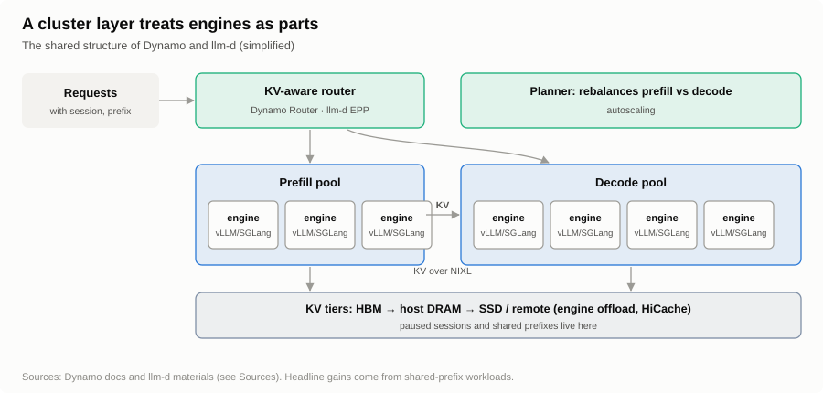

NVIDIA's [Dynamo](https://docs.nvidia.com/dynamo/knowledge-base/overview) (March 2025) names prefill/decode imbalance, KV recomputation when routing ignores cache overlap, and capacity pressure beyond HBM as its problems. Its mechanisms are a KV-aware router, a planner and the NIXL transfer library, with Rust on the hot paths and vLLM, SGLang, TensorRT-LLM and TokenSpeed as backends. Its own KV block manager, KVBM, was [deprecated](https://docs.nvidia.com/dynamo/reference/releases/deprecations) in 1.5.0 (removal planned for 1.7.0); host and disk tiering now uses each engine's own offload. [llm-d](https://www.cncf.io/blog/2026/03/24/welcome-llm-d-to-the-cncf-evolving-kubernetes-into-sota-ai-infrastructure/) is the Kubernetes answer: started in May 2025 by Red Hat, Google, IBM, CoreWeave and NVIDIA, a CNCF Sandbox project since March 2026, [1.0](https://llm-d.ai/blog/llm-d-v1.0-state-of-the-art-inference-ready-for-day-2) in October. It started around vLLM; 1.0 serves through both vLLM and SGLang.

Both rest their headline gains on shared prefixes. Dynamo reports 3x faster time to first token and llm-d reports 35 s down to 120 ms. These are two separate experiments with their own workloads and baselines; what they share is heavy prefix reuse (the llm-d result is described by [Red Hat](https://developers.redhat.com/articles/2026/06/11/intelligent-inference-scheduling-llm-d-red-hat-ai)). With prompts that do not overlap, the prefix-reuse part of the gain shrinks. Their scheduler scores are low (1.75) because routing works per request; iteration-level batching still happens in the engine underneath.

Triton has ended up as a front door for this layer: its product page now calls it [Dynamo-Triton](https://developer.nvidia.com/dynamo-triton), and LLM batching is left to the TensorRT-LLM or vLLM backend.

## 6. Local and edge: developer friction, or engineer time per backend {#edge}

The local and edge group is the mirror image of the cluster layers: device 3.9 and portability 3.4, fleet 0.5. Inside the group, two opposite instincts compete.

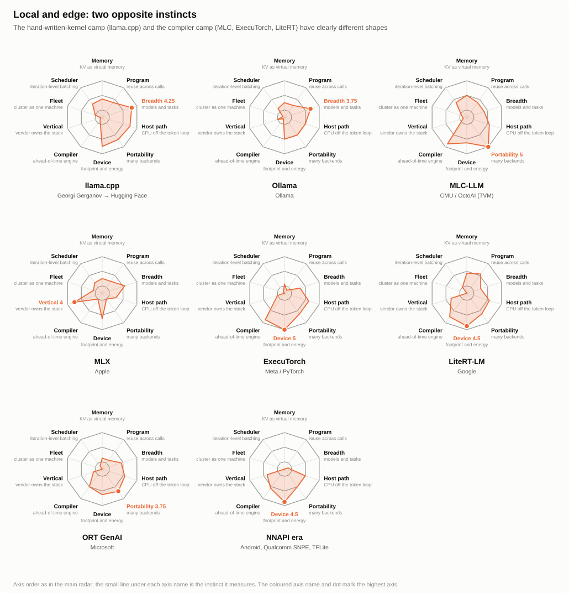

**llama.cpp (Georgi Gerganov's personal project, later ggml.ai): scarce developer friction.** ggml is a C tensor library written in the second half of 2022; it first ran GPT-2 and was then used to port Whisper. On a [podcast](https://changelog.com/podcast/532) Georgi Gerganov described the motive as no dependencies and no setup, plus a back-of-envelope estimate that a 4-bit 65B model fits a MacBook. The bill is hand-written kernels for every backend. llama.cpp scores 4.25 on breadth, 4 on host path and 4 on device, the only framework in the table with three axes at 4 or above. The team joined Hugging Face in February 2026, and NVIDIA agreed to buy Hugging Face in September (not yet closed), so where llama.cpp ends up is still open.

**MLC-LLM (Tianqi Chen and the TVM community) and ExecuTorch (Meta / PyTorch): scarce engineer time per backend.** Tianqi Chen once spent six months hand-writing CUDA kernels for one model, so he wanted TVM compilation to replace a team per platform ([Latent Space](https://www.latent.space/p/llms-everywhere)). MLC's portability is the only 5 in the table, compiling from CUDA all the way to WebGPU in the browser. The [ExecuTorch](https://arxiv.org/abs/2605.08195) authors make the same critique of the hand-written route, that each backend forces a model to be re-implemented. ExecuTorch lowers `torch.export` to fewer than 300 core ops and plans memory at export time; it scores 5 on device and 4.5 on compiler.

**Ollama (Ollama Inc., founded by ex-Docker engineers): a wrapper's choices have a cost too.** [Ollama](https://ollama.com/blog/multimodal-models) built its own Go engine for multimodal models in May 2025, added MLX on Apple silicon in March 2026, and in 0.30 [added llama.cpp](https://registry.ollama.ai/blog/improved-performance-and-model-support-with-gguf) to widen GGUF model coverage. The announcement presents it as an addition, not an abandonment of its own engine; it does show that model coverage is a running cost that even an own engine needs help with.

**Platform owners: a stateful LLM layer over a static graph.** Google's [LiteRT-LM](https://developers.googleblog.com/on-device-genai-in-chrome-chromebook-plus-and-pixel-watch-with-litert-lm/) adds engine and session objects above LiteRT, but on NPUs it ships [one model file per SoC with a fixed context](https://developers.google.com/edge/litert/next/litert_lm_npu), for example 1,280 tokens for Gemma3-1B on Qualcomm, MediaTek and Tensor G5. Microsoft's Phi Silica splits prompts into 64-token chunks. MLX, from Apple's machine-learning research team (Awni Hannun et al.), bets on unified memory and scores 4 on vertical. Their ancestor, Google's Android NNAPI, was [deprecated](https://developer.android.com/ndk/guides/neuralnetworks/migration-guide) in Android 15 because models changed faster than an OS API could keep up with.

## 7. Chip-vendor stacks: the static-shape tax {#chips}

The average chip-vendor stack is vLLM's mirror image: compiler 4.6, vertical 4.6, portability 0. Groq, AWS's Neuron (from Annapurna Labs) and Korea's FuriosaAI all built the compiler first and serving on top. Groq's [SHIP paper](https://proceedings.mlsys.org/paper_files/paper/2026/file/9c20f16b05f5e5e70fa07e2a4364b80e-Paper-Conference.pdf) at MLSys 2026 gives the fullest public account of its first-generation serving stack. The compiler statically schedules every instruction; the runtime allocates KV pages per request and keeps a BlockTrie prefix cache; the scheduler puts decode first by default and chunks prefill dynamically; the host only starts pipelines and collects results. vLLM and SGLang appear in the paper only as GPU baselines.

A compiled backend plugged into dynamic serving usually pays extra for bucketing, padding and feature adaptation; call it the static-shape tax. IBM Research's Spyre has the most detailed record. Its plugin compiles prefill for [a single fixed chunk size](https://docs.vllm.ai/projects/spyre/en/latest/user_guide/configuration.html), [replaces vLLM's V1 scheduler](https://docs.vllm.ai/projects/spyre/en/latest/contributing/scheduler.html), pads decode batches into rectangles, and counts prefix-cache hits only for whole chunks. Its 2024 [RFC](https://github.com/vllm-project/vllm/issues/9652) had continuous batching switched off, and a year after first support, in Q3 2025, it was still a P0 roadmap item. AWS Neuron [compiles a static program per bucket](https://awsdocs-neuron.readthedocs-hosted.com/en/latest/_sources/vllm-neuron/docs/guides/features-guide.md); each bucket costs device memory and start-up time, and prefill and decode never share a batch. A [field study](https://arxiv.org/pdf/2607.08215) of two large workloads on 16 Ascend 910 devices needed twelve source patches, and its authors say engineering effort, not hardware, was the dominant cost.

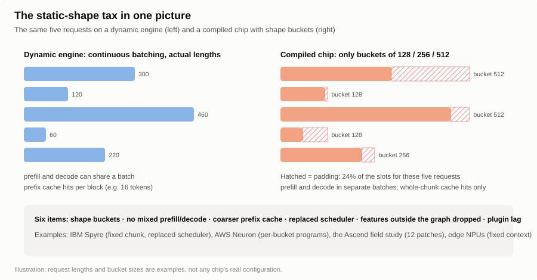

Edge NPUs running LLMs pay a similar tax. KV size is fixed at compile time, and when the context fills a runtime raises an error, slides the window or needs a bigger package. [One paper](https://arxiv.org/html/2607.05475) ran 4-bit Qwen2.5-1.5B on a OnePlus 15: the GENIE NPU path decoded at 23.0 tok/s, against 55.7 tok/s for llama.cpp on the CPU, even though the NPU won prefill by a wide margin. That compares two implementations end to end, not just two chips.

In summary the tax has six items. Spyre and Neuron each paid at least three; the examples come from chips plugged into vLLM, not only from the three vendor stacks scored on the radar:

| Item | What it costs | Example |
|---|---|---|
| Shape buckets | padding wastes compute and memory | Neuron's buckets; Spyre compiles prefill for one fixed chunk size |
| Prefill and decode cannot mix in one batch | they alternate | Neuron; Spyre now interleaves fixed-chunk prefill passes with decode to emulate chunked prefill |
| Prefix caching | missing early, or coarse | Spyre lacked it at the 2024 RFC stage; it is now [on by default](https://docs.vllm.ai/projects/spyre/en/latest/user_guide/configuration.html), in 64-token blocks |
| A replaced scheduler | upstream improvements do not land | Spyre's replacement of the V1 scheduler |
| Features outside the graph take a detour | logprobs, structured output, speculative decoding, LoRA fall back to another execution path, or are refused in some integrations | Neuron falls back to its older model runner by default; the Dynamo sidecar refuses them |
| A plugin that lags upstream | every upgrade is a re-validation | ATOM validated up to 0.17.x at the time; twelve patches in the Ascend study (missing upstream features, correctness, adaptation and performance) |

## 8. A new chip: build its own framework, or plug in? {#newchip}

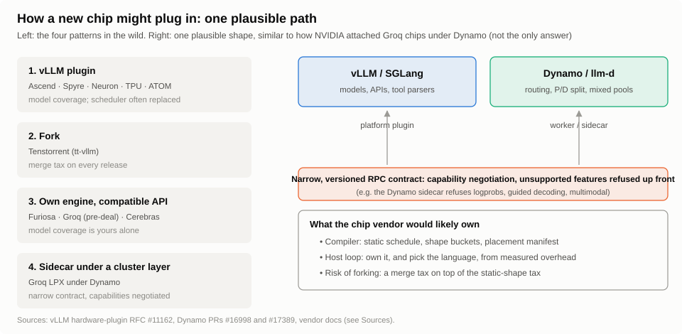

There is no golden answer here. "New chip" can mean a compiled chip, a different architecture altogether, or a system built from several chips, and every team has different constraints. What this section can do is lay out the evidence on both sides and say which path **looks** more likely to work. One caveat first: most of the evidence below comes from statically compiled chips aimed at low-latency decode, and other deployment classes may differ.

**The case for building your own is real.** A compiled chip often gets its compiler before its silicon (Groq did), and schedules all data flow statically. A dynamic engine's scheduler cannot use that and has to be replaced, which is what Spyre did. On GPUs, [TileRT](https://newsletter.semianalysis.com/p/ultra-high-interactivity-on-nvidia) compiles the whole decode graph into one persistent kernel and reaches 340 tok/s per user at one low-latency operating point on 8x B200, against 181.4 tok/s for the best conventional result in the same report; not all of that gap belongs to owning the loop. Owning the loop also lets a vendor decline the features its chip does not do well.

**The case against is heavy too.** Model coverage is a running cost: Ollama built its own Go engine and still added llama.cpp later to widen GGUF coverage. SemiAnalysis reports that most labs do not want to run AMD's ATOM in production and urges AMD to upstream into vLLM. AWS's [lessons from Trainium](https://hosted-files.sched.co/pytorchconferenceeu2026/40/Pluggable%20PyTorch%20LLM%20-%20pytorch%2026.pdf) are that bucketing belongs in the scheduler and vendors should extend vLLM, not fork it. Cluster layers now expect vLLM or SGLang underneath. On the other hand, forking a small component can work: vLLM's router is a fork of SGLang's gateway, and the cost depends on the boundary and the maintenance plan.

**One team that has walked this road.** After licensing Groq's technology, NVIDIA had to bring a compiled chip into its own Dynamo. What it wrote, in [PR #16998](https://github.com/ai-dynamo/dynamo/pull/16998), is a `dynamo-sidecar` that connects a Dynamo worker to the chip's own engine over OpenEngine gRPC. It refuses logprobs, guided decoding and multimodal requests, and can act as a decode worker behind a vLLM prefill worker with KV pulled over NIXL. That PR merged on 27 October; it says the aggregated and prefill/decode paths matched greedy reference outputs on pre-production LPX hardware. [#17389](https://github.com/ai-dynamo/dynamo/pull/17389) was a validation draft closed without merging; [#18362](https://github.com/ai-dynamo/dynamo/pull/18362), merged on 11 November, lets the Dynamo operator consume the compiler's placement instead of deriving it. Merged code, hardware validation, a downloadable release and a public production deployment are four different things, and only the first two are public. NVIDIA kept the chip's own engine, did not port it into vLLM and did not fork vLLM; it put the engine behind a narrow interface. The case validates one path through Dynamo; it does not compare the cost of making the same chip a vLLM or SGLang plugin.

Putting this together, one **plausible** path (not the only one) looks like this:

1. **Chip-specific compilation and execution stay with the vendor.** Static scheduling, shape buckets and placement need knowledge of the chip. Whether to own the host loop, and in which language, depends on measured host overhead: at sub-millisecond token steps the host side may become the ceiling first, but that should be measured, not assumed as "C++ or Rust from day one".
2. **Behind a narrow, versioned interface.** Negotiate capabilities first and refuse unsupported features at the door; that tends to be easier to maintain than half-implementing them. Whether the interface is in-process or an RPC is also a call for measurements on the critical path.
3. **Pick the attachment points you need.** A per-step plugin for vLLM/SGLang keeps the upstream scheduler and model definitions but also inherits its control path; a whole-runtime adapter keeps your own loop but borrows less from upstream; a worker under a cluster layer serves heterogeneous deployments. They give different things, you do not need all of them, and they do not come bundled automatically; a small team with one integration and an existing compiler may be fine. A fork looks cheapest, but the experience of Tenstorrent and the vendor plugins suggests it is likely to turn the static-shape tax into a long-term merge tax.

There are reasons to go the other way too: a company that serves only a few of its own models, or a chip whose execution model is very far from a general engine's, can reasonably build the whole stack.

One question is still open. I found no public measurement of host overhead at sub-millisecond token steps. A [Georgia Tech paper](https://arxiv.org/abs/2603.22774) measured 2–16 ms of CPU-side time per step in vLLM V1, and 46–73 ms under CPU interference. Those numbers include inter-process queueing under that paper's hardware and load, so they are not pure Python compute and not a lower bound. Still, if a chip targets a few milliseconds per token, that order of magnitude is worth measuring first.

## 9. Heterogeneous and disaggregated serving: unify the control plane, not the engine {#hetero}

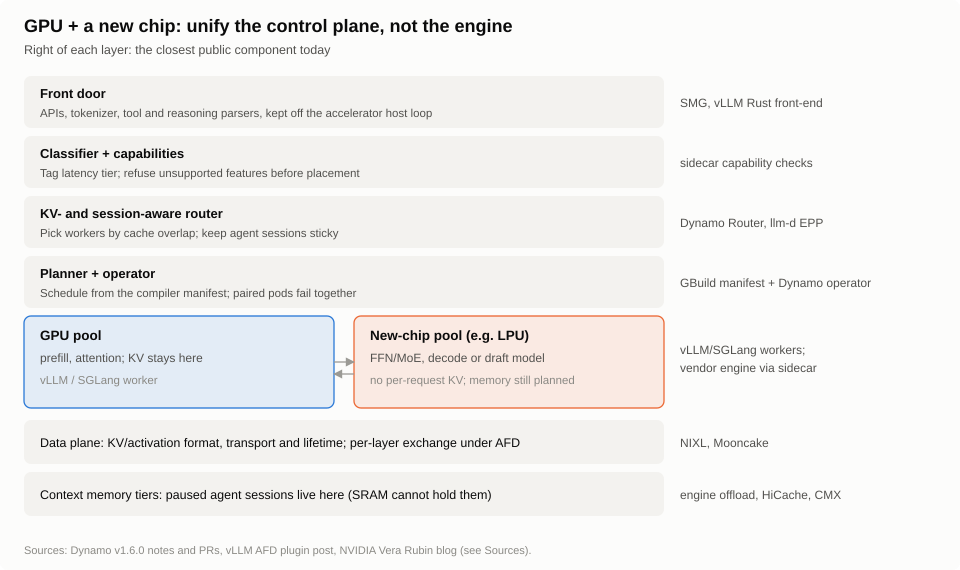

The previous section asked how one chip plugs in. This one asks something different: how several kinds of chip share one request. A new chip will rarely work alone; it will usually sit next to GPUs. And even in all-GPU fleets, separating prefill and decode into different pools is now common practice.

Part 1 covered the most complete public example, the three ways NVIDIA splits work between Vera Rubin and Groq 3 LPX. From the software side, the three place very different demands on a framework:

- **Splitting by phase** (one chip prefills, another decodes, KV handed over) is controlled mainly by the cluster layer, but both sides must agree on KV layout, quantization, positional encoding, transport and lifetime: a data-plane contract, not just a routing policy. AWS Trainium with Cerebras, AMD with Cerebras and SambaNova all describe this split; in the announcements I checked, none names its scheduler or KV transfer, and all performance figures are projections.
- **Draft/verify** needs a tuning loop between draft length and acceptance rate, compatible tokenizers and sampling on both sides, and a rollback or commit of two sets of state after verification.
- **Splitting by layer (AFD, attention–FFN disaggregation)** is the tightest coupling. ByteDance's [MegaScale-Infer](https://arxiv.org/abs/2504.02263v4) introduced it in 2025, and vLLM's [AFD plugin](https://vllm.ai/blog/2026-07-23-vllm-afd-plugin) keeps scheduling, KV and sampling on the attention side and keeps no per-request KV on the FFN side. At launch it already had validation paths on separate backends such as NVIDIA GPUs and Ascend NPUs; splitting one request across different accelerator types is what remains future work. There is counter-evidence: a 128-B200 [simulation](https://arxiv.org/abs/2605.28302) finds AFD wins only at the strictest interactivity targets, and [Baidu](https://arxiv.org/abs/2602.09721) reports an AFD "dead zone" under its interconnect and model conditions. Under those conditions it looks more like a latency-tier option than a default.

Putting these public designs together, a GPU plus new-chip system needs roughly the seven layers in the figure, and each already has a closest open-source component. What needs unifying, then, appears to be the control plane (routing, planning, capability negotiation, failure semantics), not one engine that runs every chip; the format, transport and lifetime of KV and activations need a separate data-plane contract.

One detail matters a lot: **in NVIDIA's layer-split design the KV cache stays on the GPU.** The new-chip side then needs no per-request KV manager, but weights, activations and workspaces still need memory planning, which can be a static partition plan plus a deterministic RPC. If the new chip runs the whole decode on its own, things change: Groq's SHIP paper describes the chip managing paged KV itself. The PRs also say some paths have not yet run on hardware, so this is early code.

What crosses the link between the two chips per token, how big it is and how fast, is not public. [NVIDIA's blog](https://developer.nvidia.com/blog/how-the-nvidia-vera-rubin-platform-is-solving-agentic-ais-scale-up-problem/) says only that activations are exchanged each token; [Hot Chips coverage](https://tomshardware.com/tech-industry/semiconductors/nvidia-presents-groq-3-lpx-architecture-and-unveils-its-first-third-party-inference-benchmark) adds that an FPGA bridges the synchronous domain to the GPU. Until those numbers are published, outside readers cannot independently work out the latency budget of the layer split.

## 10. From token inference systems to task inference systems {#task}

**The B2A economy.** In November an a16z piece named what is happening the [B2A economy](https://www.a16z.news/p/welcome-to-the-b2a-economy) (business-to-agent): agents are moving from answering questions to completing tasks, choosing products, creating databases and deploying code on users' behalf. Its numbers are blunt. In September more than 40% of GitHub PRs began as an agent's draft, up from 17% six months earlier; more than 60% of new Supabase databases are created by AI tools; agent-triggered deployments on Vercel grew 28x in a year. The three have different denominators and describe what agents do, not outcome quality, how customers pay, or inference cost.

**The S-1's yardstick.** At the same time, Anthropic's [S-1](https://www.sec.gov/Archives/edgar/data/2130357/000162828026067168/anthropicpbc-sx1.htm), filed on 26 October, measures customer value as cost per task. By the company's own account, Opus 5.5 cut customers' cost per task by about 40% versus Opus 5; that mixes pricing, model efficiency and quality, and it is not a serving-engine metric. In token-metered API use, billing is still in tokens; usage-based revenue was 80% of revenue in the first half of 2026, with most of the rest from subscriptions. The value metric has changed; the API pricing metric has not.

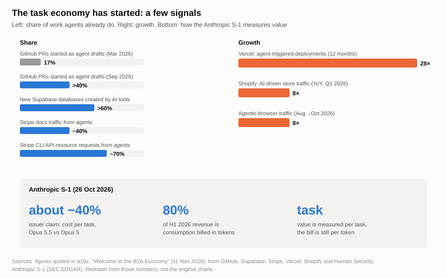
*Redrawn from the numbers a16z quotes; their own charts are nicer and worth a look in [the original piece](https://www.a16z.news/p/welcome-to-the-b2a-economy).*

The buyer pays for a finished task, so inference systems need to move from token inference systems toward task inference systems. Every framework above optimizes tokens, tokens per second and dollars per token, and they all sit below the harness, the agent's outer loop. The rest of this section looks at how far the move has gone: on the engine side, so far, as far as sessions.

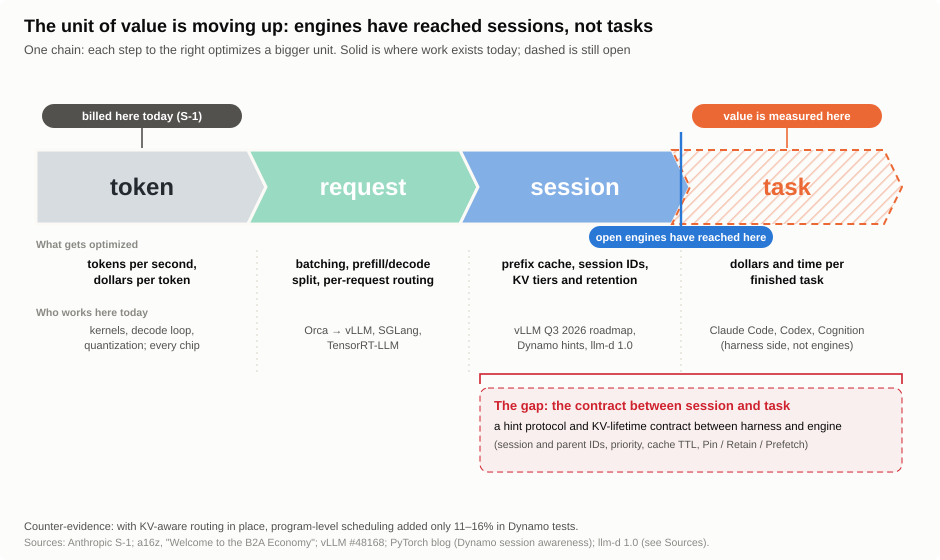

**Where an agent task's money goes.** SemiAnalysis's [AgentX](https://newsletter.semianalysis.com/p/agentx-inferencexv3-does-cuda-moat) public benchmark is 393 filtered and reconstructed Claude Code sessions, drawn from a collection of about 8,300 sessions. In that processed subset, median input per request is 142K tokens against 444 output, and the median gap between turns is 3.84 s (including tool and human waits). A Stanford [paper](https://arxiv.org/pdf/2608.25399) priced five selected SWE-bench Verified tasks run with Kimi K3 at list prices: a median of $0.11 to $1.16 per run, a 96.3% cache hit rate, and output that is 2.7% of tokens but 51% of dollars. The authors warn that these shares depend on the prices and cache conditions and do not transfer to other stacks. Once the cache is evicted, the bill changes: in one study of high-concurrency agent batch inference, recomputing prefixes lost during tool pauses reached [49.1%](https://arxiv.org/pdf/2601.22705) of end-to-end latency. At cache reads of 5% and writes of 125–200% of the input price, a prefix that breaks and is billed again as a cache write costs roughly as much as 25 to 40 cache reads (25x for a 5-minute cache write, 40x for 1 hour; my arithmetic); an internal KV eviction is not automatically a cache miss on the customer's bill. In the outcome-pricing examples I could find, such as [Intercom Fin](https://www.intercom.com/learning-center/ai-customer-service-agent-pricing-comparison) at $0.99 per resolution, a "resolution" can include a presumed one, where the customer leaves and does not ask again.

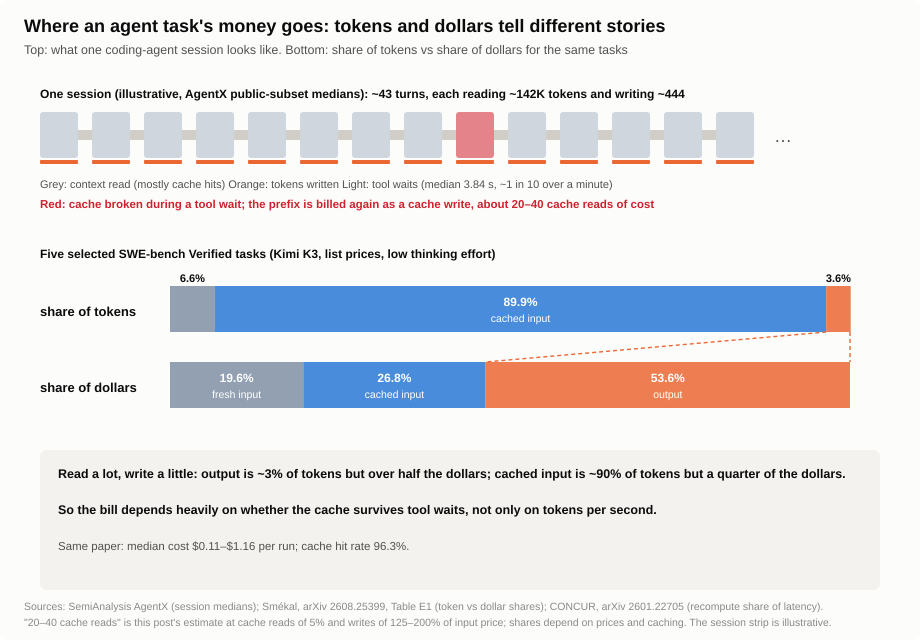

**The two sides are converging, on sessions.** The Claude Code team says it builds [the whole harness around prompt caching](https://claude.com/blog/lessons-from-building-claude-code-prompt-caching-is-everything) and treats a drop in hit rate as an incident; [Codex](https://openai.com/index/unrolling-the-codex-agent-loop) documents the same prefix discipline. On the engine side, vLLM's Q3 2026 roadmap lists session IDs and multi-tier KV offload, Dynamo maps session headers from Claude Code, Codex and OpenCode and ported a program-level scheduler, and llm-d 1.0 added session-aware routing. By their own stated design principles, all of these are **optional hints**: old clients keep working, though new optional fields appear. In multi-tenant serving, session leases, cache quotas and isolation between tenants still have to be owned by the server.

**Counter-evidence limits how far integration should go.** Lab papers report 4–15x from program-level scheduling, but against engines with no session awareness. Dynamo's [two tests](https://pytorch.org/blog/session-aware-agentic-inference-with-nvidia-dynamo/) use different baselines: on SWE-bench on one 8xH100 node, program-level scheduling added about 12–16% throughput over KV-aware routing alone; in agent RL rollout on another setup, against VERL's global load balancer, it added 11.0–14.6% at medium concurrency and about nothing at low concurrency. In one GPU-only study, agent-aware eviction did 7–23% worse than plain LRU. I found no paper that optimizes dollars per completed task directly.

**Does AI coding make a rewrite cheap?** Where an oracle exists, yes. By its author's account, [Bun](https://bun.com/blog/bun-in-rust)'s port of 535,000 lines of Zig to Rust merged into main after 11 days, with about $165,000 of API spend at list price before the merge, gated by roughly 60,000 tests per platform (security review, fuzzing and regression fixes followed the merge). Anthropic's research C compiler took two weeks and under $20,000 with GCC as the oracle. Neither is a full engineering cost. An inference engine's correctness and performance can both be measured, and evaluations such as [FlashInfer-Bench](https://arxiv.org/abs/2601.00227) exist; what is hard is representative workloads, comparability and hardware coverage, which is exactly where the Ascend study found the cost. Within what I searched, I found no production inference engine written mostly by agents. On the maintainer side, vLLM's [contributing guide](https://docs.vllm.ai/en/stable/contributing/) requires human review and does not accept pure-agent PRs. A closer data point is November's [ServerBench](https://arxiv.org/abs/2611.06841): agents build specialised inference servers against a given workload, state replay and an independent validator, with both passing and failing results. It shows that with an evaluator, results can be compared; it applies to those tasks and does not mean general production engines can now be rewritten by agents.

**What a sensible integration layer might look like.** One possible split is by access pattern. Work that needs per-token access (grammar masks, KV residency, sampling) stays in the engine. I/O-bound work (tools, history, parsing, MCP orchestration) moves to a gateway beside it, as in SMG. Between them sits a hint protocol and a KV-lifecycle interface: session and parent IDs, priority, expected output length, cache TTL, and verbs such as Pin, Retain and Prefetch, proposed in [SGLang #27574](https://github.com/sgl-project/sglang/issues/27574) (a closed issue) and [vLLM #51428](https://github.com/vllm-project/vllm/issues/51428) (an open RFC); neither is a shipped, interoperable protocol. This does not necessarily need a rewritten engine. A multi-tenant engine also cannot trust harness hints blindly, which is why one proposal adds a credit mechanism.

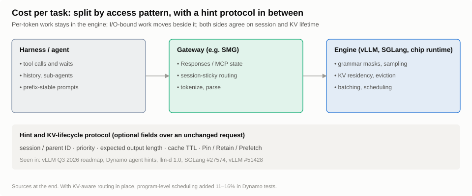

**Who will build it.** Vertically integrated harness owners are already changing serving inside their own stacks. OpenAI built a [connection-scoped WebSocket cache](https://openai.com/index/speeding-up-agentic-workflows-with-websockets) once a 1,000 tok/s target made API overhead a large share of agent latency. Cognition [co-designed](https://cognition.com/blog/swe-1-5) its model, harness and Cerebras inference, and rewrote lint and command execution to save, by its report, up to 2 s per step. The gateway and cluster layer is growing upward: LightSeek ships both SMG and TokenSpeed, and NVIDIA added agent hints to Dynamo. The two engine start-ups, Inferact (vLLM) and RadixArk (SGLang), have published no harness roadmap.

For anyone building a fast-decode chip there is a specific warning. Unless harness, tool and API latency fall with it, faster decode soon stops adding per-task value, and the KV of a paused session has to live somewhere other than on-chip memory. Estimating how much task time faster decode saves means measuring API, tool execution and cache waits too, not just tokens per second; where paused KV lives depends on capacity, resume cost and recompute cost.

## 11. Closing: five takeaways {#close}

1. **Today's mainstream frameworks are young and come from two families.** vLLM, SGLang, llama.cpp and Ollama were all born around 2023; within the 23 repositories I picked, since 2024 the Berkeley/LMSYS and ggml lineages have taken 74–80% of new stars in every half-year. That is developer attention, not production share.
2. **Each framework's sharpest point tends to match the bottleneck it set out to solve early on.** Orca's scheduler, vLLM's memory, SGLang's program runtime, MLC's portability and ExecuTorch's device axis all score 5.
3. **The moat moved from mechanisms to interfaces.** Everyone copied PagedAttention; what stayed is vLLM's plugin interface and API compatibility. NVIDIA plugged Groq's chips in through a sidecar interface, not a new framework.
4. **A new chip may gain more from shaping interfaces than from a new framework.** The static-shape tax (Spyre, Neuron, Ascend) and plugin lag both suggest that an early, narrow, versioned interface often pays off more than starting over. For most new-chip teams, reusing the mature ecosystem first and deciding how much to build from measured bottlenecks is usually the safer path.
5. **The next battleground is the task, not the token.** a16z's B2A figures and the Anthropic S-1 both point to accounting per task; engines have reached sessions, and the hint and KV-lifetime contract between harness and engine is not yet written.

Inference Year One was almost three years ago. Walking it backwards leaves the same checklist as part 1: what was scarce, which mechanism answered it, and who pays.

---

*The two appendices are for readers who want to check the work; feel free to skip them.*

## Appendix A: method and limits {#method}

**Scoring.** One rubric, two independent passes: scorer A worked framework by framework, scorer B axis by axis, neither saw the other's results, both used public sources only, and every cell has a reason, a source and a confidence level. Of 220 cells, 129 were identical, 73 differed by half a point, 15 by exactly one point and 3 by more than one; those 3 were settled on primary sources (Groq's memory and scheduler from the SHIP paper; Orca's host path at low confidence). Every other cell is the average of the two passes.

**Stars and family tree.** Star data comes from public git repositories that commit dated star counts daily ([EvanLi/Github-Ranking](https://github.com/EvanLi/Github-Ranking), [yuxiaopeng/Github-Ranking-AI](https://github.com/yuxiaopeng/Github-Ranking-AI) and others); missing values count as zero, and SGLang's 2026 monthly PyPI data, inflated by automated traffic, was not used for any time series. Every edge in the family tree has a public source; people moves backed by a single secondary source are left out of the figure.

**Changelog (2026-11-16).** After publication, a second colleague's independent audit brought another set of fixes: Spyre's current state (prefix caching on by default, prefill and decode interleaved), the cache-write multiple (25–40 cache reads), Dynamo's two experiments written separately, an unreachable survey figure removed, missing conditions added to several benchmarks, the status of the LPX pull requests, Groq as a non-exclusive licence, the scope of AFD validation, and two TokenSpeed scores (host path 4.25 → 3, program 2.5 → 2).

**Post-review corrections.** A colleague ran an independent audit: re-ran the merge and the statistics, checked 30 random cells and every disagreement cell. Following it, I updated a set of reasons to the November 2026 versions and changed 10 scores (TensorRT-LLM program, fleet and compiler; Dynamo memory; TokenSpeed program; Neuron program and host path; ONNX Runtime GenAI portability; llm-d program and breadth). Each changed cell carries its new reason and source in the data file. The disagreement counts above are computed on the two raw passes and are not affected.

**Scope.** The 22 frameworks are not a census: they are representative serving engines since 2016, cluster layers, edge runtimes and three chip-vendor stacks. Each is scored on its version as of November 2026; Orca is scored on the paper's system. Some axes overlap (breadth counts model and task coverage only; hardware coverage sits in portability): host path mixes language, overlap and routing; memory and program, and portability and vertical, are related; and some axes do not apply to some layers, so a 0 sometimes means "not applicable".

**Limits.** Scores are judgements, not measurements; Orca's commercial engine, Groq's serving stack and TokenSpeed's internals are thinly documented and marked low confidence; frameworks change, and scores are as of 15 November 2026; the axis order and origin groups are layout choices; much of the heterogeneous and cost-per-task material comes from vendor blogs and early PRs.

Every score, reason and source is in the "Data table" tab and the [data file](/assets/fw-forensics/fw-data.js); the star data is [here](/assets/fw-forensics/attention-data.js). Corrections are welcome.

## Appendix B: sources {#sources}

The Chinese and English versions share the same source list, and every score's source is in the data file. Main sources:

- Family tree and people: [LMSYS](https://lmsys.org/about/); [Inferact funding](https://siliconangle.com/2026/01/22/inferact-launches-150m-funding-commercialize-vllm/); [a16z on Inferact](https://a16z.com/announcement/investing-in-inferact/); [RadixArk funding](https://pulse2.com/radixark-launches-with-100-million-in-seed-funding-to-democratize-frontier-ai-infrastructure/); [LMArena](https://en.wikipedia.org/wiki/LMArena); [vLLM Router](https://vllm.ai/blog/2025-12-13-vllm-router-release); [LightSeek and TokenSpeed](https://lightseek.org/blog/lightseek-tokenspeed.html); [FlashInfer](https://arxiv.org/abs/2501.01005); [ggml.ai (QbitAI)](https://www.qbitai.com/2023/06/63720.html); [ggml.ai joins Hugging Face](https://simonwillison.net/2026/Feb/20/ggmlai-joins-hugging-face/); [NVIDIA 8-K on Hugging Face](https://www.sec.gov/Archives/edgar/data/0001045810/000104581026000078/nvda-20260902.htm); [NVIDIA acquires OctoAI](https://www.geekwire.com/2024/chip-giant-nvidia-acquires-octoai-a-seattle-startup-that-helps-companies-run-ai-models/); [Qualcomm completes Modular acquisition](https://www.nasdaq.com/press-release/qualcomm-completes-acquisition-modular-2026-07-29); [Red Hat completes Neural Magic acquisition](https://redhat.com/en/about/press-releases/red-hat-completes-acquisition-neural-magic-fuel-optimized-generative-ai-innovation-across-hybrid-cloud); [PyTorch Foundation welcomes vLLM](https://pytorch.org/blog/pytorch-foundation-welcomes-vllm/)
- Pre-LLM: [TensorFlow Serving open-sourced](https://opensource.googleblog.com/2016/02/running-your-models-in-production-with.html); [TF Serving design paper](https://arxiv.org/abs/1712.06139); [TensorRT Inference Server announced](https://www.edge-ai-vision.com/?p=4341); [renamed Triton](https://docs.nvidia.com/deeplearning/triton-inference-server/release-notes/rel_20-03.html); [Dynamo-Triton](https://developer.nvidia.com/dynamo-triton); [NNAPI migration guide](https://developer.android.com/ndk/guides/neuralnetworks/migration-guide)
- Datacenter engines: [Orca (OSDI 2022)](https://www.usenix.org/conference/osdi22/presentation/yu); [vLLM blog](https://vllm.ai/blog/2023-06-20-vllm) and [paper](https://arxiv.org/abs/2309.06180); [vLLM V1](https://vllm.ai/blog/2025-01-27-v1-alpha-release); [vLLM 0.6 performance update](https://vllm.ai/blog/2024-09-05-perf-update); [vLLM Rust front-end RFC](https://github.com/vllm-project/vllm/issues/40846); [SGLang paper](https://arxiv.org/abs/2312.07104); [SGLang v0.4](https://lmsys.org/blog/2024-12-04-sglang-v0-4); [TGI docs](https://huggingface.co/docs/text-generation-inference/index); [TensorRT-LLM backend removal](https://nvidia.github.io/TensorRT-LLM/latest/legacy/tensorrt-backend-removal.html); [TensorRT-LLM launch](https://developer.nvidia.com/blog/nvidia-tensorrt-llm-supercharges-large-language-model-inference-on-nvidia-h100-gpus/); [Baseten on inference engines](https://www.baseten.co/inference-engineering/book/04-software/4.3-inference-engines.md); [TokenSpeed on Dynamo](https://docs.nvidia.com/dynamo/digest/tokenspeed-day-0); [SMG](https://pytorch.org/blog/lightseek-smg/)
- Cluster layers: [Dynamo overview](https://docs.nvidia.com/dynamo/knowledge-base/overview); [Dynamo deprecations](https://docs.nvidia.com/dynamo/reference/releases/deprecations); [Dynamo 1.6.0](https://docs.nvidia.com/dynamo/reference/releases/v1-6-0); [llm-d 1.0](https://llm-d.ai/blog/llm-d-v1.0-state-of-the-art-inference-ready-for-day-2); [llm-d joins CNCF](https://www.cncf.io/blog/2026/03/24/welcome-llm-d-to-the-cncf-evolving-kubernetes-into-sota-ai-infrastructure/); [llm-d scheduling (Red Hat)](https://developers.redhat.com/articles/2026/06/11/intelligent-inference-scheduling-llm-d-red-hat-ai); [SageMaker LMI v15](https://aws.amazon.com/blogs/machine-learning/supercharge-your-llm-performance-with-amazon-sagemaker-large-model-inference-container-v15/)
- Local and edge: [Gerganov on Changelog #532](https://changelog.com/podcast/532); [Tianqi Chen on Latent Space](https://www.latent.space/p/llms-everywhere); [ExecuTorch paper](https://arxiv.org/abs/2605.08195); [LiteRT-LM](https://developers.googleblog.com/on-device-genai-in-chrome-chromebook-plus-and-pixel-watch-with-litert-lm/); [LiteRT-LM on NPUs](https://developers.google.com/edge/litert/next/litert_lm_npu); [Ollama multimodal engine](https://ollama.com/blog/multimodal-models); [Ollama 0.30](https://registry.ollama.ai/blog/improved-performance-and-model-support-with-gguf); [LM Studio 0.4.0](https://lmstudio.ai/blog/0.4.0); [GenieX](https://geniex.aihub.qualcomm.com/llms-full.txt)
- Chip vendors: [Groq SHIP paper (MLSys 2026)](https://proceedings.mlsys.org/paper_files/paper/2026/file/9c20f16b05f5e5e70fa07e2a4364b80e-Paper-Conference.pdf); [Spyre configuration](https://docs.vllm.ai/projects/spyre/en/latest/user_guide/configuration.html) and [scheduler](https://docs.vllm.ai/projects/spyre/en/latest/contributing/scheduler.html); [Spyre RFC #9652](https://github.com/vllm-project/vllm/issues/9652); [Neuron vLLM features guide](https://awsdocs-neuron.readthedocs-hosted.com/en/latest/_sources/vllm-neuron/docs/guides/features-guide.md); [Ascend field study](https://arxiv.org/pdf/2607.08215); [AWS on pluggable PyTorch LLM serving](https://hosted-files.sched.co/pytorchconferenceeu2026/40/Pluggable%20PyTorch%20LLM%20-%20pytorch%2026.pdf); [Dynamo PR #16998](https://github.com/ai-dynamo/dynamo/pull/16998); [TileRT (SemiAnalysis)](https://newsletter.semianalysis.com/p/ultra-high-interactivity-on-nvidia); [CPU overhead in vLLM V1 (Georgia Tech)](https://arxiv.org/abs/2603.22774)
- Heterogeneous: [MegaScale-Infer](https://arxiv.org/abs/2504.02263v4); [vLLM AFD plugin](https://vllm.ai/blog/2026-07-23-vllm-afd-plugin); [Baidu on AFD](https://arxiv.org/abs/2602.09721); [Vera Rubin and LPX](https://developer.nvidia.com/blog/how-the-nvidia-vera-rubin-platform-is-solving-agentic-ais-scale-up-problem/); [LPX at Hot Chips](https://tomshardware.com/tech-industry/semiconductors/nvidia-presents-groq-3-lpx-architecture-and-unveils-its-first-third-party-inference-benchmark)
- Cost per task: [a16z: Welcome to the B2A economy](https://www.a16z.news/p/welcome-to-the-b2a-economy); [Anthropic S-1](https://www.sec.gov/Archives/edgar/data/2130357/000162828026067168/anthropicpbc-sx1.htm); [Intercom pricing](https://www.intercom.com/learning-center/ai-customer-service-agent-pricing-comparison); [SWE-bench task costs](https://arxiv.org/pdf/2608.25399); [CONCUR](https://arxiv.org/pdf/2601.22705); [Claude Code and prompt caching](https://claude.com/blog/lessons-from-building-claude-code-prompt-caching-is-everything); [Codex agent loop](https://openai.com/index/unrolling-the-codex-agent-loop); [OpenAI WebSockets](https://openai.com/index/speeding-up-agentic-workflows-with-websockets); [Cognition SWE-1.5](https://cognition.com/blog/swe-1-5); [AgentX (SemiAnalysis)](https://newsletter.semianalysis.com/p/agentx-inferencexv3-does-cuda-moat); [FlashInfer-Bench](https://arxiv.org/abs/2601.00227); [Bun in Rust](https://bun.com/blog/bun-in-rust); [vLLM contributing guide](https://docs.vllm.ai/en/stable/contributing/)
- Stars and downloads: [EvanLi/Github-Ranking](https://github.com/EvanLi/Github-Ranking); [yuxiaopeng/Github-Ranking-AI](https://github.com/yuxiaopeng/Github-Ranking-AI); [pypistats](https://pypistats.org/packages/vllm); [Ant open-source community on vLLM and SGLang](https://developer.ant-ling.com/en/blogs/llm-landscape-vllm-sgl/)
