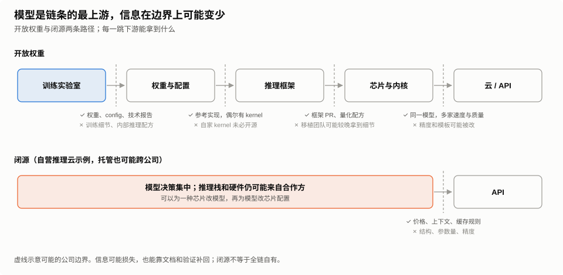
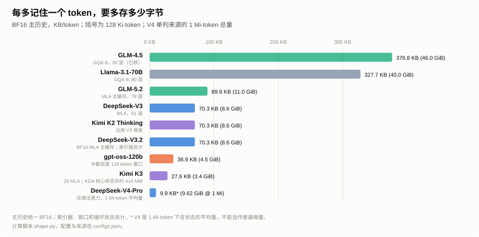
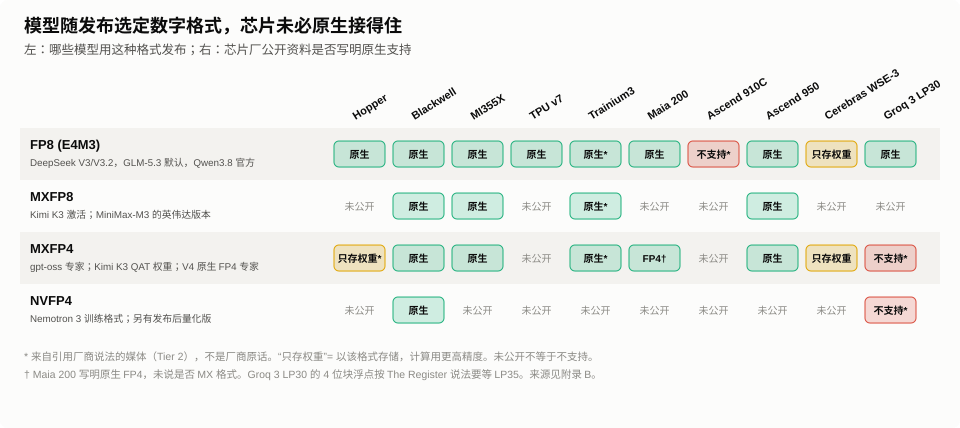
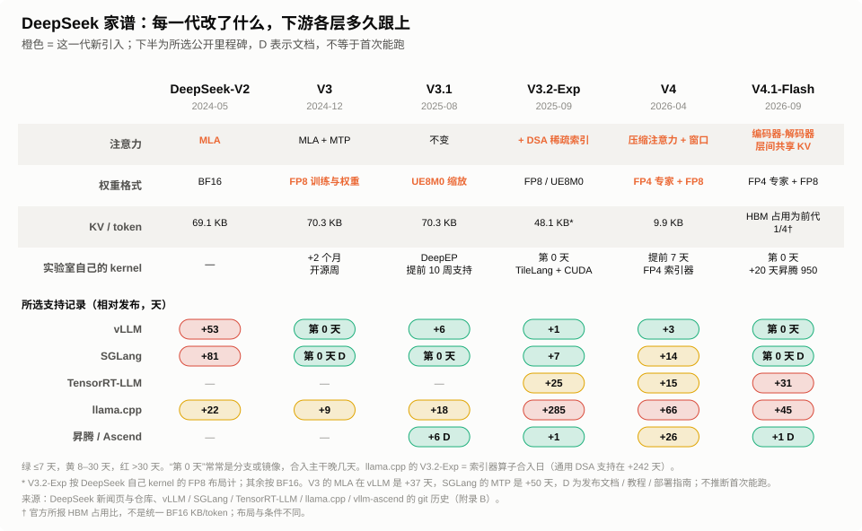
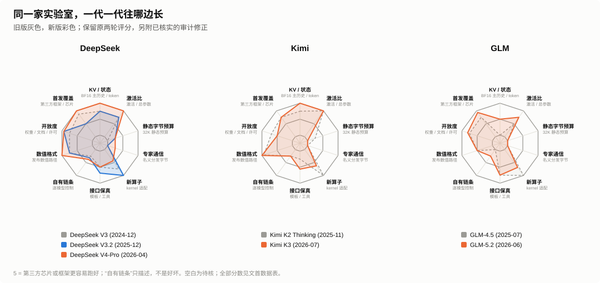
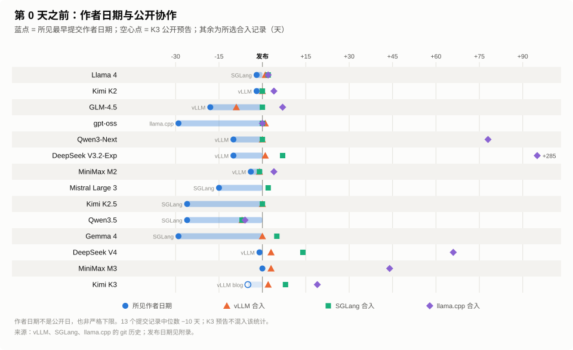
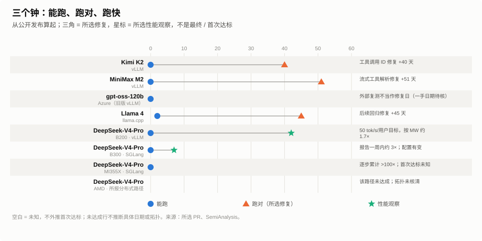



*法医威尔系列终篇。[第一篇](/zh/2026/11/inference-chip-shapes/)看芯片，[第二篇](/zh/2026/11/inference-framework-forensics/)看框架；这一篇用模型接上三角形的最后一个角。*

<link rel="stylesheet" href="/assets/chip-radar/radar.css">
<link rel="stylesheet" href="/assets/model-forensics/mf.css">

这个系列，起初只是一个周末冒出来的念头：把已经出货的芯片放到桌上，沿着公开证据往回找，看看设计者当时在想什么。

于是有了第一篇的 43 颗推理芯片。算力、内存、带宽、编译器，我想从这些形状里读出：不同团队当时认为什么最稀缺。接着，我把同样的方法往上挪了一层，看了 22 个推理框架：芯片交到软件手里之后，哪些约束被化解了，哪些又换了一种形式出现？

走到这里，三角形还差一个角，很可能也是最重要的一个角：模型。模型实验室选择注意力、专家结构、数字格式和接口，很大程度上决定了芯片与框架要做什么；而训练时的硬件约束，也会反过来写进模型的形状。这个终篇看 20 个模型，把最后一个角接上。

**模型 × 推理软件 × 芯片。三个角，交付同一个系统的性能。** 理想的协同设计，是从模型和负载出发，一起推敲三个角的选择，再让实测结果反馈到设计中。现实里，能一起改动多少，取决于团队掌握哪几个角。有些公司能在特定系统里覆盖三个角，另一些掌握两个，或者一个。芯片与框架团队拿到的模型往往已经成形，相当一部分工作，是适配上游已经作出的决定。跨公司的协同设计也能做，但需要共享知识、提前合作，以及能把关键信息传过去的接口。

这个系列沿着这样的现实往回走：从已经交付的结果，追到背后的约束与取舍，再带着这些认识走向下一次设计。模型在上游，工程上要把这个环闭合。三篇走完，希望我们能更早认出新的瓶颈——当目标从生成一个 token，走向完成一项任务，甚至交付一个应用结果，谁能改动哪一个角，又该怎样一起做？

所以这一篇的问题是：**模型在训练与发布时做的选择，给下游留下了多少作业？这份作业多快能做完？谁在做？** 我给 20 个模型（14 个开放权重，6 个闭源或绑定设备）在 10 个维度上打了 0–5 分。A1–A4 在配置充分时按脚本计算，其余维度是判断；公开资料不足的估计会标出置信度，两轮独立打分再对账。依据全是公开的论文、模型卡、代码仓库、PR 和厂商文档。先玩，长文在后面。

**怎么看。** 前九个维度的方向一致：**5 分 = 第三方芯片或框架更容易把它跑好**。比如「KV / 状态」5 分是每 token 只要存很少的历史，「新算子」5 分是成熟 kernel 类型基本可以复用。第十个维度「自有链条」只是描述实验室自己掌握多少下游，不分好坏。闭源模型未公开的维度留空，不参与面积或均值；「不适用」和「待核」也分别标明，**不公开不等于 0 分**。轮廓不是模型能力排名；A10 只描述；A9 统一评价第三方框架与芯片的首发支持，闭源或设备绑定模型标为不适用，渠道另作文字说明。

<nav class="toc" markdown="1">
**目录**

1. [模型是链条的最上游](#chain)
2. [形状：每多记住一个 token，要多存多少字节](#shape)
3. [数字格式：在训练时就选了芯片](#formats)
4. [DeepSeek 家谱：kernel 自己写，下游就快](#deepseek)
5. [Kimi 和 GLM：相近结构，不同的服务难题](#kimi-glm)
6. [三个钟：能跑、跑对、跑快](#clocks)
7. [链条在商业边界上变细](#boundary)
8. [对一颗新芯片意味着什么](#newchip)
9. [结语：五个要点](#close)

附录 A：[方法与局限](#method) · 附录 B：[参考来源](#sources)
</nav>

## 1. 模型是链条的最上游 {#chain}

*点图可看大图。*

一个开放权重模型从实验室走到用户，大致要过四道手：实验室发布权重和配置，推理框架写支持代码，芯片团队写 kernel、做量化，云厂商或推理服务商把它包成 API。这些交接可能跨过公司边界，也可能由同一家团队完成。实验室知道自己的模型在什么批大小、什么并行方式、什么精度下跑得最好，也知道聊天模板里哪个字段最容易出错。但这些知识不一定会跟着权重一起走。

有时候，硬件的影子会直接写进模型结构里。智谱的 [GLM-5 论文](https://arxiv.org/abs/2602.15763)讨论注意力头数时说得很直白：DeepSeek-V3 的头数是按 H800 的屋顶线选的，放到别的硬件上并不合适。同一篇论文还说，GLM-5 把层数减到 80 层，是为了降低专家并行的通信开销。模型的形状里，本来就带着它出生时那批芯片的指纹。

闭源路径看起来更集中：实验室保留权重、训练和产品决策权，外面主要通过 API 使用模型；但托管、推理软件和芯片仍可能跨公司。实验室可以为一种芯片改模型，也可以与合作方调整芯片配置。外界能看到多少，要看具体披露。第 7 节专门讲这一点。

## 2. 形状：每多记住一个 token，要多存多少字节 {#shape}

A1–A4 在公开配置充分时能按脚本计算，A5「新算子」仍是判断（脚本和配置见附录 A）。最直观的是 KV 缓存：模型每多记住一个 token 的历史，要多存多少字节。

稠密的分组查询注意力（GQA）是基准线。Llama-3.1-70B 有 80 层，每层 8 个 KV 头，按 BF16 算是每 token 约 328 KB；[DeepSeek 的 ISCA 2025 论文](https://arxiv.org/abs/2505.09343)拿结构相近的 Qwen-2.5-72B 做对比，给的也是这个数。DeepSeek 从 V2 开始用的多头潜在注意力（MLA）把每层的缓存压成一个 512 维的潜在向量加 64 维位置键，V3 合计约 70 KB。到了 V4，[vLLM 的发布博客](https://vllm.ai/blog/2026-04-24-deepseek-v4)给出的 BF16 对照数字是 1,048,576 token 时一条序列约 9.62 GiB，平均约 9.9 KB/token；实际 FP8 注意力 / FP4 索引器布局又不同。这个长上下文平均量含窗口与压缩器状态，不能当成所有上下文长度下的固定增量，但与 V3 相比，容量路线的变化已经很明显。

GLM 是另一个干净的对照。[GLM-4.5](https://github.com/zai-org/GLM-4.5) 还是 GQA，[官方配置](https://huggingface.co/zai-org/GLM-4.5/raw/main/config.json)确认了 92 层、每层 8 个 KV 头，按 BF16 是约 377 KB/token；GLM-5 换成 MLA，而 [GLM-5.2 配置](https://huggingface.co/zai-org/GLM-5.2/raw/main/config.json)明确是 78 层，576 维主 MLA 缓存按 BF16 算约 89.9 KB/token，少了约 76%。这里比的是主历史缓存，索引器与具体分配布局另列。

但 KV 越小，不代表下游越轻松。Kimi K3 是 69 层 Kimi Delta Attention（KDA，一种线性注意力）加 24 层 MLA 的混合结构，在所选 576 宽 BF16 分配布局下，24 层 MLA 的 KV 约 28 KB/token。[官方配置](https://huggingface.co/moonshotai/Kimi-K3/raw/main/config.json)采用 NoPE，语义上的 512 维 latent 约 24.6 KB/token；不能把保留的分配槽位当成必需的 RoPE 历史。可是线性注意力每个请求要带一份固定大小的循环状态。[Kimi K3 服务优化](https://aflowx.github.io/blog/posts/b300-kimi-state-serving/)给出的 TP8 配置中，69 层、每卡 12 个本地头的 FP32 核心状态，每个请求每张卡是 51.75 MiB；检查点、卷积状态和投机解码暂存还没计入。权重读取可以在请求之间分摊，这份可写状态不行。KV 小了，问题换了一个地方。那组文章的[第一篇](https://aflowx.github.io/blog/posts/b300-results-bottlenecks/)有一句话说得好：前缀复用省掉的是重复的 prefill，省不掉 decode。

这也是为什么雷达图上的「新算子」和「KV / 状态」经常反着走。在这组样本中，V4-Pro、K3、GLM-5.2 的 KV 分数都不低于 3 分，新算子分数都低于 4 分：省下来的字节，是用新的注意力形式换来的，而新形式需要新 kernel。想看注意力这几年怎么一步步演化，有一篇工程博客的[图解 Attention 演进史](https://aflowx.github.io/blog/posts/attention-evolution/)，从 MHA 一路画到 DSA、CSA 和 KDA，里面有句话我很喜欢：「少读几个位置，不等于少存整段历史」。

另外两个形状维度看的是 MoE。**激活比**是每个 token 用到的参数占总参数的比例：K3 是 1040 亿 / 2.8 万亿，约 3.7%；DeepSeek-V3 是 370 亿 / 6710 亿，约 5.5%。**专家通信**这里用一个标准化分发代理：按同一约定估算每个 token 发出、收回的向量字节。V3 每 token 选 8 个路由专家加 1 个共享专家，58 个 MoE 层，按 FP8 发、BF16 收，约 11 MB。gpt-oss-120b 只选 4 个专家，隐藏维度 2880，约 1.2 MB。它提示 scale-up 带宽压力，也帮助理解 GLM-5 为什么为了通信去砍层数；实际跨链路流量还取决于专家放置、共享专家是否本地执行、路由和通信协议。

## 3. 数字格式：在训练时就选了芯片 {#formats}

形状决定搬多少字节，格式决定每个字节怎么解释。过去，量化是下游的事：实验室发 BF16，芯片厂和社区自己去做 INT8、INT4。现在越来越多的实验室把低比特格式直接训进模型，或者至少随发布一起给出：

- DeepSeek-V3 用 FP8 训练，只发布 FP8 权重。V3.1 的[模型卡](https://huggingface.co/deepseek-ai/DeepSeek-V3.1)说，权重和激活改用 UE8M0 格式的 FP8 缩放因子，目的是兼容微缩放（microscaling）格式。V4 的路由专家直接是 FP4。
- [gpt-oss](https://deploymentsafety.openai.com/gpt-oss/architecture) 的 MoE 权重（超过 90% 的参数）是 MXFP4，所以 120b 能放进一张 80 GB 的 GPU。
- [Kimi K2 Thinking](https://huggingface.co/moonshotai/Kimi-K2-Thinking) 在后训练阶段做了 INT4 量化感知训练（QAT），基准分数就是在 INT4 下测的。[Kimi K3](https://github.com/MoonshotAI/Kimi-K3) 换成 MXFP4 权重加 MXFP8 激活，技术报告说训练和推理用同一套量化，消掉了两边的不一致。
- 英伟达自己的 [Nemotron 3 Super 和 Ultra](https://research.nvidia.com/labs/nemotron/files/NVIDIA-Nemotron-3-White-Paper.pdf) 用 NVFP4 训练，白皮书还特意写了 GB300 上 FP4 的峰值吞吐是 FP8 的三倍。这是围绕自家硬件能力选择数值格式的一个例子；峰值吞吐不等于端到端收益。

问题在芯片这一侧。把各家公开资料对一遍，FP8 已经基本是标配，但 4 位块浮点就参差不齐：Blackwell 原生支持 [NVFP4 和 MXFP4](https://developer.nvidia.com/blog/introducing-nvfp4-for-efficient-and-accurate-low-precision-inference)，AMD [MI355X](https://www.amd.com/en/products/accelerators/instinct/mi350/mi355x.html) 和华为[昇腾 950](https://www.huawei.com/en/news/2025/9/hc-xu-keynote-speech) 写明支持 MXFP4，据 [The Register](https://www.theregister.com/2026/04/24/deepseek_v4/) 的报道，Hopper 上的 FP4 可走权重存储、以更高精度计算的路径；按 [The Register](https://www.theregister.com/2026/03/19/nvidia_lpx_deep_dive/) 的说法，Groq 3 这一代的 4 位块浮点要等下一代。很多格子是「未公开」，而未公开不等于不支持。

格式还不是整个模型统一的。在一篇工程博客的 [B300 测试](https://aflowx.github.io/blog/posts/b300-results-bottlenecks/)里，GLM-5.2 的路由专家是 NVFP4，注意力和共享分支是 BF16，KV 是 FP8；K3 的路由专家是 W4A8，KDA 状态是 FP32。一颗芯片只支持「FP4」这一项是不够的，它要能在一个模型里同时高效地跑四五种格式。

## 4. DeepSeek 家谱：kernel 自己写，下游就快 {#deepseek}

第一篇里谷歌 TPU 是最完整的一条家谱；模型这边，最完整的是 DeepSeek。从 2024 年 5 月的 V2 到 2026 年 9 月的 V4.1-Flash，每一代都能看到一个突出的变化：V2 引入 MLA，V3 换成 FP8 训练，V3.1 改缩放格式，V3.2-Exp 加稀疏索引器（DSA），V4 换成压缩注意力并把专家放到 FP4，V4.1-Flash 又改成编码器-解码器结构、让多层共用一份 KV。

下半张图更值得看：每一代发布后，各框架留下了哪些公开支持里程碑。代码、kernel、发布文档和部署指南分开标，不能都当作「首次能跑」。

- **V2 和 V3 时期，下游是追着跑的。** V2 进 vLLM 用了 53 天。V3 发布当天 vLLM 就能跑块 FP8，但 FP8 计算的 MLA 实现又过了 37 天；SGLang 的 MTP 支持是第 50 天。DeepSeek 自己的推理 kernel（FlashMLA、DeepEP、DeepGEMM）要到 2025 年 2 月的「开源周」才放出来，也就是 V3 发布两个月之后。
- **V3.2-Exp 开始，kernel 和模型一起发。** V3.2-Exp 发布当天，DeepSeek 在[发布说明](https://api-docs.deepseek.com/news/news250929)里同时给出了 TileLang 写的可读版本和 CUDA 版本。vLLM 那边，支持 V3.2-Exp 的 PR 分支所见最早提交的作者日期比发布早 10 天，发布第二天就合进了主干。DeepSeek 在 [open-infra-index](https://github.com/deepseek-ai/open-infra-index) 里写过，新模型发布前会主动同步推理相关的工程工作，从时间线上看确实如此。
- **V4 的 kernel 比模型还早。** DeepGEMM 的 [FP4 索引器和 Mega MoE](https://github.com/deepseek-ai/DeepGEMM/pull/304) 在 V4 发布前一周就公开了。vLLM 第 3 天合入主干（按 UTC 算）；寒武纪的 [vllm-mlu](https://github.com/Cambricon/vllm-mlu) 在发布当天就提交了 V4 支持。
- **之后，官方 kernel 主线新增了国产芯片支持。** 2026 年 9 月 30 日，[FlashMLA](https://github.com/deepseek-ai/FlashMLA) 加入了昇腾 950 的稀疏注意力 kernel，README 里写的是 prefill 达到峰值的 95%、decode 83%；同一次更新里，FlashMLA 去掉了对 Hopper 和 V3 到 V4.0 的支持。README 现在写的是为英伟达 GPU 和华为昇腾上的 V4.1 推理提供支持。一个模型实验室的官方 kernel 库，从只支持英伟达变成英伟达（Blackwell）和昇腾并列，并放弃了 Hopper，这在这条家谱里是新的一步。

不是所有下游都跟得上。llama.cpp 在一些新结构上跟得较晚，但不能笼统说它没有提前合作渠道：OpenAI 的 [gpt-oss 发布名单](https://openai.com/index/introducing-gpt-oss/)就包括它。9 月 V3.2-Exp 的通用 DSA 支持在发布约 242 天后合入，索引器算子在约 285 天后；V4 是 66 天。TensorRT-LLM 对 V3.2-Exp 是 25 天，对 V4.1-Flash 是 31 天。

**这条家谱说明的事：** 难点不只是新算子，还在于谁提供和维护可移植的 kernel，以及状态管理、调度和接口如何一起接上。实验室自己写、开源并提前同步时，这些案例的下游更容易较早跟上；框架、芯片厂和社区也在做同样重要的工作。

## 5. Kimi 和 GLM：相近结构，不同的服务难题 {#kimi-glm}

月之暗面和智谱是另外两条信息比较全的线。两家用了部分相近的结构要素，但留给下游的服务难题不同。

**Kimi 这条线的难点一开始不在 kernel，而在接口。** K2 直接沿用了 DeepSeek-V3 的骨架（61 层、MLA、384 个专家），kernel 现成，框架第 0 天就能跑。真正出问题的是工具调用。vLLM 团队在 [2025 年 10 月的博客](https://vllm.ai/blog/2025-10-28-kimi-k2-accuracy)里复盘：在 K2-0905 上，预期的工具调用只有不到 20% 成功，原因是聊天模板的一个参数被吞掉、空内容被打印进提示、历史工具调用的 ID 格式不对、解析器遇到这些 ID 时直接丢掉了合法调用。月之暗面随后开源了 [K2 Vendor Verifier](https://github.com/MoonshotAI/K2-Vendor-Verifier)，拿 4000 个工具调用请求逐家对比：官方 API 的格式正确率是 100%，同期直接用 vLLM 和 SGLang 部署分别是 76% 和 73.13%；这里是已触发调用中的 JSON schema 通过率，不是端到端任务准确率。同期 DeepInfra、Fireworks、Infinigence、Novita、Groq 也达到 100%。README 也说明了差距的一部分来源：官方 API 在调用模型之前，会自动把历史工具调用 ID 改写成模型期望的格式；vLLM 的复盘还提到，官方 API 用了约束解码。这些不在权重张量里，必须靠文档、实现和验证器另外传给下游。

到 K3，Kimi 的难点换到了 kernel 和状态管理。K3 是 2.8 万亿参数、896 个专家、KDA 和 MLA 三比一的混合。[技术报告](https://github.com/MoonshotAI/Kimi-K3)里写了几个只有服务方才会碰到的问题：KDA 的循环状态和 MLA 的 KV 缓存是两种完全不同的缓存，要塞进同一个分页池；按块哈希做前缀缓存时，KDA 的状态快照只能在稀疏的边界上存，导致缓存块大到「几乎没用」；投机解码时 KDA 的原地状态更新没法回滚。这些问题月之暗面在自己的推理服务里先解决了。vLLM 的 [K3 预告博客](https://vllm.ai/blog/2026-07-22-kimi-k3-preview)比权重早 5 天发出，写明月之暗面提前分享了架构细节，可信伙伴可以测试候选版本。到 2026 年 11 月，月之暗面新版的 [Kimi Vendor Verifier](https://github.com/MoonshotAI/Kimi-Vendor-Verifier) 里，K3.1 Pro 在 11 家（含月之暗面自己）的工具调用测试上为 0.972 到 1.0，第一方与第三方互有胜负。新旧模型、样本和指标不同，不能据此计算跨代缩小了多少；但新版验证器让服务差异有了可公开核对的读数。

**K3 之后还有很多活。** 一个工程博客上的 [B300 系列](https://aflowx.github.io/blog/posts/b300-results-bottlenecks/)报告了同一台 8 卡 B300、SGLang、AgentX 编程轨迹回放下的对照。固定模型各自的精度和合成投机接受长度、改变服务方案时，K3 在 32 个并发主会话下的流式速度从每秒 9 个 token 提到 18 个，总吞吐从每卡每秒 5200 token 提到 10000；GLM-5.2 在 12 个并发主会话时从 106 提到 161 tok/s。这里的流式速度是请求平均 TPOT 的 P90 倒数；总吞吐包含命中缓存的输入历史，不是纯输出速率。这些改动包括 KDA 状态的复用和重放、MLA 历史按 token 位置切到 8 张卡上、通信和归约的融合，以及[约十个 SGLang PR](https://aflowx.github.io/blog/posts/b300-glm-generation-loop/) 里对索引器和 MTP 交互的修补。注意，它们比的是同一系列文章里的基线，不是发布当天的状态；但这至少说明，在模型发布两到四个月后，这两组指定负载的流式速度还有约 50%–100% 的提升空间，不能把收益泛化到所有硬件与负载。详细条件放在附录 A。

**GLM 这条线复用已有思路，再加上自己的改动。** GLM-4.5 是普通的 GQA MoE，但它的框架支持是智谱自己写的：vLLM 的 [#20736](https://github.com/vllm-project/vllm/pull/20736) 由智谱工程师提交，所见最早提交的作者日期比发布早 18 天，发布前 9 天就合进了主干。GLM-5 直接采用了 DeepSeek 的稀疏注意力 DSA；GLM-5.2 再加了 IndexShare，让四层稀疏注意力共用一个索引器，[README](https://github.com/zai-org/GLM-5) 说 1M 上下文时每 token 的计算量少了 2.9 倍。借用的好处是 kernel 现成：GLM-5 在 vLLM 和 SGLang 上第 0 天就能跑。坏处也一样被继承：llama.cpp 的 GLM-5 支持（[#19460](https://github.com/ggml-org/llama.cpp/pull/19460)）一开始不支持索引器，把 DSA 当稠密注意力跑，直到 [#25407](https://github.com/ggml-org/llama.cpp/pull/25407) 在 2026 年 7 月合入。[GLM-5 论文](https://arxiv.org/abs/2602.15763)还说，模型适配了七个国产平台，「从底层 kernel 到上层推理框架」。到 2026 年 8 月的 GLM-5.3-Flash，vLLM 的 recipe 把它描述为 KDA 混合稀疏 MLA，[官方配置](https://huggingface.co/zai-org/GLM-5.3-Flash/raw/main/config.json)已经给出 34 层 KDA / 11 层稀疏 MLA。结构类别相近，但是否直接沿用月之暗面的同一公式或实现，不能只凭类别判断。

上面那张图里，三家实验室的新一代都至少往「KV / 状态」和「激活比」中的一个角上长，「新算子」的易支持度得分往里缩，表示新算子与 kernel 适配工作增多。这是这几条家谱的取舍，不是所有模型必须遵循的规律。

## 6. 三个钟：能跑、跑对、跑快 {#clocks}

「第 0 天支持」听起来像是框架团队在发布当天熬夜写出来的，但有些合作显然早已开始。我把 14 次发布在 vLLM、SGLang 和 llama.cpp 里的提交作者日期、合入记录和公开预告放在一起看（样本和日期口径见附录 A）：

- **13 次有提交记录的发布中，12 次作者日期早于发布。** 全部 13 次的中位数为提前 10 天；只看提前的 12 次，中位数为 12.5 天。Gemma 4 和 gpt-oss 的所选作者日期早 29 天，Kimi K2.5 早 26 天、Qwen3.5 早 26 天。这是作者日期的差值，不是代码提前公开的天数；另一个 K3 点是发布前 5 天的公开预告，不混入提交统计。
- **这些不是无条件的下限。** 作者日期可指定或改写，压缩提交也会保留早期时间。V4 的 [#40860](https://github.com/vllm-project/vllm/pull/40860)所见最早作者日期是 4 月 23 日，公开 PR 却在 4 月 25 日建立、4 月 27 日 UTC 合入；不能把作者日期当成公众可访问的时间。1 月的另一个压缩提交也只作敏感性记录，不证明当时已公开。
- **有时候代码比权重先公开。** GLM-4.5 在 vLLM 里比发布早 9 天合入，Qwen3.5 在三个框架里都比阿里的发布公告早 6 到 7 天合入。

所以，这组历史能提示提前协作，但不能推出所有模型「通常提前两三周」。谁参与合作？从 PR 作者和博客致谢看，有实验室工程师、vLLM 和 SGLang 的维护团队、英伟达和 AMD 的 kernel 团队，以及具体平台和服务商。一个公开了详细名单的例子是 OpenAI：gpt-oss 发布时点名 [21 家](https://openai.com/index/introducing-gpt-oss/)伙伴，其中 14 个部署平台、4 家硬件厂商和 3 家早期企业伙伴。名单包含 llama.cpp；不能把它一概归为没有提前渠道。没有披露的合作，本文不作反向推断。

「第 0 天能跑」只是第一个钟。我把下游的进度分成三个钟，都从模型公开发布开始算：

- **能跑**：指定分支、镜像或主干版本能加载并生成；图中的圆点记录选取的运行证据，不把主干合入一律当作首次可用。
- **跑对**：观察到的正确性修复，涵盖模板、工具或推理解析器和数值问题。Kimi K2 的 [tool_choice=required 工具调用 ID 修复](https://github.com/vllm-project/vllm/pull/21259)在第 40 天，MiniMax M2 的[流式解析修复](https://github.com/vllm-project/vllm/pull/30555)在第 51 天；它们不是 90 天内「最后一个」修复，也不代表之前每个请求都错。Llama 的后续回归修复另作标注；gpt-oss 的外部复测日不当成修复日。
- **跑快**：在说明负载、质量和服务目标的条件下，观察到的性能改善，而不是首次达到后来峰值一半的日期。[到底什么叫做快](https://aflowx.github.io/blog/posts/what-does-fast-mean-llm-inference/)要求交代模型、负载、并发、系统、资源、质量和服务目标；[推理的武林大会在哪里](https://aflowx.github.io/blog/posts/inference-benchmark-arena-aiperf-inferencex/)报告：8 卡 B200、同一 TensorRT-LLM 容器、8K 输入 / 1K 输出合成负载下，DeepSeek-V4-Pro 的 MTP 单请求为 2.36 倍；扫描并行配置后，满足每用户中位速度至少 50 tok/s 的最好吞吐为 3.8 倍（含并行方式变化），所测峰值配置没有收益。这说明不同目标下收益不同，不是同一配置处处加速。因此图中星标表示所选公开性能观察，不把一次累积提升反推成首次达标；没有可比数据就不估。

本文采用的主要性能时间线来自 [SemiAnalysis 对 DeepSeek V4 第 0 到 43 天的跟踪](https://newsletter.semianalysis.com/p/deepseekv4-16t-day-0-to-day-43-performance)：按每用户 50 tok/s 的目标和其电力预算口径，B200 / vLLM 的吞吐约从每 MW 30 万升到 50 万 token/s；B300 / SGLang 报告一周内约 3 倍，包含 MegaMoE 与 EP8→EP4；MI355X / SGLang 从非原生 FP8 路径逐步切到原生 FP4 专家和真实 kernel，报告累计超过 100 倍。配置与精度发生了变化，这不是硬件单因素比较。报告在观察截止时还记有未解决的分布式部署路径，但这不等于 AMD 多卡一概不能跑：同文已有 MI355X / SGLang 的运行结果。图中只保留该未达成记录，不推断具体拓扑，也不编一个第 47 天成功。具体首个「跑快」日期仍未知。

## 7. 链条在商业边界上变细 {#boundary}

第 5 节里那个 K2 的例子值得再看一次：同样的权重，官方 API 的已触发工具调用 schema 通过率为 100%，同期直接部署的框架约为 73% 到 76%；也有第三方达到 100%。差别不在权重，在权重之外的东西：请求预处理、约束解码、生产配置。这些知识在公司交接处可能丢失，也能靠公开文档、上游修复和验证器补回；第 5 节里达到 100% 的第三方就是反例。OpenRouter 在介绍 [Exacto](https://openrouter.ai/blog/announcements/provider-variance-introducing-exacto/) 时也写过，以 K2 为例，不同服务商之间工具调用的差异比标准基准显示的大得多。

闭源模型把权重与模型决策留在实验室，但托管、推理栈和芯片可能跨公司。下表选取四个代表型号，比较它们和相关服务公开了什么；不把家族的其他型号当作该型号的快速档（截至 2026 年 11 月 16 日，以官方模型卡、系统卡、API 文档和监管文件为准）：

| | OpenAI（GPT-6 Astra） | Anthropic（Claude Fable 5.2） | 谷歌（Gemini 4 Argon） | xAI（Grok 4.7） |
|---|---|---|---|---|
| 结构类别 | 已查系统卡未见细节 | 已查文档未见细节 | 稀疏 MoE（只有类别） | 已查页面未见细节 |
| 参数量、精度 | 不公开 | 不公开 | 不公开 | 不公开 |
| 上下文 / 最大输出 | [1.05M / 128K](https://developers.openai.com/api/docs/models/gpt-6-astra.md) | [1M / 128K](https://platform.claude.com/docs/en/models/fable-5-2/overview) | [1M 统一窗口](https://aistudio.google.com/docs/models/gemini-4-argon)；默认输出 65,536，long decode 可用统一窗口 | [500K](https://docs.x.ai/developers/pricing.md) |
| 缓存规则与价格 | [读 0.1 倍；写 1.25 / 2.5 倍](https://developers.openai.com/api/docs/pricing.md)（30 分钟 / 12 小时） | [读 0.025 倍；写 1.25 / 2 倍](https://platform.claude.com/docs/en/models/fable-5-2/overview)（5 分钟 / 1 小时） | [仅隐式缓存，95% 折扣](https://aistudio.google.com/docs/pricing#gemini-4-argon)（公告至 11 月 30 日） | [读 0.25 倍](https://docs.x.ai/developers/pricing.md)，[按服务器粘性路由](https://docs.x.ai/developers/advanced-api-usage/prompt-caching/maximizing-cache-hits.md) |
| 训练 / 算力硬件 | [公司披露多种硬件合作](https://openai.com/index/the-full-stack-behind-abundant-intelligence/)，非 Astra 逐模型映射 | [S-1](https://www.sec.gov/Archives/edgar/data/2130357/000162828026067168/anthropicpbc-sx1.htm)：Trainium、TPU、英伟达；AMD 首个部署里程碑预计 2027，非 Fable 已部署证明 | [模型卡](https://deepmind.google/models/model-cards/gemini-4-argon/)披露训练使用 TPU、JAX、Pathways | [S-1](https://www.sec.gov/Archives/edgar/data/1181412/000162828026036936/spaceexplorationtechnologi.htm)：H100 / GB200 / GB300 集群；公司设施级，非 Grok 4.7 逐模型映射 |
| 快速档怎么来的 | [Astra Fast / Ultrafast](https://developers.openai.com/api/docs/guides/ultrafast-mode.md)的具体硬件 / 权重路径未说明；Codex-Spark 是较小型号，Cerebras 的同权重说明特指 GPT-5.6 Sol | [同模型，更快的推理配置](https://platform.claude.com/docs/en/build-with-claude/fast-mode) | [Hydrogen](https://deepmind.google/models/model-cards/gemini-4-hydrogen/)从 Carbon 改编，不是 Argon 的简单快速档 | [同模型，更快基础设施](https://docs.x.ai/developers/grok-4-7.md)；仅 Cursor / Grok Build，非公共 API |

来源：[GPT-6 Astra 系统卡](https://deploymentsafety.openai.com/gpt-6-astra)、[Claude 快速模式文档](https://platform.claude.com/docs/en/build-with-claude/fast-mode)、[Anthropic S-1](https://www.sec.gov/Archives/edgar/data/2130357/000162828026067168/anthropicpbc-sx1.htm)、[Gemini 4 Argon 模型卡](https://deepmind.google/models/model-cards/gemini-4-argon/)、[xAI 价格页](https://docs.x.ai/developers/pricing)。斯坦福的[基础模型透明度指数](https://crfm.stanford.edu/fmti/December-2025)（[论文](https://arxiv.org/abs/2512.10169)）针对 Claude 4、Gemini 2.5、o3、Grok 3 等旧版本的 2025 年评估也发现，亚马逊、谷歌、Midjourney、Mistral、OpenAI 和 xAI 在「模型信息」这一类指标上一项都没拿到分。

看不到结构，不等于结构没有为芯片改过。几个公开的例子：

- **为一种芯片做一个模型。** OpenAI 的 [GPT-5.3-Codex-Spark](https://openai.com/index/introducing-gpt-5-3-codex-spark/) 是 GPT-5.3-Codex 的一个更小研究预览版本，专门为实时编程做，跑在 Cerebras 的晶圆级芯片上。半年后 OpenAI 又上了跑在 Cerebras 上的 Ultrafast 档，Cerebras 的[技术博客](https://cerebras.ai/blog/how-cerebras-serves-gpt-5-6-sol-at-up-to-750-tokens-per-second)特意说明 GPT-5.6 Sol 在这项服务中保持同架构、权重与精度，不是蒸馏或量化的小模型；不能把这条说明移到 Astra 上。OpenAI 和博通合作的自研推理芯片 [Jalapeño](https://openai.com/index/openai-broadcom-jalapeno-inference-chip/) 的工程样片，首批跑的工作负载里就有 Codex-Spark。
- **为模型设计芯片。** 谷歌说 [TPU 8](https://blog.google/innovation-and-ai/infrastructure-and-cloud/google-cloud/eighth-generation-tpu-agentic-era/) 是和 Google DeepMind 合作设计的；[Next '26 的介绍](https://cloud.google.com/blog/products/compute/ai-infrastructure-at-next26)里，推理用的 8i 把片上 SRAM 提到 384 MB，目标是把推理模型的 KV 缓存放在片上。微软在 [Build 2026](https://microsoft.ai/news/microsoft-build-2026-mai-keynote-transcript/) 上说，MAI Thinking 1 是在自家 Maia 200 上协同设计和优化的。
- **一个模型，多种芯片。** Anthropic 在 [2025 年的事故复盘](https://anthropic.com/engineering/a-postmortem-of-three-recent-issues)里写过，Claude 同时部署在 AWS Trainium、英伟达 GPU 和谷歌 TPU 上；三个问题里有一个是 TPU 编译器的近似 top-k 在某些批大小下给出完全错误的结果。它的 [S-1](https://www.sec.gov/Archives/edgar/data/2130357/000162828026067168/anthropicpbc-sx1.htm) 里有一节标题就是模型研究和算力性能从一开始协同设计，还披露计算与基础设施费用占收入的比例从 2025 年一季度约 251% 降到 2026 年二季度的 48%；这不是训练/推理成本拆分，也不是单位 token 成本或毛利率。

开放世界里也有一个反方向的小例子：[Kimi K3 的技术报告](https://github.com/MoonshotAI/Kimi-K3)里有一段，K3 在一次 48 小时的自主运行中，用开源 EDA 工具为一个同结构的纳米模型设计了一颗推理芯片原型，[RTL 也放在了 GitHub 上](https://github.com/MoonshotAI/nano-kpu)（README 注明这不是月之暗面的官方项目）。这是一个 4 mm² 的原型：模型借助开源 EDA 工具生成 RTL 的案例，不是量产或自主设计能力的证明。

**所以这一节的结论是：** 自己有推理云的实验室，能调的旋钮比替它服务的第三方多得多：模型结构、数字格式、推理配置、芯片选型，甚至芯片本身。雷达图上「自有链条」得 5 分的是谷歌（自有 TPU）、英伟达（自家芯片和自家模型）和苹果（自家芯片和设备），3 分左右是 OpenAI 和 Anthropic（自有推理栈，芯片在合作或自研路上）。开放权重模型的作者把这些旋钮交给了下游，但未必同步交出了调旋钮需要的全部知识；这些知识也可以通过合作和公开工具传出来。

## 8. 对一颗新芯片意味着什么 {#newchip}

把三篇连起来看，一颗新推理芯片面对的不只是今天的模型，还有模型实验室怎么发布模型。几点观察：

1. **格式要跟着模型走，而且要混着跑。** MXFP4、NVFP4、块缩放 FP8 已经是实验室直接训练和发布的格式，不再是下游的可选优化。只支持其中一种不够，一个模型里常常同时有四五种精度。
2. **新算子越来越多，kernel 要有人共同维护。** DSA、压缩注意力、KDA、Mamba，每一代都在换。DeepSeek 的例子说明，实验室开源 kernel 并提前同步时，这些案例的下游能较早运行；但开源的 kernel 首先是为实验室自己的主力平台写的。实验室的主力平台通常有更直接的实现投入，其他平台仍需评估移植和维护成本。
3. **争取提前协作，比等到第 0 天再赶工重要。** 这个圈子目前主要通过 vLLM 和 SGLang 的维护团队、英伟达和 AMD 的 kernel 团队运转，部分国产芯片还通过各自的框架分支或插件参与，路径并不只有一种。对新芯片来说，接进主流框架有助于参与协作，但不保证能提前拿到模型，这和第二篇的结论是一致的。
4. **三个钟都要算。** 第 0 天能跑之后，跑对和跑快可能还要一两个月。SemiAnalysis 报告 V4 在 MI355X 上逐步累计提升超过一百倍，期间包含精度、kernel 和配置变化；不能理解为此前一直停留在首日速度。
5. **闭源实验室既是模型作者，也是芯片买家。** 它们不发布结构，但会和芯片厂一起改模型、改芯片。对芯片厂来说，这里的入口还包括硬件与服务合作，框架 PR 和合作协议各自解决不同层的问题。

## 9. 结语：五个要点 {#close}

1. **模型的形状规定下游的资源约束和优化对象。** DeepSeek 从 V3 约 70 KB/token 走到 V4 在 1 Mi-token 下平均约 9.9 KB/token 的 BF16 对照量；GLM 的 BF16 主缓存从约 377 KB 降到约 89.9 KB。省下来的字节，是用新的注意力形式和新 kernel 换来的。
2. **数字格式越来越多随模型一起发布。** FP8、MXFP4、INT4 QAT、NVFP4 越来越多地随模型一起发布，芯片能不能原生接住，影响它能否直接以发布权重与精度高效运行；转换路径仍可能可用，但要验证质量和成本。
3. **第 0 天背后有提前协作，但作者日期不是公开日期。** 这份样本中，13 次提交记录的作者日期整体中位数比发布早 10 天，不能解释成典型公开提前量；K3 的发布前预告和 gpt-oss 伙伴名单提供了更直接的合作证据。
4. **能跑、跑对、跑快是三个钟。** 选取的案例在首发时已有运行路径，仍能在第 40 到 51 天看到解析器修复；性能改善的时间和幅度还取决于平台与负载。
5. **模型细节可能在商业边界上变少，也能靠工程补回。** K2 的裸框架部署存在 schema 差距，同期也有第三方追平官方；闭源实验室未必公开完整结构，但会为芯片做专门的模型，也会为模型设计芯片。

三篇走下来，从芯片到框架再到模型，问的都是同一个问题：当初什么最稀缺，用什么机制应对，代价由谁来付。到了模型这一层，答案多了一项：谁先知道。

---

*以下两个附录给想核对的人看，可以跳过。*

## 附录 A：方法与局限 {#method}

**模型。** 20 个模型，每个只取一个版本，标明发布日期（2024 年 7 月到 2026 年 11 月）。选择原则：每种设计手段（MLA、稀疏或压缩注意力、线性混合注意力、窗口注意力、细粒度 MoE、原生低比特、MTP、自定义聊天格式）至少有两个例子；开放和闭源、中国和美国都有；多数实验室取一到两个；DeepSeek 的家谱，以及 OpenAI 的开放 / 闭源 / 特定芯片型号对照另作例外；包括有自己芯片的公司（谷歌、英伟达、苹果）。同一家谱的旧版本只出现在案例里，不和新版本平均。按要求，本文不包括华为盘古。本轮保持原来的 20 个目的性样本，便于审计前后对照，不扩大到 Mistral Large 4、MiMo-V2.6-Pro、Nemotron 3.5 或 Inkling 2 Small；未入选不代表不重要，也不笼统归因于没有公开资料。

**十个维度。** A1 KV / 状态（统一 BF16 主历史缓存增量，索引器和固定状态另列）、A2 激活比、A3 每 token 字节代理（发布检查点的激活权重估计，加指定 32K 历史与状态预算，批大小 1）、A4 专家分发代理（统一 FP8 发、BF16 收，含共享专家；不是实测物理链路流量）按输入计算；A5 新算子、A6 数值格式、A7 接口保真、A8 开放度、A9 首日覆盖、A10 自有链条是判断。A3 是静态参考预算，不是实际稀疏读取量或普遍下界。原评分规则和两轮记录保留；只修正核实的输入及具体争议格。稠密模型的专家通信标 n/a，缺失格不参与均值。A10 只描述；A9 统一按第三方首发支持计，闭源或设备绑定模型标 n/a，不据十轴面积排名。

**计算。** `shape.py` 和 `configs.json` 保存公式、精度与来源。补开官方配置后，GLM-5.2 改为 78 层 / 75 个 MoE 层；Gemma、Qwen、MiniMax、Muse 和 Nemotron 的可核结构量由估计改为配置计算。A1 图统一 BF16 主历史，V4 另标 1 Mi-token 的平均对照量；K3 保留所选引擎布局，并注明 NoPE 语义。A3 保留明确标为低置信度的静态近似，不把稀疏历史的常驻量当作实际读量；Muse 所选 NVFP4 静态预算现已按公开组件结构与仅专家量化方案重算；它不是实测读取量。Gemma 取 4 月 2 日 BF16 检查点，后来的 [6 月 5 日 QAT 发布](https://blog.google/innovation-and-ai/technology/developers-tools/quantization-aware-training-gemma-4/)不倒填首发。维度存在重叠，不合计成总分。

**打分。** 原来的两轮独立评分不改写：评分者 A 按模型、B 按维度，彼此看不到结果。历史 200 格中，30 格共同 NP、7 格单独裁定；其余 163 格中 119 格相同（含 3 个 n/a）、30 格差半分、14 格差一分，其余平均到 0.25。这个一致率描述原始两轮，不是本轮修订后的再次独立评分。修正另有日期、理由和来源。A7 的观察窗口不是穷尽的「最后修复」检索，保留判断并注明置信度；此前首日证据不足或相互矛盾的具体格子先标待核，待补证或明确口径后再裁定，不靠平均掩盖。

**第 0 天数据。** 图保留原来的 14 行：13 行的蓝点表示所见最早提交作者日期，K3 的空心点表示公开预告；它们不能合并为公开提前量。统一 V4 所选作者差值为 −1、SGLang 合入为 +14（UTC）。13 行作者差值整体中位数 −10 天，12 个负值的中位数 −12.5 天；这些是目的性样本，不是总体统计。PR 建立日、作者日期、主干合入日、镜像和文档各自记录。家谱图对具体事件标代码 / kernel / 文档；未核清的类型不写成首次可运行。

**局限。** 分数不是性能测量。NP、n/a、待核分别保留，均值只用有效值并显示 n；没有有效值时返回空，而不是 0 或 5。沿用原轴序作为版式选择，不据旧相关系数推断轴独立。A9 只评价第三方框架与芯片的首发支持；闭源或设备绑定模型标 n/a，渠道另作文字说明；A10 只描述。图中正确性与性能均是选取的观察，不是完整首末时间线。B300 数字是该工程系列自己的对照，不代表自然投机接受率、任务质量或所有硬件的收益。厂商、服务商和分析机构的测量按各自口径归因。

全部分数、理由和来源在「数据表」和[数据文件](/assets/model-forensics/mf-data.js)里，欢迎指正。

**修订与口径补注（2026-11-16）。** 本轮保留原文结构、故事和七组图，只按审计修正数字、标签、来源范围与具体争议格。原始评分和冻结包不变；修正另表记录，待核不等于零分。当前官方配置的检查日期与首发证据分开，不能拿后出的检查点倒填首发。定量图沿用原版布局，日期和缺失值的含义以修订图例为准。

**OpenAI 复核修正（2026-11-18）。** 本轮只修正版本证据、组件精度、所选 UTC 日期及图表和卡片文字，保留文章结构。A9 统一按第三方首发支持计，闭源或设备绑定模型标 n/a；Nemotron A3 改用明列的混合组件静态预算。原两轮独立评分仍作历史记录保留。

**三处待核项的补证（2026-11-18）。** Muse A3 取官方 NVFP4 检查点：60 层专家用 NVFP4，边界专家层和其余解码器权重保留较高精度；批大小 1、32K 的静态参考约 61 GB，包含所述 BF16 历史/窗口与保守 embedding 口径，未声称读取了受限的完整张量头。Muse A10 只描述文档中的用户自部署/外部服务商公开服务路径，不评价 Meta 内部集群。12 月 V3.2 的 A9 为 3/M：12 月 1 日已有 SGLang 公开开发工作的实际生成记录，SGLang/vLLM 主干在 +1/+2 跟进；两框架主干/镜像加两个平台的完整首日高档条件仍未建立。按原 3 分锚点，有日期生成证据的具名公开开发分支可以计入，单有 PR 建立记录不算。三处待核现均以中等置信度解决，并保留这些范围限制。

**B300 对照条件。** 10 月 15 日工程系列使用单机 8×B300、SGLang 和 AgentX 编程轨迹回放，预热后记录 1,800 秒。并发数 C 是主会话树数，不是固定 GPU batch。GLM-5.2 的精度为 NVFP4 路由专家 / BF16 其他分支 / FP8 KV，MTP 提议 3 token，合成提交长度目标 2.99，配置从 TP8 调到两组 TP4；K3 为 W4A8 专家 / BF16 投影 / FP8 MLA KV / FP32 KDA 核心，DSpark 提议 7 token、合成提交长度目标 3.84，TP8 并在历史分片阶段使用 DCP8。流式指标为请求平均 TPOT 的 P90 倒数，总吞吐含缓存命中的输入历史。接受长度是固定合成条件，不证明自然接受率或任务质量；数字只归因于该系列报告的对照。

可机读核对的原始工程文章：[总览](https://github.com/aflowx/blog/blob/0f39aec83bd5f7a924284881824abba6adc8e9e7/posts/b300-results-bottlenecks.md)、[GLM](https://github.com/aflowx/blog/blob/0f39aec83bd5f7a924284881824abba6adc8e9e7/posts/b300-glm-generation-loop.md)、[Kimi](https://github.com/aflowx/blog/blob/0f39aec83bd5f7a924284881824abba6adc8e9e7/posts/b300-kimi-state-serving.md)。

**MTP 数字的范围。** 上述 6 月 12 日合成负载中，单请求从 96 到 226 tok/s；50 tok/s/用户目标下，最好吞吐从 TP8 的 905 tok/s/GPU 到 DEP8 的 3,437 tok/s/GPU，TP8 内比较约为 1.9 倍。所测峰值是关闭 MTP 的 C512、5,231 tok/s/GPU，对照开启 MTP 的 C256、4,743 tok/s/GPU；C256 是该次 MTP 测试的最高并发，不能据此断言 MTP 的理论最优峰值永远更低。[原始文章](https://github.com/aflowx/blog/blob/0f39aec83bd5f7a924284881824abba6adc8e9e7/posts/benchmark-arena.md)。

## 附录 B：参考来源 {#sources}

中英文两版的来源相同（工程博客的链接指向对应语言的版本），每个分数对应的来源都在数据文件里。主要来源：

- DeepSeek：[V2 仓库](https://github.com/deepseek-ai/DeepSeek-V2)；[V3 仓库与配置](https://github.com/deepseek-ai/DeepSeek-V3)；[ISCA 2025 论文](https://arxiv.org/abs/2505.09343)；[V3.1 模型卡](https://huggingface.co/deepseek-ai/DeepSeek-V3.1)；[V3.2-Exp 发布](https://api-docs.deepseek.com/news/news250929)；[V3.2 发布](https://api-docs.deepseek.com/news/news251201)；[V4 发布](https://api-docs.deepseek.com/news/news260424)；[V4.1-Flash 发布](https://api-docs.deepseek.com/news/news260910)；[FlashMLA](https://github.com/deepseek-ai/FlashMLA)；[DeepGEMM #304](https://github.com/deepseek-ai/DeepGEMM/pull/304)；[open-infra-index](https://github.com/deepseek-ai/open-infra-index)；[vLLM V3.2 博客](https://vllm.ai/blog/2025-09-29-deepseek-v3-2)；[vLLM V4 博客](https://vllm.ai/blog/2026-04-24-deepseek-v4)；[寒武纪 vllm-mlu](https://github.com/Cambricon/vllm-mlu)；[SemiAnalysis V4 第 0 到 43 天](https://newsletter.semianalysis.com/p/deepseekv4-16t-day-0-to-day-43-performance)
- 月之暗面与智谱：[Kimi K2](https://github.com/MoonshotAI/Kimi-K2)；[K2 Thinking 模型卡](https://huggingface.co/moonshotai/Kimi-K2-Thinking)；[Kimi K3 仓库与技术报告](https://github.com/MoonshotAI/Kimi-K3)；[Kimi K3 博客](https://www.kimi.com/blog/kimi-k3)；[nano-kpu](https://github.com/MoonshotAI/nano-kpu)；[K2 Vendor Verifier](https://github.com/MoonshotAI/K2-Vendor-Verifier)；[Kimi Vendor Verifier](https://github.com/MoonshotAI/Kimi-Vendor-Verifier)；[vLLM：Kimi K2 工具调用复盘](https://vllm.ai/blog/2025-10-28-kimi-k2-accuracy)；[vLLM：K3 预告](https://vllm.ai/blog/2026-07-22-kimi-k3-preview)；[GLM-4.5](https://github.com/zai-org/GLM-4.5)；[GLM-5 仓库](https://github.com/zai-org/GLM-5)；[GLM-5 论文](https://arxiv.org/abs/2602.15763)；[vLLM #20736](https://github.com/vllm-project/vllm/pull/20736)；[llama.cpp #19460](https://github.com/ggml-org/llama.cpp/pull/19460)；[llama.cpp #25407](https://github.com/ggml-org/llama.cpp/pull/25407)
- 其他开放模型：[gpt-oss 发布](https://openai.com/index/introducing-gpt-oss/)；[gpt-oss 结构](https://deploymentsafety.openai.com/gpt-oss/architecture)；[vLLM gpt-oss 博客](https://vllm.ai/blog/2025-08-05-gpt-oss)；[vLLM Gemma 4 博客](https://vllm.ai/blog/2026-04-02-gemma4)；[Qwen3.8](https://github.com/QwenLM/Qwen3.8)；[MiniMax：M2 为什么回到全注意力](https://www.minimax.io/news/why-did-m2-end-up-as-a-full-attention-model)；[vLLM MiniMax M3 博客](https://vllm.ai/blog/minimax-m3-vllm)；[AMD：Muse Spark Open 第 0 天支持](https://www.amd.com/en/developer/resources/technical-articles/2026/day-0-support-for-meta-muse-spark-open-on-amd.html)；[Nemotron 3 白皮书](https://research.nvidia.com/labs/nemotron/files/NVIDIA-Nemotron-3-White-Paper.pdf)；[苹果基础模型技术报告 2025](https://arxiv.org/abs/2507.13575)
- 闭源实验室：[GPT-6 Astra 系统卡](https://deploymentsafety.openai.com/gpt-6-astra)；[Codex-Spark](https://openai.com/index/introducing-gpt-5-3-codex-spark/)；[Ultrafast 预览](https://openai.com/index/previewing-ultrafast/)；[Cerebras：如何服务 GPT-5.6 Sol](https://cerebras.ai/blog/how-cerebras-serves-gpt-5-6-sol-at-up-to-750-tokens-per-second)；[Jalapeño](https://openai.com/index/openai-broadcom-jalapeno-inference-chip/)；[OpenAI 全栈](https://openai.com/index/the-full-stack-behind-abundant-intelligence/)；[Anthropic 事故复盘](https://anthropic.com/engineering/a-postmortem-of-three-recent-issues)；[Anthropic S-1](https://www.sec.gov/Archives/edgar/data/2130357/000162828026067168/anthropicpbc-sx1.htm)；[Claude 快速模式](https://platform.claude.com/docs/en/build-with-claude/fast-mode)；[Gemini 4 Argon 模型卡](https://deepmind.google/models/model-cards/gemini-4-argon/)；[Google Cloud Next '26 与 TPU 8](https://cloud.google.com/blog/products/compute/ai-infrastructure-at-next26)；[xAI 价格](https://docs.x.ai/developers/pricing)；[xAI 发布说明](https://docs.x.ai/docs/release-notes)；[微软 Maia 200](https://blogs.microsoft.com/blog/2026/01/26/maia-200-the-ai-accelerator-built-for-inference/)；[微软 Build 2026](https://microsoft.ai/news/microsoft-build-2026-mai-keynote-transcript/)；[基础模型透明度指数 2025](https://arxiv.org/abs/2512.10169)
- 芯片与格式：[英伟达 NVFP4](https://developer.nvidia.com/blog/introducing-nvfp4-for-efficient-and-accurate-low-precision-inference)；[英伟达 Groq 3 LPX](https://developer.nvidia.com/blog/inside-nvidia-groq-3-lpx-the-low-latency-inference-accelerator-for-the-nvidia-vera-rubin-platform)；[The Register：LPX](https://www.theregister.com/2026/03/19/nvidia_lpx_deep_dive/)；[AMD MI355X](https://www.amd.com/en/products/accelerators/instinct/mi350/mi355x.html)；[华为全联接大会主题演讲](https://www.huawei.com/en/news/2025/9/hc-xu-keynote-speech)；[OCP 微缩放格式论文](https://arxiv.org/abs/2310.10537)
- 一致性与服务商差异：[OpenRouter Exacto](https://openrouter.ai/blog/announcements/provider-variance-introducing-exacto/)
- 工程博客：[图解 Attention 演进史](https://aflowx.github.io/blog/posts/attention-evolution/)；[B300 在手，推理就快了吗？（上）](https://aflowx.github.io/blog/posts/b300-results-bottlenecks/)、[（中）GLM 5.2](https://aflowx.github.io/blog/posts/b300-glm-generation-loop/)、[（下）Kimi K3](https://aflowx.github.io/blog/posts/b300-kimi-state-serving/)；[到底什么叫做快？](https://aflowx.github.io/blog/posts/what-does-fast-mean-llm-inference/)；[推理的武林大会在哪里？](https://aflowx.github.io/blog/posts/inference-benchmark-arena-aiperf-inferencex/)

- 审计修正的一手配置：[GLM-4.5](https://huggingface.co/zai-org/GLM-4.5/raw/main/config.json)、[GLM-5.2](https://huggingface.co/zai-org/GLM-5.2/raw/main/config.json)、[Gemma 4](https://huggingface.co/google/gemma-4-31b-it/raw/main/config.json)、[Qwen3.8](https://huggingface.co/Qwen/Qwen3.8-2.4T-A95B/raw/main/config.json)、[MiniMax-M3](https://huggingface.co/MiniMaxAI/MiniMax-M3/raw/main/config.json)、[Nemotron Ultra](https://huggingface.co/nvidia/NVIDIA-Nemotron-3-Ultra-550B-A55B-BF16/raw/main/config.json)、[Muse recipe](https://raw.githubusercontent.com/vllm-project/recipes/main/models/meta-models/Muse-Spark-Open-816B-A42B.yaml)、[GLM-5.3-Flash](https://huggingface.co/zai-org/GLM-5.3-Flash/raw/main/config.json)；[Gemma 首发](https://blog.google/innovation-and-ai/technology/developers-tools/gemma-4/)与 [6 月 QAT](https://blog.google/innovation-and-ai/technology/developers-tools/quantization-aware-training-gemma-4/)；[V4 路由实现](https://raw.githubusercontent.com/vllm-project/vllm/main/vllm/models/deepseek_v4/nvidia/model.py)。

- 11 月 18 日修正所用一手来源：[Nemotron Ultra launch report](https://arxiv.org/html/2606.15007v1)；[Nemotron mixed-precision checkpoint](https://developer.nvidia.com/blog/creating-the-nvidia-nemotron-3-ultra-nvfp4-checkpoint-with-nvidia-model-optimizer/)；[NVIDIA MXFP8 hardware](https://docs.nvidia.com/deeplearning/transformer-engine/features/low_precision_training/mxfp8/mxfp8.html)；[Blackwell PTX ISA](https://docs.nvidia.com/cuda/archive/12.8.0/parallel-thread-execution/index.html)；[Google-managed Claude](https://platform.claude.com/docs/en/build-with-claude/claude-models-on-google-cloud/google-managed)；[Foundry hosting operators](https://learn.microsoft.com/en-us/azure/foundry/foundry-models/concepts/claude-models-hosting-comparison)；[Fable launch](https://www.anthropic.com/claude-fable-and-mythos-5-2)；[K3 launch licence](https://raw.githubusercontent.com/MoonshotAI/Kimi-K3/521359a5cae5e79d02e5a2102c2cea9ce3b9b79a/LICENSE)；[ds_v32 A5 1](https://arxiv.org/html/2512.02556v1)；[ds_v32 A5 2](https://github.com/vllm-project/vllm/pull/25896)；[ds_v32 A5 3](https://huggingface.co/deepseek-ai/DeepSeek-V3.2/raw/main/README.md)；[ds_v32 A7 1](https://github.com/vllm-project/vllm/pull/29837)；[ds_v32 A7 2](https://github.com/vllm-project/vllm/pull/29848)；[ds_v32 A7 3](https://github.com/vllm-project/vllm/pull/30025)；[ds_v32 A7 4](https://github.com/sgl-project/sglang/pull/14249)；[ds_v32 A9 1](https://api-docs.deepseek.com/news/news251201)；[ds_v32 A9 2](https://github.com/sgl-project/sglang/pull/14249)；[ds_v32 A9 3](https://api.github.com/repos/sgl-project/sglang/issues/14227)；[ds_v32 A9 4](https://api.github.com/repos/sgl-project/sglang/issues/14275)；[ds_v32 A9 5](https://github.com/vllm-project/vllm/pull/29837)；[k3 A8 1](https://raw.githubusercontent.com/MoonshotAI/Kimi-K3/521359a5cae5e79d02e5a2102c2cea9ce3b9b79a/LICENSE)；[k3 A8 2](https://api.github.com/repos/MoonshotAI/Kimi-K3/commits?path=LICENSE&until=2026-11-16T23:59:59Z&per_page=5)；[k3 A7 1](https://github.com/sgl-project/sglang/pull/33183)；[k3 A7 2](https://github.com/sgl-project/sglang/pull/32567)；[k3 A7 3](https://github.com/sgl-project/sglang/pull/33995)；[gptoss120 A7 1](https://github.com/vllm-project/vllm/pull/22920)；[gptoss120 A7 2](https://github.com/sgl-project/sglang/pull/9190)；[nemotron3u A3 1](https://arxiv.org/html/2606.15007v1)；[nemotron3u A3 2](https://developer.nvidia.com/blog/creating-the-nvidia-nemotron-3-ultra-nvfp4-checkpoint-with-nvidia-model-optimizer/)；[December V3.2 model card](https://huggingface.co/deepseek-ai/DeepSeek-V3.2/raw/main/README.md)；[muse_open A3 gap evidence 1](https://www.lmsys.org/blog/2026-10-15-meta-muse-spark-open)；[muse_open A3 gap evidence 2](https://dev.meta.ai/resources/blog/build-with-muse-spark-open)；[muse_open A3 gap evidence 3](https://github.com/NVIDIA/TensorRT-LLM/blob/feat/musespark-open/docs/source/deployment-guide/deployment-guide-for-musespark-open-on-trtllm.md)；[muse_open A3 gap evidence 4](https://vllm.ai/blog/2026-10-15-muse-spark-open)；[muse_open A3 gap evidence 5](https://dev.meta.ai/docs/muse-spark-open/get-the-model)；[muse_open A10 gap evidence 1](https://dev.meta.ai/docs/models)；[muse_open A10 gap evidence 2](https://research.meta.ai/blog/muse-spark-open)；[muse_open A10 gap evidence 3](https://dev.meta.ai/docs/overview)；[muse_open A10 gap evidence 4](https://dev.meta.ai/docs/muse-spark-open/get-the-model)；[muse_open A10 gap evidence 5](https://dev.meta.ai/docs/muse-spark-open/deploy)；[muse_open A10 gap evidence 6](https://dev.meta.ai/models/muse-spark-open)；[ds_v32 A9 gap evidence 1](https://github.com/sgl-project/sglang/issues/14227#issuecomment-3599205240)；[ds_v32 A9 gap evidence 2](https://github.com/sgl-project/sglang/issues/14227#issuecomment-3599139813)；[ds_v32 A9 gap evidence 3](https://github.com/sgl-project/sglang/pull/14249)；[ds_v32 A9 gap evidence 4](https://github.com/vllm-project/vllm/pull/29837)。
