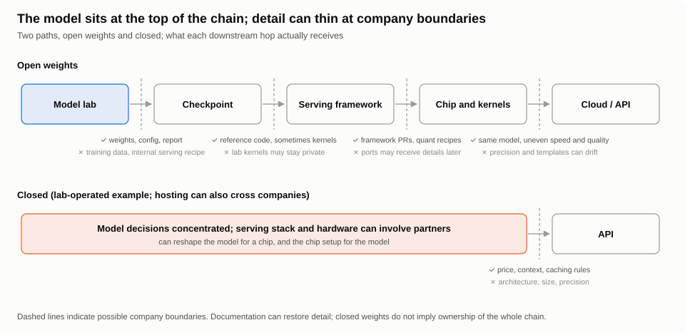
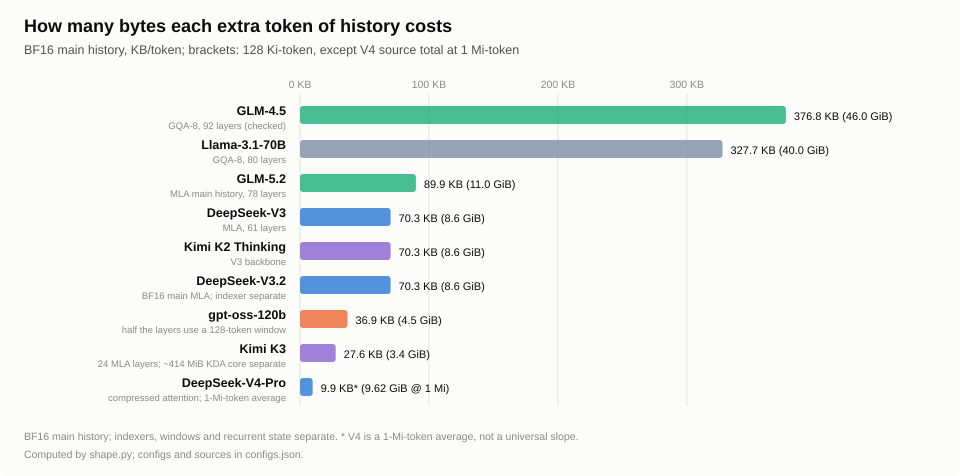
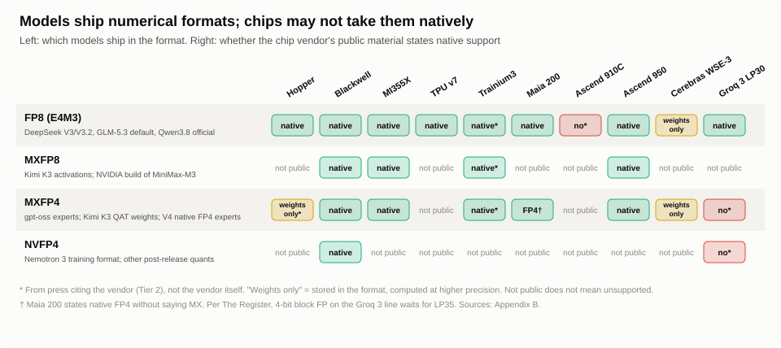
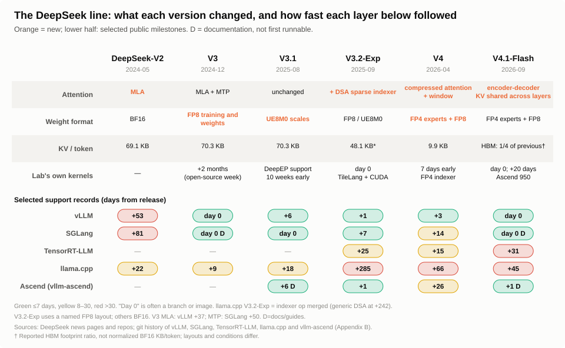
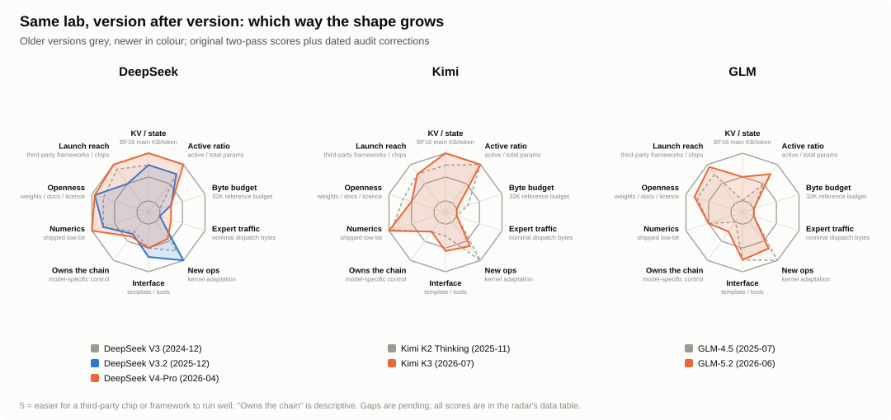
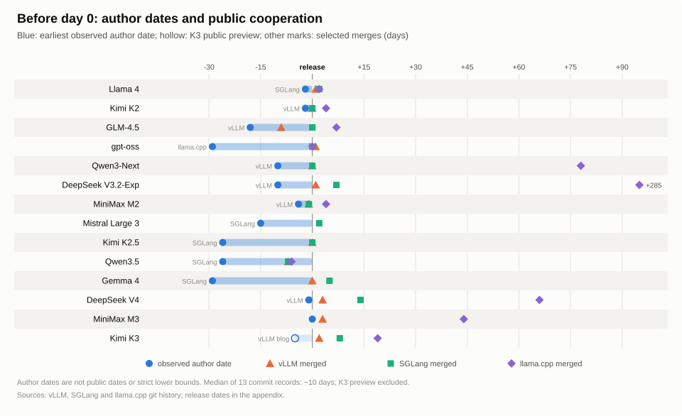
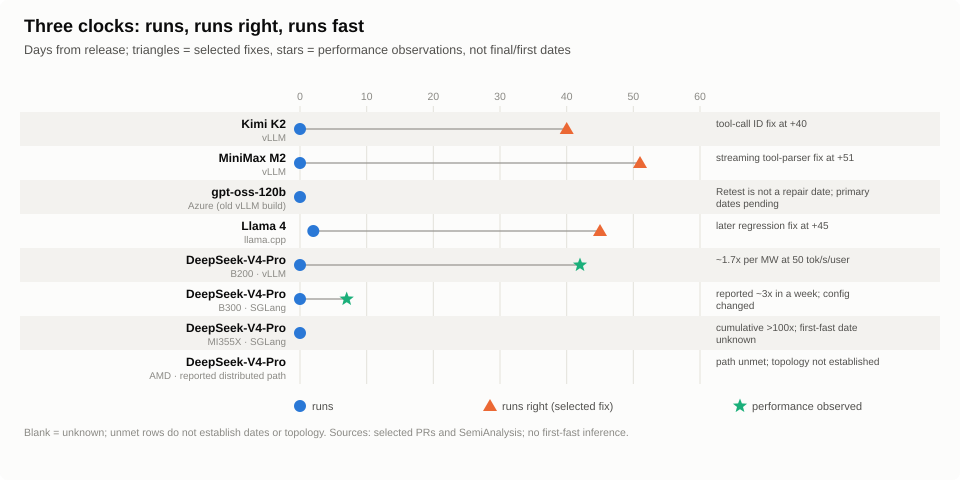



*The finale of Forensic Will. [Part one](/2026/11/inference-chip-shapes/) examined the chips; [part two](/2026/11/inference-framework-forensics/), the frameworks. Here, the models complete the triangle.*

<link rel="stylesheet" href="/assets/chip-radar/radar.css">
<link rel="stylesheet" href="/assets/model-forensics/mf.css">

This series began with a weekend idea: put a chip that had shipped on the table, follow the public evidence backward, and ask what its designers had been thinking.

That became the first case: 43 inference chips. Compute, memory, bandwidth, compilers: I wanted to read the shapes for clues to what each team had thought was scarce. Then I moved the same method up one layer, to 22 inference frameworks. Once software took over, which constraints did it remove, and which reappeared in another form?

One corner of the triangle was still missing, probably the most important one: the model. Model labs choose attention, expert structures, number formats and interfaces, setting much of the work that chips and frameworks must do. Hardware constraints during training can also work their way back into the model's shape. This finale looks at 20 models and connects that last corner.

**Model × inference software × chip. Three corners delivering one system's performance.** In an ideal co-design process, the model and workload guide choices across all three, and measured results feed back into the design. In practice, the freedom to change them together depends on which corners a team controls. Some companies span all three in selected systems; others control two, or one. For a chip or framework team receiving a model that has already taken shape, much of the job is adapting to decisions made upstream. Co-design across company boundaries is possible, but it takes shared knowledge, early cooperation and interfaces that carry the right information.

This series works backward through that reality: from what shipped, to the constraints and choices behind it, then forward into the next design. The model is upstream; the engineering has to close the loop. After three cases, I hope we can recognize the next bottleneck sooner. As the goal moves from generating a token to completing a task, and perhaps delivering an application outcome, who can change which corner—and how will they work together?

So the question here is: **how much homework do a model's training and release choices leave for the layers below it? How fast does that homework get done? Who does it?** I scored 20 models (14 open-weight, 6 closed or device-bound) from 0 to 5 on 10 axes. A1–A4 are computed where configs provide enough information; the other axes are judgments, with confidence stated for estimates, scored in two independent rounds and then reconciled. All evidence comes from public papers, model cards, code repositories, PRs and vendor docs. Play with the chart first. The long text follows.

**How to read it.** The first nine axes point the same way: **5 = easier for a third-party chip or framework to run well**. For example, 5 on "KV / state" means very little history stored per token, and 5 on "New ops" means mature kernel types can largely be reused. The tenth axis, "Owns the chain", only describes how much of the downstream the lab controls itself. It is neither good nor bad. Undisclosed axes remain gaps, excluded from areas and averages; not applicable and pending are separately labelled. **Not public does not mean 0.** The outline is not a model-quality ranking. A10 is descriptive; A9 measures third-party framework/chip launch support and is not applicable to closed or device-bound models. Their channels remain descriptive notes.

<nav class="toc" markdown="1">
**Contents**

1. [The model is the top of the chain](#chain)
2. [Shape: how many bytes each remembered token costs](#shape)
3. [Number formats: choosing the chip at training time](#formats)
4. [The DeepSeek lineage: write your own kernels, and downstream is fast](#deepseek)
5. [Kimi and GLM: related structures, different serving problems](#kimi-glm)
6. [Three clocks: runs, runs right, runs fast](#clocks)
7. [The chain thins at commercial boundaries](#boundary)
8. [What this means for a new chip](#newchip)
9. [Conclusion: five takeaways](#close)

Appendix A: [Method and limits](#method) · Appendix B: [Sources](#sources)
</nav>

## 1. The model is the top of the chain {#chain}

*Click the image for a larger view.*

An open-weight model passes through roughly four hands on its way from the lab to the user. The lab releases weights and config. Inference frameworks write support code. Chip teams write kernels and quantize. Clouds or inference providers wrap it as an API. These hand-offs may cross company boundaries or happen within one team. The lab knows which batch size, parallelism and precision suit its model best. It also knows which field in the chat template is easiest to get wrong. That knowledge does not always travel with the weights.

Sometimes the hardware leaves its mark directly on the model structure. Zhipu's [GLM-5 paper](https://arxiv.org/abs/2602.15763) is blunt about this when it discusses attention head counts: DeepSeek-V3's head count was chosen for the H800 roofline and does not fit other hardware well. The same paper says GLM-5 cut its depth to 80 layers to reduce expert-parallel communication cost. A model's shape carries the fingerprint of the chips it was born on.

The closed path concentrates more decisions in the lab: weights, training and product choices remain under its control, while outsiders mainly use an API. Hosting, software and chips can still cross companies. The lab can change a model for a chip or adjust chip configurations with partners. What outsiders can see depends on the specific disclosure. Section 7 covers this.

## 2. Shape: how many bytes each remembered token costs {#shape}

A1–A4 can be computed where public configs are sufficient; A5, "New ops", remains a judgment (scripts and configs in Appendix A). The most intuitive is the KV cache: how many extra bytes the model stores for each token of history it remembers.

Dense grouped-query attention (GQA) is the baseline. Llama-3.1-70B has 80 layers with 8 KV heads per layer, about 328 KB per token in BF16. [DeepSeek's ISCA 2025 paper](https://arxiv.org/abs/2505.09343) compares against the similar Qwen-2.5-72B and gives the same number. Multi-head latent attention (MLA), which DeepSeek has used since V2, compresses each layer's cache into a 512-dim latent vector plus a 64-dim positional key. V3 totals about 70 KB. For V4, the [vLLM launch blog](https://vllm.ai/blog/2026-04-24-deepseek-v4) gives a BF16 reference of about 9.62 GiB for one sequence at 1,048,576 tokens, averaging about 9.9 KB/token; its FP8-attention/FP4-indexer deployment is a different layout. This long-context average includes window and compressor state, so it is not a constant increment at every context length. Even with that distinction, the capacity direction differs markedly from V3.

GLM is another clean comparison. [GLM-4.5](https://github.com/zai-org/GLM-4.5) still uses GQA. Its [official config](https://huggingface.co/zai-org/GLM-4.5/raw/main/config.json) confirms 92 layers and 8 KV heads per layer, about 377 KB/token in BF16. GLM-5 switched to MLA, and [GLM-5.2's config](https://huggingface.co/zai-org/GLM-5.2/raw/main/config.json) specifies 78 layers: its 576-wide main MLA cache totals about 89.9 KB/token in BF16, about 76% less. This compares main-history storage; indexers and physical allocation are additional.

A smaller KV does not mean an easier time downstream. Kimi K3 is a hybrid of 69 layers of Kimi Delta Attention (KDA, a form of linear attention) and 24 layers of MLA. In the selected 576-wide BF16 allocation layout, the 24 MLA layers use about 28 KB/token. The [official config](https://huggingface.co/moonshotai/Kimi-K3/raw/main/config.json) uses NoPE; its semantic 512-wide latent is about 24.6 KB/token. Reserved allocation slots should not be mistaken for necessary RoPE history. But linear attention carries a fixed-size recurrent state for every request. The [Kimi K3 serving post](https://aflowx.github.io/blog/en/posts/kimi-k3-state-memory-motion/) reports 51.75 MiB of FP32 core state per request per GPU at TP8, across 69 layers and 12 local heads per GPU. Checkpoints, convolution state and speculative scratch are additional. Weight reads can be shared across requests. This writable state cannot. The KV got smaller, and the problem moved somewhere else. The [first post](https://aflowx.github.io/blog/en/posts/b300-find-the-bottleneck/) in that series makes a good point: prefix reuse saves repeated prefill, but it does not save decode.

This is also why "New ops" and "KV / state" often move in opposite directions on the radar. In this selected panel, V4-Pro, K3 and GLM-5.2 all score at least 3 on KV, and all score below 4 on new ops. The bytes saved were paid for with new forms of attention, and new forms need new kernels. For how attention evolved over these years, an engineering blog has an [illustrated history of attention](https://aflowx.github.io/blog/en/posts/attention-evolution/) that goes from MHA to DSA, CSA and KDA. One line I like from it, paraphrased: reading fewer positions does not mean storing less history.

The other two shape axes look at MoE. **Active ratio** is the share of total parameters each token uses. K3 is 104B / 2.8T, about 3.7%. DeepSeek-V3 is 37B / 671B, about 5.5%. **Expert traffic** here is a standardized dispatch proxy: vector bytes sent and combined under one explicit convention. V3 picks 8 routed experts plus 1 shared expert per token, over 58 MoE layers, sending FP8 and receiving BF16, for about 11 MB. gpt-oss-120b picks only 4 experts with a hidden size of 2880, about 1.2 MB. It indicates scale-up bandwidth pressure and helps explain why GLM-5 cut layers to save communication. Physical link traffic also depends on placement, local shared experts, routing and communication protocols.

## 3. Number formats: choosing the chip at training time {#formats}

Shape decides how many bytes move. Format decides how each byte is read. Quantization used to be a downstream job: the lab shipped BF16, and chip vendors and the community did INT8 and INT4 themselves. Now more labs train low-bit formats into the model, or at least ship them with the release:

- DeepSeek-V3 was trained in FP8 and released only FP8 weights. The V3.1 [model card](https://huggingface.co/deepseek-ai/DeepSeek-V3.1) says weights and activations moved to FP8 scale factors in UE8M0 format, for compatibility with microscaling formats. V4's routed experts are FP4 directly.
- [gpt-oss](https://deploymentsafety.openai.com/gpt-oss/architecture) has its MoE weights (over 90% of parameters) in MXFP4, so the 120b fits on one 80 GB GPU.
- [Kimi K2 Thinking](https://huggingface.co/moonshotai/Kimi-K2-Thinking) used INT4 quantization-aware training (QAT) in post-training, and its benchmark scores were measured in INT4. [Kimi K3](https://github.com/MoonshotAI/Kimi-K3) moved to MXFP4 weights with MXFP8 activations. The technical report says training and inference use the same quantization, which removes the mismatch between them.
- NVIDIA's own [Nemotron 3 Super and Ultra](https://research.nvidia.com/labs/nemotron/files/NVIDIA-Nemotron-3-White-Paper.pdf) were trained in NVFP4. The white paper notes that FP4 peak throughput on GB300 is three times FP8. This is one example of choosing numerical formats around the vendor's hardware capabilities; peak throughput is not an end-to-end gain.

The problem is on the chip side. Checking each vendor's public material, FP8 is now mostly standard, but 4-bit block floating point is uneven. Blackwell supports [NVFP4 and MXFP4](https://developer.nvidia.com/blog/introducing-nvfp4-for-efficient-and-accurate-low-precision-inference) natively. AMD [MI355X](https://www.amd.com/en/products/accelerators/instinct/mi350/mi355x.html) and Huawei [Ascend 950](https://www.huawei.com/en/news/2025/9/hc-xu-keynote-speech) list MXFP4 support. According to [The Register](https://www.theregister.com/2026/04/24/deepseek_v4/), Hopper can use FP4 in a weights-only path with higher-precision computation. According to [The Register](https://www.theregister.com/2026/03/19/nvidia_lpx_deep_dive/), 4-bit block floating point on Groq 3 has to wait for the next generation. Many cells are "not disclosed", and not disclosed does not mean not supported.

Formats are not uniform within one model either. In an engineering blog's [B300 tests](https://aflowx.github.io/blog/en/posts/b300-find-the-bottleneck/), GLM-5.2's routed experts are NVFP4, attention and the shared branch are BF16, and KV is FP8. K3's routed experts are W4A8 and its KDA state is FP32. Listing "FP4" as one supported item is not enough. A chip has to run four or five formats efficiently inside one model.

## 4. The DeepSeek lineage: write your own kernels, and downstream is fast {#deepseek}

In part one, Google TPU was the most complete lineage. On the model side, the most complete is DeepSeek. From V2 in May 2024 to V4.1-Flash in September 2026, each generation had a prominent change. V2 introduced MLA. V3 moved to FP8 training. V3.1 changed the scale format. V3.2-Exp added a sparse indexer (DSA). V4 moved to compressed attention and put experts in FP4. V4.1-Flash switched to an encoder-decoder structure with several layers sharing one KV.

The lower half is the more interesting part: selected public support milestones after each release. Model code, kernels, launch documentation and deployment guides are labelled separately; they are not all "first runnable" events.

- **In the V2 and V3 era, downstream was catching up.** V2 took 53 days to land in vLLM. On V3's release day vLLM could run block FP8, but an MLA implementation with FP8 compute took another 37 days. SGLang's MTP support came on day 50. DeepSeek's own inference kernels (FlashMLA, DeepEP, DeepGEMM) were only released during "Open Source Week" in February 2025, two months after V3.
- **From V3.2-Exp, kernels shipped with the model.** On V3.2-Exp's release day, DeepSeek's [release notes](https://api-docs.deepseek.com/news/news250929) gave both a readable TileLang version and a CUDA version. In vLLM, the earliest observed author date on the V3.2-Exp PR branch was 10 days before release, and it merged into main the day after release. DeepSeek wrote in [open-infra-index](https://github.com/deepseek-ai/open-infra-index) that it syncs inference engineering work ahead of new model releases, and the timeline bears this out.
- **V4's kernels came before the model.** DeepGEMM's [FP4 indexer and Mega MoE](https://github.com/deepseek-ai/DeepGEMM/pull/304) went public a week before V4's release. vLLM merged into main on day 3 (in UTC). Cambricon's [vllm-mlu](https://github.com/Cambricon/vllm-mlu) committed V4 support on release day.
- **After that, the official kernel mainline added Chinese-chip support.** On September 30, 2026, [FlashMLA](https://github.com/deepseek-ai/FlashMLA) added sparse attention kernels for Ascend 950. The README states 95% of peak for prefill and 83% for decode. In the same update, FlashMLA dropped support for Hopper and for V3 through V4.0. The README now says it supports V4.1 inference on NVIDIA GPUs and Huawei Ascend. A model lab's official kernel library went from NVIDIA only to NVIDIA (Blackwell) and Ascend side by side, and dropped Hopper. That is a new step in this lineage.

Not every downstream keeps up. llama.cpp followed some new structures later, but it cannot be categorically described as lacking early cooperation: OpenAI's [gpt-oss partner list](https://openai.com/index/introducing-gpt-oss/) includes it. For the September V3.2-Exp release, generic DSA support merged about 242 days after release, and the indexer op about 285 days after. For V4 it was 66 days. TensorRT-LLM took 25 days for V3.2-Exp and 31 days for V4.1-Flash.

**What this lineage shows:** the difficulty is not just new ops. It is who provides and maintains portable kernels, and how state management, scheduling and interfaces fit together. Lab-provided open kernels and early coordination help downstream follow earlier in these cases; frameworks, chip vendors and communities also do essential work.

## 5. Kimi and GLM: related structures, different serving problems {#kimi-glm}

Moonshot and Zhipu are the other two lines with fairly complete information. They share some architectural ingredients, but leave different serving problems downstream.

**For Kimi, the hard part at first was not kernels but the interface.** K2 reused DeepSeek-V3's skeleton (61 layers, MLA, 384 experts). Kernels already existed, and frameworks ran it on day 0. What actually broke was tool calling. The vLLM team's [October 2025 blog](https://vllm.ai/blog/2025-10-28-kimi-k2-accuracy) reviewed it: on K2-0905, fewer than 20% of expected tool calls succeeded. The causes were a chat template argument that got dropped, empty content printed into the prompt, the wrong ID format for past tool calls, and a parser that discarded valid calls when it met those IDs. Moonshot then open-sourced the [K2 Vendor Verifier](https://github.com/MoonshotAI/K2-Vendor-Verifier), which compared providers on 4,000 tool-call requests. The official API had 100% format correctness. Direct vLLM and SGLang deployments at the time scored 76% and 73.13%. This is JSON-schema accuracy among responses that triggered tool calls, not end-to-end task accuracy. DeepInfra, Fireworks, Infinigence, Novita and Groq also scored 100% in the same test. The README also explains part of the gap: before calling the model, the official API rewrites past tool-call IDs into the format the model expects. The vLLM review also notes that the official API uses constrained decoding. These behaviors are not specified by the weight tensors; documentation, implementations and verifiers must carry them to downstream.

By K3, Kimi's hard part had moved to kernels and state management. K3 has 2.8T parameters, 896 experts, and a 3:1 hybrid of KDA and MLA. The [technical report](https://github.com/MoonshotAI/Kimi-K3) describes several problems only a serving provider would hit. KDA's recurrent state and MLA's KV cache are two completely different caches that must fit in one paged pool. With block-hash prefix caching, KDA state snapshots can only be stored at sparse boundaries, which makes cache blocks so large they are close to useless. Under speculative decoding, KDA's in-place state updates cannot be rolled back. Moonshot solved these first in its own inference service. vLLM's [K3 preview blog](https://vllm.ai/blog/2026-07-22-kimi-k3-preview) went out 5 days before the weights. It states that Moonshot shared architecture details early and that trusted partners could test release candidates. By November 2026, in Moonshot's newer [Kimi Vendor Verifier](https://github.com/MoonshotAI/Kimi-Vendor-Verifier), K3.1 Pro scored between 0.972 and 1.0 on tool-call tests across 11 providers, with first- and third-party services trading places. Models, samples and metrics differ, so the two tests cannot quantify a cross-generation narrowing. The newer verifier does provide public readings of provider differences.

**There was still a lot of work after K3.** An engineering blog's [B300 series](https://aflowx.github.io/blog/en/posts/b300-find-the-bottleneck/) reports comparisons on one 8-GPU B300 machine using SGLang and AgentX coding-trace replay. With model-specific precision and synthetic speculative acceptance fixed while the serving recipe changed, K3's streaming speed at 32 concurrent main conversations rose from 9 to 18 tokens per second, and total throughput rose from 5,200 to 10,000 tokens per second per GPU. GLM-5.2 at 12 main conversations rose from 106 to 161 tok/s. Streaming speed means the reciprocal of P90 request-average TPOT; total throughput includes cached input history rather than only generated output. The changes include reuse and replay of KDA state, splitting MLA history across 8 GPUs by token position, fused communication and reduction, and fixes to the indexer and MTP interaction in [about ten SGLang PRs](https://aflowx.github.io/blog/en/posts/glm-5-2-faster-decode-loop/). Note that these compare against baselines in the same series, not against release-day state. Still, they show that two to four months after release, those named workloads had roughly 50–100% additional streaming-speed improvement available. This is not a universal gain across hardware and workloads; detailed conditions are in Appendix A.

**The GLM line reuses existing ideas and adds its own.** GLM-4.5 is a plain GQA MoE, but Zhipu wrote its framework support itself. vLLM [#20736](https://github.com/vllm-project/vllm/pull/20736) was submitted by a Zhipu engineer. Its earliest observed commit author date was 18 days before release, and it merged into main 9 days before release. GLM-5 adopted DeepSeek's sparse attention, DSA. GLM-5.2 added IndexShare, which lets four sparse attention layers share one indexer. The [README](https://github.com/zai-org/GLM-5) says this cuts per-token compute by 2.9x at 1M context. The benefit of borrowing is that the kernels already exist: GLM-5 ran on vLLM and SGLang on day 0. The drawbacks are inherited too. llama.cpp's GLM-5 support ([#19460](https://github.com/ggml-org/llama.cpp/pull/19460)) did not support the indexer at first and ran DSA as dense attention, until [#25407](https://github.com/ggml-org/llama.cpp/pull/25407) merged in July 2026. The [GLM-5 paper](https://arxiv.org/abs/2602.15763) also says the model was adapted to seven Chinese platforms, "from underlying kernels to upper-level inference frameworks". For GLM-5.3-Flash in August 2026, the vLLM recipe describes it as KDA hybrid with sparse MLA. The [official config](https://huggingface.co/zai-org/GLM-5.3-Flash/raw/main/config.json) discloses 34 KDA and 11 sparse-MLA layers. A similar architecture class does not establish direct reuse of Moonshot's exact formula or implementation.

In the chart above, the newer generations from all three labs grow toward at least one of the "KV / state" and "Active ratio" corners, while the ease-of-support score on "New ops" shrinks inward, meaning more new-op and kernel adaptation work. This describes the selected lineages, not a rule every model must follow.

## 6. Three clocks: runs, runs right, runs fast {#clocks}

"Day-0 support" sounds like a framework team staying up on release night, but some cooperation clearly starts earlier. I compared commit author dates, merges and public previews for 14 releases in vLLM, SGLang and llama.cpp (sample and timestamp conventions in Appendix A):

- **In 12 of the 13 commit-based records, the author date precedes release.** The full 13-record median is 10 days early; among the 12 early records it is 12.5 days. Selected author dates for Gemma 4 and gpt-oss are 29 days early, Kimi K2.5 26, and Qwen3.5 26. These are author-date offsets, not public-code lead times. The separate K3 point is a public preview five days before weights, excluded from commit statistics.
- **These are not unconditional lower bounds.** Author dates can be specified or rewritten, and squashes can retain old timestamps. V4 [#40860](https://github.com/vllm-project/vllm/pull/40860) has an earliest observed author date of April 23, but its public PR was created April 25 and merged April 27 UTC. Another January-dated squash is a sensitivity record, not evidence of January public access.
- **Sometimes code goes public before the weights.** GLM-4.5 merged in vLLM 9 days before release. Qwen3.5 merged in all three frameworks 6 to 7 days before Alibaba's release announcement.

So this history suggests early cooperation, not a universal "two to three weeks" lead. Who participates? PR authors and acknowledgments include lab engineers, vLLM and SGLang maintainers, NVIDIA and AMD kernel teams, and specific platforms and providers. One detailed public list is OpenAI's: gpt-oss named [21 partners](https://openai.com/index/introducing-gpt-oss/), comprising 14 deployment platforms, four hardware vendors and three early enterprise partners. It includes llama.cpp, which therefore cannot be categorically placed outside early cooperation. Undisclosed cooperation is not inferred absent.

"Runs on day 0" is only the first clock. I split downstream progress into three clocks, all counted from public release:

- **Runs**: a named branch, image or main-branch version loads and generates. The circles record selected runnable evidence; a main-branch merge is not automatically first availability.
- **Runs right**: an observed correctness fix, covering templates, tool/reasoning parsers and numerics. Kimi K2's [tool-call ID fix for tool_choice=required](https://github.com/vllm-project/vllm/pull/21259) came on day 40 and MiniMax M2's [streaming-parser fix](https://github.com/vllm-project/vllm/pull/30555) on day 51. These are not proven last fixes within 90 days or evidence every earlier request failed. Llama's later regression is labelled separately; a gpt-oss external retest date is not treated as a repair date.
- **Runs fast**: observed performance improvement under a stated workload, quality requirement and service target, not a first date at half of a later peak. [What does "fast" actually mean?](https://aflowx.github.io/blog/en/posts/what-does-fast-mean-llm-inference/) calls for model, workload, concurrency, system, resources, quality and service target; [Every Speedup Lives on a Curve](https://aflowx.github.io/blog/en/posts/every-speedup-lives-on-a-curve/) reports that on eight B200 GPUs, in the same TensorRT-LLM container with synthetic 8K-input/1K-output requests, DeepSeek-V4-Pro with MTP gave 2.36x for one request and 3.8x best throughput meeting median ≥50 tok/s/user after a parallelism sweep (including a layout change), with no gain at the measured peak configurations. Benefits depend on the objective; these are not gains at one unchanged configuration. Stars therefore mark selected public performance observations, not a first crossing inferred from a cumulative gain. Without comparable observations, I do not estimate it.

The main performance timeline used here is [SemiAnalysis's DeepSeek V4 day-0-to-day-43 tracking](https://newsletter.semianalysis.com/p/deepseekv4-16t-day-0-to-day-43-performance). At a 50-tok/s/user target under its utility-power budget convention, B200/vLLM throughput rose from roughly 300,000 to 500,000 tok/s per MW. B300/SGLang reported about 3x within a week, including MegaMoE and EP8→EP4; MI355X/SGLang moved progressively from non-native FP8 to native FP4 experts and real kernels, reporting over 100x cumulative improvement. Precision and configuration changed, so this is not a hardware-only comparison. The report also describes an unresolved distributed-deployment path at its observation cutoff. That is not AMD-wide multi-GPU unavailability: its MI355X/SGLang results already ran. The chart records the unresolved reported milestone without inferring its exact topology or a success on day 47. The actual first "fast" date remains unknown.

## 7. The chain thins at commercial boundaries {#boundary}

The K2 example from Section 5 is worth another look. With the same weights, the official API had 100% schema accuracy among triggered tool calls, while directly deployed frameworks scored about 73% to 76%; some third parties also reached 100%. The difference is not in the weights. It is in what sits outside them: request preprocessing, constrained decoding, production config. Such knowledge may be lost at handoffs, but public documentation, upstream fixes and verifiers can restore it. The third-party 100% results in Section 5 are a counterexample to inevitable loss. OpenRouter also wrote, when introducing [Exacto](https://openrouter.ai/blog/announcements/provider-variance-introducing-exacto/), using K2 as the example, that tool-call differences across providers are much larger than standard benchmarks show.

Closed labs retain weights and model decisions, while hosting, serving software and chips may cross companies. The table selects four representative models and compares their disclosures and related services; another member of a family is not treated as the named model's fast tier (as of November 16, 2026, based on official model cards, system cards, API docs and regulatory filings):

| | OpenAI (GPT-6 Astra) | Anthropic (Claude Fable 5.2) | Google (Gemini 4 Argon) | xAI (Grok 4.7) |
|---|---|---|---|---|
| Architecture class | Details not found in the checked system card | Details not found in checked docs | Sparse MoE (class only) | Details not found in checked pages |
| Parameters, precision | Not disclosed | Not disclosed | Not disclosed | Not disclosed |
| Context / max output | [1.05M / 128K](https://developers.openai.com/api/docs/models/gpt-6-astra.md) | [1M / 128K](https://platform.claude.com/docs/en/models/fable-5-2/overview) | [1M unified window](https://aistudio.google.com/docs/models/gemini-4-argon); default output 65,536, long decode can use the unified window | [500K](https://docs.x.ai/developers/pricing.md) |
| Cache rules and pricing | [Read 0.1x; write 1.25 / 2.5x](https://developers.openai.com/api/docs/pricing.md) (30 min / 12 h) | [Read 0.025x; write 1.25 / 2x](https://platform.claude.com/docs/en/models/fable-5-2/overview) (5 min / 1 h) | [Implicit only, 95% discount](https://aistudio.google.com/docs/pricing#gemini-4-argon) (announced through November 30) | [Read 0.25x](https://docs.x.ai/developers/pricing.md), [server-sticky routing](https://docs.x.ai/developers/advanced-api-usage/prompt-caching/maximizing-cache-hits.md) |
| Training / compute hardware | [Company-wide hardware partnerships](https://openai.com/index/the-full-stack-behind-abundant-intelligence/), not an Astra deployment map | [S-1](https://www.sec.gov/Archives/edgar/data/2130357/000162828026067168/anthropicpbc-sx1.htm): Trainium, TPU, NVIDIA; first AMD deployment milestone expected in 2027, not evidence Fable already uses AMD | [Model card](https://deepmind.google/models/model-cards/gemini-4-argon/): training on TPU, JAX, Pathways | [S-1](https://www.sec.gov/Archives/edgar/data/1181412/000162828026036936/spaceexplorationtechnologi.htm): H100 / GB200 / GB300 clusters, at company/facility scope rather than a Grok 4.7 map |
| Where the fast tier comes from | [Astra Fast / Ultrafast](https://developers.openai.com/api/docs/guides/ultrafast-mode.md) hardware/weight path unspecified; Codex-Spark is smaller, and Cerebras's identical-weights statement concerns GPT-5.6 Sol | [Same model, faster inference config](https://platform.claude.com/docs/en/build-with-claude/fast-mode) | [Hydrogen](https://deepmind.google/models/model-cards/gemini-4-hydrogen/) is adapted from Carbon, not simply Argon's fast mode | [Same model, faster infrastructure](https://docs.x.ai/developers/grok-4-7.md); Cursor / Grok Build only, not the public API |

Sources: [GPT-6 Astra system card](https://deploymentsafety.openai.com/gpt-6-astra), [Claude fast mode docs](https://platform.claude.com/docs/en/build-with-claude/fast-mode), [Anthropic S-1](https://www.sec.gov/Archives/edgar/data/2130357/000162828026067168/anthropicpbc-sx1.htm), [Gemini 4 Argon model card](https://deepmind.google/models/model-cards/gemini-4-argon/), [xAI pricing page](https://docs.x.ai/developers/pricing). Stanford's [Foundation Model Transparency Index](https://crfm.stanford.edu/fmti/December-2025) ([paper](https://arxiv.org/abs/2512.10169)) evaluated older models, including Claude 4, Gemini 2.5, o3 and Grok 3, in 2025 and found that Amazon, Google, Midjourney, Mistral, OpenAI and xAI scored zero on every indicator in the "model information" category.

Not seeing the architecture does not mean it was never changed for a chip. Some public examples:

- **Building a model for one chip.** OpenAI's [GPT-5.3-Codex-Spark](https://openai.com/index/introducing-gpt-5-3-codex-spark/) is a smaller research-preview version of GPT-5.3-Codex, built for real-time coding and served on Cerebras wafer-scale chips. Six months later OpenAI launched an Ultrafast tier on Cerebras. Cerebras's [technical blog](https://cerebras.ai/blog/how-cerebras-serves-gpt-5-6-sol-at-up-to-750-tokens-per-second) states that GPT-5.6 Sol keeps the same architecture, weights and precision in that service, rather than being a distilled or quantized smaller model. That statement does not establish the same facts for Astra. Engineering samples of [Jalapeño](https://openai.com/index/openai-broadcom-jalapeno-inference-chip/), the in-house inference chip OpenAI built with Broadcom, included Codex-Spark among the first workloads.
- **Designing a chip for models.** Google says [TPU 8](https://blog.google/innovation-and-ai/infrastructure-and-cloud/google-cloud/eighth-generation-tpu-agentic-era/) was co-designed with Google DeepMind. Per the [Next '26 overview](https://cloud.google.com/blog/products/compute/ai-infrastructure-at-next26), the inference part, 8i, raises on-chip SRAM to 384 MB, with the goal of keeping reasoning models' KV cache on chip. At [Build 2026](https://microsoft.ai/news/microsoft-build-2026-mai-keynote-transcript/), Microsoft said MAI Thinking 1 was co-designed and optimized on its own Maia 200.
- **One model, many chips.** Anthropic's [2025 postmortem](https://anthropic.com/engineering/a-postmortem-of-three-recent-issues) says Claude is deployed on AWS Trainium, NVIDIA GPUs and Google TPUs at the same time. One of the three issues was the TPU compiler's approximate top-k returning completely wrong results at some batch sizes. Its [S-1](https://www.sec.gov/Archives/edgar/data/2130357/000162828026067168/anthropicpbc-sx1.htm) has a section whose title says model research and compute performance were co-designed from the start. It also discloses that compute and infrastructure expenses as a share of revenue fell from about 251% in Q1 2025 to 48% in Q2 2026; this is not a training/inference cost split, cost per token or gross margin.

The open world has a small example in the other direction. A passage in the [Kimi K3 technical report](https://github.com/MoonshotAI/Kimi-K3) describes K3, during a 48-hour autonomous run, using open-source EDA tools to design a prototype inference chip for a nano model with the same structure. [The RTL is on GitHub too](https://github.com/MoonshotAI/nano-kpu) (the README notes it is not an official Moonshot project). It is a 4 mm² prototype: a model using open-source EDA tools to generate RTL, not evidence of production deployment or autonomous chip-design capability.

**So the conclusion of this section:** labs with their own inference cloud have far more knobs than the third parties that serve their models: model architecture, number formats, inference config, chip choice, even the chip itself. On the radar, the 5s on "Owns the chain" go to Google (own TPUs), NVIDIA (own chips and own models) and Apple (own chips and devices). OpenAI and Anthropic sit around 3 (own inference stacks, with chips in partnership or in-house development). Authors of open-weight models hand these knobs to downstream, but may not transfer all the knowledge needed to turn them; cooperation and public tools can transfer that knowledge too.

## 8. What this means for a new chip {#newchip}

Taking the three parts together, a new inference chip faces not only today's models but also how model labs release them. Some observations:

1. **Formats must follow the models, and run mixed.** MXFP4, NVFP4 and block-scaled FP8 are now formats that labs train and release in directly. They are no longer optional downstream optimizations. Supporting just one is not enough, since a single model often has four or five precisions at once.
2. **New ops keep coming, and kernels need shared maintenance.** DSA, compressed attention, KDA, Mamba: each generation changes something. The DeepSeek case shows that when a lab open-sources kernels and syncs early, downstream follows earlier in these cases. But open-source kernels are written first for the lab's own main platform. A lab's main platforms often receive more direct implementation effort; other platforms still face porting and maintenance costs.
3. **Seeking early cooperation matters more than waiting until day 0.** For now this circle runs mainly through the vLLM and SGLang maintainer teams and the NVIDIA and AMD kernel teams. Some Chinese accelerators also participate through framework forks or plugins; there is more than one route. For a new chip, plugging into mainstream frameworks can help participation but does not guarantee early model access. This matches the conclusion of part two.
4. **Count all three clocks.** After "runs" on day 0, "runs right" and "runs fast" can take another month or two. SemiAnalysis reports cumulative improvement of over a hundred times for V4 on MI355X, including precision, kernel and configuration changes. It does not say performance stayed at the day-0 level until then.
5. **Closed labs are both model authors and chip buyers.** They do not publish architectures, but they change models and chips together with chip vendors. For a chip vendor, the routes also include hardware and serving partnerships; a framework PR and a partnership agreement address different layers.

## 9. Conclusion: five takeaways {#close}

1. **A model's shape sets resource constraints and optimization objects.** DeepSeek went from V3's roughly 70 KB/token to V4's BF16 reference averaging 9.9 KB/token at 1 Mi-token; GLM's BF16 main cache fell from about 377 KB to 89.9 KB. The bytes saved were paid for with new forms of attention and new kernels.
2. **Number formats increasingly ship with the model.** FP8, MXFP4, INT4 QAT and NVFP4 increasingly ship with the model. Whether a chip supports them natively affects whether it can directly execute released weights and precision efficiently. Conversion paths may still work, with quality and cost to validate.
3. **Day 0 can involve early cooperation, but author dates are not public dates.** The 13 commit-based records have a median author-date offset of 10 days before release, not a typical public lead time. K3's preview and the gpt-oss partner list provide more direct evidence of cooperation.
4. **Runs, runs right and runs fast are three clocks.** Selected cases had runnable launch paths and still received parser fixes on days 40 to 51. The timing and magnitude of performance improvements depend on platform and workload.
5. **Model details can thin out at boundaries, and engineering can restore them.** K2's direct framework deployments had schema gaps, while some third parties matched the official API. Closed labs may not publish full architectures, but they build models for specific chips and design chips for models.

Across three parts, from chips to frameworks to models, the question has been the same: what was scarcest at the start, what mechanism dealt with it, and who pays the cost. At the model layer, the answer gains one more item: who knows first.

---

*The two appendices below are for readers who want to check the work. Feel free to skip them.*

## Appendix A: Method and limits {#method}

**Models.** 20 models, one version each, with release dates (July 2024 to November 2026). Selection rules: at least two examples of each design technique (MLA, sparse or compressed attention, linear hybrid attention, window attention, fine-grained MoE, native low-bit, MTP, custom chat format); both open and closed, both Chinese and US; generally one or two per lab, with exceptions for DeepSeek's lineage and OpenAI's open/closed/chip-specific comparisons; including companies with their own chips (Google, NVIDIA, Apple). Older versions from the same lineage appear only in the case studies and are not averaged with newer ones. As requested, Huawei Pangu is not included. This revision preserves the original purposive panel of 20 for audit continuity rather than adding Mistral Large 4, MiMo-V2.6-Pro, Nemotron 3.5 or Inkling 2 Small. Omission is not a judgment of importance or a blanket claim that public information is unavailable.

**Ten axes.** A1 KV/state (BF16 main-history growth, with indexers/fixed state separate), A2 Active ratio, A3 Bytes/token proxy (estimated active weights at the selected checkpoint precision plus a specified 32K history/state budget, batch 1), and A4 Expert dispatch proxy (FP8 send/BF16 receive, shared-inclusive, not measured link traffic) are computed from available inputs. A5 New ops, A6 Numerics, A7 Interface fidelity, A8 Openness, A9 Day-0 reach and A10 Owns the chain are judgments. A3 is a static reference budget, not actual sparse reads or a universal lower bound. Original rubric and independent records are retained; only verified inputs and specific disputed cells are corrected. Dense expert traffic is n/a and missing cells are excluded from means. A10 is descriptive; A9 has one third-party launch-support definition, with closed/device-bound cases marked n/a. Ten-axis areas are not ranked.

**Computation.** `shape.py` and `configs.json` record formulas, precision and sources. Reopened official configs correct GLM-5.2 to 78 layers/75 MoE layers and replace available architectural estimates for Gemma, Qwen, MiniMax, Muse and Nemotron. A1 figures use BF16 main history, with V4 separately labelled as a 1-Mi-token average; K3 names the selected engine layout and NoPE semantics. A3 retains explicitly low-confidence static approximations rather than equating stored sparse history with actual reads; Muse's selected NVFP4 static budget is now reconstructed from the public component topology and expert-only precision recipe; it is not a measured read count. Gemma uses the April 2 BF16 checkpoint; the [June 5 QAT release](https://blog.google/innovation-and-ai/technology/developers-tools/quantization-aware-training-gemma-4/) is not backfilled into launch. Axes overlap and are not added to a total.

**Scoring.** The original independent rounds remain unchanged: A scored by model and B by axis, blind to each other. Historically, 30 of 200 cells were common NP, seven were adjudicated, and the other 163 comprised 119 identical (including three n/a), 30 half-point differences and 14 one-point differences; unadjudicated numerical cells were averaged to 0.25. This agreement describes the original passes, not a fresh independent rescore. Corrections carry a date, reason and source. A7 observations are not an exhaustive last-fix search; judgments retain stated confidence. Previously disputed launch cells were held pending until supporting evidence or a scope adjudication was available; conflicting facts were not averaged into an answer.

**Day-0 data.** The original 14 rows remain: blue points in 13 rows are earliest observed commit author dates; K3's hollow point is a public preview. They are not pooled into public lead times. The selected V4 author offset is −1 and SGLang merge +14, in UTC. The 13 author offsets have median −10 days; the 12 negative offsets have median −12.5. This is a purposive sample, not a population estimate. PR creation, author dates, merges, images and documentation are separate events. The lineage chart labels code/kernel/documentation; an unverified event type is not called first runnable.

**Limits.** Scores are not performance measurements. NP, n/a and pending remain distinct; means use only valid values and show n, returning empty rather than 0 or 5 when none exist. The original axis order is retained as layout, not evidence from the old correlation values. A9 measures third-party framework/chip launch support; closed/device-bound cases are n/a, with channels described separately; A10 is descriptive. Correctness and performance points are selected observations, not complete first/last timelines. B300 numbers are that engineering series' own comparisons, not natural speculative acceptance, task quality or gains on every chip. Vendor, provider and analyst measurements are attributed under their stated conditions.

All scores, reasons and sources are in the "data table" and the [data file](/assets/model-forensics/mf-data.js). Corrections are welcome.

**Revision and scope note (November 16, 2026).** This revision retains the original structure, stories and seven figure families, correcting numbers, labels, source scope and specific disputed cells. Original scoring records and the frozen package are unchanged; corrections are recorded separately, and pending does not mean zero. Current-config checks are distinguished from launch evidence; later checkpoints are not backfilled into launch. Charts retain the original layouts, with corrected timestamp and missing-value legends.

**OpenAI review corrections (November 18, 2026).** Version-specific evidence, component precision, selected UTC dates and figure/card labels are corrected without changing the article structure. Closed/device-bound A9 is n/a under the common third-party definition. Nemotron A3 uses an explicit mixed-component static budget; original blind-scoring records remain historical.

**Targeted gap resolution (November 18, 2026).** Muse A3 uses the official NVFP4 checkpoint: 60 expert layers are NVFP4, boundary expert layers and other decoder weights remain higher precision. The batch-1, 32K static reference is about 61 GB, including the stated BF16 history/window and conservative embedding conventions; exact gated tensor headers were not inspected. Muse A10 describes its documented self-host/provider public serving path, not Meta’s internal fleet. December V3.2 A9 is 3/M: actual generation is reported on December 1 in public SGLang development work, followed by SGLang/vLLM main support at +1/+2; the stronger two-framework main/image plus two-platform day-0 bar remains unproved. Under the existing score-3 anchor, a named public development branch can qualify when dated generation is demonstrated; PR creation alone cannot. All three previously pending cells are resolved, with medium confidence and these scope limits.

**B300 comparison conditions.** The October 15 engineering series used one 8×B300 machine, SGLang and AgentX coding-trace replay for 1,800 seconds after warmup. C counts main conversation trees, not a fixed GPU batch. GLM-5.2 used NVFP4 routed experts/BF16 other branches/FP8 KV, MTP proposing three tokens with synthetic committed-length target 2.99, and moved from TP8 to two TP4 groups. K3 used W4A8 experts/BF16 projections/FP8 MLA KV/FP32 KDA core, DSpark proposing seven tokens with synthetic committed-length target 3.84, TP8 and DCP8 in the history-sharding stage. Streaming is 1/P90 request-average TPOT; total throughput includes cached input history. Fixed synthetic acceptance is not evidence of natural acceptance or task quality. Numbers are attributed only to the series' comparisons.

Machine-readable original engineering posts: [overview](https://github.com/aflowx/blog/blob/0f39aec83bd5f7a924284881824abba6adc8e9e7/posts/b300-results-bottlenecks.en.md), [GLM](https://github.com/aflowx/blog/blob/0f39aec83bd5f7a924284881824abba6adc8e9e7/posts/b300-glm-generation-loop.en.md), [Kimi](https://github.com/aflowx/blog/blob/0f39aec83bd5f7a924284881824abba6adc8e9e7/posts/b300-kimi-state-serving.en.md).

**Scope of the MTP numbers.** In that June 12 synthetic workload, one request rose from 96 to 226 tok/s. At the 50-tok/s/user target, best throughput rose from 905 tok/s/GPU with TP8 to 3,437 tok/s/GPU with DEP8; TP8-only improvement was about 1.9x. Measured peaks were 5,231 tok/s/GPU without MTP at C512 versus 4,743 tok/s/GPU with MTP at C256, the highest MTP concurrency tested. This does not establish that MTP's theoretical best peak is always lower. [Original article](https://github.com/aflowx/blog/blob/0f39aec83bd5f7a924284881824abba6adc8e9e7/posts/benchmark-arena.en.md).

## Appendix B: Sources {#sources}

The Chinese and English versions use the same sources (engineering-blog links point to the matching language), and the sources for each score are in the data file. Main sources:

- DeepSeek: [V2 repo](https://github.com/deepseek-ai/DeepSeek-V2); [V3 repo and config](https://github.com/deepseek-ai/DeepSeek-V3); [ISCA 2025 paper](https://arxiv.org/abs/2505.09343); [V3.1 model card](https://huggingface.co/deepseek-ai/DeepSeek-V3.1); [V3.2-Exp release](https://api-docs.deepseek.com/news/news250929); [V3.2 release](https://api-docs.deepseek.com/news/news251201); [V4 release](https://api-docs.deepseek.com/news/news260424); [V4.1-Flash release](https://api-docs.deepseek.com/news/news260910); [FlashMLA](https://github.com/deepseek-ai/FlashMLA); [DeepGEMM #304](https://github.com/deepseek-ai/DeepGEMM/pull/304); [open-infra-index](https://github.com/deepseek-ai/open-infra-index); [vLLM V3.2 blog](https://vllm.ai/blog/2025-09-29-deepseek-v3-2); [vLLM V4 blog](https://vllm.ai/blog/2026-04-24-deepseek-v4); [Cambricon vllm-mlu](https://github.com/Cambricon/vllm-mlu); [SemiAnalysis V4 day 0 to day 43](https://newsletter.semianalysis.com/p/deepseekv4-16t-day-0-to-day-43-performance)
- Moonshot and Zhipu: [Kimi K2](https://github.com/MoonshotAI/Kimi-K2); [K2 Thinking model card](https://huggingface.co/moonshotai/Kimi-K2-Thinking); [Kimi K3 repo and technical report](https://github.com/MoonshotAI/Kimi-K3); [Kimi K3 blog](https://www.kimi.com/blog/kimi-k3); [nano-kpu](https://github.com/MoonshotAI/nano-kpu); [K2 Vendor Verifier](https://github.com/MoonshotAI/K2-Vendor-Verifier); [Kimi Vendor Verifier](https://github.com/MoonshotAI/Kimi-Vendor-Verifier); [vLLM: Kimi K2 tool-calling review](https://vllm.ai/blog/2025-10-28-kimi-k2-accuracy); [vLLM: K3 preview](https://vllm.ai/blog/2026-07-22-kimi-k3-preview); [GLM-4.5](https://github.com/zai-org/GLM-4.5); [GLM-5 repo](https://github.com/zai-org/GLM-5); [GLM-5 paper](https://arxiv.org/abs/2602.15763); [vLLM #20736](https://github.com/vllm-project/vllm/pull/20736); [llama.cpp #19460](https://github.com/ggml-org/llama.cpp/pull/19460); [llama.cpp #25407](https://github.com/ggml-org/llama.cpp/pull/25407)
- Other open models: [gpt-oss launch](https://openai.com/index/introducing-gpt-oss/); [gpt-oss architecture](https://deploymentsafety.openai.com/gpt-oss/architecture); [vLLM gpt-oss blog](https://vllm.ai/blog/2025-08-05-gpt-oss); [vLLM Gemma 4 blog](https://vllm.ai/blog/2026-04-02-gemma4); [Qwen3.8](https://github.com/QwenLM/Qwen3.8); [MiniMax: why M2 went back to full attention](https://www.minimax.io/news/why-did-m2-end-up-as-a-full-attention-model); [vLLM MiniMax M3 blog](https://vllm.ai/blog/minimax-m3-vllm); [AMD: day-0 support for Muse Spark Open](https://www.amd.com/en/developer/resources/technical-articles/2026/day-0-support-for-meta-muse-spark-open-on-amd.html); [Nemotron 3 white paper](https://research.nvidia.com/labs/nemotron/files/NVIDIA-Nemotron-3-White-Paper.pdf); [Apple foundation models tech report 2025](https://arxiv.org/abs/2507.13575)
- Closed labs: [GPT-6 Astra system card](https://deploymentsafety.openai.com/gpt-6-astra); [Codex-Spark](https://openai.com/index/introducing-gpt-5-3-codex-spark/); [Ultrafast preview](https://openai.com/index/previewing-ultrafast/); [Cerebras: how it serves GPT-5.6 Sol](https://cerebras.ai/blog/how-cerebras-serves-gpt-5-6-sol-at-up-to-750-tokens-per-second); [Jalapeño](https://openai.com/index/openai-broadcom-jalapeno-inference-chip/); [OpenAI full stack](https://openai.com/index/the-full-stack-behind-abundant-intelligence/); [Anthropic postmortem](https://anthropic.com/engineering/a-postmortem-of-three-recent-issues); [Anthropic S-1](https://www.sec.gov/Archives/edgar/data/2130357/000162828026067168/anthropicpbc-sx1.htm); [Claude fast mode](https://platform.claude.com/docs/en/build-with-claude/fast-mode); [Gemini 4 Argon model card](https://deepmind.google/models/model-cards/gemini-4-argon/); [Google Cloud Next '26 and TPU 8](https://cloud.google.com/blog/products/compute/ai-infrastructure-at-next26); [xAI pricing](https://docs.x.ai/developers/pricing); [xAI release notes](https://docs.x.ai/docs/release-notes); [Microsoft Maia 200](https://blogs.microsoft.com/blog/2026/01/26/maia-200-the-ai-accelerator-built-for-inference/); [Microsoft Build 2026](https://microsoft.ai/news/microsoft-build-2026-mai-keynote-transcript/); [Foundation Model Transparency Index 2025](https://arxiv.org/abs/2512.10169)
- Chips and formats: [NVIDIA NVFP4](https://developer.nvidia.com/blog/introducing-nvfp4-for-efficient-and-accurate-low-precision-inference); [NVIDIA Groq 3 LPX](https://developer.nvidia.com/blog/inside-nvidia-groq-3-lpx-the-low-latency-inference-accelerator-for-the-nvidia-vera-rubin-platform); [The Register: LPX](https://www.theregister.com/2026/03/19/nvidia_lpx_deep_dive/); [AMD MI355X](https://www.amd.com/en/products/accelerators/instinct/mi350/mi355x.html); [Huawei Connect keynote](https://www.huawei.com/en/news/2025/9/hc-xu-keynote-speech); [OCP microscaling formats paper](https://arxiv.org/abs/2310.10537)
- Consistency and provider variance: [OpenRouter Exacto](https://openrouter.ai/blog/announcements/provider-variance-introducing-exacto/)
- Engineering blog: [Attention, Illustrated: From Context to Memory](https://aflowx.github.io/blog/en/posts/attention-evolution/); [Making B300s Faster for Coding Agents](https://aflowx.github.io/blog/en/posts/b300-find-the-bottleneck/) (part 1), [GLM 5.2: Speeding Up the Whole Decode Loop](https://aflowx.github.io/blog/en/posts/glm-5-2-faster-decode-loop/), [Kimi K3: Faster Serving with Hybrid Attention](https://aflowx.github.io/blog/en/posts/kimi-k3-state-memory-motion/); [What does "fast" actually mean?](https://aflowx.github.io/blog/en/posts/what-does-fast-mean-llm-inference/); [Every Speedup Lives on a Curve](https://aflowx.github.io/blog/en/posts/every-speedup-lives-on-a-curve/)

- Primary configurations for audit corrections: [GLM-4.5](https://huggingface.co/zai-org/GLM-4.5/raw/main/config.json), [GLM-5.2](https://huggingface.co/zai-org/GLM-5.2/raw/main/config.json), [Gemma 4](https://huggingface.co/google/gemma-4-31b-it/raw/main/config.json), [Qwen3.8](https://huggingface.co/Qwen/Qwen3.8-2.4T-A95B/raw/main/config.json), [MiniMax-M3](https://huggingface.co/MiniMaxAI/MiniMax-M3/raw/main/config.json), [Nemotron Ultra](https://huggingface.co/nvidia/NVIDIA-Nemotron-3-Ultra-550B-A55B-BF16/raw/main/config.json), [Muse recipe](https://raw.githubusercontent.com/vllm-project/recipes/main/models/meta-models/Muse-Spark-Open-816B-A42B.yaml), [GLM-5.3-Flash](https://huggingface.co/zai-org/GLM-5.3-Flash/raw/main/config.json); [Gemma launch](https://blog.google/innovation-and-ai/technology/developers-tools/gemma-4/) and [June QAT](https://blog.google/innovation-and-ai/technology/developers-tools/quantization-aware-training-gemma-4/); [V4 routing implementation](https://raw.githubusercontent.com/vllm-project/vllm/main/vllm/models/deepseek_v4/nvidia/model.py).

- Primary sources for the November 18 corrections: [Nemotron Ultra launch report](https://arxiv.org/html/2606.15007v1)；[Nemotron mixed-precision checkpoint](https://developer.nvidia.com/blog/creating-the-nvidia-nemotron-3-ultra-nvfp4-checkpoint-with-nvidia-model-optimizer/)；[NVIDIA MXFP8 hardware](https://docs.nvidia.com/deeplearning/transformer-engine/features/low_precision_training/mxfp8/mxfp8.html)；[Blackwell PTX ISA](https://docs.nvidia.com/cuda/archive/12.8.0/parallel-thread-execution/index.html)；[Google-managed Claude](https://platform.claude.com/docs/en/build-with-claude/claude-models-on-google-cloud/google-managed)；[Foundry hosting operators](https://learn.microsoft.com/en-us/azure/foundry/foundry-models/concepts/claude-models-hosting-comparison)；[Fable launch](https://www.anthropic.com/claude-fable-and-mythos-5-2)；[K3 launch licence](https://raw.githubusercontent.com/MoonshotAI/Kimi-K3/521359a5cae5e79d02e5a2102c2cea9ce3b9b79a/LICENSE)；[ds_v32 A5 1](https://arxiv.org/html/2512.02556v1)；[ds_v32 A5 2](https://github.com/vllm-project/vllm/pull/25896)；[ds_v32 A5 3](https://huggingface.co/deepseek-ai/DeepSeek-V3.2/raw/main/README.md)；[ds_v32 A7 1](https://github.com/vllm-project/vllm/pull/29837)；[ds_v32 A7 2](https://github.com/vllm-project/vllm/pull/29848)；[ds_v32 A7 3](https://github.com/vllm-project/vllm/pull/30025)；[ds_v32 A7 4](https://github.com/sgl-project/sglang/pull/14249)；[ds_v32 A9 1](https://api-docs.deepseek.com/news/news251201)；[ds_v32 A9 2](https://github.com/sgl-project/sglang/pull/14249)；[ds_v32 A9 3](https://api.github.com/repos/sgl-project/sglang/issues/14227)；[ds_v32 A9 4](https://api.github.com/repos/sgl-project/sglang/issues/14275)；[ds_v32 A9 5](https://github.com/vllm-project/vllm/pull/29837)；[k3 A8 1](https://raw.githubusercontent.com/MoonshotAI/Kimi-K3/521359a5cae5e79d02e5a2102c2cea9ce3b9b79a/LICENSE)；[k3 A8 2](https://api.github.com/repos/MoonshotAI/Kimi-K3/commits?path=LICENSE&until=2026-11-16T23:59:59Z&per_page=5)；[k3 A7 1](https://github.com/sgl-project/sglang/pull/33183)；[k3 A7 2](https://github.com/sgl-project/sglang/pull/32567)；[k3 A7 3](https://github.com/sgl-project/sglang/pull/33995)；[gptoss120 A7 1](https://github.com/vllm-project/vllm/pull/22920)；[gptoss120 A7 2](https://github.com/sgl-project/sglang/pull/9190)；[nemotron3u A3 1](https://arxiv.org/html/2606.15007v1)；[nemotron3u A3 2](https://developer.nvidia.com/blog/creating-the-nvidia-nemotron-3-ultra-nvfp4-checkpoint-with-nvidia-model-optimizer/)；[December V3.2 model card](https://huggingface.co/deepseek-ai/DeepSeek-V3.2/raw/main/README.md)；[muse_open A3 gap evidence 1](https://www.lmsys.org/blog/2026-10-15-meta-muse-spark-open)；[muse_open A3 gap evidence 2](https://dev.meta.ai/resources/blog/build-with-muse-spark-open)；[muse_open A3 gap evidence 3](https://github.com/NVIDIA/TensorRT-LLM/blob/feat/musespark-open/docs/source/deployment-guide/deployment-guide-for-musespark-open-on-trtllm.md)；[muse_open A3 gap evidence 4](https://vllm.ai/blog/2026-10-15-muse-spark-open)；[muse_open A3 gap evidence 5](https://dev.meta.ai/docs/muse-spark-open/get-the-model)；[muse_open A10 gap evidence 1](https://dev.meta.ai/docs/models)；[muse_open A10 gap evidence 2](https://research.meta.ai/blog/muse-spark-open)；[muse_open A10 gap evidence 3](https://dev.meta.ai/docs/overview)；[muse_open A10 gap evidence 4](https://dev.meta.ai/docs/muse-spark-open/get-the-model)；[muse_open A10 gap evidence 5](https://dev.meta.ai/docs/muse-spark-open/deploy)；[muse_open A10 gap evidence 6](https://dev.meta.ai/models/muse-spark-open)；[ds_v32 A9 gap evidence 1](https://github.com/sgl-project/sglang/issues/14227#issuecomment-3599205240)；[ds_v32 A9 gap evidence 2](https://github.com/sgl-project/sglang/issues/14227#issuecomment-3599139813)；[ds_v32 A9 gap evidence 3](https://github.com/sgl-project/sglang/pull/14249)；[ds_v32 A9 gap evidence 4](https://github.com/vllm-project/vllm/pull/29837)。
